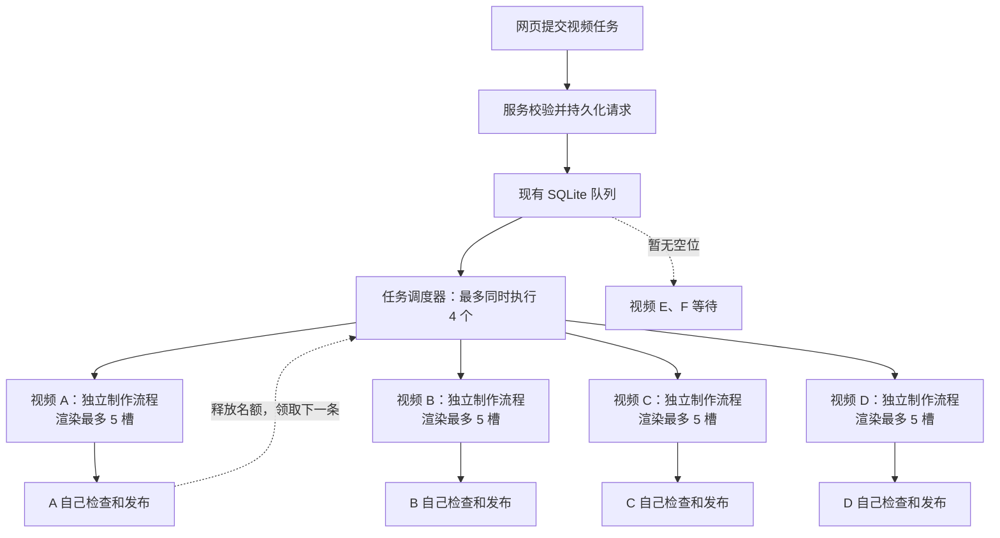
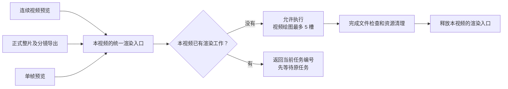
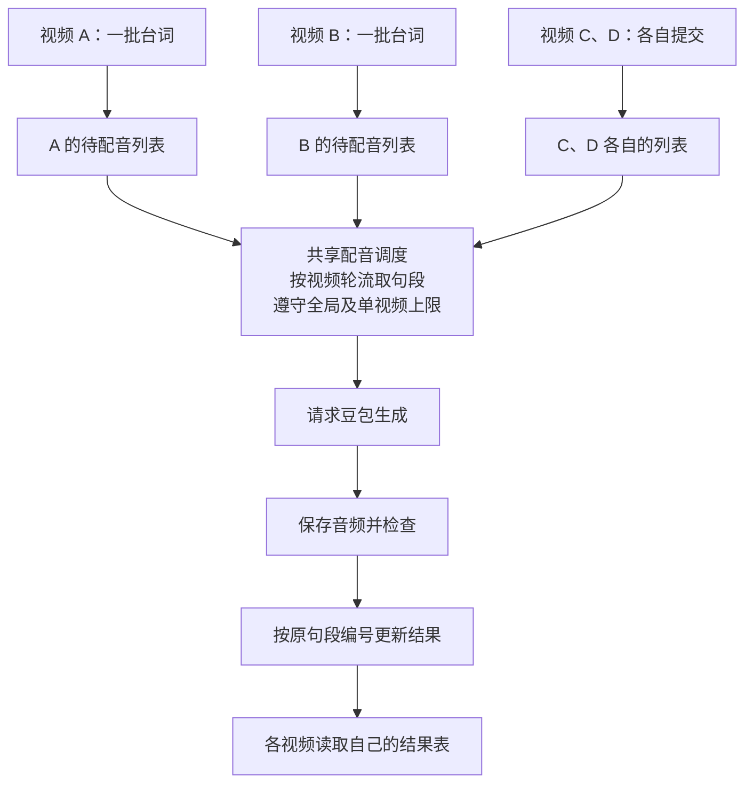
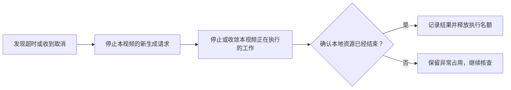

# 四任务并发与批量配音优化方案

- 日期：2026 年 10 月 13 日。
- 适用项目：`textvideo-studio` 文本模板视频生产服务。
- 文档状态：方案已确认；保存方案后，用户另行授权“根据文档完成代码开发”。开发结果及验证边界见 [开发验收记录](20261013四任务并发与批量配音开发验收.md)。以下设计内容保留确认时的表述。
- 本轮范围：任务与渲染并发、批量配音、已暴露的异常问题。

## 1. 目标与已确认的取舍

一台 Worker 最多同时处理 **4 个视频任务**，每个视频最多使用 **5 个渲染槽位**。第 5 个及后续请求接收后排队，有空位自动开始。

本方案重视多个视频能同时推进，替代此前“让一个视频使用 20 槽、尽快完成”的建议。即使当前只有一个视频，它也只使用最多 5 个渲染槽位，不自动借用其他视频的额度。

配音使用独立限额：本方案采用全服务最多 **20 条**、每个视频最多 **5 条**同时处理，并让不同视频轮流取得空位。这是方案配置，不是从供应商账号后台读取的配额，也不与渲染的 20 个槽位共用。依据用户已测试可行的反馈，不再单独开展额度可行性摸底；实现后仍需验证排队、防重、限额和异常处理是否正确。

本轮不安排浏览器缓存、整片切分、无损中间文件、布局检查重构、整套时间轴改造或新监控平台。仅在现有状态记录中补充本方案必需的任务归属、完成文件和异常信息。

## 2. 当前基线与问题

最新服务器样本从文字分析到发布约 51 分 30 秒，其中完整预览从提交到首次确认成功约 10 分 12 秒，正式整片及 13 个分镜导出约 18 分 19 秒。44 段配音提交与结果收集跨度约 2 分 06 秒，与部分制作工作并行。

这些渲染时间包含准备、检查和查询间隔，不是纯绘图时间；各项耗时不能简单相加。Windows 的约 39 分 52 秒样本与服务器样本在机器、模板和作品上存在差异，不用两次总耗时直接判断操作系统或版本优劣。

| 层级 | 当前实际行为 | 本方案需要解决的问题 |
|---|---|---|
| 请求接收 | 多个请求可以持久化排队，没有固定的队列条数上限 | 区分“已受理”和“正在执行”，不把排队理解为执行失败 |
| 阶段执行 | 整个服务同时只执行一个 Analysis 或 Render Run | 允许四个不同视频的阶段同时执行 |
| 调度循环 | 等当前 Run 全部完成后才继续调度 | 启动任务后及时返回，持续补充空位 |
| 单次渲染 | 并发配置直接传给每次渲染调用，本次服务器为 4 | 设置为 5，并限制一个视频同时只能有一项渲染工作 |
| 同视频多份渲染 | 不同渲染请求可以同时启动，单帧预览又走独立入口 | 防止多个渲染调用叠加后突破单视频上限 |
| 任务收尾 | 等待全服务的配音与渲染 | 改成只等待本视频的工作 |
| 配音 | 每登记一段就立即异步生成，没有独立并发上限 | 批量登记、统一限流、按视频公平分配 |
| 媒体检查 | 作者可能临时组织命令、提前检查输出路径 | 提供固定检查入口，只检查明确完成的文件 |

## 3. 总体调用链

继续使用现有 SQLite 任务队列和一个 Runtime，不部署四套完整服务，不引入独立队列平台。

### 3.1 区分三种执行单位

| 单位 | 含义 | 限制 |
|---|---|---|
| 视频任务 `taskId` | 一条视频的业务身份，可能经历分析、制作和后续修改 | 同一个视频同时只执行一个阶段 |
| 阶段执行 `runId` | 一次文字分析或一次视频制作 | 全服务最多同时执行 4 个 |
| 渲染作业 | 一次连续预览、正式导出或单帧预览 | 每个运行视频同时只执行 1 项；视频绘图最多 5 槽 |

全服务画面并发上限由三个条件共同保证：

> 4 个执行中的视频 × 每视频 1 项实际渲染工作 × 每项最多 5 个画面槽＝最多 20 个画面槽。

“5 槽”不是同时导出 5 个分镜，也不是给整个任务硬分配 5 个 CPU 线程。浏览器、构建、编码、音频处理和完整性检查仍有额外资源消耗。

### 3.2 阶段占用与释放规则

| 时机 | 是否占用四个执行名额之一 |
|---|---|
| 请求已保存但尚未领取 | 不占用，处于排队状态 |
| 正在进行文字分析 | 占用一个 |
| 分析完成，用户尚未确认制作 | 释放，不因用户停留在页面而占用 |
| 用户提交视频制作 | 重新排队，领取后占用一个 |
| 正在配音、创作、预览、正式导出或交付检查 | 占用一个；未实际绘图时不提前使用五个画面槽 |
| 本阶段完成，所属后台工作已收尾 | 释放 |
| 最终通知正在重试 | 不占用制作名额，不重新生成视频 |
| 取消或异常清理中 | 本地工作未确认结束前不提前释放 |

同一视频不同版本继续按现有顺序规则执行。结果未知的旧版本不能被当作普通排队任务重放；它仍阻挡本视频后续版本。若已确认本地工作全部结束，供应商结果仍未知，应区分业务状态与本地资源占用，不能因此重发付费请求。

## 4. 任务与渲染并发的具体修改

### 4.1 调度器补足四个名额

旧逻辑是“领取 A，等待 A 全部完成，再领取 B”。新逻辑是“启动 A 后继续领取其他符合条件的任务，补足四个；其中一个真正结束后再补下一个”。

具体要求：

1. 调度器同时跟踪每个 Run 的取消信号和执行结果，不只记录是否已启动。
2. 每次调度只负责领取、启动和补位，不等待整条视频完成。
3. 防止重复调度导致同一任务重复领取或超过四个名额。
4. 普通任务与可恢复任务经过同一容量限制，恢复不能绕过上限。
5. 服务停止时先停止领取，再收敛活动任务，最后关闭数据库。

现有数据库的事务、请求防重、同视频顺序和结果身份检查继续保留，不另造一套任务存储。

### 4.2 同一视频统一渲染入口

只把每次渲染配置设为 5 不够：如果同一个视频同时启动两份渲染，它就可能占 10 槽。单帧预览也必须进入相同的控制范围。

采用以下处理规则：

- 同一渲染请求、相同输入再次提交，返回原任务，不重复执行。
- 相同请求编号被用于不同输入，继续拒绝，不能覆盖原任务。
- 同一视频已有渲染时，新渲染请求或单帧预览返回明确的繁忙状态与原任务编号，不暗中启动第二项。
- 暂不增加视频内部的第二层渲染排队。避免同步单帧工具排在长导出后超时，也避免排队期间工程变化造成输入不明确。
- 正式导出内部保持整片和分镜顺序生成，不再同时导出多个分镜。
- 并发配置由服务控制，不允许作者通过工具参数自行扩大。
- 请求实际开始执行前再次检查所属 Run 是否仍允许运行；取消中的 Run 可以查询原结果，不能新增生成工作。

### 4.3 每个视频独立收尾

当前全局等待改为按 `runId` 等待。视频 A 只等待 A 的配音、单帧预览、视频渲染和检查；不能因为 B、C、D 仍在制作而推迟 A 的交付。

服务整体关闭时才执行全服务等待。停止接收、停止派发、任务结束和数据库关闭必须有明确顺序，不能在后台任务仍会回写时提前关闭数据库。

### 4.4 配置与资源含义

| 配置含义 | 本方案数值 | 说明 |
|---|---:|---|
| 同时执行的 Run 上限 | 4 | Analysis 与 Render 共用，同视频仍串行 |
| 每项视频渲染的画面并发 | 5 | 与每视频一项渲染的限制共同生效 |
| 全服务画面并发上限 | 20 | 由 4×1×5 推导，不额外设置互相矛盾的上限 |
| 全服务配音并发上限 | 20 | 独立于渲染 |
| 单视频配音并发上限 | 5 | 单视频不能占满全服务配音额度 |

配置应在启动时校验有效正整数及相互关系。四个视频会产生四套创作会话、浏览器与编码等开销，模型请求额度也独立于画面槽位。不能把单视频 20 槽与四视频各 5 槽的全部资源开销视为相同。

## 5. 批量配音与准确匹配

### 5.1 旧链路与新链路

旧链路由模型逐段提交、逐段查询，并搬运多份结果。服务登记完成后立即请求供应商，尚无独立并发控制。

新链路由模型一次提交整批自然句段，服务负责持久登记、限流派发、音频保存与检查，最后返回按句段编号组织的统一结果。

本轮不改变台词、自然分段、音色、语速和正文顺序，不把整批台词合成为一个大音频。

### 5.2 批量登记与请求防重

批量入口和查询入口属于拟新增能力，不能当作当前已经发布的接口。

拟采用一个稳定批次编号和句段列表。每段沿用现有句段编号、请求编号、文字、音色和语速，保留所属分镜与原始顺序。

执行顺序：

1. 先检查完整清单的字段、重复编号、音色合法性和同编号输入冲突。
2. 保存批次及单段记录，再允许派发供应商请求。
3. 登记过程保留短时串行保护，不能直接取消保护后并发读写相同记录。
4. 登记保护不包含等待配音生成，不能让一个批次的网络等待堵住其他视频。
5. 同一批次重复提交返回原批次。若登记中断，沿原记录恢复，不给已启动句段重新创建付费请求。
6. 保留单段入口供局部处理，但单段和批量必须经过同一个配音限流入口。

### 5.3 配音额度分配

服务保存每个视频自己的待生成列表。有空位时按视频轮流取下一段，同时遵守全局 20、单视频 5 的上限。

一个视频有 44 句，另一个视频稍后提交 10 句，后者应能在后续空位出现时参与分配，不必等前者整批做完。已经发出的请求不抢占、不重发。

若供应商还有每秒请求数等限制，派发也应服从已知限制。并发数量限制不能自动代替其他额度规则。

### 5.4 结果匹配与查询

并发配音的完成顺序可能与台词顺序不同，必须按句段编号匹配，不能按“第几个完成”匹配。

统一结果至少包含：

| 信息 | 用途 |
|---|---|
| 批次、Run、句段编号与分镜归属 | 确认结果属于哪个视频和哪句台词 |
| 原文、音色、语速 | 防止文字或参数错配 |
| 状态与原配音任务编号 | 定位成功、失败或未知结果 |
| 受管音频路径及内容摘要 | 确认采用正确文件 |
| 实测时长及采样信息 | 供后续时间轴使用 |
| 供应商请求编号与诊断 | 排障与恢复依据 |

模型读取统一结果，删除逐条复制并重复保存几十份结果的机械操作。查询只获取自己的批次；需要等待时采用有界等待，不能让一次工具调用无限等待整批完成。

这里的匹配仅指句段与声音一一对应及实测时长，不表示取得逐字时间，也不代替作者决定画面节奏。

### 5.5 配音异常处理

| 情况 | 处理 |
|---|---|
| 清单字段错误、音色无效 | 生成前拒绝，指出具体句段 |
| 同批次或同段原样重发 | 返回原记录，不再收费生成 |
| 同编号改变台词或参数 | 拒绝冲突，不覆盖原记录 |
| 某段明确被供应商拒绝 | 保留其他成功段，返回该段原因；重试依据真实返回决定 |
| 超时、断线或响应不完整 | 保存原请求号，标记供应商结果未知，不自动换编号重发 |
| 音频已完整取得，本地检查失败 | 保留音频，只恢复本地检查 |
| 视频取消，句段尚未发出 | 取消本地待生成项 |
| 视频取消，请求已经发出 | 停止后续派发，收敛原请求；不承诺撤销供应商收费 |
| 服务重启，能证明尚未发出 | 仅在原 Run 允许继续时恢复待生成项 |
| 服务重启，可能已发出 | 保留未知，不因内存任务表为空而重新发送 |

当前配音查询主要读取本地记录，没有证据证明现有供应商接口支持追回丢失结果或用请求编号保证不重复收费。方案不承诺未知结果自动补齐。

已发送而仍未知的请求，不能无条件视作额度已经释放并持续补发。应依据可确认的结束条件收敛；确认不了时明确记录异常占用，不以盲目重发维持表面进度。

## 6. 已暴露异常的修复方案

### 6.1 工具悬挂与超时失效

Windows 样本中曾发生文件读取声明超时后，外层仍等待接近十分钟的现象。现象已确认，具体卡在执行、沙箱或回传哪一层尚未确定；新服务器样本没有复现同样的长时间悬挂。

对服务自己控制的文件检查、媒体探测等操作，设置合理的最长执行时间，并把超时处理落实到对应操作的终止和退出确认。不能只停止等待，留下后台工作继续运行。

对创作会话内部的调用，定位具体开始后未结束的调用及其所属任务。宿主支持取消对应操作时，使用已有能力处理；无法确认单次调用结束时，保留未知和诊断，不声称已经安全停止，也不自动重启整条制作任务。

取消规则必须覆盖单帧预览、视频渲染、媒体检查及交付检查。只处理该 Run 的资源，不能全局结束浏览器或媒体进程，误伤其他三个视频。

现有渲染库已有取消能力，应先使用其实际能力并核对退出；对尚无法中断的准备步骤，在阶段边界检查取消，未结束前不假装释放资源。若定位表明必须新增进程隔离等较大改造才能修复，应说明真实代价后再确定实现，不在本轮文档中假定已经具备。

### 6.2 音频检查执行环境不一致

最新服务器样本的错误出现在作者受限环境运行模板句段音频校验器时，相关子进程无法启动。同一未修改校验器在服务器直接执行后通过。配音服务本身已有音频完整性检查，不能把再加一次普通探测当成此问题的完整修复。

拟提供固定的“本 Run 句段音频与时间轴核对”工具：

> 作者提交本任务时间轴引用 → 服务定位受管音频 → 执行固定验证规则 → 返回问题及对应句段。

实现前逐项核对当前模板校验器，保持其实际验证含义。作者只能传入规定的对象或文件引用，不允许传任意命令、脚本或其他任务路径。固定逻辑由服务维护，不把模板任意脚本直接放入持有供应商凭据的环境执行，也不放开整个作者沙箱。

检查失败要区分权限、工具启动、文件损坏、时间轴或句段不一致。已生成音频保留，只恢复必要检查。这类检查不能代替真实听审。

### 6.3 文件未完成就开始检查

现有导出在整片完成后仍会继续生成分镜。作者可以先审整片，这种与后续导出重叠的工作应当保留。

拟在现有渲染作业结果中增加已完成文件列表，只有经过以下步骤的文件才对作者标记为可审查：

> 渲染调用完成 → 文件完整性检查通过 → 摘要等信息确认 → 加入已完成列表。

原渲染查询返回当前处理的输出、已完成文件及整体状态。作者不再猜测目录中的文件是否可用，也不把“文件存在”当成“文件完整”。

每份作业的状态更新应顺序写入，避免并发覆盖状态或临时文件冲突。单个文件已完成只表示允许审查，不代表整套任务成功。正式发布仍要求整片和全部分镜齐全。

### 6.4 已修复历史问题的边界

Windows 模板路径误报、片尾人物卡残留已在新版模板中处理。本轮确认已有修复有效即可，当前未复现时不重复改造，也不修改历史冻结模板或把既有修复计作本轮新增成果。

## 7. 修改位置与调用链责任

下列路径相对仓库根目录。表中内容均为拟修改范围，不表示已实施。

| 位置 | 主要修改 |
|---|---|
| `packages/production-service/src/config.ts` | 分开配置四任务上限、每项五槽、配音全局及单视频上限，并校验参数 |
| `packages/production-service/src/runner.ts` | 跟踪四个并发 Run；调度快速返回；按 Run 收尾；清理后释放名额；恢复和停止遵守同一限制 |
| `apps/runtime/src/index.ts` | 主循环持续调度；停止时等待任务收尾后再退出 |
| `packages/production-service/src/repository.ts` | 沿用现有排队、事务、防重及同视频顺序保护；按需配合调度，不替换存储体系 |
| `apps/server/src/production/routes.ts` | 统一每 Run 渲染入口；单帧也受限；后台工作按 Run 归属；配音批量路由；取消后禁止新生成 |
| `apps/render-worker/src/template-renderer.ts` | 保留顺序输出；服务控制五槽；回报已完成文件；补齐取消信号及阶段边界检查 |
| `packages/speech-services/src/doubao.ts` | 批量登记与查询、共享限流和任务间轮转、统一结果、按 Run 等待与异常分类 |
| `apps/server/src/production/speech-tools.ts` | 发布实际新增的批量配音及固定检查能力；明确忙、未知、已完成文件等返回语义 |
| `packages/production-service/src/files.ts` | 本地检查的有界执行、终止及退出确认 |
| `packages/production-service/src/delivery.ts` | 交付检查跟随所属 Run 取消，保持整套文件完整性和来源检查 |
| `packages/production-service/src/codex-session.ts` | 定位具体未结束调用与连接异常，保留原会话和未知结果边界 |
| `packages/production-service/src/task-instructions.ts` | 制作任务使用批量结果、固定音频核对、已完成文件清单；忙时读取原任务 |
| `.agents/skills/_shared/TEMPLATE_PRODUCTION.md` 及必要的模板配音入口 | 同步真实接口、限额和恢复方法，不误改其他视频流程 |
| `tests/production-*.test.ts` 等相关测试 | 验证并发上限、隔离、防重、取消、恢复和媒体就绪行为 |

固定句段音频核对逻辑的具体文件位置在开发时按现有模块组织确定，不在文档阶段新增无实现的工具或文件。

### 7.1 外部接口与网页

尽量保留现有文字分析提交、视频制作提交及最终回调结构。第 5 个请求仍返回已受理和排队状态，不静默丢弃或暗中启动。

Worker 的任务查询已经有状态基础。如果实际网页尚未展示排队状态，需要客户端接入显示；后端支持排队不等于网页已正确处理。此次文档不假定已经修改外部客户端。

### 7.2 保留、替换和删除范围

| 内容 | 处理 |
|---|---|
| 现有 SQLite、同视频版本顺序、输入防重和身份校验 | 保留 |
| 全服务单任务执行与等待完成后才继续调度 | 替换为最多四个 Run 的持续调度 |
| 任一视频收尾时等待全服务工作 | 替换为按 Run 等待 |
| 同视频可同时多开渲染、单帧绕过限制 | 统一到同一入口，移除绕过路径 |
| 配音登记后无上限立即生成 | 替换为统一限流派发 |
| 模型逐条查询并搬运整批配音结果 | 改用批次结果；单段入口保留给局部处理并共用限流 |
| 作者临时执行音频检查、猜测输出文件就绪 | 改用固定检查与已完成文件列表 |
| 完整导出、技术验证、必要视听、发布与回调防重 | 保留，不以并发优化为由取消 |

## 8. 实施顺序与验收标准

实施须另获开发授权。建议顺序如下：

1. 完成四任务调度、每 Run 独立收尾及统一渲染入口，先用隔离模拟验证限额不被绕过。
2. 完成批量配音、独立限流、结果匹配和异常分类，使用模拟供应商验证，不发真实收费请求。
3. 完成固定音频检查、已完成文件列表、取消和超时边界，并同步实际工具定义与制作说明。
4. 通过相关测试后构建候选发行物，核对 Runtime、MCP 与 Skills 同版；生产部署及切换另行执行，不把代码或文档完成当成已部署。

不重复开展用户已完成的并发额度可行性摸底。功能验收需要覆盖以下行为：

| 场景 | 合格标准 |
|---|---|
| 同时提交 6 个不同视频 | 最多 4 个执行、其余排队；完成一项才补下一项 |
| 同一视频提交多个版本 | 仍按顺序执行；未知旧结果不被重放 |
| 单视频同时请求两份渲染与单帧预览 | 实际渲染不突破一个作业、最多五槽 |
| 四个视频同时渲染 | 整片和分镜保持各自顺序，画面槽总上限不超过二十 |
| A 完成，B 仍在渲染 | A 独立交付，不等待 B |
| 四批配音乱序完成 | 音频与原台词、句段和分镜准确对应 |
| 大批次先到，小批次后到 | 小批次能参与后续空位分配，不等大批次全完 |
| 配音或渲染原样并发重发 | 不启动第二份生成；改输入用同编号被拒绝 |
| 音频收到后检查失败 | 保留音频，恢复只重做本地检查，供应商调用不增加 |
| 取消一个视频 | 只影响该视频，资源确认结束后释放名额；其他视频继续 |
| 在准备、渲染、单帧、检查阶段注入异常 | 不提前释放尚占用的资源，不全局结束其他视频的进程 |
| 服务中途退出和恢复 | 保留原身份和已确定结果；未知不自动重新收费；恢复不超过四任务上限 |
| 文件尚在写入或检查失败 | 不进入可审查文件列表 |
| 部分文件已完成 | 可提前审查，但整套输出不齐不得发布成功 |
| 回调失败 | 重试原通知，不重新生成音频或视频，不占制作名额 |

无需为了确认配置数字编写空泛测试；测试应检查实际在途任务、派发次数、归属和资源释放。旧测试若依赖“等待一次调度就代表任务全部完成”，需改为显式等待对应任务结束。

## 9. 代价、限制与不承诺事项

1. **单视频速度与多视频公平性取舍。** 固定五槽会比单视频独占二十槽慢；本方案选择让最多四个视频共同推进。此前基于单视频二十槽的耗时目标不再直接适用。
2. **画面槽不是整机资源配额。** 四个视频有四套准备、浏览器、编码、检查和创作会话，不能把二十槽等同于二十个 CPU 线程，也不能把它当作模型接口额度。
3. **未知结果不能保证自动补齐。** 供应商结果无法确认时，优先保留原身份、防止重复收费；不能同时承诺任何断线都自动重做。
4. **停止等待不代表工作已经停止。** 无法确认本地资源结束时不能假装空出名额，可能需要核查对应异常任务。
5. **任务排队仍会存在。** 同时执行上限为四，后续任务必须等待；现有接收能力不代表磁盘或等待队列有无限容量。
6. **技术通过不等于创作验收。** 音频解码、帧数、摘要和文件数量检查不能替代真实听审、连续观看及用户最终定稿。

## 10. 参考依据与当前交付状态

- 当前代码：上表所列 Runtime、任务执行器、任务存储、制作路由、配音服务与模板渲染器。
- 本地验收记录：`docs/20261013远程网页两阶段部署验收.md`，其中记录了 44 段真实配音、完整时间线、音频检查权限问题及最终验证范围。
- [Remotion 渲染并发参数](https://www.remotion.dev/docs/renderer/render-media#concurrency)：用于说明渲染并发参数的范围。
- [Remotion 取消信号](https://www.remotion.dev/docs/renderer/make-cancel-signal)：用于核对现有渲染取消能力，不能代替本项目全链路资源退出验证。

**方案初次保存时只交付本 Markdown，未执行代码开发。随后授权的实现、测试和候选构建另见开发验收记录；生产部署与作品生成不属于本轮实施。**
