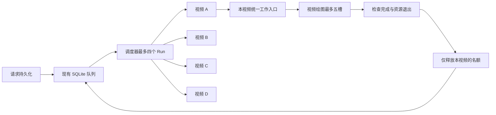
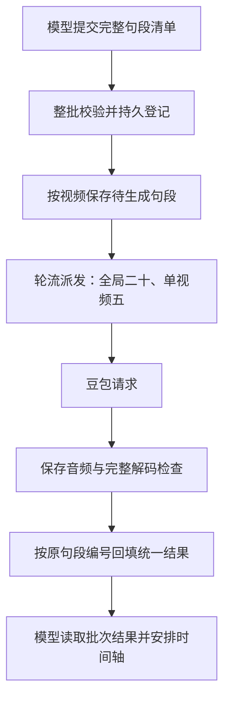

# 四任务并发与批量配音开发验收

- 日期：2026 年 10 月 13 日。
- 开发依据：[已确认方案](20261013四任务并发与批量配音优化方案.md)。
- 授权：用户明确要求“根据文档完成代码开发”。
- 本轮产物：代码、相关测试、制作说明及 `textvideo-studio 0.1.6` 候选发行物。
- 部署状态：尚未部署；没有修改正式视频、生产队列、服务器配置或已安装插件缓存。

## 1. 已实现的效果

### 1.1 最多四个视频同时推进，每个视频五个画面槽

请求仍先存入现有 SQLite 队列。调度器领取一项后立即继续领取其他符合条件的任务，最多同时处理四项。第五项保持排队；活动任务真正结束并清理后，现有调度循环继续补位。

这里的四项是正在运行的分析或制作阶段。分析完成后释放名额，不会在等待用户确认时一直占位。同一视频的不同版本仍串行，旧版本结果未知时不会直接开始后续版本。

同一个视频的静帧、视频预览、正式导出和固定音频检查共用一个入口。已有工作时，新请求返回 `RENDER_BUSY`，信息中带有原工作编号；相同渲染编号、相同输入仍返回原作业。正式导出内部仍按整片、分镜的顺序输出，每次视频绘图最多五槽。

这三个限制共同形成画面并发上限：四个活动阶段 × 每个阶段最多一项渲染 × 每项最多五槽。浏览器、构建、编码及音频检查的资源开销仍在五槽之外。

视频 A 收尾只等待 A 的配音、渲染和检查，不再等待 B、C、D 的制作。交接进入收尾后，禁止继续新增生成工作。服务整体退出时才等待全部任务，并在后台工作结束后关闭数据库。

### 1.2 一次提交配音清单，由服务排队和对应结果

新增批量提交与批量查询工具。服务先校验整批输入，再登记批次和各句段的稳定编号，最后允许请求豆包。单段接口保留，但与批量接口使用同一个限流器。

配音最多同时处理二十条，每个视频最多五条。这是独立于画面渲染的另一组额度。不同视频轮流取得空位，后来提交的小批次不需要等待先来的大批次全部完成。

结果按原始句段顺序返回，每条保留句段编号、分镜编号、文字、音色、原供应商请求号、音频路径、摘要和实际时长。先完成第三句不会把它误放到第一句。时长使用完整解码后的 PCM 采样长度，另外保留容器时长，避免把 MP3 填充部分当作真实语音时长。

同批次或同句段原样重复提交返回原记录；同编号改变输入被拒绝。批次内有非法音色等明确输入错误时，在发送任何新供应商请求前拒绝整批。

服务负责生成、限流和结果对应，作者仍负责选择自然句段、画面节奏及真实听审。本轮没有引入新的整套时间轴自动生成系统，也没有自动更改正文或音色。

### 1.3 异常处理及文件就绪

已取得完整音频但本地检查失败，保存为 `validation_failed`，可以只重做本地检查。覆盖“文件已改名、成功状态还没写入就退出”的恢复边界，不因此重新配音。

供应商请求超时、连接断开或响应不完整，保留原编号并标记 `unknown`，不自动重发。可能仍在供应商执行的未知请求继续占用配音额度；重启后也会恢复这项保留，避免靠不断补发突破实际并发。

句段音频审计改为服务提供的固定工具。它读取本任务的确认正文、批次结果及工程时间轴，核对正文、句段顺序、字幕绑定、帧区间、音频摘要和 PCM 时长。作者不再需要在受限环境中启动模板审计脚本。服务不会接受任意命令或替作者运行任意模板脚本。

渲染作业新增 `currentOutput` 和 `readyFiles`。文件只有在渲染返回、完整媒体检查及摘要计算都完成后才进入 `readyFiles`。整片先完成时可以提前审片，后续分镜继续生成；整套输出不齐仍不能发布成功。

本地媒体子进程有真实超时处理：终止本操作的进程组，必要时升级终止，并等待退出。渲染和交付检查接入所属 Run 的取消信号；停止 A 不会全局结束其他视频的媒体进程。

创作会话记录长时间未完成的具体调用及线程编号。该记录用于定位，不代表已经查明历史 Windows 悬挂的根因，也不自动重启整条视频。

## 2. 配置与工具

### 2.1 配置

| 环境变量 | 默认值 | 生效位置 |
|---|---:|---|
| `TEXTVIDEO_MAX_ACTIVE_RUNS` | 4 | 阶段调度器，Analysis 与 Render 共用 |
| `TEXTVIDEO_RENDER_CONCURRENCY` | 5 | 每次视频绘图 |
| `TEXTVIDEO_SPEECH_CONCURRENCY` | 20 | 全服务配音派发 |
| `TEXTVIDEO_SPEECH_PER_RUN_CONCURRENCY` | 5 | 单视频配音派发 |

启动时拒绝非整数、零、负数、超过本方案上限的配置，以及单视频配音上限大于全局上限的配置。可以调低，不允许通过工具调用扩大上限。

旧服务器若显式设置了渲染并发 4，新默认值不会覆盖它。将来部署时应明确设置上述四个值，并读回 `/healthz` 的 `capacity` 确认实际配置。健康响应还会返回当前活动 Run 数量；它不代表云端模型或供应商账号的实时额度。

### 2.2 新增工具

| 工具 | 输入重点 | 作用 |
|---|---|---|
| `synthesize_speech_batch` | `speechBatchRequestId`、`segments` | 登记整批自然句段并异步派发 |
| `read_speech_batch` | 原批次编号 | 返回整批状态、分类计数及原顺序句段结果 |
| `retry_speech_validation` | 原 `speechJobId` | 仅恢复已取得音频的本地检查 |
| `verify_sentence_audio` | `timelineRef`、`speechBatchRequestIds`，可选 `renderRequestId` | 固定核对当前工程或正式快照的句段、字幕及音频 |

`segments` 每项包含 `speechRequestId`、`segmentId`、确认分镜 `sceneId`、`text`、`voiceRef`、`speed`，可按原规则显式引用基础音频。工具身份绑定当前 Run，不能传入其他 Run 绕过隔离。

批次状态包括登记中、处理中、成功、部分成功、失败、取消和未知。查询立即返回现状，不把一次工具调用挂起到整批完成。单段 `queued/running/validating/succeeded/validation_failed/failed/cancelled/unknown` 状态用于定位具体处理位置。

原网页分析提交、制作提交、任务查询和最终回调结构继续使用。此次没有修改外部网页；网页是否显示“排队中”，仍取决于客户端原有状态展示。

## 3. 修改文件与调用链

以下路径相对仓库根目录。

| 文件 | 实际修改 |
|---|---|
| `packages/production-service/src/config.ts` | 四组容量配置及合法性检查 |
| `packages/production-service/src/runner.ts` | 四任务调度、执行跟踪、按 Run 收尾、恢复容量限制及停止入口 |
| `packages/production-service/src/run-work.ts` | 新增同视频统一渲染和检查入口 |
| `apps/server/src/production/routes.ts` | 容量读回、批量工具路由、渲染防重与繁忙、取消隔离、就绪文件及关闭顺序 |
| `apps/render-worker/src/template-renderer.ts` | 逐文件完成回报、静帧和视频取消、准备阶段边界检查 |
| `packages/speech-services/src/doubao.ts` | 批次登记、统一限流、轮流分配、原顺序结果、未知保留、本地检查恢复及 PCM 时长 |
| `packages/production-service/src/sentence-audio.ts` | 新增固定句段审计、当前任务路径与真实配音摘要检查 |
| `packages/production-service/src/files.ts` | 媒体子进程超时、取消、退出确认及 PCM 采样测量 |
| `packages/production-service/src/delivery.ts` | 交付检查跟随所属任务取消 |
| `packages/production-service/src/codex-session.ts`、`tool-observer.ts` | 创作会话退出收敛、连接错误处理及未结束调用定位 |
| `apps/server/src/production/speech-tools.ts` | 发布新增 MCP 工具及实际返回语义 |
| `packages/production-service/src/task-instructions.ts` | 制作指令升级到 `template-production/3`，使用批次、固定审计及就绪文件 |
| `.agents/skills/_shared/TEMPLATE_PRODUCTION.md`、`voice-production/SKILL.md` | 更新模板生产入口；通过既有脚本同步插件副本 |
| `tests/production-http.test.ts` | 旧流程测试改为显式等待任务结束 |
| `tests/production-concurrency.test.ts` | 新增调度、渲染入口、收尾、取消、恢复及会话退出测试 |
| `tests/production-batch-speech.test.ts` | 新增批量配音、限流、公平性、防重、未知恢复及固定审计测试 |
| `tests/production-release.test.ts` | 新增候选 Runtime 与 MCP 的隔离启动和同版检查 |
| `plugins/textvideo-studio/.codex-plugin/plugin.json`、`runtime/dist/` | 插件版本更新到 0.1.6，并重新生成候选发行物 |

`apps/runtime/src/index.ts` 原来已有持续调度循环和统一关闭入口，本轮通过改造调度器和服务关闭实现接入，没有新增第二套循环。`repository.ts` 的事务领取、同视频串行、防重、回调存储规则沿用，没有另建队列系统。

主要调用链：

1. 网页提交 → 现有 Repository 持久受理 → Runtime 调度循环 → Runner 填充四个名额 → 独立创作会话。
2. 批量配音 MCP → 当前 Run 路由 → 整批校验登记 → 公共限流器 → 豆包 → 保存与解码 → 批次结果。
3. 渲染 MCP → 同视频统一入口 → Remotion 顺序输出 → 媒体核验 → `readyFiles` → 完整交付核对 → 原发布与回调。
4. 取消 → 禁止新生成、取消尚未派发配音 → 收敛在途配音与渲染 → 等待本 Run 清理 → 释放本 Run 名额。

## 4. 验证结果与范围

验证使用临时目录、临时数据库、本地模拟供应商及独立端口。没有调用真实豆包收费生成，也没有连接生产任务队列。

| 检查 | 结果和覆盖范围 |
|---|---|
| TypeScript 全仓类型检查 | 通过 |
| `tests/production-*.test.ts` | 35 项通过，0 失败；包含原有生产流程回归及本轮新增测试 |
| 四任务和渲染隔离 | 实际调度六个模拟视频，最多四项活动；渲染入口实测传入每项五槽，四项合计二十；同视频第二份及静帧被挡住 |
| 收尾与取消 | A 完成不等待 B；清理未结束不补位；取消 B 不改变 C 的取消信号；失败文件不进入就绪清单 |
| 配音限流和结果 | 四批本地 HTTP 请求最多二十在途、每视频五条；单段入口共用限制；乱序返回后按原编号和音频摘要对应 |
| 配音恢复 | 本地检查失败及改名后中断均不增加供应商调用；未知请求在新服务实例中保留编号和额度；取消只处理所属待发段 |
| 固定音频审计 | 真实解码检查；错误字幕、错误时长、音频替换及越界引用被拒绝 |
| 会话与服务恢复 | 恢复也受四名额约束；原会话未知不新开制作；关闭一会话不影响另一会话 |
| 候选构建和完整性 | 通过现有构建与 `verify-production.mjs` 校验 |
| 候选运行检查 | 真实启动已构建 Runtime 与 MCP；Release 一致，新工具可发现，容量读回正确 |

本机默认 FFmpeg 缺少旧测试需要的编码器。验证使用放在临时目录的完整 FFmpeg 7.1，未替换系统工具，也未新增项目运行依赖。后续部署仍要求按原部署约定准备完整 FFmpeg/ffprobe；精简到缺少 PCM 输出功能的媒体包不能承担固定句段审计。

候选发行位置：`plugins/textvideo-studio/runtime/dist/`。候选身份以该目录 `manifest.json` 的 `releaseId` 与 `skillsDigest` 为准。发行副本按现有脚本重新生成；跨平台重建还产生了部分静态文本的换行差异，没有改写机制库正文或字体内容。

## 5. 仍然存在的限制与代价

1. **未知配音不会自动补齐。** 供应商没有已验证的结果追回能力，未知请求保留额度。若累积占满额度，新的配音需要等待核查；本轮没有增加人工释放未知额度的管理接口，也不会通过重启偷偷清空它。
2. **部分准备步骤不能立即中断。** 当前构建和 Composition 读取只能在阶段边界检查取消，结束前仍占用名额，没有另造强制隔离进程池。
3. **历史宿主悬挂的根因未证实。** 已落实受控媒体进程的超时与会话退出，并记录宿主未结束调用；没有声称已经修复所有沙箱或回传层面的挂起。
4. **没有做真实付费或整片速度复测。** 四任务公平性意味着单片仍最多五槽，不能沿用独占二十槽的速度预估。功能测试不等于实际成片耗时承诺。
5. **Windows 原生退出行为尚未现场验证。** 本轮在 macOS 验证；Windows 分支使用本操作 PID 的进程树终止方式，需要目标环境部署验证。历史模板路径误报和片尾卡修复不计作本轮新增成果。
6. **技术检查不等于作品定稿。** 固定句段审计沿当前财经模板的结构规则实现；不同时间轴结构的模板需要明确适配，不能假定通用。真实听审、连续观看和全部交付文件的核验继续保留。

后续生产切换应单独执行：确认旧任务已收敛，准备独立候选配置，启动后核对实际 Release、容量及 MCP 同版，再由制作会话重新连接。当前交付的是开发完成并验证的候选版本，线上行为尚未改变。
