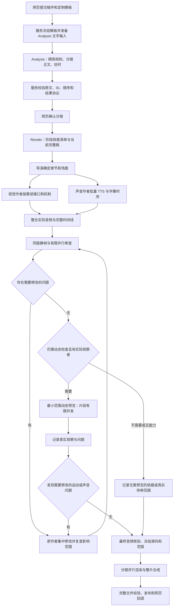
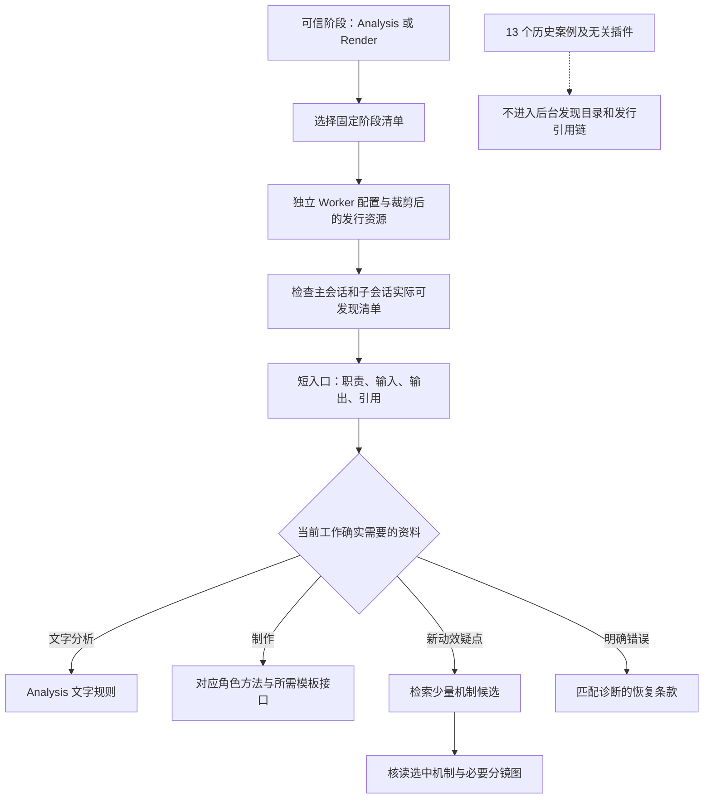
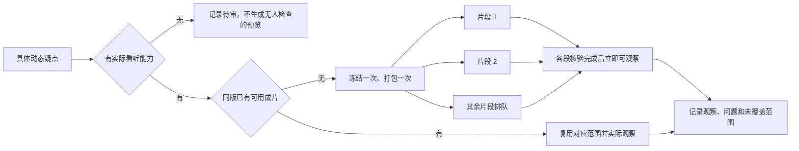
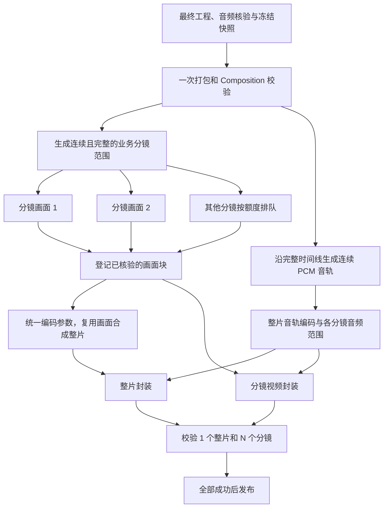

# VideoCutRemotion 全链路耗时优化最终方案

> 日期：2026-10-14。本文时间统一按北京时间说明。
>
> 状态：最终开发方案，尚未实施本文新增改动。本轮交付为文档，不代表代码、技能禁用、生产配置或新渲染流程已经上线。
>
> 适用范围：仅生成 Remotion 动画视频，覆盖网页“数据解读 → 定制化模板”的 Analysis / Render 两阶段流程，以及独立插件 `textvideo-studio` 和配套 Worker。模型保持 `gpt-6-astra / low`。
>
> 代码基线：`a128eeef2778f0524a7c89afd5119c2b86a7548a`；插件 0.1.8；指令 `template-production/5`；Remotion 4.0.519。

## 1. 最终决策与实施边界

用户已明确本项目只生成 Remotion 动画视频。后台不再选择或支持人物口播、访谈、数字人表演、Vlog、实拍纪录片及混合素材剪辑工作流；相关技能、自动路由和专用审查条款从本项目发行范围移出。动画可以包含旁白、字幕、图表、图形角色、模板头像及音乐，这些能力继续保留。“口播稿”作为网页输入字段，不构成人物口播制作入口；TTS 配音也不等于人物口型和表演生成。

本次优化按以下顺序实施：

1. **优先改 Analysis**：只分析文字，不读取 React / TypeScript 渲染源码，不加载制作、配音、动效、审片和导出方法。
2. **收缩后台技能与上下文**：只保留 Remotion 动画主流程，排除 11 个当前无用的一级技能和其他视频类型分支；按 Analysis / Render 提供阶段清单，Render 内再按角色和实际问题读取正文。去掉旧平台接口、重复合同和大段工具结果。
3. **禁用无关历史动效案例**：13 个自有历史案例包退出本项目 Worker 的发现目录、默认引用链和发行包。120 库的机制检索保留，限视觉作者按需使用。
4. **优化检查与返修**：同版证据集中准备，无依赖检查在真实名额内并行，问题集中返修，只复查实际影响范围。
5. **优化动态预览**：先判断是否确有检查需要和真实看听能力；需要的片段有限并发，不固定生成大范围预览。
6. **优化正式媒体导出**：按确认分镜的全局帧范围并行渲染，复用画面合成整片，替换“先渲染整片，再逐镜重复编码”的新任务主路径。
7. **服务接管确定性等待和交付**：减少模型轮询，完善媒体子进程计时，最后再评估重复校验与打包缓存。

首版只在现有 Worker、MCP、作业记录和发行脚本上修改，不增加多机渲染集群、新消息中间件、新案例数据库或新的智能调度平台。

维持以下业务合同：

- 用户在正常网页提交 Analysis、确认分镜后提交 Render；不通过直接写数据库替代网页验收。
- 确认稿的分镜 ID、正文、顺序、音色要求、模板固定包装及输出规格保持正确。
- 仍交付“1 个整片 + N 个确认分镜”，所有文件技术核验成功后才完整发布。
- TTS 句段、业务分镜、主题章节和渲染分块分别建模，不强制一一对应。
- 保留原任务身份、幂等规则、取消、明确失败恢复和未知结果核查。
- 技术生成成功、实际静帧观察、连续视频观察、听审及用户定稿分别记录。

本文中的新增配置概念、模板字段和记录字段均为**拟开发内容**，不能当成当前已发布接口调用。源码技能继续以 [.agents/skills](/Users/jiang/Downloads/ifeng/VideoCutRemotion/.agents/skills) 为唯一维护源；文档目录不建立另一套活动技能树。

## 2. 实际基线与问题定位

### 2.1 本次网页验收样本

| 项目 | 实际值 |
|---|---|
| 任务 | 黄仁勋与 AI 落地，定制化财经模板 2.0.2 |
| taskKey | `40b811ea-86d4-43f3-92ff-6a5c8e450012` |
| Analysis Run | `a052008a-dc55-4230-8322-051324defe2a` |
| Render Run | `66141186-9ec2-4e14-b7c6-faa87ad17cd5` |
| 内容结构 | 5 个主题、10 个业务分镜、36 个 TTS 句段 |
| 输出 | 1920×1080、30fps、4401 帧；整片文件实测约 146.752 秒 |
| 交付 | 11 个视频文件；Analysis / Render 均成功，回调首次成功 |
| 实际配置 | 并行审片关闭、按需预览关闭、切片 `accurate`、媒体计时开启 |
| 实际观察边界 | 有静帧审查；连续视频与音频观察仍为待审，不能称完整视听验收通过 |

**0.1.8 已部署，但这次验收没有开启主要提速开关。** 因此前一轮代码上线与本次任务提速必须分开评价，不能把本次耗时作为所有优化已启用后的结果。

可复查材料：

- [本次两阶段结果、媒体计时和文件核验](/Users/jiang/Downloads/ifeng/VideoCutRemotion/.candidate/web-018-20261014/two-stage-result.json)。
- [0.1.8 开发与隔离验证记录](/Users/jiang/Downloads/ifeng/VideoCutRemotion/docs/20261014最终优化开发与隔离验证.md)。
- 服务器原 Run 的 `logs`、`metrics`、`qa`、`render-jobs` 记录。服务器数据根为 `/home/ops/jiangzb/textvideo-studio-deploy/data/tasks`。

本地候选目录不一定随 Git 分发。后续性能验收应把不含凭据的环境、参数、输入摘要及计时摘要保存到正式验证文档中，原始会话保存在受管任务目录。

### 2.2 耗时拆分

Analysis 约 **1 分 59 秒**。Render 接收到发布完成约 **35 分 18 秒**，不包含两阶段之间的用户操作等待。

| Render 区间 | 实测耗时 | 判断 |
|---|---:|---|
| 启动到第一轮静帧开始 | 5:13 | 包含加载、协作、配音、编排和制作，不能全部记成推理 |
| 第一轮 12 张静帧 | 0:27 | 实际绘帧约 7 秒，其余主要是打包和准备 |
| 首轮静帧完成到动态预览开始 | 8:20 | 审查、修改、校验、第二轮静帧和交接窗口 |
| 8 段动态预览 | 4:13 | 片段之间串行，合计约 68 秒内容 |
| 正式媒体导出 | 14:15 | 整片渲染与分镜切片均有大额开销 |
| 导出前后交接与确认 | 1:56 | 分布在正式导出前后 |
| 发布 | 0:54 | 其中约 53 秒为媒体再次校验 |
| 合计 | **35:18** | 以上为不重叠区间，按秒取整 |

正式导出内部：

- 整片绘帧与编码：**6:58**。
- 10 个分镜切片及校验：**6:35**，其中重新编码约 6:08。
- 打包、整片校验等：约 42 秒。

“8:20”不是第二轮图片渲染耗时，也不是全部审片角色时长的总和：

| 事件窗口 | 约耗时 |
|---|---:|
| 首轮图片完成到首轮审查报告 | 3:24 |
| 首轮报告到第二轮预览开始 | 2:16 |
| 第二轮 12 张图片生成 | 0:24 |
| 第二轮图片完成到动态预览开始 | 2:16 |

首轮查出两项真实问题：市场图中文字重叠，以及网络连线穿过“全球产业”文字。返修有实际价值；第二轮还补查了章节标题和人物入场。二次审查在动态渲染开始后继续，二者存在重叠，不能再次累计。

动态预览的 4:13 包含约 3:44 片段渲染、15 秒校验、14 秒打包与准备。8 段共 2037 帧，约占整片 46%。每段内部有 5 路绘图并发，**8 段之间没有并行**。

### 2.3 上下文与调用基线

| 会话 | 首次输入 tokens | 最大输入 tokens | 模型响应次数 |
|---|---:|---:|---:|
| Analysis | 15,406 | 44,188 | 6 |
| Render 主协调 | 15,373 | 152,167 | 127 |
| 导演 | 18,760 | 130,410 | 29 |
| 视觉作者 | 18,820 | 81,987 | 29 |
| 声音作者 | 18,874 | 75,394 | 23 |

Render 合计 208 次模型响应。累计输入约 1999 万 tokens，其中约 97.7% 为缓存输入；非缓存输入合计约 46.9 万。累计数重复包含历史上下文，不能当成一次加载的独立文本量，也不能将多个代理的窗口相加。

主要冗余：

1. Analysis 读取了五份模板组件源码，一次返回约 3.15 万字符。
2. 约 7759 字符的模板公共合同被四个 Render 角色分别读取，随后又读取各自模板说明和参考。
3. 主协调反复收到完整配音数组、时间线、组件源码和详细报告。
4. 模板入口后仍连接旧 Project / Revision、旧导出接口和 OmniVoice 等不适用内容。
5. 正式媒体导出期间，主协调仍产生 35 次模型响应；其中很多是查询与等待，且与媒体计算重叠。

媒体作业及发布覆盖约 20:12。其余约 15:06 仍混有创作、返修和协调，不是可全部消除的模型耗时。

## 3. 目标流程

### 3.1 两阶段主流程

图中导演、视觉、声音是职责，不要求每项 Skill 各占一个代理。已有完整稿时无需再建立文案、取材或历史研究角色。声音与视觉在具备输入后可同时推进，最终动效落点使用实测音频。

### 3.2 技能与资料加载流程

“可发现”“读过正文”“携带在磁盘上”分别统计。官方技能机制采用渐进读取；关闭隐式调用也不等于删除资源或禁止显式读取。[OpenAI 技能说明](https://learn.chatgpt.com/docs/build-skills)

## 4. P0：Analysis 不读取 React 源码

### 4.1 当前问题

当前 [task-instructions.ts](/Users/jiang/Downloads/ifeng/VideoCutRemotion/packages/production-service/src/task-instructions.ts) 对两阶段共用“完整读取模板全部说明、继续读取组件接口”的要求；公共合同又重复这一入口。Analysis 因而进入了画面实现、音频时序、组件和导出规则。

文字拆稿不需要判断组件内部怎样绘制、怎样处理阴影或怎样编码视频。这些内容应由 Render 的对应作者读取。

### 4.2 新输入边界

| Analysis 可以读取 | Analysis 不应读取 |
|---|---|
| 本次完整口播稿、需求描述、模板标识 | React / TS / TSX 组件及实现源码 |
| 分镜原文保留、顺序、ID 和估时规则 | `FinancialDialogue.tsx`、`VisualBlocks.tsx`、`visualExtensions.tsx` |
| 与文字有关的模板限制：角色、禁止增写、必要文字包装等 | `types.ts`、`validateTimeline.ts`、渲染入口与时间线实现 |
| 必要的模板版本、画幅、文字合同摘要 | 完整制作说明、素材库、动效机制和历史案例 |
| Analysis 结果协议 | 配音、静帧、视频生成、导出和专业审片操作 |

“不读源码”指**源码不进入 Analysis 模型输入和工具返回**。服务为冻结版本而读取文件字节、计算 SHA、检查归档完整性，不属于模型读取，不应取消。

### 4.3 模板合同拆分

给模板增加专用的 Analysis 文字合同，制作说明继续由 Render 使用。拟在 manifest 中声明 `analysisInstructions` 文件列表；该字段为待实现约定，当前不能假定已经生效。

- 文字合同由模板维护者编写并随模板发布，服务按明确路径读取。
- 不在每个任务中再调用模型，从 React 源码临时提炼文字规则。
- 现用模板 2.0.2 需要随模板发布流程补齐文字合同；不同模板的原文限制、角色规则必须保留。
- 缺少新文字合同时，模板校验明确提示待补齐，不静默回退到读取全套源码，也不猜测模板约束。
- 模板版本、归档摘要、文字合同摘要与 Analysis 输出绑定。Render 使用确认提交对应的实际模板，发现版本改变时依现有版本规则处理。

Analysis 工作输入只展开必要文字和文件引用。不要把完整渲染目录写入初始提示词或要求模型遍历。当前 `workspace-write` 不是读权限白名单，不能仅改变工作目录就声称完成强制读取隔离；应通过阶段输入投影、技能裁剪和实际会话验证证明没有读源码。

### 4.4 技能、工具与输出

- Analysis 只使用 `production-coordinator` 的文字阶段入口和精简项目事实；`project-basics` 的必要身份规则并入同一短合同，不重复读旧对象模型。
- 不启动导演、美术、声音、动效和审片子代理。
- MCP 工具发现按可信 Run 阶段投影，只提供所需只读事实；保留服务端阶段权限校验。机制工具也不应在 Analysis 中暴露。
- [codex-session.ts](/Users/jiang/Downloads/ifeng/VideoCutRemotion/packages/production-service/src/codex-session.ts) 的插件发现校验也要按阶段调整，不能在 Analysis 中仍要求发现配音和渲染工具。
- 保持现有 `dataList` 和非空 Markdown 字符串 `context` 协议。context 只保存有效文字约束、分析决定、未确定事项及模板依据引用，不复制全部制作合同。
- 服务校验 ID 唯一、正文完整拼接、顺序、估时标识和 Schema；失败定位具体字段，不让模型重新阅读整套模板。

验收：Analysis 会话中 React / TS / TSX 正文读取为 0，动效/配音/媒体调用为 0；原文和输出合同正确。耗时从约 1:59 降到 1～1.5 分钟为性能验证目标，不能用删除必要文字规则换速度。

## 5. P0：技能清单、正文与引用链调整

### 5.1 后台环境隔离

本次实际目录：Analysis 有 42 个技能；Render 主会话最初 33 个，子会话后续又出现 42 个。Pages、Sites、Pets 等无关项没有正文读取证据，但仍出现在发现目录。现有 `features.apps=false` 不能作为技能目录已经清理的证明。

处理方式：

1. 继续使用本项目独立 Worker 的 Codex 配置，不修改用户桌面的个人插件配置。
2. 在发行阶段按明确清单生成 Analysis / Render 技能视图；源内容仍维护在现有源技能目录，视图只是生成产物。
3. 启动时使用当前宿主真正支持的技能启停配置；官方提供 `skills.config`。具体路径语义、App Server 覆盖方式及对子代理的继承，必须在部署 CLI 上验证，不发明未发布配置键。[OpenAI 配置参考](https://learn.chatgpt.com/docs/config-file/config-reference)
4. 各任务不并发改写共享全局配置；阶段配置在启动时固定并记录，已运行会话继续使用原配置。
5. 主会话、子会话启动和恢复后分别核对实际目录，禁止子代理重新引入整套无关插件。
6. 系统强制提供且无法关闭的条目单独记录；不得用隐藏输出伪装它们不存在。

首版要求：Analysis 发现范围足够小；Render 只发现模板生产所需技能。Render 内首先实现**角色正文按需读取**，不为追求每个子角色不同的元数据目录另建复杂宿主系统；宿主支持角色目录隔离时再直接使用已有能力。

### 5.2 技能调整清单

当前源仓库共有 29 个一级 Skill。当前方案保留或按需提供 18 个，另 11 个从本项目 Worker 的技能发现、引用链和发行资源中排除，后者不只是“默认不调用”。保留的 18 个不是每次全部读取，Analysis 与各 Render 角色仍遵守阶段和按需边界。

此处的删除范围是 `textvideo-studio` 后台发行与执行入口；其他工作流和 `videoflowcut` 插件的维护范围不随之扩张。当前没有名为“纪录片”的独立一级 Skill，相关实拍方法分散在 Vlog、取材、语义剪辑及共享导演/审片正文中，需要一起处理。

| Skill | 后台策略 | 正文调整与读取条件 |
|---|---|---|
| `production-coordinator` | 保留，分阶段短入口 | Analysis 仅文字合同；Render 仅分派、版本、提交和结果接回 |
| `project-basics` | 精简 | 改为 task/run/模板/源码/作业身份；移出旧 Project、Revision、Asset/Cue 对象操作 |
| `production-director` | Render 动画导演读取 | 负责当前完整稿、章节、跨段关系；删除视频类型选择、默认文案重写和取材 |
| `visual-explainer-director` | 动画导演按需读取 | 保留信息递进、数据和机制解释方法，作为动画方法参考，不再构成另一条视频类型主流程 |
| `scene-planning` | 导演或视觉按需 | 保留动画场面状态、对象持续与边界；删除 Presenter / Vlog 分支，不让每句 TTS 自动变成一个场面 |
| `visual-treatment-planning` | 视觉作者读取 | 保留构图、配色、中文排印和视觉连续；历史案例路由移出后台版本 |
| `remotion-production` | 视觉实现阶段读取 | 本期工程、实际组件接口、全局时钟和提交边界；不用时不读全部源码 |
| `effect-timing` | 动效落点阶段读取 | 按实测语音时间安排建立、阅读与退出 |
| `motion-brief-writing` | 新建或重构动效时读取 | 保留连续演出方法；已采用机制的局部改字、改色、偏移不强制重新检索 |
| `motion-case-library` | 视觉作者按需 | 后台只保留机制检索与核读，删除历史案例、全库概览、向量和模型分支指令 |
| `voice-production` | 声音作者读取 | 保留动画旁白、当前豆包批量工具、文本与音色身份、实测时长；移出 OmniVoice、人物表演链和旧对象写入 |
| `captions` | 声音/字幕作者读取 | 真实音频对齐、分页、统一样式；不带无关旧接口 |
| `audio-finishing` | 涉及 BGM、混音或衔接时读 | 保留动画旁白连续、音乐压低、音效及听审；删除实拍现场声剪辑分支，不触发素材搜索 |
| `quality-verification` | 审片角色读取 | 只审动画的静帧、连续画面、音频和技术结果；删除人物口型、实拍事件与采访剪辑专项 |
| `export` | 精简为模板导出合同 | 主协调只掌握提交、状态、异常和交付；固定计算由服务负责 |
| `known-errors` | 异常发生时读 | 只读匹配当前诊断的恢复规则，不启动时全文加载 |
| `depth-composition` | 复杂层级画面按需 | 有图形角色、遮挡、前后景或安全区问题时使用；不因此启用真人抠像或数字人表演 |
| `evidence-visualization` | 数据或证据表达按需 | 保留主张、限定条件和图表表达；不触发外部搜索或事实补造 |
| `narration-writing` | 从发行包排除 | 当前链路输入为确认稿，不自动改稿；不是因为动画不需要文案 |
| `presenter-motion-director` | 从发行包排除 | 不支持人物口播、访谈、数字人主持及 Presenter 混合制作 |
| `vlog-director` | 从发行包排除 | 不支持实拍事件、Vlog 和纪录片式素材剪辑 |
| `avatar-performance` | 从发行包排除 | 不生成数字人口型、表情和表演；固定模板头像继续按模板使用 |
| `semantic-continuity` | 从发行包排除 | 不执行源音视频选段、删口误、访谈重组等语义剪辑 |
| `transcription` | 从发行包排除 | 当前由确认文字生成 TTS，不引入源录音转写流程 |
| `asset-import` | 从发行包排除 | 当前素材由模板和受管输入提供，原有资源读取与校验仍保留 |
| `cutaway-planning` | 从发行包排除 | 不组织 B-roll、实拍插播与返回人物的画面切换 |
| `visual-asset-sourcing` | 从发行包排除 | 当前任务不做在线画面取材 |
| `sound-asset-sourcing` | 从发行包排除 | 当前沿模板声音资源，不做额外在线声音取材 |
| `web-editor-operator` | 从发行包排除 | 网页提交和验收属于外部操作入口，不是 Worker 制作角色 |

Pages、Sites、Pets、插件创建/安装等无关插件或技能不进入后台阶段清单。OpenAI Docs 等开发资料不应成为普通生产任务默认资料；保留实际宿主必须提供的系统部分并记录。

### 5.3 单一 Remotion 主流程与共享正文裁剪

删除专用 Skill 目录后，还要处理保留技能里的类型分流和间接引用。否则导演、场面或审片角色仍会读到口播、实拍方法，甚至转回已经排除的入口。

| 现有入口或参考 | 后台版本调整 |
|---|---|
| `production-coordinator` 与 `references/task-routing.md` | 直接进入文字分析或 Remotion 动画制作；删除“选择主视频类型”和默认启动文案、素材作者的要求 |
| `production-director` 与 `references/rough-cut-review.md` | 保留完整稿、章节、视觉组织和返修责任；删除 Presenter / Vlog 选择、采访选段和实拍粗剪方法 |
| `visual-explainer-director/references/explanation-design.md` | 保留比较、分类、流程、关系和信息释放；去掉取材驱动主流程、转交其他视频类型以及旧剪辑对象操作 |
| `scene-planning` | 保留持续对象、建立、推进、稳定和退出；去掉人物讲述、实拍事件和镜头组接专用章节 |
| `quality-verification/references/professional-review.md` 与 `mode-specific-rubrics.md` | 只保留动画可读性、图表含义、运动连续、声画同步和真实观察；去掉人物可信度、口型、Take 选择、实拍动作及现场声专项 |
| `voice-production`、`captions`、`audio-finishing`、`depth-composition` | 保留动画确实使用的能力，去掉返回 Presenter / Vlog、转写、人物生成或实拍剪辑的引用 |
| `_shared/TOPIC_TO_FILM.md` 及旧项目写入路由 | 从本项目后台默认引用链排除；以阶段模板合同承接，不引入素材主导的多类型制作流程 |

唯一主链为：确认稿 → 动画信息组织与场面设计 → Remotion 实现 + TTS/字幕 → 动画质量检查 → 导出。导演职责与解释设计方法可以由同一负责人承接，不另起“解释片导演”代理，也不为了收窄范围再新建一套同义技能。

模板自带资源、受管输入、字体、Logo、头像和必要音频仍可按已有合同使用。移出 `asset-import`、取材和数字人 Skill 不等于删除这些基础能力。文案生成是否需要取决于输入合同；本次确认稿流程不加载创作文案 Skill，不因“纯动画”擅自关闭网页其他既有文字能力。

发行验证同时检查技能目录、正文引用、主子会话实际读取和路由行为。对明确超出纯动画范围的任务返回范围说明，不静默启用旧类型工作流，也不把不支持的视频类型误报为平台故障。被排除内容不设置“任务失败后自动重新启用”的回退。

### 5.4 从“大合同”改为短入口与专业参考

现有 [模板生产合同](/Users/jiang/Downloads/ifeng/VideoCutRemotion/.agents/skills/_shared/TEMPLATE_PRODUCTION.md) 拆成以下职责范围，文件名可在开发时按现有目录规范确定：

- 基础事实与边界：阶段、身份、原文、模板、源码版本、真实观察、结果未知处理。
- Analysis 文字合同。
- Render 协调与工具提交合同。
- 视觉制作方法与必要组件接口。
- 声音、字幕和实测时间合同。
- 静帧审查、动态预览及媒体交付合同。

各 Skill 入口只说明何时读哪一份。公共基础在当前角色输入中完整提供后，不再次逐层链回整个合同。专业原则仍保留，不用压缩成几个含糊关键词替代完整创作责任。

源目录中供其他工作流使用的旧内容可以保留，但后台发行采用明确的模板入口映射和引用清单；不把所有通用正文复制后再要求模型自行忽略，也不用脆弱的正则批量删段落。

### 5.5 工具结果与角色交接

- 原始响应保存到当前 Run；模型默认收到状态、计数、异常、文件引用和摘要。
- 配音默认返回完成/失败/待定数量、批次身份、必要的音频和时序引用；仅在处理具体句段时展开详情。
- 媒体状态默认返回进度、已核验文件、失败块及原作业身份，不反复返回全稿和完整时间线。
- 交接包含职责、当前输入引用、源码摘要、实际差异和未完成事项；已有原作者续接时不重复发送全部历史。
- 导演和视觉作者需要理解完整内容，不能为了降低 tokens 删除当前完整稿及必要上下文。
- 不机械截断 JSON 或错误诊断。摘要字段由程序投影，详情仍可按引用取回。
- 用真实 `token_count` 记录输入、缓存输入、输出和响应次数；文件字符数不能冒充精确 token 数。

## 6. P0：动效机制库保留，历史案例退出后台

### 6.1 三类资源分开处理

| 资源 | 决策 |
|---|---|
| 120 库拆出的 567 个运动机制、词法索引及静态分镜图 | 保留，按需检索和读取 |
| 120 库的整片概览浏览、全库卡片分页、原片研究及旧检索脚本入口 | 普通模板 Worker 不开放；不作为机制无结果的回退 |
| 源技能内的 13 个自有历史案例包及其旧源码、视频、教学材料 | 从本项目 Worker 发行资源与引用链排除 |

本次机制工具只有一次检索和一次详情读取，合计约 0.96 秒，返回 3 个候选并读取 1 个机制与 1 张分镜图。没有证据表明整库加载；最终画面只体现部分参考关系，没有对照试验证明其效果收益。

本次日志未见下面 13 个案例正文被读取。禁用它们是执行用户要求、减少无关入口和未来误加载，不能声称因此能直接省下本次几分钟。

### 6.2 明确禁用的 13 个历史案例

这些目录都位于 [历史案例源目录](/Users/jiang/Downloads/ifeng/VideoCutRemotion/.agents/skills/motion-case-library/references/cases)：

| 目录 | 案例内容 |
|---|---|
| `motion-case-active-window-focus` | 活动视窗展开与主体聚焦 |
| `motion-case-attention-programme` | 时代变化与节目安排 |
| `motion-case-comment-focus` | 弹幕穿行、文字收束与气泡 |
| `motion-case-context-detail-observation` | 整体定位与局部观察 |
| `motion-case-cover-flow` | 封面流、选中接管与展开 |
| `motion-case-mixed-scene-relay` | 混合场面的整片接力 |
| `motion-case-object-type-relay` | 物体微距、部件离开与大字接管 |
| `motion-case-occlusion-condition-reveal` | 遮挡揭字与条件说明 |
| `motion-case-product-fan` | 产品扇开、数字突出与箭头接力 |
| `motion-case-relation-unfold` | 保持参照与关系拆层 |
| `motion-case-sim-paper` | SIM、手机页面、撕纸与场景接管 |
| `motion-case-smooth-relay` | SIM、QCI 页面与时钟接力 |
| `motion-case-ticket-phone` | 机票价格、手机条款与日期聚焦 |

当前这些案例文件合计约 39.3 MiB。该数字是包含媒体的磁盘体积，不是上下文大小。

具体落实：

1. 调整 [sync-skills.mjs](/Users/jiang/Downloads/ifeng/VideoCutRemotion/plugins/textvideo-studio/scripts/sync-skills.mjs)，由复制整树改为明确发行清单；13 个案例目录不再复制到 `textvideo-studio`。
2. 后台版本移出 `validated-index.md`、`validated-use.md`、`r92-family-index.md`、`skillry-retrieval.md` 的自动入口，以及引用这些资料的旧正文。
3. 检查 `timing-continuity.md` 等间接引用。通用时序方法可以保留，历史视频和案例教学依赖不随之进入后台。
4. 不给这些案例注册独立 Skill，不提供从机制无结果自动跳回历史源码的分支。
5. 源仓库历史资料继续保留以供追溯；不删除其他插件资源、不手改已安装缓存。通过新发行构建、校验和部署让禁用生效。
6. 发行清单、入口链接和磁盘资源同时检查。只设置 `allow_implicit_invocation=false` 不满足“后台禁用历史案例”的要求。

### 6.3 机制库的按需规则

- 只有视觉作者需要新建或实质重构运动关系时检索；Analysis、声音作者和审片者不预读。
- 首次通常取 3 个候选；核读真正入围的 1～2 项。该数量是初始批次，不是妨碍创作的硬上限。
- 原机制仍适用的改字、改色、位置微调继续复用，不在每句 TTS、每个分镜或每轮审片重复搜索。
- 搜索默认返回 ID、目的、起止状态、简短适用关系和来源指纹；不每次返回完整 taxonomy。
- 详情默认只读机制正文；分镜图根据实际选择需要获取。精确 ID 和已有采用记录直接定位。
- 在当前演出稿保留“采用 ID、来源指纹、本片对象映射、保留/舍弃动作、观察范围”，不另建采用数据库。
- 无结果先调整关系描述；仍无匹配就如实说明并由作者完成本片设计，不伪造编号，不自动打开历史案例或调用向量/网络/外部模型。

[build-production.mjs](/Users/jiang/Downloads/ifeng/VideoCutRemotion/plugins/textvideo-studio/scripts/build-production.mjs) 当前复制的机制资源还包含整片卡片等文件。裁剪时必须检查真实依赖：`case-catalogue.json` 参与机制索引构建，不能为了禁止整片浏览直接删掉必要索引元数据。应先保留词法检索的最小依赖闭包，再删除无关浏览脚本、整片参考入口及资源。

当前 `read_motion_mechanism` 的 `part=overview` 分支也应从普通后台能力范围移出；核心 `mechanism` 正文和分镜读取继续通过发行包实测验证。

## 7. P1：检查、返修与静态预览

目标是减少等待、重复阅读和分散返修，同时保留真实发现问题的能力。

1. 作者提交可检查版本及关键风险点，一次冻结静帧快照；固定包装、长文字、图形中间态、章节切口优先覆盖。
2. 不强制每轮凑满 12 张。当前上限保留，按问题选帧；首次考虑已知高风险状态，减少第二轮仅为补漏而取帧。
3. 按真实代理名额安排只读检查，最多沿现有配置使用 3 名；名额不足就排队，不新建重复负责人。
4. 导演负责跨章节一致性和包装，其他检查者负责具体单元。作者自查不冒充独立检查。
5. 先集中汇总同版问题，原视觉作者统一修改。审片者不并发写源码。
6. 复查修改区域与邻近切口；共享组件、全局时序、字幕或包装变化才扩大范围。
7. 未变区域只有在存在可信文件摘要和影响范围依据时复用旧证据；不能仅改版本号继承通过。
8. 主协调接收简短问题清单和结果引用，不反复读取两份完整逐帧报告和重复问题台账。

正常进度由实际新增观察帧、问题或修复结果推进。反复催问、心跳、改派和重复读报告不计为有效进展。

本次两项遮挡问题应作为真实回归样例；不能靠去掉审查把耗时做短。修复后的静帧通过，也不能自动标记连续动效和音频通过。

## 8. P1：动态预览按需且有限并发

### 8.1 先决定是否生成

动态预览请求必须有：当前源码摘要、具体问题、最小有效帧范围、真实检查者、看/听能力与通过条件。

- 静帧已能回答的问题，不生成视频。
- 没有连续看听能力时，记录待审及原因，不自动生成一批无人观察的预览。
- 已有同版正式文件时，优先直接播放或读取对应范围，不再次渲染。
- 新版源码影响运动或声音时，按疑点补最小连续范围。
- “按需”不得解释为取消必要动态检查；发现问题后仍回原作者修改并复查。

### 8.2 需要生成时并行处理片段

使用同一冻结工程、同一次打包结果和统一并发预算，初始验证每批同时处理 2～3 段。其余片段排队，任一完成后补位。

预览和正式导出共用分段调度能力，但仍是不同用途、不同作业，不把预览文件自动当成正式交付。每 Run 同时一项媒体作业的外层互斥可以保留，并发发生在该作业内。

默认保持正式规格用于排版和边界判断。降低预览分辨率只可作为后续明确区分的运动检查模式，不能拿低清预览证明中文清晰度或最终画质。

同样 8 段内容从 4:13 降到 2～3 分钟为测试目标；减少无用途范围与片段并发的收益重叠，不相加。

## 9. P2：正式分镜并行渲染，再合成整片

### 9.1 旧路径、新路径与删除范围

旧路径：完整 Composition 渲染一次整片 → 整片校验 → 按业务分镜从整片反复解码、裁剪和编码 → 全部文件发布。

当前 [template-slices.ts](/Users/jiang/Downloads/ifeng/VideoCutRemotion/apps/render-worker/src/template-slices.ts) 的准确路径从输入开头解码后按帧裁剪；[template-renderer.ts](/Users/jiang/Downloads/ifeng/VideoCutRemotion/apps/render-worker/src/template-renderer.ts) 又逐个等待分镜，形成重复工作和串行等待。

新路径：固定完整工程和实际音频时间线 → 按业务分镜全局范围并行渲染画面 → 保存可复用分镜画面 → 连续音轨处理 → 封装分镜及顺序合成整片 → 校验后发布。

新路径验证通过后，**从新任务默认流程删除“先整片渲染、再全量分镜重编码”**。旧策略暂时只用于已存在作业恢复和受控回退；在旧作业退出后再清理对应分支，不长期保留多套自动试错主流程。

首版可以先做较小的对照改法：提高整片绘图并发、切片有限并行。该改法仍有重复编码，只作为性能基线与回退，不冒充最终方案。

### 9.2 分块单位和时间连续性

- 首版采用确认分镜的全局半开帧范围，不按 TTS 数量拆块。
- 全部分镜使用同一完整 Composition、输入、模板、素材、字体和源码快照。只改变输出 `frameRange`，不把每段时间重置为独立场面。
- 当前第二个分镜输出全片第 435～738 帧，仍沿完整时间线计算跨句图形和 BGM；这类范围应由服务计算及校验。
- 章节可以跨分镜；TTS 只提供声音和触发点，不要求一个 TTS 对应一个独立画面。
- 分镜必须完整覆盖应交付的范围，片头、章节包装、片尾有明确归属，不漏帧、不重复帧。
- 单帧可确定重建、随机种子稳定、资源准备完成是并行成立的前提；不能依赖“前一块先运行”留下的内存状态。

Remotion 支持在同一 Composition 上按帧范围输出，以及每次渲染内部的绘图并发；两层并发需要共同预算。[renderMedia 官方接口](https://www.remotion.dev/docs/renderer/render-media)

### 9.3 画面与音频的合成路径

实施要求：

1. 画面块采用一致的编码参数、尺寸、帧率和时间基，并保证块起点可独立解码；中间文件格式按当前 Remotion / FFmpeg 实测确定。
2. 整片复用这些画面数据，目标是拼接和封装时不再全片重编码。若最终仍重新编码全部画面，必须单独报告耗时与代价，不能称已消除重复编码。
3. 音频按完整时间线连续混音，保留 TTS、音乐、音效、压低和跨段衔接。整片音轨统一编码；分镜音频从同一 PCM 依据全局样本边界取段。
4. 不直接串接任意长度、各自独立 AAC 编码的分镜音轨。采样边界由全局帧数和采样率统一计算，避免每段独立四舍五入引入累计偏移。
5. 拟采用的 Remotion `combineChunks()` 有固定分块长度等约束；本项目业务分镜长度不同，**不能直接把不等长分镜套进去**。首版采用适配不等长画面块的封装/拼接路径与连续音轨，按实际编码容器验证。[Remotion 合并接口约束](https://www.remotion.dev/docs/renderer/combine-chunks)
6. 整片与分镜的帧数、时间边界、头尾画面、音频接点、BGM 连续性和实测时长必须验证。容器时长与音频编码延迟分别解释，不能用“看起来差不多”代替边界核验。

### 9.4 并发额度

服务器检测到 56 个逻辑 CPU、约 126 GiB 内存；当前单片绘图并发上限为 5。该硬件信息不等于所有资源可独占，也不证明提高并发会线性提速。

采用现有服务内的有界队列，统一管理：

- 全部活动 Run 的绘图总额度。
- 单个 Run 同时工作的分镜/预览片段数。
- 每片段内部的绘图并发。
- 同时编码/混音/封装的进程数。

首轮测试可从每任务 2 个片段、每片段 4 路绘图开始，与单片 8 路绘图使用相近预算对照，再测 3 个片段及更高总预算。不要一开始让 10 个分镜各自开 5 路，再叠加 4 个视频任务。

预算由服务统一领取和释放；取消、异常、重试均释放资源。多任务轮转，避免一条长片占满所有槽位。首版以测定的固定配置为主，不增加复杂的自动扩缩容算法。

### 9.5 作业状态、恢复和兼容

- 保持一个正式媒体作业身份，内部记录各块的范围、源码摘要、参数摘要、状态、真实文件路径和哈希。
- 块可能乱序完成；状态持久化串行合并，最终文件按确认分镜顺序排列，不能用完成顺序拼接。
- 只对明确失败且输入快照可信的块续做；已成功块经身份和摘要复核后复用。
- 合并失败时复用已完成块，只恢复合并及必要校验，不重新生成 TTS 或全部画面。
- 当前 `retry_render_slices` 要求可信整片先存在。新模式必须调整恢复逻辑并按作业策略分派，不能原样调用旧守卫后声称支持分块恢复。优先扩展既有入口并同步合同，不为相同恢复动作再造一套平台。
- 旧作业仍沿记录中的旧切法恢复；新作业的策略、并发、编码与版本在创建时固定，部署后不静默切换。
- 取消时停止子进程并等待退出，临时文件不进入 readyFiles；结果未知先核查原块及进程状态，不换键重放。
- 任意块未成功时不发布完整结果。已有上一版本文件保持独立，不能用旧文件补齐新版本冒充成功。

## 10. P1 / P3：等待、打包和发布

### 10.1 减少等待驱动的模型调用

模型负责创作决定和实际问题判断；作业进度、等待、确定性校验和回调由服务负责。

优先在现有 `read_render_job` 及宿主能力内增加有界事件等待/状态变化读取。等待参数和返回字段属于待开发扩展，需按真实 Schema 使用。

- 服务在完成、失败、取消或需要模型处理的事件到来时返回有效结果。
- 网页进度直接来自作业状态，不依靠模型不断说“正在渲染”。
- 等待超时只返回原作业身份和当前状态，不产生新渲染请求。
- 不简单把超时设成无限；保持取消、断线核查和跨进程恢复。
- 宿主不支持长等待时，使用已有服务状态机收口确定性导出阶段，而不是新增一套代理编排框架。
- 完整文件清单和最终 Schema 交接由可信服务生成或校验，模型不重复搬运所有结果。

本次正式导出期间的 35 次模型响应与媒体计算重叠，减少它们主要降低调用和上下文负担，不能把整个 14 分钟算成可省的 AI 等待。

### 10.2 同版打包复用

静帧、动态预览和正式导出若源码摘要完全相同，可以复用当前 Run 内的构建结果。缓存键包括源码、发行和依赖版本及必要编译参数。

- 只缓存不可变快照，不复用仍在写的工程。
- 源码变更立即失效；不得排除影响作品的 JSON 来凑相同摘要。
- 首版限制在当前 Run，沿作业生命周期清理；不建设跨用户分布式缓存。
- 打包收益主要是几十秒，不作为分钟级提速的主要承诺。

### 10.3 发布复验

本次发布约 54 秒，其中再次媒体校验约 53 秒，文件复制不足 1 秒。先优化前面的大项，再决定是否复用同版校验凭据。

若实施复用：凭据必须由服务产生并绑定文件字节哈希、范围、规格、校验版本和来源快照；发布前仍校验身份与哈希，复制后再次比对。缺凭据、参数不同或文件变化时完整重验。

不接受作者自行写的“校验通过”JSON，不为了省几十秒取消最终文件正确性检查。

## 11. 性能目标与估计边界

以下是工程目标，不是已测出的收益，也不是在任何素材下的时长承诺。

| 范围 | 当前基线 | 首轮目标或预计收益 |
|---|---:|---|
| Analysis | 约 1:59 | 目标 1～1.5 分钟 |
| 只精简上下文 | 分散在制作过程 | Render 预计省 1～3 分钟 |
| 上下文、重复读取及交接一起调整 | 同上 | 合计预计省 3～5 分钟，包含上一项 |
| 正式媒体导出 | 14:15 | 目标 7～10 分钟，预计省 4～7 分钟 |
| 保留同样 8 段动态预览并行处理 | 4:13 | 目标 2～3 分钟 |
| 动态预览按需缩小或不生成无用途片段 | 取决于真实检查问题 | 本次无人连续观察的 4:13 可避免；其他任务不套用固定节省值 |
| 检查返修协作 | 8:20 窗口 | 争取减少 1～3 分钟，与上下文收益重叠 |
| Render 总流程 | 35:18 | 首轮整体验证目标 20～25 分钟 |

不把上述收益直接相加。上下文缩小比例不等于延迟下降比例，缓存输入、并行重叠和真实返修会影响结果。

不承诺稳定 6～10 分钟完成全流程，不通过降画质、删正文、删分镜或取消必要质量检查达标。模型保持 Astra low，首轮不把换模型混入性能对照。

## 12. 拟修改文件与主要调用链

以下为后续开发清单，本轮没有修改这些实现文件。

| 文件或源目录 | 改动职责 |
|---|---|
| [task-instructions.ts](/Users/jiang/Downloads/ifeng/VideoCutRemotion/packages/production-service/src/task-instructions.ts) | 按阶段组织读取范围，缩短交接，移除 Analysis 组件阅读要求 |
| [template-package.ts](/Users/jiang/Downloads/ifeng/VideoCutRemotion/packages/production-service/src/template-package.ts) | 校验文字阶段合同及模板版本依据 |
| [codex-session.ts](/Users/jiang/Downloads/ifeng/VideoCutRemotion/packages/production-service/src/codex-session.ts) | 阶段技能配置、发现校验、真实配置与上下文证据 |
| [config.ts](/Users/jiang/Downloads/ifeng/VideoCutRemotion/packages/production-service/src/config.ts) | 单一配置入口、并发预算及策略校验 |
| [源 Skills](/Users/jiang/Downloads/ifeng/VideoCutRemotion/.agents/skills) | 短入口、模板方法引用、角色按需阅读、旧路径分离 |
| [sync-skills.mjs](/Users/jiang/Downloads/ifeng/VideoCutRemotion/plugins/textvideo-studio/scripts/sync-skills.mjs) | 明确发行清单、历史案例排除、生成阶段技能视图 |
| [build-production.mjs](/Users/jiang/Downloads/ifeng/VideoCutRemotion/plugins/textvideo-studio/scripts/build-production.mjs) | 精简机制库依赖和发行资源，生成实际摘要 |
| [verify-production.mjs](/Users/jiang/Downloads/ifeng/VideoCutRemotion/plugins/textvideo-studio/scripts/verify-production.mjs) | 校验技能引用闭包、禁用资源缺席和机制工具可用 |
| [mcp.ts](/Users/jiang/Downloads/ifeng/VideoCutRemotion/apps/server/src/mcp.ts) | 按阶段注册必要工具，保持真实版本核验 |
| [speech-tools.ts](/Users/jiang/Downloads/ifeng/VideoCutRemotion/apps/server/src/production/speech-tools.ts) | 工具返回摘要、详情引用、查询与恢复合同 |
| [motion-library-tools.ts](/Users/jiang/Downloads/ifeng/VideoCutRemotion/apps/server/src/motion-library-tools.ts) | 精简机制搜索返回，限制整片概览入口 |
| [motion-library-output.ts](/Users/jiang/Downloads/ifeng/VideoCutRemotion/apps/server/src/motion-library-output.ts) | 机制结果投影，不混入全量无关元数据 |
| [review-policy.ts](/Users/jiang/Downloads/ifeng/VideoCutRemotion/packages/production-service/src/review-policy.ts)、[preview-policy.ts](/Users/jiang/Downloads/ifeng/VideoCutRemotion/packages/production-service/src/preview-policy.ts) | 同版审片、影响范围、按需预览判断 |
| [routes.ts](/Users/jiang/Downloads/ifeng/VideoCutRemotion/apps/server/src/production/routes.ts)、[run-work.ts](/Users/jiang/Downloads/ifeng/VideoCutRemotion/packages/production-service/src/run-work.ts) | 作业内并发调度、状态持久化、取消、恢复和等待 |
| [template-renderer.ts](/Users/jiang/Downloads/ifeng/VideoCutRemotion/apps/render-worker/src/template-renderer.ts) | 统一分段渲染、共享准备、分镜文件及整片合成 |
| [template-slices.ts](/Users/jiang/Downloads/ifeng/VideoCutRemotion/apps/render-worker/src/template-slices.ts) | 旧作业恢复及对照路径，逐步退出新任务默认流程 |
| [scene-cut-timeline.ts](/Users/jiang/Downloads/ifeng/VideoCutRemotion/packages/production-service/src/scene-cut-timeline.ts)、[sentence-audio.ts](/Users/jiang/Downloads/ifeng/VideoCutRemotion/packages/production-service/src/sentence-audio.ts) | 全局范围、包装归属、音频时序与同版审计 |
| [contracts.ts](/Users/jiang/Downloads/ifeng/VideoCutRemotion/packages/production-service/src/contracts.ts)、[registered-video.ts](/Users/jiang/Downloads/ifeng/VideoCutRemotion/packages/production-service/src/registered-video.ts) | 新旧作业策略、真实文件依据和校验兼容 |
| [delivery.ts](/Users/jiang/Downloads/ifeng/VideoCutRemotion/packages/production-service/src/delivery.ts) | 原业务结果顺序、可信校验和发布 |
| [media-metrics.ts](/Users/jiang/Downloads/ifeng/VideoCutRemotion/packages/production-service/src/media-metrics.ts) | 区分排队、绘帧、编码、音频、合成和子进程资源 |

调用链保持为：

网页提交 → 生产服务归一化和模板冻结 → 阶段配置与 Codex 会话 → 受管工具/作者输出 → 同版检查与冻结 → Worker 内部分段调度 → 文件校验 → 原发布与回调。

历史案例禁用只通过本项目的同步、构建和安装流程落地；不直接修改安装缓存，不覆盖 `plugins/videoflowcut`。

## 13. 开发与验证顺序

### 13.1 分批落地

| 批次 | 内容 | 完成条件 |
|---|---|---|
| P0-A | Analysis 文字合同与阶段工具边界 | 不读源码、输出正确，缺合同有明确诊断 |
| P0-B | 单一动画流程、18 项保留/按需技能、11 项技能及 13 个案例排除 | 主子会话目录符合预期，无其他视频类型路由和残留引用，排除资源不随发行 |
| P1-A | 摘要交接、等待、审片与按需预览 | 保留质量记录，减少重复读取，无用途预览不生成 |
| P1-B | 动态预览有限并发 | 同样范围输出一致，取消与部分失败可恢复 |
| P2 | 分镜并行渲染、连续音轨、整片合成 | 帧/声边界正确、局部续做成立，正式导出对照提速 |
| P3 | 同版打包与可信校验复用 | 缓存不串版、不削弱身份及最终文件校验 |

P0 优先独立交付，不等待媒体大改完成。P2 比只提高并发配置更复杂，复杂度集中在分块恢复、无缝音频和合成验证；不在首版额外扩展到多机或任意粒度智能切块。

### 13.2 功能回归

沿用现有生产测试并补充真正验证新行为的测试：

- Analysis 不需要读取源组件即可完成；正文含数字、英文、标点、换行和长句时仍完整保留。
- 模板文字合同缺失、路径越界、版本变化、字段无效时给出明确诊断。
- Analysis 不发现或不能执行制作工具；Render 仍能发现并使用实际必要工具。
- 排除的 11 个一级技能及口播、实拍工作流不进入发行与引用链；正文不因出现“口播稿”“旁白”或“头像”误触发人物制作。
- TTS、字幕、模板头像、图表、连续音乐和已有受管资源在纯动画流程中仍可正常使用；明确要求其他视频类型时如实说明范围，不回退到已移除技能。
- 发行包中 13 案例及无关引用不存在；机制检索、正文和静态分镜从发行包实际可读。
- 主子会话及恢复会话不重新加载 Pages / Sites / Pets 等无关技能。
- 分镜和预览块乱序完成，最后顺序仍正确；同键不同输入拒绝。
- 字体、随机种子、跨分镜图形和视频素材在分块与基线输出中保持一致。
- 使用跨边界对白、连续音乐、转场、片头片尾、极短和较长分镜验证漏帧、重帧、黑帧及音频间隙。
- 注入单块失败、合并失败、取消、进程断线、文件损坏，证明只恢复符合条件的原作业范围。
- 并发额度在异常退出后释放；四条任务同时运行时不超过全局限制。
- 两项真实文字遮挡问题仍能被检查发现，修复后复查范围正确。
- 连续看听未执行时状态保持待审，不被技术成功覆盖。

Skill 测试重点是引用可达、阶段行为和实际加载；不要只断言 Markdown 含某句话，就声称技能隔离已实现。

### 13.3 性能对照

媒体对照使用同一冻结工程、TTS 音频、模板、4401 帧范围、尺寸、帧率、编码质量及依赖版本。不得一边改输入内容，一边把差异全部归因于优化。

建议对照组：

1. 当前配置：整片 5 路绘图 + 串行准确切片。
2. 小改基线：提高整片绘图并发 + 切片有限并行。
3. 分镜方案：相近总绘图预算下分镜并行 + 连续音轨合成。
4. 动态预览：相同 8 段的串行与并行。
5. 最终组合：实际按需范围 + P0 / P1 / P2 全流程。

至少三轮交替执行并记录中位数、每轮原始时间、冷/热构建、机器负载和配置。少量样本不报告 P95。

上下文对照使用相同稿件与模板，并记录模型实际读取文件、技能正文、工具结果体积、首轮/峰值输入、缓存输入、输出与响应次数。模型制作存在非确定性，需要把返修差异单独记录。

资源观测补齐 Chrome 和 FFmpeg 子进程 CPU、内存，以及绘帧、编码、音频、合并和排队时间。现有 Node 进程指标不包含全部子进程，不能据此宣称已经定位 CPU 或 GPU 瓶颈。

统计遵循父子阶段及并行区间去重，分别报告“单任务完成时间”和“四任务总吞吐”，不把提高单任务速度却拖慢其他任务的配置称为整体提升。

## 14. 生产切换与网页验收

1. 在隔离目录、端口和队列完成构建及回归，不与正式 Runtime 共用测试队列。
2. 同步源 Skills，构建新的 `textvideo-studio` 候选发行，记录实际版本、releaseId、skillsDigest、配置和依赖。
3. 更新模板文字合同并通过正常模板发布流程提供新版本，不静默替换已有任务的冻结模板。
4. 沿既有部署流程安装插件和 Worker，保留旧版本及原作业恢复依据；不手改缓存或数据库。
5. 切换后读回 Runtime / MCP 的真实 releaseId、健康和新会话清单。特别核实优化开关已经用于本次任务。
6. 通过网页创建全新数据解读任务、选择定制模板、提交 Analysis；核对日志中没有 React 源码读取。
7. 在网页确认分镜并提交 Render；读取原作业直到成功或明确失败，核对实际并发、技能读取和专业检查范围。
8. 核对整片、全部分镜、音画边界、网页播放、回调，以及真实观察与待审标识。
9. 同时交付代码验证、生产部署、网页流程和性能对照四类结果；任何一类缺失都单独说明。

只看到环境变量或构建文件存在，不算优化已生效。验收证据必须来自**新任务实际执行的配置和调用链**。

回退时停止向新策略派发新任务；活动作业按创建时固定的策略和版本继续或明确终止。不能部署回退后把原作业悄悄改成另一种切法，更不能用旧成片冒充新结果。

## 15. 交付清单与已知代价

后续开发完成应交付：

- Analysis / Render 读取边界及模板文字合同。
- 全部 29 个源技能的处置记录：18 项保留/按需、11 项排除，以及单一动画路由、阶段发现清单、实际正文读取证据。
- 13 个历史案例的发行排除清单和链接完整性验证。
- 保留的机制库最小资源、搜索结果投影及真实采用记录。
- 静帧审查、按需动态预览和分段渲染的实现及测试。
- 原作业恢复、取消、乱序完成、合并和音频接点验证。
- 同输入性能数据、实际配置、资源范围和不能证明的结论。
- 正常网页两阶段的新任务验收与真实媒体结果。

已知代价：

1. 模板需要维护清楚的文字阶段合同；旧模板须先补齐，不能让每个 Analysis 重新阅读源码猜规则。
2. 禁用历史案例后，后台不再自动借用这些整片参考。需要此类研究时属于另外明确的工作范围，不作为无结果兜底。
3. 技能裁剪需要维护明确发行清单和引用闭包，但可减少旧接口混入和无关阅读。
4. 分镜并行增加内存、编码竞争和恢复逻辑；收益必须在单任务及多任务条件下验证。
5. 采用连续音轨与画面复用，需要处理时间基、采样边界和容器封装；不能用简单拼接掩盖音频缺口。
6. 真实美术问题仍可能触发返修；性能目标不保证每条内容固定时间完成。
7. 本项目后台不再承担人物口播、访谈、数字人表演、实拍纪录片和 Vlog 制作。这是用户已确认的产品范围；对应专用流程不保留自动回退，动画旁白和模板资源能力继续保留。

本轮实际产物仅为本方案文档。当前代码、正式任务、生产技能与运行配置均未因本文自动改变。
