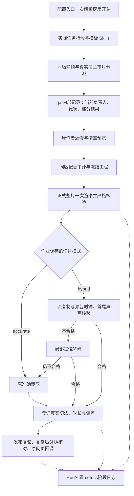

# 最终优化方案：代码实现与隔离验证

## 范围与基线

以 `docs/VideoCutRemotion_Final_Optimization_Plan.md` 为实施依据，开发基线为 `0463fbd09eb1ed5c60e73a769349182ae5f3d1e9`，分支为 `codex/render-optimization`。本轮为平台开发；保留现有 Analysis/Render、网页分镜 ID/正文/顺序以及整片交付合同。用户提供的优化方案和 AGENTS 修改不属于本轮新编写内容。

候选插件版本为 `textvideo-studio 0.1.8`，实际注入指令版本为 `template-production/5`。候选构建、隔离验证与生产部署分别报告；本轮不修改正式任务、生产数据库或已安装插件缓存。

最终候选标识：

- `releaseId`：`release-dc568272afced43e499020ff1443e1d70c21e3a830572927ca3fa32b4c0e0f50`
- `skillsDigest`：`909e45e918ac0be7546b8767c6a43ec185b8c952ed54d3107e12eee761433669`
- 构建目录：`plugins/textvideo-studio/runtime/dist/`，包括 Runtime、MCP 和新增加的 `review.cjs`；已完成源码 Skills 同步。

## 实现与调用链



| 范围 | 主要文件与职责 |
|---|---|
| 配置及注入 | `config.ts` 统一校验开关；`task-instructions.ts` 与 `codex-session.ts` 把真实配置传给工作会话 |
| 审片与预览 | `review-policy.ts`、`review-cli.ts`、`preview-policy.ts`；五份源 Skills；真实创建代理仍由宿主执行，辅助命令不伪造代理或观察 |
| 配音切点 | `sentence-audio.ts`、`scene-cut-timeline.ts`；实测句段核验绑定源码摘要，服务检查点保留核验凭据，当前模板全局范围包含固定包装 |
| 媒体切片 | `template-renderer.ts` → `template-slices.ts` → `fast-cut-validation.ts`；只绘整片一次，串行补齐确认分镜 |
| 可信交付 | `contracts.ts`、`registered-video.ts`、`delivery.ts`；发布和恢复均复核真实文件，复制后再次核对 SHA |
| 性能记录 | `media-metrics.ts`、`routes.ts`、`runner.ts`，及 `production-media-timing-report.ts`；区分构建、选取 Composition、绘帧编码、ffprobe、完整解码、逐镜切片与发布 |
| 通信诊断 | `tool-observer.ts`、`codex-session.ts`；通信异常、工具长时间未完成、有效审片进展分别记录，不改变媒体重试身份 |
| 候选发行 | 原同步/构建/验证脚本，增加随发行提供的 `review.cjs` |

## 灰度与兼容

| 环境变量 | 默认 | 约束 |
|---|---|---|
| `TEXTVIDEO_QA_PARALLEL_REVIEW` | `false` | 开启后最多按实际宿主名额分派独立只读审片 |
| `TEXTVIDEO_QA_MAX_REVIEWERS` | `3` | 仅接受 1～3，不增加宿主配额 |
| `TEXTVIDEO_PREVIEW_ON_DEMAND` | `false` | 开启后按具体疑点及真实连续看听能力判断 |
| `TEXTVIDEO_SCENE_CUT_MODE` | `accurate` | 仅接受 `accurate` / `hybrid`；保存到媒体作业，续切沿用原模式 |
| `TEXTVIDEO_MEDIA_TIMING` | `true` | `false` 停止新性能记录，媒体验证逻辑不改变 |

没有数据库迁移，也没有新增公共媒体 API。交付文件增加可选 `cutMetadata`，旧结果仍可解析。`fromFrame/toFrame` 保持业务逻辑范围，`dur` 使用实测值；新增切片资料随 `extraData.cutMetadata` 返回。旧作业没有模式字段时按准确模式恢复，不重写历史结果。

混合模式要求当前模板的 `fps/totalFrames/scenes[].from/frames/utterances` 结构，以及同一源码版本的 `verify_sentence_audio` 服务核验凭据；末镜尾部如包含独立片尾，使用 `ending.narrationEndFrame/outro.frames` 明确归属。旧模板无法提供这些依据时使用默认准确模式，不猜切点。源码返修后应重新核验最终工程，作者手写检查 JSON 不能代替服务检查点。

## 失败处理与代价

- 快速候选只在 `.pending.mp4` 内生成，完整核验通过才原子改名；失败只回退该分镜。局部转码不合格时保留原准确裁剪作为最后回退。取消时清理候选，不发布假成功。
- 原明确失败作业可以续切，原整片与已成功分镜必须通过路径、范围、摘要、实测媒体及切片记录复核；未知、取消或快照不可信时拒绝续切。切片模式不因部署后的配置变化而被偷偷替换。
- 流复制使用原压缩包 SHA 与源 PTS 判断实际边界，再检查解码首尾画面和音频采样；首版最多接受一帧视觉偏差。此门槛比方案候选的 100ms 更保守，没有为了命中率放宽到秒级。AAC/长 GOP 等不可靠情况自动回退。
- 局部转码的零偏差表示准确定位转码的目标边界，并经首尾画面、各声道采样比对确认；它不是再次独立测出的源绝对时间戳。`boundaryValidation` 区分这种核验与流复制的源包 PTS 核验。
- 仍保留整片与切片的完整解码检查，发布时再次验证。额外包核验和多次 FFmpeg 启动有成本，混合模式不保证每类素材都更快，因此默认关闭。
- QA 记录在 `run/qa`，性能记录在 `run/metrics`，不进入源码摘要；不忽略工程内真正影响作品的 JSON 或说明文件。QA 辅助不自动证明图像已看、音频已听或阻断问题已关闭。
- `Broken pipe`、连接回退、超时只作为通信诊断，不能据此重发配音、重画整片或认定某个主题无进展。主 App Server 连接丢失仍按原未知结果处理。
- 性能阶段以单调时钟计时，并保留 UTC、请求身份及父子关系；汇总去除重叠，不能相加为端到端耗时。资源值仅覆盖 Node 进程，包含同进程并发、不包含 FFmpeg/浏览器子进程；I/O 等待为空值，不伪报完整主机瓶颈结论。日志落盘失败不覆盖媒体原结果。

## 验证记录

最终候选的 **73 项生产测试全部通过**，失败、取消、跳过均为 0，耗时 74.359 秒。另已通过 TypeScript 全仓类型检查、Skills 同步、插件构建与发行校验，以及保留原 CRLF 文件格式的差异空白检查。所有媒体、Runtime 与 HTTP 测试使用临时目录和隔离端口，不操作生产队列。

检查范围包含真实 Remotion 批量静帧与整片、真实 FFmpeg 快速候选/局部转码/准确裁剪、取消与失败续切、同版配音凭据及输出篡改拒绝、发布复制后 SHA 复核、33 句与 11 个业务分镜对应关系、只读审片领取/接管/迟到结果/同版补帧、按需预览、通信诊断、计时关闭与失败隔离、真实 Runtime/MCP 发行对齐、网页两阶段提交与回调。

关键验证命令（使用本机现有 Node 和 FFmpeg；不是全局安装步骤）：

```sh
export PATH=/Users/jiang/.cache/codex-runtimes/codex-primary-runtime/dependencies/node/bin:/usr/local/opt/ffmpeg@7/bin:$PATH
export FFMPEG_PATH=/usr/local/opt/ffmpeg@7/bin/ffmpeg
export FFPROBE_PATH=/usr/local/opt/ffmpeg@7/bin/ffprobe
node node_modules/typescript/bin/tsc --noEmit
node plugins/textvideo-studio/scripts/sync-skills.mjs
node plugins/textvideo-studio/scripts/build-production.mjs
node plugins/textvideo-studio/scripts/verify-production.mjs
node --import tsx --test --test-concurrency=4 tests/production-*.test.ts
node --import tsx scripts/production-media-timing-report.ts docs/benchmarks/20261014-render-timing.jsonl
```

环境修正：本机默认 `ffmpeg` 缺少 `libx264`，导致最初 HTTP 夹具生成失败。已改用本机现成 `/usr/local/opt/ffmpeg@7/bin` 的 FFmpeg/ffprobe，并将该目录放在验证进程的 PATH 前部；未安装或修改全局依赖。修正后 HTTP 发布及指定版本修改闭环通过。

## 性能证据及尚未验收事项

### 同输入切片

原始结果保存在 [快速切片隔离基准](20261014快速切片隔离基准.json)，复现脚本为 `scripts/production-cut-benchmark.ts`。固定 60 秒、640×360、30fps、长 GOP/B 帧/AAC 源，裁剪同一个 6 秒范围，三轮交替执行。

| 轮次 | accurate（秒） | hybrid（秒） | hybrid 实际采用 |
|---|---:|---:|---|
| 1 | 2.160 | 2.634 | local_transcode |
| 2 | 2.227 | 2.623 | local_transcode |
| 3 | 2.282 | 2.635 | local_transcode |

中位数分别为 2.227 秒和 2.634 秒，混合模式慢 **18.3%**。三次均因源 PTS 超过一帧容差拒绝流复制，最终局部转码通过。短小片段的额外核验成本抵消了定位收益，默认保持 accurate。首次结果未保存完整 FFmpeg 构建号和源 SHA，原临时媒体已清理，因此只保留原始观测值，不冒充严格可复查的生产基准；后续用随附脚本重新采集。另有真实关键帧内部范围流复制成功的自动化测试。

### 真实 Remotion 阶段计时

固定 320×180、30fps、60 帧、确定性 WAV 和两个分镜，分别关闭/开启埋点，三轮交替执行真实 Remotion 渲染、切片与完整媒体核验。脚本为 `scripts/production-render-benchmark.ts`，保存 [实验环境与结果](benchmarks/20261014-render-timing.json)、[63 条阶段原始日志](benchmarks/20261014-render-timing.jsonl) 和 [阶段汇总](benchmarks/20261014-render-timing.md)。关闭模式均无性能日志。

| 轮次 | 关闭埋点墙钟（秒） | 开启埋点墙钟（秒） |
|---|---:|---:|
| 1 | 24.847 | 27.649 |
| 2 | 20.340 | 22.796 |
| 3 | 19.470 | 21.566 |

中位数为 20.340 / 22.796 秒；开启模式的构建为 12.774～17.503 秒、绘帧编码为 5.550～6.545 秒、两镜切片含核验为 1.049～1.119 秒。父子阶段不得相加。六次样本有缓存和执行波动，不足以证明埋点无开销、把全部差异归因于埋点，或报告 P95。首次关闭样本出现浏览器退出时的非致命 `Target closed` 提示，整片与两镜实际验证成功，样本保留并记录该限制。

两组都是合成小样，与正式 4,255 帧业务片不是同一输入，不能据此推导约 40 分钟流程已经缩短，也不能断言正式长片的主要瓶颈。

本轮不宣称已经完成：真实业务视频的 R0/R1/R2/R3 全流程对照、三名审片 AI 对已知四类画面问题的真实观察验收、四条真实媒体 Run 同时运行的资源压力实验、生产灰度切换与网页人工定稿。这些需要候选版本后续灰度验收；现有四任务调度测试只能证明容量与互斥合同。

没有基于小样去修改 Remotion 编码质量、并发数或引入跨任务缓存。方案 P3 定向优化与 P2 第二阶段切片并发仍以正式样本数据为前提。
