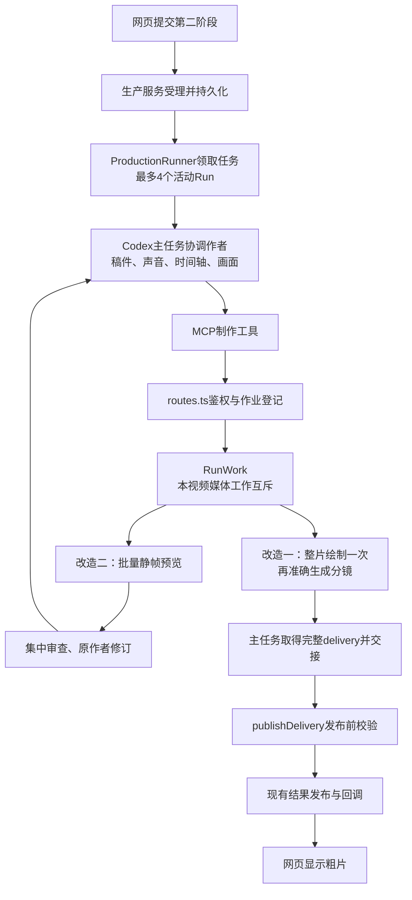
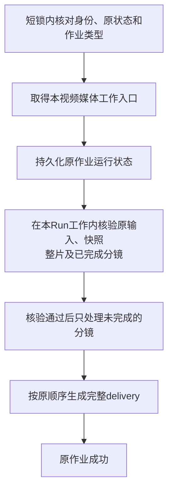
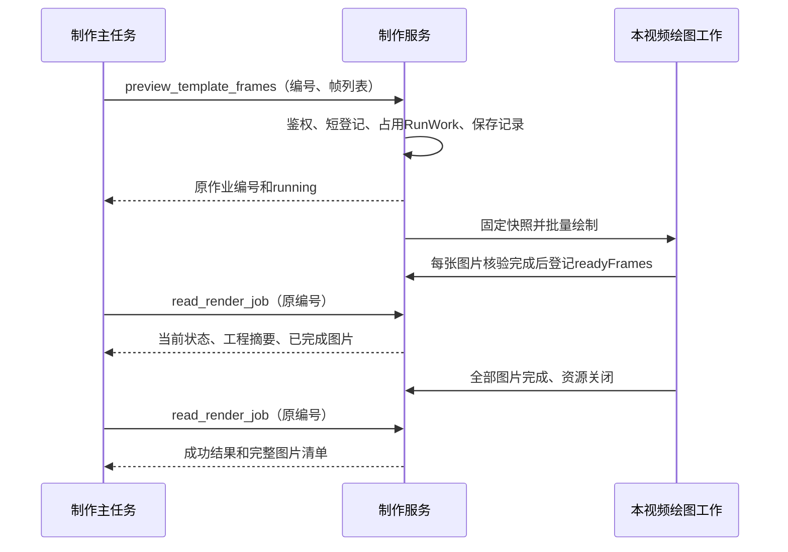
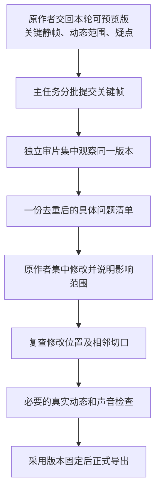

# 第二阶段耗时优化详细开发方案

> 后续实测：0.1.7已部署，正常网页Analysis/Render均成功，整片和11分镜已发布；完整耗时优化目标未通过。最新状态及证据见[部署与网页复测](20261014新版插件部署与网页两阶段复测.md)。本文其余内容保留方案或开发时的记录。

- 日期：2026 年 10 月 14 日。
- 适用项目：textvideo-studio 文本模板视频生产服务。
- 代码核对基线：Git 提交 `6b7538e`；实际复测使用 textvideo-studio 0.1.6。
- 文档状态：用户随后已要求“根据文档完成代码开发”，现已实施并进行隔离验证。实现与测试结果见《20261014第二阶段耗时优化开发验收.md》；本文保留设计时的旧方案、拟修改说明，不能据此判断线上能力。
- 范围：正式导出减少重复绘制；批量预览与集中返修，包含已确认的模板片头问题修复。
- 实施取舍：按用户对本文的开发指令，采用高质量二次编码生成分镜；整片保持原渲染流程。尚未推送、生产部署或进行新一轮网页性能复测。

阅读导航：第2节看问题证据，第4节看整个链路，第5节看正式导出开发，第6～7节看批量预览和模板修复，第8～9节看接口与文件清单，第10～12节看验收、部署及代价。

## 1. 方案要解决什么

本次单任务复测的第二阶段用了 **27 分 50.854 秒**。配音批量化已经生效，制作会话也没有出现断线重连，但正式导出和画面返修仍然占用了主要时间。

本轮只处理两个大头，不再扩展成十几项优化：

1. **整片只绘制一次，分镜从整片准确生成。** 当前相同画面在整片和分镜中重新绘制两遍；拟替换第二遍绘制。
2. **同一版画面批量预览、集中检查、原作者集中修改。** 同时修掉已经确认、每次制作都会重新处理的模板问题，减少重复返修。

第一项减少机器重复计算，第二项减少作者和审片之间的重复往返。两项分别验证，不能把局部接口变快直接当作完整视频已经提速。

本文先解释问题和取舍，再说明接口、代码、状态、测试及部署。文中的“拟新增”“拟修改”都是待开发内容，不能当作当前已发布能力使用。

## 2. 实测基线与证据边界

### 2.1 样本身份

| 项目 | 本次实际情况 |
|---|---|
| 网页任务 | 黄仁勋与AI落地｜0.1.6单任务耗时复测｜20261014 |
| 网页任务 ID | `d1f27f5edfa5407f88a163c32704afab` |
| 内部任务标识 | `2301bc3e-6ec0-419e-9508-f2ad1e37b735` |
| Analysis Run | `5ab4b7c5-8131-49bb-848e-610941867be3` |
| Render Run | `481c2a35-d7da-4dfc-9c5e-81ea0e8815cb` |
| 主任务及作者模型 | gpt-6-astra / low |
| 画面规格 | 1920×1080，30fps |
| 输出 | 4209 帧整片＋12 个分镜，共 13 个视频文件 |
| 配音 | 37 段，批次首次提交至最后成功落盘约 8.70 秒 |
| 并发配置 | 最多 4 个活动 Run；每视频最多 5 个绘图槽 |

本次只运行一条视频，是单任务耗时样本，不是四任务同时运行的性能结论。所有时间均为北京时间。

### 2.2 第二阶段的互不重叠拆分

| 阶段 | 起止时间 | 耗时 | 主要工作 |
|---|---|---:|---|
| 制作、预览与返修 | 09:26:00.617—09:38:09.060 | 12分08.443秒 | 画面源码、声音与时间轴、静帧及动态预览、修改 |
| 正式导出 | 09:38:09.060—09:52:36.993 | 14分27.933秒 | 整片与12个分镜生成、文件检查 |
| 导出后交接 | 09:52:36.993—09:53:51.471 | 1分14.478秒 | 最后核验、记录与主任务交接 |
| 合计 | 09:26:00.617—09:53:51.471 | **27分50.854秒** | 请求受理到制作主会话结束 |

该口径不包含之后的最终发布检查、网页回调及客户端复核。整个任务从首次分析受理到网页粗片可用约 31 分钟。

正式导出中，整片文件约在 09:45:11 落盘，对应约 7 分 02 秒；其后全部分镜及剩余检查约 7 分 26 秒。这个内部拆分根据文件落盘时间估计，不能当作精确的纯绘图计时。

另外两个已核实的事实：

- 第一轮 4 个重点分镜动态预览共 1699 帧，约 2 分 57 秒；这部分包含在前面的 12 分 08 秒内，与部分审查工作存在重叠。
- 10 次静帧工具执行合计约 59 秒。静帧批量化的直接机器收益主要是减少重复准备，不能据此声称一定能省掉几分钟。

### 2.3 不能从本样本推出的结论

- 37 段配音的 8.70 秒不包含模型准备台词和后续组装时间轴，不能称整个声音制作只花了 9 秒。
- 制作前半段包含真实创作，不能把 12 分 08 秒全部标成等待或浪费。
- 本次没有制作会话断线重连，但 stderr 仍有模型列表刷新超时，不能描述为所有日志完全无错误。
- 文件通过了技术核验，网页进入粗片阶段；这不等于用户定稿或对外发布。
- 本次没有完成全片连续视听。未来速度比较必须写明检查范围，不能通过少检查来达成提速目标。

证据归档位置：仓库本地 `.candidate/single-retest-20261014/复测结果.md`、`evidence.json` 及对应 Run 的原始日志。该目录属于本地测试证据，不保证随 Git 分发；本文已经保留关键事实和标识。

## 3. 保留的约束与本轮范围

### 3.1 资源与输出约束

| 项目 | 方案约束 |
|---|---|
| 活动阶段任务数 | 最多4个，Analysis与Render共用现有容量 |
| 同一个视频 | 沿现有顺序规则执行，不同时推进相互冲突的版本 |
| 每视频媒体工作 | 同时最多1项，静帧、动态预览、正式导出和固定媒体检查共用入口 |
| 每视频绘图槽 | 最多5个，单视频空闲时也不借用其他15槽 |
| 切分编码 | 每视频最多1个受控切分进程，解码、滤镜和编码线程受限 |
| 配音 | 保留全局20、单视频5的现有独立限额与批量接口 |
| 正式输出 | 整片＋全部确认分镜，编号、顺序、正文和全局帧范围保持 |
| 画面与声音 | 保留整片全局时间、跨句动画、片头片尾及原稿 |

“5 个槽”是浏览器绘图并发，不是 5 个 CPU 线程。浏览器之外的构建、编码、音频和检查也会用资源；新增切分不能绕开资源约束。

### 3.2 本轮不纳入的工作

不改网页业务提交协议，不重做文字分析和配音，不建立新的队列平台、全局缓存、审片数据库、自动审美打分或通用失败恢复系统。不通过删除布局检查、减少输出文件、降低分辨率来提速。

本轮新增的状态字段仅服务于图片身份、原作业查询和失败分镜续做，不建立阶段计时平台。

## 4. 当前调用链与修改位置

### 4.1 从网页到结果的完整链路



现有生产入口直接调用 `apps/render-worker/src/template-renderer.ts` 中的函数。名称中的 Worker 不代表此次要部署一个新的服务；代码随现有 textvideo-studio Runtime/MCP 发行。

### 4.2 关键文件职责

| 层级 | 当前文件 | 本轮位置 |
|---|---|---|
| 调度与主任务交接 | `packages/production-service/src/runner.ts` | 保留四任务领取和交接规则，做回归验证 |
| 工具登记 | `apps/server/src/production/speech-tools.ts` | 更新静帧接口，新增失败切分恢复工具；该文件现实际登记全部制作工具 |
| MCP转发 | `apps/server/src/mcp.ts` | 继续转发到现有服务；不靠延长180秒工具等待实现批量预览 |
| 工具服务路由 | `apps/server/src/production/routes.ts` | 登记两种媒体作业，持久化状态、部分结果和恢复入口 |
| 单视频工作约束 | `packages/production-service/src/run-work.ts` | 沿用，不另造调度池 |
| 绘图实现 | `apps/render-worker/src/template-renderer.ts` | 正式导出替换循环；单帧改批量静帧 |
| 发布检查 | `packages/production-service/src/delivery.ts` | 加入共用的准确媒体校验 |
| 制作行为 | `task-instructions.ts`及模板生产Skill | 调整批量审查、修订和查询方式 |

## 5. 优化一：整片只绘制一次，分镜准确切分

### 5.1 问题与原有逻辑

当前 `renderTemplate()` 为正式导出建立“whole-video＋所有ranges”的列表，对每一项调用 `renderMedia()`。分镜不是从已完成整片取得，而是重新计算动画、绘制画面、编码和检查。

本次整片 4209 帧，分镜合计 4209 帧，正式绘制总量为 8418 帧。分镜使用同一整片 Composition 的全局帧范围，并没有额外独立包装；这为复用整片提供了明确基础。

拟删除的是“正式整片完成后，再逐分镜调用 renderMedia”的循环行为。局部动态预览仍按选定范围直接绘制，不为了几个短预览先做整片。


### 5.2 输入与正式交付合同

现有 `render_template` 输入保持：`renderRequestId`、`timelineRef`、`ranges`、`checks`、`previewOnly`；Run身份继续来自当前执行授权。

例如一个范围为：

```json
{
  "id": "scene_006",
  "fromFrame": 1500,
  "toFrame": 1830
}
```

表示全局半开区间 `[1500,1830)`，包含1500至1829帧，共330帧。30fps时从50秒开始、有效视频长11秒。切点从原帧号换算，不使用网页四舍五入后的秒数，也不根据上一段容器时长累计下一段起点。

现有 `deliverySchema` 不需要新增字段。每个文件继续返回 `id/content/file/sha256/dur/fromFrame/toFrame/width/height/fps`。帧数是校验时的实测值，不必扩展网页回调。

保留原ranges语义：不强加“分镜必须无缝覆盖整片”的新限制。整片独立保留所有片头片尾；合法范围之间即使存在空隙或重叠，也按原区间生成。

### 5.3 正常执行顺序

1. 路由确认Run仍在运行，当前身份有效，本视频可以启动媒体工作。
2. 按原请求编号登记作业并占用本Run的RunWork。作业记录持久化成功后立即向调用方返回编号。
3. 将当前工程复制为 `render-snapshots/<renderRequestId>/project`。复制期间核对源工程与快照一致，后续只读取固定快照。
4. 提前保存该快照的 `sourceDigest`。保存失败不继续绘制。
5. 沿现有bundle和selectComposition取得模板规格；校验宽高、fps、确认分镜编号及范围。
6. 用现有5槽配置绘制完整视频。整片仍从完整Composition第0帧开始，保持现有编码质量。
7. 核验整片、计算文件摘要后，将whole-video登记到readyFiles，供作者提前检查。
8. 按确认分镜顺序，依次从这份整片生成分镜。
9. 每个分镜先写临时文件，核验通过后改名并登记readyFiles；不从正在写入的路径读取预览。
10. 所有文件完成后，再核对固定工程未变，按原顺序生成delivery.json，作业标记成功。
11. 主任务读取工具产生的交付清单，按现有result.json/handoff协议交接；ProductionRunner继续调用publishDelivery检查、发布和回调。

渲染作业成功不直接取代主任务交接，部分readyFiles也不触发网页成功回调。

### 5.4 切分实现与明确代价

拟新增 `apps/render-worker/src/template-slices.ts`，提供固定用途的内部函数 `cutSceneFromWhole(...)`，接收：核验成功的整片、原始帧范围、实际媒体规格、受管输出位置和取消信号。它不接收模型提供的任意shell命令。

首版算法选择可验证的简单路径：

1. 解码整片视频，按原始帧序号裁剪需要的区间。
2. 以同一区间换算音频位置，保留原声音混音结果。
3. 归零输出时间戳，使用固定的高质量H.264/AAC配置生成分镜。
4. 保持原宽高、fps及适用的色彩、像素格式和音频采样约定。
5. 输出先落为 `N.pending.mp4`；完整检查合格后再改名为 `N.mp4`。

FFmpeg的trim支持按帧选择，裁剪后需重置时间戳，详见[官方trim说明](https://ffmpeg.org/ffmpeg-filters.html#trim)。参数由服务以参数数组调用现有受控进程函数，不拼接模型命令。

必须公开的代价：

- **分镜二次有损编码。** 整片不变；分镜的细小中文、细线和渐变可能有额外损失。高质量配置只能降低差异，不能称无损。
- **重复解码成本。** 首版从解码帧序号定位，可能为后续分镜再次解码前面的内容；它省去重复浏览器绘图，但不是零成本切分。输入快速seek只能在证明首帧和音频边界等价后使用。
- **编码质量与时间存在取舍。** 具体CRF、preset和音频参数在隔离样片上固定并记录，不能为了时间指标临时降低画质。
- **音频边界要单独验证。** AAC编码延迟和填充可能影响容器时长，不能仅看时长接近就认定没有截字或错位。

普通流拷贝受关键帧与音频边界约束，不能直接保证任意帧准确；无损中间文件则增加磁盘、清理和故障管理。二者本轮不默认实现。有关定位与流拷贝差异见[FFmpeg官方说明](https://ffmpeg.org/ffmpeg.html#Main-options)。

### 5.5 并发、取消与文件原子性

- 每个Run一次最多一个切分进程，分镜依次生成；不同时启动12个编码器。
- 对解码、滤镜和编码线程显式限额，默认值在隔离性能样片中验证后固定。不能让FFmpeg自动占满全部CPU。
- 正式导出从整片绘制到分镜完成始终占用本视频媒体工作入口，防止同Run静帧或另一份导出叠加。
- FFmpeg使用现有 `processFile()` 的超时、取消、进程组清理能力；超时长度按预期片段规模设定并测试，不直接套用不足的默认超时。
- 等真实子进程关闭、检查和持久化结束后才释放RunWork。不能用Promise.race先返回、留下编码器继续运行。
- 文件存在不代表完成。只有核验通过且readyFiles持久化成功，才算可使用的输出。
- 文件改名成功但清单落盘失败：该文件仍是未登记结果；确认原工作停止后，显式续做可以重建它。
- 已登记成功的文件丢失或摘要变化：明确报告不可信，不能当作普通未完成段静默复用。

### 5.6 失败切分续做：拟新增能力

当前没有“原渲染失败后只补分镜”的工具。同键重发render_template只是读取旧记录，read_render_job也只查询。本方案新增以下专用工具，而不改变原提交的防重语义：

```text
retry_render_slices({ renderRequestId: "delivery_v1" })
```

它不接收新ranges、新工程位置、新幂等键或任意文件路径。路由从原记录取首次输入与固定快照。

允许续做必须同时满足：当前Run仍为running且允许新工作；原作业属于正式视频导出且明确failed；本Run没有其他媒体工作；原始请求、快照摘要齐全；whole-video已登记成功且再次核验有效；所有声称完成的分镜身份和文件均有效。

续做流程：



短登记锁只负责身份与状态检查、占位和恢复登记；耗时媒体核验放在已取得的本Run工作范围内，不占用全服务登记锁。核验失败则回写failed，保存诊断，待本Run工作收敛后释放入口；不开始切分。这样其他视频不会因本视频复核整片而无法登记工作，也避免同视频重复恢复同时开始核验。

| 原状态或问题 | 处理 |
|---|---|
| running，工作仍在本进程执行 | 返回原状态，不启动第二份 |
| succeeded | 返回原成功记录 |
| failed且满足所有条件 | 使用原快照、原整片继续未完成段 |
| unknown | 不自动恢复，未证明旧工作结束 |
| cancelled或Run终态 | 拒绝，不复活取消或完成的任务 |
| 整片未完成 | 拒绝，本工具只处理切分 |
| 原输入元数据缺失 | 拒绝，不猜测旧作业 |
| 快照或整片摘要不符 | 拒绝，不能混入别的版本 |
| 已登记分镜丢失或摘要不符 | 明确报该文件不可信，首版不在恢复中隐式修复 |
| 工作目录已修改、需要新画面 | 正常提交新导出，不把新工程塞进旧切分任务 |

恢复时readyFiles按文件身份去重，最终按原确认列表排序。不能每重试一次就追加重复项。第4段失败的例子中，原整片和1～3段保持，补做4～12段，不调用整片renderMedia，也不调用配音。

该能力只保证活动制作Run内的明确失败切分恢复，不承诺服务重启或模型失败后任意任务都能自动续做。

### 5.7 统一媒体检查

拟新增 `packages/production-service/src/video-output.ts`，提供Worker与publishDelivery共用的检查函数，避免两处规则逐渐不一致。

逐文件检查包含：

1. 受管路径、普通文件、音视频轨道存在。
2. 实际宽高和fps匹配；合理处理帧率的有理数表示。
3. **实际视频帧数等于toFrame-fromFrame**，不能只信可能缺失的nb_frames元数据。
4. 视频时间戳和有效时长正确，完整音视频解码通过。
5. 音频起点、有效时长及容器填充合理；不把AAC容器时长硬等同于视频帧时长。
6. 文件摘要与登记值一致。

尽量结合现有完整解码检查取得帧数；若使用ffprobe真实计数，也要把新增读取开销计入性能验收。不要为了准确性无意增加多轮重复全片解码而不测成本。[FFprobe帧计数说明](https://ffmpeg.org/ffprobe.html#Main-options)

首尾画面是否对应正确源帧，通过带唯一帧标记的测试夹具和候选样片验收；压缩后像素和文件SHA不会与原帧或旧分镜完全一致，不用逐像素相等作为有损视频验收条件。生产阶段不新增全片感知质量评分系统。

## 6. 优化二：批量预览、集中审查与原作者返修

### 6.1 问题与实际收益来源

当前preview_template_frame只接收一个帧号；每次重新准备模板、构建、选择Composition，再出一张图。此次制作先修改数字间距，后续复查又发现SVG文字继承描边，形成了新的修改和检查往返。

10次静帧工具合计约59秒，不能将批量出图包装成确定节省数分钟。该项的主要目标是让初轮检查覆盖完整，把同一版本的问题集中交给原作者，减少分散发现、转述、修订和确认。

当前动态预览已经支持ranges数组，readyFiles也支持提前检查已完成片段。这些是保留能力，不是本轮新增功能。

### 6.2 工具合同：异步批量静帧

拟新增并替换旧单帧接口：

```text
preview_template_frames({
  renderRequestId: "review_v1",
  frames: [0, 1400, 1700, 2875, 3400, 3900, 4170]
})
```

查询继续使用现有工具：

```text
read_render_job({ renderRequestId: "review_v1" })
```

具体约束：

- renderRequestId沿现有规则：1～100个字母、数字、下划线或连字符。
- frames为1～12个唯一的非负整数；长度1也走同一实现。
- 参数类型、重复及数量先检查；Composition取得后检查每个帧小于durationInFrames，并核对宽高、fps与模板清单一致。越界时不开始绘制，异步作业记录明确失败原因。
- 不接受调用方指定Run、输出路径、浏览器数量或自行扩大并发。
- 数组顺序作为检查展示顺序；清单按请求顺序组织，不按生成完成先后组织。
- 两个媒体提交工具共享同一编号命名空间，不同类型或不同输入使用同一编号时返回冲突。
- 旧preview_template_frame注册、路由及单帧专用实现由新接口替换，不长期保留两套。插件、服务、指令在同一发行中更新。

### 6.3 为什么采用异步而不是一次等所有图片

当前MCP转发和宿主工具等待上限均为180秒。批次在通常情况下较短，但四任务并行或复杂模板可能拖长；不能用延长同步等待规避问题。

本方案复用render_template已有的持久作业模式：



不新建队列、数据库表或完成通知系统。主任务使用原查询方式，等待期间继续无依赖工作，避免高频轮询。回复丢失或请求超时时，读取原编号，不换编号重画。

### 6.4 同一批图片固定同一份工程

单纯在出图前后计算摘要，可以发现变化，却无法保证读取活动工程期间没有混版。首版沿现有正式快照方式，使用受管副本：

1. 原作者交回本轮可预览版本，主任务协调停止本轮写入。
2. 计算工作工程摘要。
3. 复制到本Run的 `preview-snapshots/<renderRequestId>/project`，排除现有规则中的node_modules和.cache。
4. 再核对工作工程和副本摘要；三者一致才进入构建。复制期间变化则SOURCE_CHANGED失败，不生成混版图片。
5. 后续bundle、资源读取和绘图只使用该副本。
6. 将sourceDigest写入批次结果，图片与该批次绑定。

使用完整受管工程副本，避免为了少复制几个文件而新增任意TS依赖分析系统。禁止链接的现有路径检查继续生效，不以可变硬链接或符号链接代替隔离。

快照复制完成、摘要核对通过且sourceDigest持久化后，作者可以继续改工作目录，已冻结批次不会受影响。批次处于running不代表快照已经固定，不能仅凭running就恢复写入。正式导出前由主任务核对本次采用版本及实际源码、时间轴、素材差异；发生影响画面的修改就补查相应范围。

treeDigest目前包含audit等记录，因此只用于精确标识工程身份。新增审片记录也可能改变摘要，不能据此机械要求全片重审；复查范围取决于真正影响作品的差异。

### 6.5 绘图实现

拟将templateFrame替换为批量函数，执行顺序为：

```text
固定批次快照
  → bundle一次
  → openBrowser一次
  → selectComposition一次
  → renderFrames指定帧数组，并发不超过本任务5槽
  → 保存原尺寸PNG与结果索引
  → 生成分组概览
  → 等待所有写盘并关闭本批浏览器
```

已核对项目安装的Remotion 4.0.519支持frames数组、concurrency、puppeteerInstance及可等待的onFrameBuffer回调。直接使用原生稀疏帧渲染，不自行启动多个renderStill组成另一个调度池。见[Remotion renderFrames文档](https://www.remotion.dev/docs/renderer/render-frames)。

浏览器仅在本批内部复用，成功、失败和取消都在finally中收敛；本轮不建立跨任务或跨版本缓存。

### 6.6 图片保存、并发回调与结果结构

renderFrames可能并发回调。现有writeJson使用固定临时文件名，同一作业的并发写入会有重命名冲突或丢项风险。因此：

1. 单张图片用对应帧的独立临时文件写入，确认PNG完整、尺寸正确后改名。
2. 帧号与来源对应，不能把“第几个完成”当作真实帧号。
3. 计算图片摘要。
4. 在本批串行持久化队列中更新readyFrames并等待写盘完成。
5. 查询按原frames顺序返回结果。
6. 所有请求帧都齐全且图片有效，才允许成功。

拟返回结构示意如下，路径和摘要为示例，不是当前实际结果：

```json
{
  "id": "review_v1",
  "kind": "frame-preview",
  "state": "succeeded",
  "sourceDigest": "本批固定工程摘要",
  "readyFrames": [
    {
      "frame": 1700,
      "path": "受管目录中的原尺寸图片路径",
      "sha256": "图片文件摘要"
    }
  ],
  "overviewPaths": ["受管目录中的概览图路径"]
}
```

图片批次使用readyFrames，不把PNG混入视频readyFiles，也不产生delivery.json或result.json。正式发布不能接纳静帧批次冒充视频交付。

概览采用现有图片处理依赖或受控媒体能力生成，无需新增大型图片系统。概览按帧顺序排列，提供明确索引；原尺寸PNG保留用于中文细节检查。概览失败时保留原图和诊断，不通过重新绘制全部图片来修复概览；若所请求帧全部成功，结果明确说明概览缺失，而不是宣称所有辅助产物齐全。

### 6.7 部分失败、取消与版本变更

| 情况 | 处理 |
|---|---|
| 同编号、同类型、同输入重提 | 返回原作业，不重画 |
| 同编号不同输入或类型 | 冲突，不覆盖旧图片 |
| 原批仍在运行 | 查询原批，返回已完成图片 |
| 某帧失败 | 保留readyFrames，批次失败，列出未完成范围 |
| 工具回复丢失 | 用原编号查询，不新建批次 |
| 记录running但实际工作已不存在 | 返回unknown，不能自动重播 |
| 用户取消 | 取消绘图，关闭浏览器并等待写盘结束，再释放本Run入口 |
| 新源码修订 | 新批次编号和新摘要，不能覆盖旧版证据 |

本轮不增加静帧通用续做工具。明确失败且原因修复后，可提交仅含缺失帧的新批次；如果工作工程已变化，要按新版本重新确定检查覆盖，不能直接把旧图与新图合成同一版结论。unknown不适用这个补提规则。

异步接口解决的是工具同步等待问题，不保证构建或浏览器永远不挂起。现有Remotion错误、取消和进程管理继续生效；无法证明旧工作已经结束时不能释放入口并启动另一份。本轮不承诺新增全平台悬挂自动恢复。

### 6.8 临时文件与空间代价

本地模板展开约37MB，加上本期配音；四个同时出图的批次仅模板副本就约148MB，实际还包含声音、构建输出和PNG。批次数增加也会增加空间。

首版保留批次图片、清单和工程快照，沿已有任务目录的保留方式管理，便于复查来源。不在本轮引入会删除证据的后台自动清理。浏览器和不再使用的临时运行资源在批次结束时关闭；正式保留数据与临时运行资源必须区分。

复制、摘要和构建成本计入性能验收。若实测使总流程变慢，应调整批次大小或实现，不通过隐瞒这些成本宣称提速。

### 6.9 制作与审片的具体协作规则

修改 `packages/production-service/src/task-instructions.ts` 和 `.agents/skills/_shared/TEMPLATE_PRODUCTION.md` 两处活动入口，不另复制一套审片规程。由现有同步脚本产生插件Skill副本。



执行约定：

- 原作者提供本轮工程、关键帧、运动范围和已知疑点，不只回复“已完成”。
- 关键静帧覆盖片头、章节边界、核心数字与语义变化、片尾，不只取画面中点。
- 主任务合并相同问题，集中交回原作者；多角色可以观察，但不重复转述已经定位的问题。
- 问题清单写明版本、场景或帧、现象、修改目标及复查范围。
- 原作者返回真实修改差异及影响范围，不只提高版本数字。
- 改单镜局部布局时复查本镜及相邻切口；改字体、共用组件、字幕或全局时序时扩大覆盖。
- 静帧之外，继续使用已有render_template的previewOnly和ranges检查运动与声音。
- 不规定“最多只能返修一轮”。发现真实问题就继续处理，不以次数或时间指标强制通过。
- 保留独立审片，不把原作者自查或技术解码当作全部质量验收。

问题记录沿项目现有audit记录维护，例如：

| 字段 | 示例 |
|---|---|
| 来源 | review_v1对应的固定版本 |
| 位置 | 第1700帧，行业应用图 |
| 问题 | 文字继承外层SVG描边，笔画发糊 |
| 修改目标 | 文字组件显式关闭描边 |
| 影响 | 使用同一组件的其他行业标签 |
| 复查 | 本画面及其他使用位置；涉及运动时查看相邻片段 |

## 7. 将反复出现的模板问题修到发布源头

### 7.1 已确认问题与责任归属

| 问题 | 已确认的位置 | 处理方式 |
|---|---|---|
| 片头出现后可能持续覆盖整个分镜 | 冻结模板FinancialDialogue.tsx中的BodyVisual分支 | 修模板整理与发布入口，生成新版本 |
| 有intro的分镜可能跳过正文覆盖检查 | 模板validateTimeline.ts中的整镜判断 | 补齐片头以外的正文检查 |
| SVG文字继承描边导致发糊 | 本次作者生成的画面源码 | 本期问题不冒称公共模板Bug；提供可靠文字示例或小组件 |
| 数字与图形间距紧 | 本次画面布局 | 提供数值与单位排版示例，并在初轮审查检查 |

当前可确认的维护入口为 `scripts/prepare-finance-template.py`：从授权源包复制renderer，生成制作说明、调整源码并打包；其中已有片尾处理，尚未修复片头显示范围。`.candidate`中的模板副本是证据或候选，不是已确认的长期源码维护目录。

### 7.2 片头显示规则的修改

新模板在 `FinancialDialogue.tsx` 中明确：

```text
introStart = 片头起点
introEnd = introStart + 片头实际帧数

只有 introStart <= 当前帧 < introEnd 时显示片头
片头结束后恢复同一全局时间上的正文
```

Sequence也使用真实片头长度，不延长到整个scene结束；检查最后一帧保持逻辑，不能让holdLastFrame造成区间外覆盖。

同时处理：

1. 片头起点、时长、结束位置在scene有效范围内，时长来自实际素材；缺乏有效时长时明确拒绝，不以默认值掩盖。
2. 片头画面和对应声音使用一致区间，避免只改视觉分支后声音仍延长。
3. 不自动移动原配音、字幕或全局图形时间。
4. 当前scene.chapter表示分镜开头标题转场，不能擅自改为“总在片头后”。两者冲突需要在模板校验与实际时间轴中明确处理。
5. 正文覆盖校验排除真正的片头区间，而不是因为scene存在intro就跳过整镜；片头前钩子和片头后正文都应有覆盖。
6. 继续保留已有片尾处理，验证片头修复不会使主持人卡重新覆盖片尾。

### 7.3 可维护的打包方式

在整理器中加入明确、有前置结构匹配检查的变换，必要时把固定补丁放在同目录受维护文件中。只修改新生成包，不修改历史冻结任务。

- 明确适用的源模板结构，补丁目标须正确命中；未知源结构立即失败。
- 不允许字符串替换未命中仍继续产出看似成功的ZIP。
- 模板源码、校验规则、必要类型及说明一起更新。
- 新包提升templateVersion，具体版本由后续实施确定，不沿用2.0.1冒充更新。
- 模板编译和边界用例通过后，才输出可发布包。
- 通过网页现有定制模板入口新增或发布新版本，记录真实模板ID及包摘要。

**插件发行和模板发行是两件事。** Worker代码更新不会改变网页上已上传的模板包；Analysis冻结过的旧任务也不会自动换包。因此验证必须从新建网页任务、选择新版模板、重新Analysis开始。

### 7.4 轻量文字与数字防错

只补已发生问题需要的小组件或示例：SVG普通文字显式关闭继承描边；数值、单位与图形采用明确间距和对齐。作者仍可以按本期内容自由设计画面，不建立新的固定卡片菜单或大规模动画库。

例子和默认样式不能代替实际审查，也不能保证今后不再出现排版问题。它们用于减少重复犯错，不用作取消独立审片的理由。

## 8. 两项改造共用的接口、状态和目录合同

### 8.1 工具变化总表

| 工具 | 当前状态 | 拟修改 |
|---|---|---|
| render_template | 已有，异步 | 参数保持；正式导出内部换为整片＋切分，局部动态预览保留 |
| read_render_job | 已有，只读 | 查询两类作业；说明readyFiles与readyFrames区别 |
| preview_template_frame | 已有，同步单帧 | 删除旧专用入口，单帧改用新数组接口 |
| preview_template_frames | 拟新增 | 异步批量静帧，与视频作业共用编号和查询 |
| retry_render_slices | 拟新增 | 仅原正式作业内恢复明确失败的切分 |
| verify_sentence_audio | 已有 | 保留，不在本轮重新实现 |
| 配音批量及读取工具 | 已有 | 保留原语义、配额和防重 |

工具注册Schema、服务校验Schema、工具说明、任务指令与Skill必须在同一发行内同步。不得先让模型按文档调用尚未发布的接口。

### 8.2 作业记录的最小扩展

继续使用 `render-jobs/<renderRequestId>.json`，不新增数据库表。把目前松散的job对象收敛为简单的两类记录，避免图片批次误走视频发布。具体类型可放在渲染模块相邻位置，不建立通用工作流框架。

| 字段 | 状态 | 用途 |
|---|---|---|
| id、runId、state、inputDigest | 已有 | 原作业身份、状态及参数防重 |
| kind | 拟新增 | template-render或frame-preview，明确作业类型 |
| input | 拟新增 | 保存首次通过校验的完整输入，续切读取原范围，预览保留帧列表 |
| sourceDigest | 拟提前保存到作业 | 标识固定工程；同名字段已有于最终delivery，并非新增网页概念 |
| readyFiles、currentOutput | 已有视频字段 | 已核验视频、当前输出；恢复时按id去重 |
| readyFrames、overviewPaths | 拟新增图片字段 | 真实帧号对应的图片与概览，不用于视频发布 |
| deliveryPath、delivery | 已有视频结果字段 | 视频渲染沿用原结构，含局部动态预览；预览清单不能用于正式发布，图片作业不得生成 |
| error | 已有 | 保留原始诊断并标明具体失败步骤或输出，不只返回笼统失败 |

新作业的防重摘要同时包含kind与经Schema校验的输入。同一编号在视频导出与图片预览之间不能互相覆盖。已存在的旧记录仍能查询，但缺少input/sourceDigest等恢复依据时，不猜测、不自动升级成可续切作业。

当前previewOnly=true的视频渲染也会返回deliveryPath/delivery并保存局部结果清单，本轮保留这一返回合同。工具结果清单不等于正式交付资格；只有正式导出、完整确认文件与快照身份均通过检查，才能进入发布。

新增内部回调可采用 `onSourceFrozen(sourceDigest)`：Worker取得固定快照后，通知路由持久化；成功后才继续实际生成。它不增加一个对模型开放的写入工具。

### 8.3 不同层级的摘要不要混淆

- Run的inputDigest标识网页提交的业务输入。
- 媒体作业的inputDigest标识一次具体预览或导出的工具参数及类型。
- sourceDigest标识固定工程内容。
- sha256标识具体图片或视频文件。

恢复时必须核对对应层级，不用“网页稿件没变”代替“实际画面源码没变”，也不用“路径相同”代替“文件内容相同”。

### 8.4 并发登记和清理

沿用routes.ts的短登记锁检查编号冲突、Run是否可运行及RunWork占位。实际构建、复制、媒体核验、绘图和编码不挂在全服务登记等待链上。

正常执行、失败续切和批量预览都经过RunWork。本Run的工作promise覆盖完整资源生命周期：输出写盘、回调持久化、浏览器或子进程结束。任务A完成仅等待A自己的工具，不因B、C、D仍在制作而阻止A交接。

旧实现中的单帧独立逻辑被删除；现有统一锁、SQLite受理队列和发布回调保留，不再增加另一个全局队列。

### 8.5 目录布局

以下路径均相对本Run根目录；由服务构造，不接受模型指定跨目录输出：

```text
project/                                  当前可修改工程
render-jobs/<id>.json                      两类作业状态和部分结果
render-snapshots/<id>/project/             正式导出固定工程
preview-snapshots/<id>/project/            静帧批次固定工程
previews/<id>/                            静帧或动态预览结果，编号不可跨类型复用
output-staging/<id>/0.mp4                  整片
output-staging/<id>/1.mp4 … N.mp4          已完成分镜
output-staging/<id>/N.pending.mp4          当前待核验的分镜
output-staging/<id>/delivery.json          全部视频成功后的交付清单
```

正式发布仍由publishDelivery复制到任务结果目录，未发布路径不能被当成网页成功文件。旧任务和旧冻结包保持原状。

## 9. 文件级开发清单

下表是后续实施清单，**本次文档任务不执行这些修改**。所有代码关键注释、错误说明和交付说明使用中文。

| 文件或位置 | 动作 | 具体职责 |
|---|---|---|
| `apps/render-worker/src/template-renderer.ts` | 修改 | 正式分支只绘制整片一次；调用切分；增加冻结摘要回调；批量静帧替换templateFrame；保留动态预览 |
| `apps/render-worker/src/template-slices.ts` | 拟新增 | 固定参数切分函数、临时文件、准确范围、线程限制、取消和超时 |
| `packages/production-service/src/video-output.ts` | 拟新增 | 统一规格、真实帧数、音视频解码及时间边界检查 |
| `apps/server/src/production/routes.ts` | 修改 | 两类作业登记、防重和异步启动；串行持久化；retry_render_slices；read_render_job类型区分 |
| `apps/server/src/production/speech-tools.ts` | 修改 | 新Schema与工具说明，移除旧单帧入口，登记限定恢复工具 |
| `packages/production-service/src/delivery.ts` | 修改 | 调用共用媒体校验，继续拒绝缺失、不一致及未完整完成的交付 |
| `packages/production-service/src/task-instructions.ts` | 修改 | 批量静帧、集中问题清单、原作者修订、查询与限定恢复；更新指令版本 |
| `.agents/skills/_shared/TEMPLATE_PRODUCTION.md` | 修改 | 活动合同与真实接口同步；明确静态/动态/声音检查边界 |
| `scripts/prepare-finance-template.py`及必要固定补丁 | 修改/按需新增 | 片头、正文覆盖检查、说明和版本；结构匹配与构建验证通过才出包 |
| `tests/production-concurrency.test.ts` | 扩展 | 同视频互斥、4×5、切分与绘图混合负载的入口隔离、取消及重复恢复 |
| `tests/production-http.test.ts` | 扩展 | 新接口参数、结果发布校验、坏文件与不完整结果拒绝 |
| `tests/production-release.test.ts` | 按实际断言更新 | 新工具和指令随同一插件发行，旧单帧入口不残留 |
| 专项测试文件与必要小型夹具 | 拟新增 | 精确切分、批量静帧版本、部分失败、片头边界 |
| `plugins/textvideo-studio/skills/` | 仅由脚本生成 | 从唯一Skill源同步，不手工维护第二套 |
| `plugins/textvideo-studio/runtime/dist/` | 仅构建生成 | 通过现有构建发行Runtime与MCP，不手改安装缓存 |

以下部分原则上不需要业务改造：网页提交接口、Analysis结果、deliverySchema字段、配音调度、ProductionRunner四任务策略、RunWork设计和SQLite表结构。若实施时发现必须改变这些边界，应先记录真实原因，不顺手扩成第三个优化项目。

## 10. 测试和验收方案

### 10.1 开发测试的隔离方式

使用独立任务目录、数据库、端口和队列，不和生产Runtime共用工作队列。先使用短夹具核对媒体边界及失败处理，再对冻结工程做性能对比；开发过程中不提交真实用户视频来代替隔离测试。

夹具只提供验证需要的内容：逐帧唯一标记、清晰中文和细线、已知声音脉冲、片头和片尾边界。不能只mock成功回复就声称真实切分和画质通过。

### 10.2 正式导出与切分测试

| 编号 | 场景 | 验收依据 |
|---|---|---|
| E01 | 首段、中段、末段、仅1帧 | 帧数与首尾标记准确，范围不越界 |
| E02 | 非关键帧起点 | 从要求的那一帧开始，不偏移到关键帧 |
| E03 | 30fps及合同允许的其他帧率 | 不使用只适合30fps的硬编码；有理数换算及计数正确 |
| E04 | 非整AAC包边界、切点附近有声音 | 无额外明显静音、漏音和音画错位；容器填充合理处理 |
| E05 | 分镜范围有空隙或重叠 | 保持现有语义；整片片头尾不因分镜列表丢失 |
| E06 | 正式导出与局部动态预览 | 正式整片renderMedia只执行一次；预览只绘制所选范围 |
| E07 | 第4段失败 | whole-video及1～3段保留，原作业续做4～N，不重新配音或重画整片 |
| E08 | 重复提交和重复恢复 | 运行中不启动第二份；成功后读原结果，readyFiles不重复 |
| E09 | 改动原快照、整片或已登记分镜 | 摘要和身份不符明确拒绝 |
| E10 | 未登记文件已经存在 | 不能仅凭路径跳过；确认旧工作停止后可重新生成 |
| E11 | unknown、cancelled、跨Run、终态Run | 不允许限定重试接口越权复活 |
| E12 | 编码超时或取消 | 实际进程结束后再释放入口，其他Run不受影响 |
| E13 | 发布文件少一帧、fps错误、缺音轨或缺分镜 | 拒绝发布，不只依赖原时长容差 |

正式文件重新编码后SHA必然可能变化，不能要求与旧分镜摘要相同。对比内容、边界、规格和可接受画质。

### 10.3 批量预览与模板测试

| 编号 | 场景 | 验收依据 |
|---|---|---|
| P01 | 空数组、重复、负数、非整数、超过12帧 | 明确参数拒绝；长度1可以正常使用 |
| P02 | 帧越界、Composition规格不符 | 不进入绘制，原作业有可读诊断 |
| P03 | 正常批次 | 一次构建、一个本批浏览器，原生frames接口，最多5槽 |
| P04 | 同编号重复或跨类型复用 | 同输入读原记录；不同类型或输入冲突 |
| P05 | 多帧并发完成 | 清单无覆盖、丢项和临时文件重命名冲突；按请求顺序返回 |
| P06 | 某帧失败 | 已完成图片保留，未齐全不得succeeded |
| P07 | 概览失败 | 原图不丢失，不重画全部帧，缺失辅助产物说明清楚 |
| P08 | 回复超时或丢失 | 原编号可查，不重建作业；未知状态不自动重播 |
| P09 | 复制期间改源码、冻结后改工作目录 | 前者拒绝混版，后者不影响本批图片 |
| P10 | 静帧与正式导出同时请求 | 同Run互斥，其他视频可继续 |
| P11 | 取消 | 等绘图、写盘及浏览器收敛才放名额 |
| P12 | 图片批次进入交付 | 无delivery，不能作为正式视频结果发布 |
| T01 | 片头前、起点、末帧、结束帧 | 仅在正确区间显示，结束后正文恢复 |
| T02 | 非零片头起点、前后存在正文 | 钩子与正文覆盖完整，声音字幕不被自动平移 |
| T03 | 片头与章节转场冲突 | 按明确合同处理，不能静默吞掉转场或正文 |
| T04 | 片尾与主持人卡 | 片头修改不破坏已有片尾卸载逻辑 |
| T05 | 补丁未命中或模板编译失败 | 不输出可发布ZIP，保留明确诊断 |
| T06 | 新版模板冻结 | 新Analysis实际取得新ID/摘要，旧冻结任务保持原样 |

### 10.4 性能验证分三层

**第一层：固定工程对比导出。** 复制本次已冻结工程到隔离验证目录，使用相同5槽、相同帧范围、相同整片质量和13文件要求，分别运行旧导出与候选导出。比较正式总耗时、切分检查耗时、文件大小和实际画质。不要重新让模型创作另一版画面来测这一项。

**第二层：正常网页完整流程。** 同稿件、同要求、astra low，选择新版定制模板，从新Analysis开始完成Render。记录预览次数、返修轮次、检查范围以及第二阶段完成时间。前后作品可能因模型创作不同而变化，因此只能与固定工程测试结合判断，不能只用一个总时长归因。

**第三层：四任务同时运行。** 通过网页创建4个独立视频任务，核对四个不同网页ID和对应Run。测试任务处于不同阶段的混合情况：部分在绘图、部分在预览、部分在切分。记录每个视频的提交、受理、开始、制作交接、回调成功与网页可用时间。

四路测试确认资源隔离和真实吞吐，不重新要求用户证明其已经确认可行的供应商并发额度。不得把服务内部4个子作业描述成网页提交了4个视频任务。

### 10.5 质量与成功口径

- 技术成功：输出完整、身份正确、帧数/规格/音轨及完整解码通过。
- 内容检查：真实检查静态画面、运动和声音，记录覆盖及未完成项。
- 网页成功：回调首轮或重试成功，并在网页看到可播放粗片。
- 用户定稿：另一个业务状态，不能由自动测试成功代替。

本次27分51秒基线没有全片连续视听。新流程若补齐这项，应把耗时记入验收并单独说明，不对不同覆盖范围做简单速度结论。若仍未完成，也必须明示，不能写“质量全部通过”。

## 11. 开发批次、发行与回退

### 11.1 开发顺序

| 批次 | 内容 | 进入下一步的条件 |
|---|---|---|
| 1. 正式导出 | 切分、共用媒体检查、整片一次、限定失败恢复 | 帧与声音边界正确，部分失败与取消隔离通过；二次编码取舍已确认 |
| 2. 预览与协作 | 异步批量静帧、快照、清单持久化、集中审片指令 | 图片同版、批次防重、5槽与取消正确；新工具合同完整 |
| 3. 模板与发布 | 片头和覆盖检查修复、模板新版、插件同步构建 | 模板边界与发行校验通过，使用候选版本完成隔离验证 |
| 4. 上线验收 | 已授权范围内切换服务及模板，正常网页单任务和四任务 | 实际版本一致、媒体和网页结果可核查，形成验收记录 |

这四个是两个优化项的实施步骤，不是新增四个独立产品功能。

### 11.2 构建与部署链路

后续实施时沿现有脚本：类型检查与相关生产测试 → Skill同步 → 插件构建 → 插件发行校验 → 候选包隔离验证。Skill唯一源仍为 `.agents/skills/`；`plugins/textvideo-studio/skills/`和runtime/dist是发行结果。

部署要求：

1. 明确维护窗口，按现有运维方式停止新提交，并等待活动Run结束后切换。当前停止服务会触发活动任务取消，不能把直接重启描述为自动优雅排空。
2. 不手改已安装插件缓存，不覆盖其他项目的VideoFlowCut，不手改生产数据库或历史结果。
3. Runtime、MCP、工具注册和制作指令来自同一已校验Release。
4. 启动后读取健康状态及实际releaseId，核对MCP/Runtime一致，并确认4任务、5槽配置。
5. 通过现有网页定制模板入口发布新ZIP，记录实际版本、ID、摘要；不要只更新Worker就宣布模板Bug已修复。
6. 从新网页任务开始验证Analysis及Render；已冻结旧模板的任务不能用于证明新版模板生效。
7. 只有构建、部署和实际读取均确认，才在验收记录中称已部署。

本文件不要求新增一个部署控制台或停机接口；若现有环境无法安全安排切换，应按当时授权和实际状态处理，不能用修改任务终态来伪造空闲。

### 11.3 回退策略

保存旧插件发行物和旧模板版本。候选验证失败时不切换；切换后发现问题，在活动任务安全收敛后回退成套Runtime/MCP与工具指令，新任务重新选择有效模板版本。

已经发布的视频和历史冻结工程不删除、不覆盖。新旧工具不能混装。回退不等于把使用新模板的既有Analysis静默改回旧包；需要新任务或明确的新版本流程。

## 12. 收益目标、代价与实施前需要明确的决定

### 12.1 收益如何估算

正式导出的公式为：

```text
新正式导出时间 = 整片绘制及检查 + 分镜切分编码及检查
节省时间 = 原分镜重复绘制及检查 - 新分镜切分编码及检查
```

本次整片约7分02秒，后续分镜及检查约7分26秒。若新切分与检查实测为1～3分钟，则正式导出约8～10分钟，比14分28秒约少4～6分钟。这是假设，不是已测结果；不能把绘制帧数减半直接换算为总耗时减半。

集中审查目标是减少约1～3分钟的返修和交接，但受画面复杂度与作者表现影响。静帧工具本身约59秒，因此不能将全部目标归因于批量接口。

下一轮将第二阶段 **20～23分钟** 作为完整流程验证目标。单任务目标不自动适用于4任务同跑；四路分别报告耗时和整体完成时间。此前已经有并行重叠，各项节省不能不加判断地简单相加。

### 12.2 已知代价和对应控制

| 代价或风险 | 控制方式 |
|---|---|
| 分镜再次有损编码 | 开发前确认接受该代价；固定高质量参数，真实样片验收 |
| 切分与检查仍需CPU和时间 | 限制单Run编码进程和线程，计入完整耗时 |
| 帧和音频切口偏差 | 帧标记、声音脉冲、真实计数及实际播放验收 |
| 静帧快照和PNG增加磁盘 | 每批一份受管快照，保留策略明确，统计真实占用 |
| 批量图缩小后漏中文字形 | 概览定位、原尺寸核查，动态与声音另查 |
| 新旧工具或模板混用 | 同版发行；新版模板从新Analysis冻结 |
| 误把有限重试当万能恢复 | 仅允许活动Run内已确认失败且整片可信的续切 |
| 为追求时长减少检查 | 技术、内容、网页与定稿分别报告，固定比较口径 |

### 12.3 开发授权与交付边界（2026-10-14 更新）

保存方案后，用户已明确要求按文档完成代码开发。本轮实施本文两项优化，并完成对应隔离测试、候选插件构建及新模板打包。实际完成项、测试及代价见同目录《20261014第二阶段耗时优化开发验收.md》。

本轮未推送、未修改安装缓存、未切换生产服务或上传网页模板，也未创建正式视频任务。单任务和四任务的完整制作耗时仍须在线部署后复测，不能用隔离测试代替。

## 13. 参考与后续交付要求

### 13.1 仓库依据

- `docs/20261013四任务并发与批量配音优化方案.md`：此前已实施方向和4×5约束；其当时“不做整片切分”等范围说明属于前一轮，本文件是新的增量方案，不改写历史结论。
- `docs/20261013四任务并发与批量配音开发验收.md`：已实现范围与验证边界。
- `docs/20261013四任务网页并发部署验收.md`：真实网页任务和部署记录。
- `.candidate/single-retest-20261014/复测结果.md`及evidence.json：本次单任务基线，属于本地证据。
- 本文件第4、9节列出的当前代码：实际工具、状态、渲染和发布链。

### 13.2 后续开发应交付的结果

后续获授权实施时，应交付对应代码与针对性测试、更新后的活动工具/Skill合同、通过校验的候选插件、修复后的模板包，以及中文验收记录。

验收记录至少列出：实际修改文件与调用链、Release和模板身份、单任务各阶段耗时、四个独立网页任务各自耗时、媒体边界与画质结果、失败恢复和取消结果、实际内容检查覆盖、已知代价与尚未完成事项。

文档完成、代码完成、隔离测试通过、生产部署成功和视频生成成功分别报告，不用其中一种结果替代另一种。


