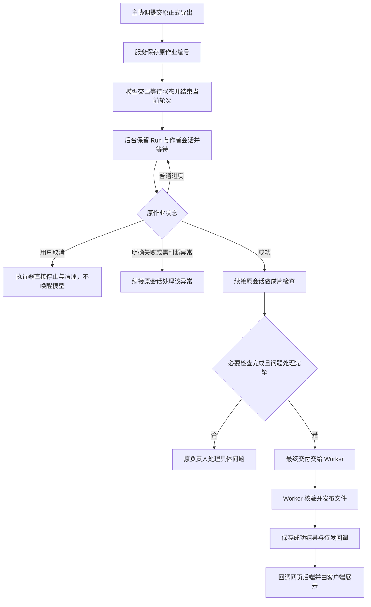

# 保效果与全链路提速：五个优化方向及落地方案

日期：2026-10-15。源码核对基线：`394fe4f`，对应当前 0.1.10 制作实现；效果恢复的对照基线为 `a128eee` 的 0.1.8 技能及此前测试作品。

**本文是新方案文档，不代表代码已经修改、服务已经部署或成片已经重新验收。** 本轮只编写本文，保留原方案文档。下文写“新增”“改为”“应当”的内容均为拟实施设计，接口示例不是当前已发布接口。

阅读顺序：第一节看整体取舍，第二至六节逐个解释五个方向；每个方向先讲问题，再讲做法。第八至十节供开发和验收使用，可以在理解方向后再看。

## 一、先说清楚这次要解决什么

用户已经确认的方向是：恢复之前经过测试的专业制作知识，把不需要模型判断的登记、派单和等待交给程序；不能通过长字幕、减少动作、降低画质或少做必要检查来提速。

**声音时间表本轮不加。** 不新增供应商时间戳采集、时间编译器、统一动作节点系统，也不把所有配音统一改成长句或短句。先恢复旧版关于自然分段、字幕对齐和连续演出的完整方法，沿现有音频与时间线能力制作，再以实际作品验证。

### 1.1 五个方向

| 方向 | 问题是什么 | 解决方案是什么 | 用户应看到的变化 |
|---|---|---|---|
| 1. 恢复专业技能知识 | 字幕、声音分段和动效演出的方法被压缩，制作容易只做到“有字幕、有动画” | 恢复旧版必要正文和例子，保留当前可执行接口 | 字幕能读清，动作跟随讲述推进，画面不会开头动一下后一直等 |
| 2. 审片 MCP 与连续领活 | 审片者猜参数，主协调反复搬运结果、登记、再派任务 | 用少量明确字段提交；后台原子保存并返回下一章 | 审片者连续工作，主协调只处理问题和返修 |
| 3. 局部返修、对应复查 | 改一张字幕或一个图形，被扩大成全片重复检查 | 对比真实变化，按范围和检查目的重新安排 | 改哪里及其真实影响查哪里，保留仍有效的结论 |
| 4. 程序等待导出并唤醒 | 模型反复查进度；停止当前轮次又会关闭会话 | 保存等待记录，后台监听原作业，完成或异常才续接原会话 | 等待时不反复推理，完成后继续审片，Worker 自动回传结果 |
| 5. 按角色加载、减少重复上下文 | 父子会话混入无关技能、完整历史和重复目录 | 保留完整知识，限制无关发现，按职责读取，沿原作者续接 | 该懂的方法仍完整，额外说明和无关历史减少 |

媒体分块绘制、完整 Composition、全局帧、连续音轨和视频码流复用继续保留。重复技术核验作为后续小范围优化，不单独再造渲染体系。

### 1.2 已有证据与判断边界

| 已确认的现象或机制 | 能说明什么 | 不能据此声称什么 |
|---|---|---|
| 此前记录中，Render 创建到发布约 41 分 32 秒，正式媒体作业约 5 分 44 秒 | 大部分时间在正式导出之外，应先查制作、审片和协调 | 导出前的时间并非全是浪费，不能全部删除 |
| 0.1.8 样本为 36 段配音、36 张字幕；新样本为 18 段、18 张；最长字幕由约 30 字变为 72 字 | 本次作品确实出现更长的声音与字幕单位 | 两个样本时长和分镜不同，不是严格性能对照实验 |
| “五层模型”新源码把多个推进点绑定同一句段起点；旧作品有不同的推进位置 | 声画设计与时间消费确有退化风险 | 不能把旧片秒数搬进新片，必须使用本次实际配音 |
| 无 `captionTiming` 时，校验器要求一段音频对应一张字幕卡 | 只恢复一句“字幕要短”不能改变程序限制 | 不能声称恢复技能后任意长音频都自动支持多卡 |
| 审片记录目前由文件读改写保存，且需逐项登记分派 | 简单增加并发提交可能覆盖记录 | 加一个 MCP 外壳并不等于解决调度和存储 |
| 目前导出已有状态落盘和通知，但执行器只接受最终交接并关闭会话 | 可以复用现有媒体事件，补齐会话等待机制 | 当前并没有完整实现“模型暂停后自动续接” |

以上作品数据来自此前核对过的运行记录与源码，不是本轮新做的连续看听验收。本轮没有重新访问生产服务器或重新生成视频。此前记录中“创建到模型完成”的约 40 分 52 秒，与“创建到发布”的约 41 分 32 秒口径不同，后续报告必须分开。

### 1.3 为什么按这个顺序改

1. 先恢复专业知识，建立效果基线，否则更快地生成效果退化的视频没有价值。
2. 再把审片协议、记录和连续领活交给程序，消除已确认的参数错误与交接空档。
3. 在可靠审片记录上计算局部复查，避免“少看了”却不知道遗漏了什么。
4. 补导出等待和原会话恢复，保留最终带声检查与现有发布链路。
5. 同步修正角色加载和真实子线程检查，减少上下文，但不再压缩专业方法。

这部分记录的是方案的判断依据和取舍。正式导出即使缩短一半，本次样本也只省约 2 分 52 秒；不应继续优先提高渲染并发，更不能提前承诺整条流程一定降到某个分钟数。

## 二、方向一：恢复已经验证的专业技能

### 2.1 问题与判断依据

旧知识并没有从仓库消失。字幕、配音、动效时机、演出设计、案例机制、美术、Remotion 的七份原始技能，及重要参考文件，仍保留在 `.agents/skills/`。此前核对表明相关原文与 0.1.8 基线一致。

当前模板生产发行改从 `.agents/skills/_shared/template-production/` 获取精简入口和共享说明。部分基本原则仍然存在，但具体判断方法、正反例与失败诊断被明显压缩。

因此应恢复原有方法，不能再用一句“注意对齐”“保持连续演出”替代完整知识；也不能把本次问题简单归结为模型没有认真执行。

### 2.2 具体恢复哪些内容

| 专业内容 | 必须恢复的方法与例子 | 必须避免的误解 |
|---|---|---|
| 字幕分卡 | 字幕卡是阅读单位、声音句群是声音单位、场面是观看单位；按语义分卡；保护否定词、人名、数字和单位；结合真实字号与停留时间复核 | 不按标点机械切卡，不用缩字、挤字掩盖过长字幕 |
| 声音分段 | 恢复“过短会碎、过长难演”的两面判断；完整句、转折、列表项、问答和重要视觉边界可作为自然边界；读出来确认 | 不默认全部短句，也不把完整句群理解为越长越好 |
| 动效与讲述关系 | 提前建立、与结论共同落定、听到后回应、解释期间保持参照；恢复数字、列表、比较、因果等例子 | 动作开始不等于动作落定；不能把所有动作放在句首 |
| 连续演出 | 主体变化、持续参照、画内文字、观察位置和接管共同发展；检查关键中途、交叠、惯性和收势 | 背景漂浮、淡入、微移不能替代尚未完成的主要内容变化 |
| 机制借用 | 搜索主行为和关系；做对象映射；解释顺序、并行、嵌套、交叠怎样连接；删外观时保留必要关系 | 检索结果不是完成的演出方案；仅剩淡入不能叫完整复现 |
| 美术与实现 | 恢复必要的中文排印、材质、真实字形、空间坐标、源时间和跨段状态延续方法 | 不因为恢复旧知识就重置逐镜时钟，或恢复旧项目接口 |
| 质量判断 | 恢复专业检查目的、失败诊断与真实观看要求 | 静帧合格不能替代运动、换卡、声音与声画同步检查 |

“五层模型”的验收例子：观众应先认清整体，再随讲述理解前四层，最后把注意力转到应用层。允许作者设计提前建立、交叠和惯性，但三个意思不能在第一秒同时演完后只等待字幕。

另一个必须恢复的诊断是：**动作结束后长时间只有字幕变化，应检查后续信息是否缺少画面发展。** 有表达作用的静止可以保留，不要求每个对象始终移动。

### 2.3 如何恢复，避免维护两份相同知识

1. 以 0.1.8 原文及当前保留的原文件为依据，列出“保留、迁移、仅调整接口、排除旧操作”的对照表。
2. 已经独立成篇、没有旧接口依赖的专业参考，继续作为唯一正文，不重新复制成第二份维护源。
3. 原 `SKILL.md` 中混有操作流程的专业章节，原文迁入所属技能的 `references/` 方法文件；原位置改为引用，删除重复正文。只分离知识与操作，不再次摘要化。
4. 模板生产入口引用同一专业方法；模板专用的任务身份、工具参数、提交和恢复规则仍放在 `template-production` 中。
5. 现有模板参考中与完整方法重复的教学段落，改成链接和必要的服务差异说明，避免同一角色重复读两遍。
6. 扩展现有发行 manifest，显式列出专业源文件映射。允许源来自 `.agents/skills/` 中的明确清单，继续验证真实路径、禁止越界、检查引用闭包；不放开任意目录复制。
7. 沿现有同步脚本生成 `plugins/textvideo-studio/skills` 和阶段副本，不手改发行副本或已安装缓存。

涉及其他工作流的原入口只做知识移入参考后的等价引用，不能顺带改写其他插件业务。构建不得用正则临时删除旧工具名来拼装技能。

### 2.4 哪些旧内容不恢复

- 已不适用的旧 Project、Revision、Cue、SpeechAsset 写入操作。
- 旧 OmniVoice、本地音色、FunASR 字幕工具等作为当前模板能力的承诺。
- 已移除的向量检索、历史工程分析和旧工具参数。
- 全部作者开工先读全部技能、整库图片或历史成片源码。
- 逐镜从零计时、重复绘制或重复编码的旧媒体流程。

删除范围仅是这些过时操作或重复正文；专业方法、必要实例和质量要求尽可能完整保留。

### 2.5 本轮不加声音时间表的真实边界

现有程序没有可靠对齐记录时，仍要求一段音频对应一张卡。本轮不放宽校验、不按字符比例伪造时间，也不新造一份“看上去完整”的对齐 JSON。

制作先沿恢复后的方法选择自然、可演出的分段，并使用本次真实音频边界；已有真实可靠的对齐资料可以按当前合同使用。具体音频若仍不能满足字幕或关键动作需要，应明确指出该处能力缺口、由原作者调整相应范围，不全片重配，不自动引入被暂缓的时间系统。

**验收可能发现仅恢复知识还不够。** 届时记录可复现的具体限制，再单独讨论最小修复；不能预先把复杂时间系统塞回本方案，也不能声称只改技能就保证所有问题消失。

### 2.6 完成标准与代价

- 对照表能证明必要原文和例子进入实际发行，而非仅留在仓库。
- 全新制作的相关作者实际读到完整方法；局部修改不会无条件重读整套知识。
- 原测试内容重新制作后，字幕可读、声音自然、关键动作跟随本次实际讲述。
- 实际连续看听记录与技术验证分别保存；未看、未听的范围保持未完成。
- 代价：对应作者会比精简版读取更多必要知识，这是恢复质量的合理成本；通过方向五减少无关内容，而不是再次删专业知识。

## 三、方向二：精简审片 MCP，让审片者连续工作

### 3.1 问题与方案选择

现在的问题包括协议示例不完整、模型手工拼证据、文件读改写不适合并发，以及每完成一章都需要主协调接回、登记、再分派。

只把 `review.cjs` 包成 MCP，能改善参数提示，却不能解决后面三件事。因此选择：**复用现有 Runtime 和 SQLite，增加小范围审片服务；模型负责观察，程序负责保存和领活。** 不增加独立服务、消息队列或通用多代理平台。

继续保留“每位审片者一个活动章节包”。消除等待的方法是完成后自动领取下一包，不是同时给一个审片者塞入很多活动任务。

### 3.2 四个操作及必要输入

以下为拟定合同，最终由同一份 Zod Schema 生成 MCP 参数、服务校验和示例。

| 操作 | 谁使用 | 模型需要提交 | 服务返回 |
|---|---|---|---|
| `prepare_review` | 主协调 | `renderRequestIds`、`phase`；只有无法从服务记录定位时间线时才提供 `timelineRef` | `reviewId`、检查包数量、缺失材料或能力 |
| `claim_review_work` | 审片者 | 空对象；会话已绑定当前唯一审片计划 | 当前分派凭据、完整章节范围、检查要求和必要证据 |
| `submit_review` | 审片者 | `assignmentToken`、`observations`、`issues`、`status` | 是否接收；部分提交返回剩余要求，完成提交直接返回下一包 |
| `read_review` | 主协调或恢复处理 | `reviewId` | 总体状态、剩余数量、阻断问题及异常，默认不展开历史 |

`phase` 只区分导出前检查与正式成片检查，决定应提供哪些材料和检查要求；不让模型自行删除必要检查。具体专业检查仍沿现有质量方法安排。

`timelineRef` 不能无理由重复索取：正式导出作业已有该引用；静帧作业当前只有帧列表，没有时间线引用。服务优先使用同快照已登记的核验记录，确实缺少时才要求主协调补一个快照内路径，并核对其中场景与确认正文。不能为了少一个字段而猜时间线文件名。

检查包从真实时间线生成。存在已核验的章节划分时按章节组包；没有章节资料时按实际分镜组包，不让程序猜故事结构，也不让模型重复手填每个场景的范围。

重复领取时返回该审片者已有的活动包，不报错迫使模型猜恢复方式，也不再领取另一包。修订后建立新计划时，由 Runtime 显式更新会话绑定并撤销过期分派，不能让工具自行选择“最新一份”造成跨版提交；本轮不增加一个会话同时选择多个计划的功能。

### 3.3 提交字段进一步展开

| 字段 | 必要内容 | 不需要重复的内容 |
|---|---|---|
| `assignmentToken` | 服务发出的本次分派凭据，绑定版本、范围、审片者与代次 | `runId`、`reviewId`、`unitId`、作者自报身份、源码摘要 |
| `observations` | `checkId`、`evidenceId`、简短真实观察；连续媒体另带实际观察范围 | 图片路径与 SHA 拼接串、整段材料原文、每项重复的通用规则 |
| `issues` | `checkId`、`evidenceId`、`severity`、`problem`；问题区间在需要时提供 | 无问题时的占位描述；强制的 `expected`、长篇修复计划 |
| `status` | `partial` 或 `complete`，表示本检查包的观察是否完成 | 把这一包完成扩写成“全片所有检查通过” |

连续媒体范围统一使用当前完整 Composition 的 `[fromFrame, toFrame)`，即含起帧、不含止帧；检查包提供时间换算，模型不重新估算。静帧的帧号由证据登记提供，不另填范围。

每个 `checkId` 明确需要静帧、连续观看、听审或同时看听。例如字幕布局不能代替字幕换卡，单独听音频不能代替声画同步。对同一张图的不同检查目的可以共享图像，但结论分别保存。

完成条件逐个 `checkId` 计算：该项目要求的证据必须齐全，连续观察区间不能有空洞，不能借用另一检查目的的覆盖。观察与问题必须属于当前分派，问题落点必须位于实际观察范围。发起读取或播放请求不等于已经看完、听完；缺少观察能力时保持 `partial`，服务返回尚欠项目、范围和已知原因，不编造已完成记录。

示例为导出前静帧检查，字段值均来自实际领取的检查包：

```json
{
  "assignmentToken": "服务返回的当前分派凭据",
  "observations": [
    {
      "checkId": "caption-layout",
      "evidenceId": "ev-102",
      "note": "字幕第二行与图表底部数值重叠，数值单位看不完整。"
    }
  ],
  "issues": [
    {
      "checkId": "caption-layout",
      "evidenceId": "ev-102",
      "severity": "blocking",
      "problem": "字幕遮挡比较数值，影响理解。"
    }
  ],
  "status": "complete"
}
```

示例只有一个应查证据；实际检查包有更多要求时，不能照抄 `complete`。`observations` 证明做了哪些检查，`issues` 供修订与阻断判断，两者用途不同。没有问题时 `issues` 为空，不能省略实际观察记录。

保留现有严重度语义：`blocking` 阻断交付，`warning` 须明确处置，`suggestion` 不自动要求返修。声音与关键动作缺陷按真实影响判断，不能为提速降级。

### 3.4 服务自己处理哪些资料

- 真实任务、当前版本、章节范围、分派代次：从计划和分派反查。
- 审片者身份与权限：从运行时创建的会话凭证取得，不能相信模型自报 `agentId`。
- 证据访问位置、摘要、对应快照：服务验证并登记。模型查看材料仍需要短引用或访问路径，但不再手工回填路径和哈希。
- 时间戳、重试次数、完整历史：内部保存，正常回复不回显。
- 重复提交：按“分派代次＋规范化提交正文摘要”去重，不要求模型编造 `submissionId`。

成功回复只含当前有用的接收结果和下一包；异常回复保留 `code`、中文原因、确有问题的字段及可执行下一步，不塞满空值，不返回多层转义的 JSON 字符串。

### 3.5 真实身份目前缺什么，如何补齐

当前 MCP 只携带 Run 级身份，同一生产会话共享配置，尚不能证明某条审片结果确实来自指定审片线程。因此不能直接删除 `reviewerAgentId` 后假定身份问题已解决。

具体落地：

1. 主协调准备检查材料和审片计划；Runtime 按实际可用名额启动有界的只读审片会话。
2. 复用当前 App Server 连接方式，为每位审片者提供独立的审片凭证，绑定真实线程、Run、角色和当前唯一计划；名额不超过现有配置和宿主实际剩余容量。
3. 凭证通过工具连接环境传入，不写进模型提示词，不继承制作会话的生成、渲染和发布权限。分派凭据还必须与该会话身份匹配。
4. 先验证当前宿主是否支持线程级 MCP 配置隔离；支持则复用一个连接，不支持才使用独立连接承载审片者。实际调用必须验证越权被拒绝，不能只看配置文字。
5. 审片者只读工程，通过审片 MCP 保存 QA 记录；正式源码和项目修改仍由原作者及主协调按现有合同负责。

这是实现前的必要技术验证，不是另外创建一个新的“成片 Agent”。不能用模型填写的身份或提示词中的“你是只读”代替实际权限。

### 3.6 最小存储与原子续领

复用现有 SQLite，拟增加四张小表，不另建素材数据库：

| 表 | 保存什么 | 必要约束 |
|---|---|---|
| `reviews` | Run、快照、阶段、证据索引及计划状态 | 相同有效输入返回原计划，不清空进度 |
| `review_work` | 章节范围、检查要求、累计覆盖、问题、负责人、分派代次、状态 | 同一审片者最多一个活动包；同一包只归一个当前负责人 |
| `review_sessions` | 审片凭证摘要、真实线程、权限与失效状态 | 凭证不跨 Run 使用，撤销后不能继续更新 |
| `review_submissions` | 分派、正文摘要、原始提交与原响应 | 同分派同正文只处理一次，可恢复丢失的响应 |

图片、视频和完整工程继续保存为受管文件。文件检查在事务外进行，进入短事务后复核计划仍有效；事务内不读大文件、不调用模型、不等待网络。

一次完整提交在同一事务中完成：认证并确认有权读取原分派 → 按原分派和正文摘要查已接收记录 → 重复则返回原接收结果 → 新提交才校验当前代次 → 累积实际覆盖 → 保存问题 → 验证本包能否结束 → 标记结束 → 领取下一包 → 保存本次响应。事务失败则整体不生效。幂等查回必须在新提交的代次校验之前，否则正常完成后的重试会被误认为过期提交。

- `partial` 累积进度，不抹掉已有观察，也不提前领取下一章。
- `complete` 只结束实际检查已齐全的包；有问题可以结束观察，但问题仍阻断后续质量门。
- 完成提交响应丢失后重试，返回原先的下一包，不再领取第二包。
- 原响应中“下一包”的分派如果已撤销，返回原接收结果并标明该下一包凭据不可继续使用，不把过期凭据作为新任务发出。
- 旧负责人、旧版本或旧代次的新结果仅保存为迟到记录，不能覆盖当前结果。
- 同一版本、同一证据、同一检查项的不同真实问题都应保留，不能仅按类别合并而丢失其中一个；只对确实相同的报告去重。

### 3.7 替换范围、验收与代价

新服务成为新 Run 的审片状态唯一来源。原 QA JSON 保留为审计导出，不再作为多代理共同修改的主状态；删除新流程中的手工 `assign/result/takeover` 文件交接要求，不长期维护两套写入链路。历史 QA 文件保留可读。

验收必须覆盖：并发提交不丢结果；重复完成不多领；部分结果可续接；迟到结果不污染当前版；错误字段有明确提示；静帧不能冒充听审；无材料、无能力不能假通过。实际审片者应完成至少两个连续检查包，证明没有主协调逐项再派单。

代价：需要小规模数据库迁移和真实会话权限验证。该代价用于消除已确认的并发和身份问题，不扩展为通用任务平台。

## 四、方向三：局部返修只重查真实受影响部分

### 4.1 问题与取舍

当前 `affectedReviewUnits()` 对字幕变化返回全部单元，对普通场景修改附带前后整章，范围过大。反过来，完全相信作者说“只改两处”也会漏掉共享字号、公共组件或前段时长带来的影响。

采用折中但可验证的办法：**程序对比真实文件与结构差异；作者声明作为定位线索；已知局部变化精确复查，无法确定的代码影响保守扩大相关检查。** 本轮不开发通用源码依赖分析器。

### 4.2 复查的最小单位

每条结论至少绑定：快照版本、范围、检查目的、实际证据、相关依赖。模型不必填写这些内部字段，服务从检查包取得。

例如“第 3 章通过了”太粗；“当前版本这张字幕的布局已看过，且没有遮挡”才是可以判断是否仍有效的结论。

### 4.3 服务怎么判断变化

1. 以两次冻结快照为准，比较文件摘要，不能比较仍在写入的工作目录。
2. 对已知结构读取真实差异：字幕文字和起止位置、场景时间范围、配音文件摘要、图形或场景数据、共享字体和组件。
3. 使用一份小型明确依赖清单，记录本模板哪些数据属于某场景，哪些资源是共享的。清单由模板适配维护并用实际引用核对，不只依赖作者自报。
4. 作者提交的修改说明帮助定位，但不足以缩小程序发现的影响范围。
5. 无法归属的源码变化，扩大相关视觉或时序检查，并说明原因；不要宣称能自动精确解析所有动画代码。

作者完成返修并生成新证据后，主协调再次调用 `prepare_review`。服务找到同 Run 的前一计划，对比两版冻结材料，建立新计划并关联仍有效的旧结论，只把失效部分放回待审范围。模型不再额外填写 `subtitles: true` 等粗粒度影响开关，也不手工重标全部章节。

### 4.4 按变化安排检查

| 实际变化 | 应重新检查 | 可保留的工作 |
|---|---|---|
| 一个图形的位置 | 所在范围的布局、运动途中共存状态、涉及的进出接点 | 未变音频及其技术核验、无关场景 |
| 一张字幕断行，时间未变 | 该卡、背景叠加及实际阅读；换卡呈现变化时补相关连续片段 | 配音文件、无关动作和字幕 |
| 字幕出现或消失时间 | 该卡与相邻换卡、对应声音、覆盖到的画面关系 | 未变音频生成结果 |
| 全局字体或字号 | 实际使用该样式的文字布局、阅读和重叠 | 音频内容与未受影响的声音结论 |
| 某场景动作曲线 | 受影响运动区间、关键中途、语义落点和接管 | 无关场景及其静态结论 |
| 前段配音时长或全局偏移 | 相关声音、后续全局对齐、字幕与接点 | 未变的音频文件，不重新请求全部配音 |
| 共享组件或无法定位的源码 | 受影响组件的使用范围；无法确定时扩大相关视觉检查 | 能证明独立且未变的声音检查 |

“相邻接点”是实际退场、转场、接管和持续对象经过的区间，不是固定前后一整章。范围从当前时间线和演出材料取得；缺少可靠接点范围时保守检查相关过渡，不猜固定几秒。

### 4.5 什么时候可以复用结论

- 图片字节相同、显示条件相同、检查目的相同，可以复用这张图支持的静态观察。
- 图片相同不能证明两张图之间的动作相同，也不能证明声音和动作同步。
- 音频字节相同可以复用针对音频本身的有效核验；如果摆放位置或相邻关系变了，仍要检查连续性和同步。
- 当前版本的技术检查仍核对正文、时间线和绑定关系；不能只把旧报告的源码摘要改成新值。
- 复用记录保存原结论引用和等价依据，不复制一份“本次已重新看过”的假观察。

导演负责跨章推进和整体观看关系，专业审片者负责分配的检查目的。主协调只处理冲突和阻断问题，不默认把所有图再看一遍。确实出于不同目的重复观察时，应说明目的。

### 4.6 完成标准与代价

用字幕断行、图形位移、全局字号、前段时长、未知共享代码五类返修测试覆盖范围。局部案例不能无故全片重查；全局案例不能漏掉真实影响。

代价是保守回退仍可能多查一些范围。它比开发复杂源码推断系统更容易验证和维护。本文明确此边界，实施不能暗中以“不确定”当成“未影响”。局部复查范围缩小，也不代表本轮已实现只重绘对应几个媒体块。

## 五、方向四：导出等待交给程序，完成后继续原任务

### 5.1 当前链路缺哪一段

目前已有异步媒体作业、状态文件、通知和有界等待查询。缺少的是：模型结束当前轮次后，后台仍保留同一 Run 和作者会话，在作业完成时继续下一轮。

现有 `codex-session.ts` 的正常结束路径会关闭 App Server，`runner.ts` 把执行器返回值当作最终交付。因此不能仅删除轮询，也不能无限延长 MCP 调用来替代会话生命周期管理。

### 5.2 新的完整调用链



同一个 Render Run、同一份确认输入、同一批持续负责的作者继续工作。普通百分比或分片进度不唤醒模型；原作业成功或明确失败时续接必要判断。取消由执行器直接停止和清理，不为取消再开启模型轮次。

### 5.3 最小等待协议

模型在正式导出已受理、没有其他独立工作可做时，返回以下非最终结果：

```json
{
  "kind": "await_runtime",
  "renderRequestId": "当前已经受理的原导出编号"
}
```

这里只需要种类和原作业编号。Run、线程、当前轮次、作业尝试代次、材料引用和恢复状态由执行器保存，不让模型填写 `wakeId`、事件序号或整份检查点。

最终交接使用 `kind: "final"`，保留现有交付身份和 `resultPath` 核验。`await_runtime` 不能进入发布、不能产生成功回调，也不能被当成结束整条任务。

### 5.4 执行器和会话怎么改

1. 把 App Server 的所有权从“一轮模型调用”上移到“当前 Run 的会话控制”。新增一个小型 `execution-controller.ts` 管理循环，不另造任务平台。
2. `executeCodex` 内部可以执行多轮：制作轮次 → 等待 → 成片检查轮次；对外只有最终交接才返回给现有发布路径。
3. 每次轮次结束清理该轮监听器，但保留连接、主线程、作者线程及材料。只有最终收尾、取消或不可恢复关闭才回收整个会话。
4. `runner.ts` 在等待期间继续维护活动 Run、心跳、取消和媒体工作；不得提前进入 `finishing` 或停止原导出。
5. 对外任务仍为 `running`，内部检查点记 `waiting_media`、`reviewing_final` 等阶段，先不扩展网页公共状态枚举。
6. 主协调有其他不依赖导出的工作时可以先做；只有纯等待阶段退出推理。审片者若还有已分配工作，也不能因主协调等待被一并终止。

等待仍占用现有 Run 活动名额；本轮不改变四任务容量计算，只减少等待时的模型调用。这一取舍避免因“释放名额”引入新的媒体超额并发。

### 5.5 如何防止漏通知和重复唤醒

- 等待记录先持久化，再登记通知监听，并立即读取原作业状态；已经完成就直接进入续接流程，不等下一次通知。
- 每次等待保存内部 `waitId`，可由发起等待的真实主线程与轮次派生；同时记录等待中、续接已发起或已接回的状态，以及取得后的实际续接 `turnId`。这些不进入模型必填字段。
- 媒体完成时先写可靠状态，再通知等待者。现有内存通知用于及时唤醒，持久化状态用于恢复，不能只依赖内存事件。
- 给原作业的每次实际尝试保存代次，内部以“Run＋作业＋尝试代次＋终态”关联一次唤醒，进度变化不产生新轮次。
- 开启下一轮前记录唤醒意图，获得响应后把实际 `turnId` 绑定到对应 `waitId`。同一线程同时只允许一个活动轮次，不把同一作业终态误认为多个等待都已消费。
- `turn/start` 响应丢失时，先读取原线程核对已启动的轮次；无法证明是否已启动则保留结果未知，不能再启动一个重复轮次。
- 续接同线程时，要过滤旧轮次迟到事件；新轮次事件早于启动响应时先缓冲并核对身份，不能把旧 final 当成新结果。
- 等待与续接状态使用 repository 原子比较更新；心跳只更新时间。现有检查点是浅合并，更新嵌套 `codex` 或等待对象时必须保留原字段，不能覆盖作者句柄或恢复记录。

外部启动模型轮次与本地数据库不在同一事务里，因此不承诺跨进程天然“严格一次”。目标是记录关联、查询确认，在结果未知时不重复启动有副作用的工作。

无需增加独立消息队列。执行器必要时可以用程序级状态核对兜底，这不消耗模型推理；不能把这种后台核对再次包装成模型每分钟询问。

### 5.6 连接故障与重启如何处理

| 情况 | 处理方式 | 不应发生的行为 |
|---|---|---|
| 正常导出，暂无新决定 | 程序等待，保留原会话 | 模型反复问进度 |
| 用户取消等待中的任务 | 执行器停止原工作并清理，记录取消 | 为取消新开模型轮次或发布结果 |
| 通信连接正在重试，原线程仍工作 | 记录具体线程与重试状态，继续核对原线程 | 立即另起一个作者或重复审片者 |
| 审片线程明确停止且不可恢复 | 作废旧分派，保存已完成覆盖，只接替剩余只读检查 | 全片重审或重新配音、导出 |
| 作者写入线程异常 | 先确认旧写入已停止，再处理原材料和恢复 | 两个作者同时修改同一工程 |
| Worker 重启，原媒体已明确完成 | 读回原结果；按部署版本实际支持的线程恢复协议续接 | 重新提交媒体作业 |
| 记录为运行中，却无法确认原媒体进程 | 保留 `unknown` 并提供诊断，先核查原结果 | 换作业编号盲目重做 |
| 原媒体明确失败且已有恢复入口 | 沿原编号、原快照恢复允许的缺失部分 | 全部重启或自动重新收费生成 |

必须对当前部署的 App Server 协议做实际验证。正常等待可以保留进程；进程丢失后能否完整恢复子线程，不能只依据存了线程 ID 就保证。无法恢复的部分如实记录，不能假装原作者还在线。

### 5.7 导出成功以后谁发给客户端

责任不变：**模型及专业审片者完成判断，Worker 完成发布和结果投递。**

| 环节 | 负责人 | 完成依据 |
|---|---|---|
| 文件生成 | 媒体作业 | 原作业明确成功，输出清单完整 |
| 成片质量检查 | 原导演、对应作者及审片角色 | 真实观察、必要范围完成、问题已处理 |
| 发布文件 | Worker 的 `publishDelivery` | 身份、快照、文件及媒体要求核验通过，生成访问地址 |
| 保存成功与通知 | `ProductionRepository.finish` | 同一事务保存结果和回调事件 |
| 发给网页后端 | `CallbackSender` | 调用现有结果回调接口，对方明确接受 |
| 显示在网页 | 网页后端及客户端 | 保存收到的结果，按网页已有展示机制呈现 |

现有渲染回调接口为 `getAiVideoEditingDataCallback`。本方案不增加模型直接发客户端消息的路径，也不假设网页已经支持某种新的实时推送方式。

**本次新增专业审片完成校验；当前发布只有技术核验。** 发布前应由服务检查本次成片所需审片记录与当前文件版本相符，不能仅凭模型写入 `checks` 文本就认定完成。未实际完成的关键连续看听保留待检查状态；不能用“已生成文件”代替“成片质量合格”。

### 5.8 通知失败不能让视频重做

现有回调队列、签名、有限退避重试和人工重投接口继续使用：

- 网络超时等可重试错误只重发原通知，沿用原事件编号和正文。
- HTTP 成功还需对方返回约定的业务成功结果，不能仅凭 HTTP 200 宣称投递成功。
- 超过重试上限或业务明确拒绝后，保留诊断和未送达记录。
- 允许“视频已发布、通知尚未送达”分别展示；重投不调用模型、不配音、不渲染。
- 网页接收端应按事件编号去重、按任务版本处理迟到结果。需在联调中验证，不能因 Worker 带了版本字段就声称网页已正确处理。

## 六、方向五：按角色加载完整知识，减少无关上下文

### 6.1 问题与判断依据

当前已有 Analysis/Render 阶段隔离，但阶段配置并不等于每个真实子线程都只收到正确内容。此前记录发现子线程出现额外插件目录，部分作者继承完整父历史，目录和历史材料重复进入上下文。

还要区分三件事：技能登记为可发现、技能正文实际读取、父历史已经携带正文。这三项不能混为“加载次数”。此前记录不能证明所有技能都在同一会话反复读取，不能把正常的不同作者各自阅读也算浪费。

### 6.2 具体加载规则

| 角色 | 默认获取 | 按实际需要补读 |
|---|---|---|
| 主协调 | 运行合同、角色责任、当前材料引用、问题与状态 | 与争议或异常有关的具体资料 |
| 导演 | 完整当前稿、采用设计、整体推进和场面方法 | 需要判断的声画、机制及跨章关系 |
| 视觉作者 | 当前完整视觉设计，美术、演出、动效时机和实现方法 | 采用的机制详情、特定空间或证据表现方法 |
| 声音／字幕作者 | 当前全文、自然分段、字幕与声音方法、实际音频材料 | 对应声音收尾或局部对齐问题 |
| 审片者 | 本检查包、对应专业方法、真实证据和必要上下文 | 具体问题涉及的设计依据及相邻关系 |

“按需”不等于作者只看到自己的孤立一句话，也不等于把方法压成几句话。完整动态场面制作应读取完整相关方法；纯局部修字沿现有设计，只读取对应部分。

### 6.3 代码与交接如何落地

1. 沿用阶段 manifest 和发行机制，在其中明确角色所需入口与参考，不另建技能注册系统。
2. 核对实际宿主是否支持对子线程单独约束发现目录。支持时在创建前设置；不支持时，明确只能做到阶段目录隔离与角色正文按需，不作更强承诺。
3. 归一化 `thread/started` 与实际 `subAgentActivity` 中的线程信息，为每个真实主、子线程保存有效目录和能力证据；不能只检查根线程。
4. 优先让新作者按受管材料引用取得当前稿、设计和必要接口，不默认继承父会话整段图片、失败日志和状态查询历史。现有持续作者正常返修时继续使用，不每次重建空白作者。
5. 输入变更交真实差异、当前完整稿引用和受影响部分；不能只换版本号重发旧材料。
6. 返回主协调的是采用结论、具体问题、当前产物引用和待办；全文仍完整保存，需要时可读。
7. 审片工具默认返回当前包及简短汇总，详细历史按需获取。插件系统强制存在且无法去除的条目如实报告，不假称目录已完全净化。

### 6.4 验收与代价

真实启动导演、视觉、声音和审片线程，逐个核对实际可发现目录、实际读取正文和继承内容；确认外部无关插件不再被错误注入，或明确记录无法控制的宿主边界。

计量分开记录：目录条目、唯一正文、重复正文、首轮输入、峰值上下文、失败日志量和作品质量。不能只以总 token 更少判断优化成功。

代价：减少整段历史继承后，交接材料必须完整准确；遗漏材料会造成补读。因此交接优先保证作者能完整理解当前作品，不用缺上下文换取表面节省。

## 七、保留有效媒体层，谨慎复用重复核验

现有分块画面按完整 Composition 的全局帧绘制，整片及分镜复用视频码流，连续 PCM 音轨按当前严格规则处理。这些保留，不再改回逐镜时钟、不降低规格、不继续盲目提高并发。

重复音频核验和发布完整解码可以后置优化，但必须使用服务生成的核验依据：

1. 区分“音频文件本身未变”和“该音频在当前时间线的摆放未变”。前者可复用解码时长等结果，后者仍需核对当前结构。
2. 相同媒体字节、相同验证规则及参数、已有成功核验记录时，可以复用昂贵的完整解码；只认服务记录，不认作者自填的“已验证”。
3. 文件摘要、发布身份、文件完整性和复制后摘要仍核对。缺记录、字节改变或规则升级时重新核验。
4. 技术解码复用不能替代最终实际声画审查；不能把静帧结论扩成完整视频结论。
5. 只在前四项能明确实现和验证后减少对应重复调用，不先删除检查再补解释。

该部分使用现有媒体、音频审计与发布模块的小范围修改，不新增通用缓存服务。

## 八、工程落地清单与替换范围

所有新增文件名为建议落点，开发时可按现有结构合并，不能为了目录整齐拆出不必要的层。

| 范围 | 修改或新增位置 | 具体职责 |
|---|---|---|
| 专业知识恢复 | `.agents/skills/` 对应业务技能与方法参考 | 保留原文方法，分离旧操作，建立唯一正文 |
| 模板入口与发行 | `template-production/manifest.json`、入口和参考；`skill-manifest.mjs`、`sync-skills.mjs` | 专业源显式映射、角色路由、闭包和字节一致性 |
| 审片合同与服务 | 拟新增 `packages/production-service/src/review-service.ts`；沿用 `review-policy.ts` | 同源 Schema、材料登记、领活、提交、汇总、质量门 |
| 审片存储 | `packages/production-service/src/repository.ts` | 四张小表、短事务、幂等和历史隔离 |
| MCP 与鉴权 | `apps/server/src/mcp.ts`、`production/speech-tools.ts`、`production/routes.ts` | 工具注册、最小字段、角色凭证、结构化错误 |
| 局部复查 | `review-policy.ts`；复杂度需要时才独立 `review-invalidation.ts` | 真实差异、明确依赖、检查维度失效与复用依据 |
| 等待与续接 | 拟新增 `execution-controller.ts`；修改 `codex-session.ts`、`turn-events.ts`、`runner.ts` | 多轮执行、Run 级会话生命周期、等待检查点、恢复 |
| 媒体完成通知 | `production/routes.ts`、`run-work.ts` | 先落盘后通知、区分普通进度与终态、原作业代次 |
| 通信与角色证据 | `tool-observer.ts`、`codex-session.ts` | 线程级错误、恢复状态、子线程实际发现与加载记录 |
| 交付与回传 | `delivery.ts`、`registered-video.ts`、`callbacks.ts`、`web-contract.ts` | 发布前质量依据、可信技术复用、保持原回调结构 |
| 实际执行说明 | `task-instructions.ts`、模板运行参考、必要的模板打包说明 | 说明当前真实工具和职责，删除旧手工协调及模型轮询要求 |

### 8.1 本轮明确删除或退出活动路径的逻辑

- 新 Run 中由模型手填审片 JSON 文件并让主协调逐项 `assign/result` 的路径。
- 多代理共同读改写 QA 文件的主状态模式；JSON 改为审计产物。
- 字幕变化一律全片复查、普通场景修改一律附带前后整章的规则。
- 正常导出期间模型反复询问进度、每轮结束关闭整个作者会话的路径。
- 模板技能中与唯一专业正文重复的压缩教学，以及已过时的工具操作承诺。

原接口若被历史任务固定引用，应让历史任务继续使用其固定发行完成；新任务统一使用新路径。不在同一新 Run 内混用文件状态和数据库状态，也不覆写旧任务证据。

### 8.2 本轮明确不做

- 新声音时间表、供应商字幕时间能力接入、强制对齐服务、时间编译器、统一动作系统。
- 全部短句配音、全部长句配音、固定字数切割、无真实依据的字幕时间。
- 通用多代理框架、独立消息队列、新媒体存储服务、通用源码依赖分析器。
- 更换模型或降低推理配置来制造提速；对比应固定并记录实际配置。
- 用一个新作者替代原作者持续负责，或修改现有业务分镜正文和顺序来降低工作量。

## 九、实施顺序、失败处理与发布边界

### 9.1 分批实施，每批可独立核验

| 批次 | 实施内容 | 进入下一批前的检查 |
|---|---|---|
| A | 专业知识恢复、唯一源映射、角色读取规则与实际发现记录 | 旧方法确实进入候选发行；必要正文能被对应作者读取；未混入旧接口 |
| B | 审片 Schema、SQLite、MCP、身份隔离、原子提交续领 | 真线程权限验证；并发、幂等、部分结果和迟到隔离通过 |
| C | 真实差异与局部复查、结论复用、发布前质量依据 | 五类变化覆盖正确；静帧不能顶替连续看听 |
| D | 非最终等待、会话生命周期、通知续接与故障恢复 | 正常等待不推理；完成续接；漏通知、重复事件及启动未知均正确处理 |
| E | 有依据的重复技术核验复用、完整网页两阶段回归 | 同质量作品合格，回调可恢复，端到端与分项耗时有真实对照 |

身份隔离和线程恢复能力应在 B、D 开始时做小型真实验证，不等写完整套代码后才发现宿主不支持。与开发无关的文案或视频项目不在这些批次中修改。

### 9.2 统一失败处理

| 失败类型 | 最小处理范围 |
|---|---|
| 字段错误、请求明确未执行 | 按同源 Schema 修正字段，保留已观察材料 |
| 分派过期或版本变化 | 读取当前分派和真实差异，旧结果留档 |
| 部分证据暂不可读 | 保留已完成观察，只恢复失败读取 |
| 审片者停止 | 撤销旧代次，接替未完成的只读范围 |
| 纯网络连接重试 | 核查线程状态，避免重复启动 |
| 媒体结果未知 | 核查原 Job，不换编号重放 |
| 发布失败 | 有可靠交付检查点时仅恢复发布 |
| 回调失败 | 只重投原回调事件 |
| 真实效果仍不合格 | 原负责人处理相应创作问题，不把“成功出片”当成通过 |

### 9.3 候选发行与生产切换

先在隔离目录、端口、数据库和队列验证，再沿现有同步、构建及发行校验脚本生成 `textvideo-studio` 候选。技能、Runtime、MCP 与测试须同版，不能仅更新技能文件就宣称整套优化已部署。

正式切换前让旧活动 Run 收敛，避免把正在等待的新检查点交给不理解它的旧执行器。数据库使用增量迁移，回退时保留新表和历史记录，不删除证据。回退发行前检查是否仍有新协议活动 Run，不能只换可执行文件后强行恢复。

切换后核对 Runtime/MCP 实际 `releaseId`、API 与 Worker 健康，按项目现有部署确认流程处理。随后使用新网页测试任务验证 Analysis 和 Render；不修改历史测试任务冒充新一轮结果。

## 十、验收：效果、正确性、耗时分别证明

### 10.1 自动检查

| 检查范围 | 最重要的用例 | 现有测试入口或拟新增测试 |
|---|---|---|
| 技能发行 | 唯一源、完整知识、引用闭包、无旧接口、实际子线程记录 | 扩展 `production-skill-release.test.ts`、阶段测试与真实线程集成测试 |
| 审片服务 | 并发不覆盖、重复不多领、partial 累积、过期隔离、权限拒绝 | 扩展 `production-review-policy.test.ts`，新增审片服务及 MCP 契约测试 |
| 局部复查 | 局部与全局变化、未知代码回退、静态与动态结论分离 | 新增局部失效测试，接入真实快照差异 |
| 等待续接 | 完成早于等待、重复通知、断线、重启、启动响应未知、旧事件迟到、取消不增加轮次 | 扩展 `production-turn-events.test.ts`、`production-flow.test.ts`，新增执行控制测试 |
| 等待检查点 | 心跳与等待／续接交错更新不丢字段，过期 token 不得改变状态 | 扩展 `production-repository.test.ts` 与并发测试 |
| 发布回调 | 无质量依据不假通过；成功与通知原子保存；重投不重制；网页去重 | 扩展 `production-callback.test.ts`、`production-web-contract.test.ts`、模拟端和网页联调 |
| 媒体不回退 | 全局帧、PCM、码流复用、损坏文件拒绝、缓存规则失效 | 沿用 `production-scene-chunks.test.ts`、配音与媒体测试 |

文档完成不需要运行制作测试。正式开发时执行与变更对应的测试，再执行候选发行验证；不能用仅有单元测试的结果替代部署和作品检查。

### 10.2 正常网页两阶段验证

1. 通过网页“数据解读”创建新任务，选择定制化模板，提交已确认测试稿。
2. Analysis 完成后，核对正文完整性、分镜顺序、实际模板及返回状态。
3. 沿正常网页操作提交 Render，记录实际模型、模板、画质、并发和声音配置。
4. 核对原作者持续负责、审片连续领活、返修范围、纯媒体等待不唤醒模型。
5. 完成真实连续声画检查：字幕是否读得完、换卡是否对应声音、五层模型等关键动作是否依次响应讲述、声音是否自然。
6. 确认文件发布、回调业务接受、网页展示和媒体播放；另做通知重试验证，确认不会重做视频。

审片过程中应记录实际看听范围、问题和处理结果；没有能力实际看听时保留待检查，不能填空报告宣称通过。必要的人工确认与 AI 检查分别记录。

### 10.3 耗时怎么比较才公平

固定输入正文、表达要求、模板内容、画幅、帧率、编码质量、模型配置和资源预算。创作性任务存在自然波动，记录实际分镜、音频时长、配音段数和必要动作，不能把短了一截或少了动作当成提速。

分两类测量：固定工程用于验证媒体与核验开销；正常网页完整制作用于验证创作、审片、等待及发布。两者不互相替代。

至少记录以下时间点和数量：

- 网页受理、Analysis 完成、Render 受理、首次可审材料就绪、返修材料就绪。
- 每个检查包领取、首次有效观察、完成、下一包领取；区分正常观察和无人推进的交接空档。
- 正式导出开始、完成、最终检查结束、发布完成、客户端回调接受。
- 参数拒绝、无理由重复检查、模型进度查询、会话恢复、音频生成、完整解码次数。
- 模型首轮输入、峰值上下文、实际正文读取及无关目录注入。

并行阶段记录墙钟区间，不把重叠工作耗时直接相加。多次对照报告每次结果和波动；样本不足时不声称得到可靠的尾部百分位性能。

### 10.4 最终通过条件

1. 必要专业知识已经恢复并实际被使用，字幕、声音和关键动作达到经过确认的效果要求。
2. 审片不靠猜参数，多个审片者提交不丢失，完成后不等待主协调逐项派发。
3. 局部返修不无理由全片重查，共享或时序变化也不漏检。
4. 正常纯导出等待期间主协调模型调用为零，完成或异常能正确续接原会话。
5. 最终审查、文件发布与客户端通知职责明确，投递失败不触发重新制作。
6. 相同质量要求下端到端确实变快，并能解释节省发生在哪些阶段；没有足够数据时如实保留结论。

## 十一、源码与证据索引

以下路径以仓库根目录为基准；原方案作为历史分析保留，涉及新增声音时间系统的内容不属于本文实施范围。

| 依据 | 位置 |
|---|---|
| 本次细化前的完整分析 | `docs/VideoCutRemotion_Quality_Preserving_Optimization_Plan.md` |
| 现有字幕与真实音频约束 | `packages/production-service/src/sentence-audio.ts` |
| 审片范围、部分结果、静帧边界 | `packages/production-service/src/review-policy.ts` |
| 当前文件式审片协议 | `packages/production-service/src/review-cli.ts` |
| 实际模板技能来源与发行映射 | `.agents/skills/_shared/template-production/manifest.json`；`plugins/textvideo-studio/scripts/skill-manifest.mjs` |
| 旧专业知识 | `.agents/skills/captions/`、`voice-production/`、`effect-timing/`、`motion-brief-writing/`、`motion-case-library/`、`visual-treatment-planning/`、`remotion-production/` |
| 当前 Run 级鉴权与工具定义 | `apps/server/src/mcp.ts`；`apps/server/src/production/speech-tools.ts` |
| 媒体状态与通知 | `apps/server/src/production/routes.ts`；`packages/production-service/src/run-work.ts` |
| 模型轮次与会话关闭 | `packages/production-service/src/codex-session.ts`、`turn-events.ts`、`runner.ts` |
| 发布、成功事务与回调 | `packages/production-service/src/delivery.ts`、`repository.ts`、`callbacks.ts` |
| 本地已保存的运行证据 | `.candidate/web-019-20261014/new-render-verification.json`、`new-render-timing.json` |

本文交付范围：五个优化方向的依据、取舍、必要字段、职责链、实施步骤、替换范围、失败处理和验收标准。代码开发、候选构建、生产部署、网页测试与作品质量验收尚未在本轮执行。
