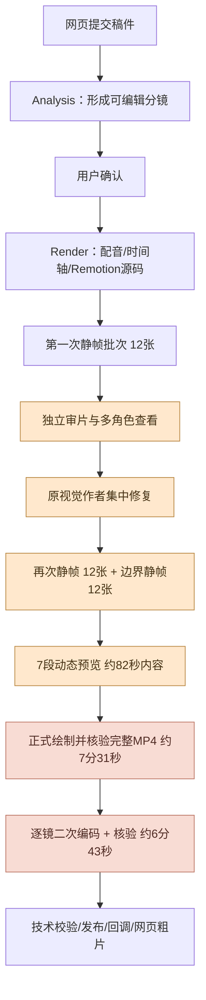
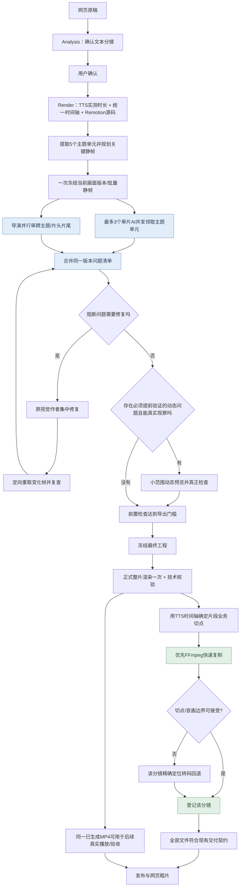
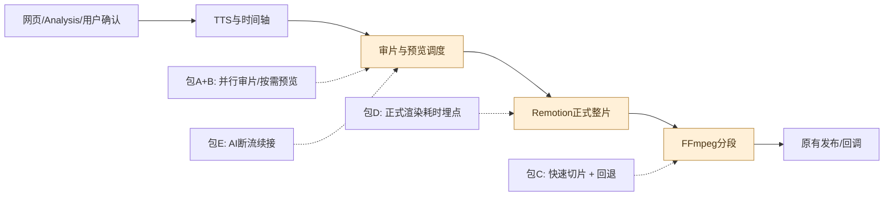
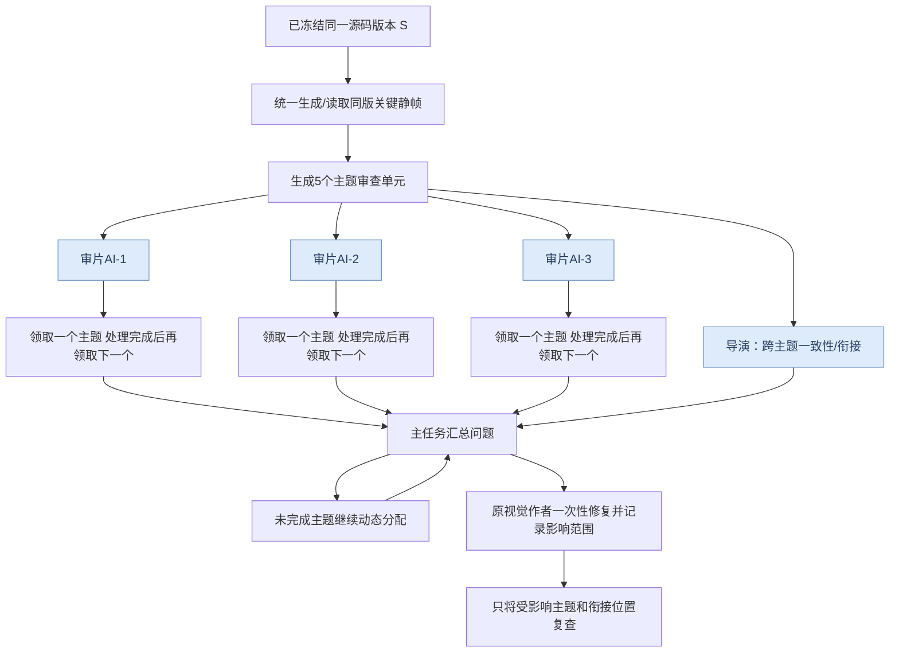
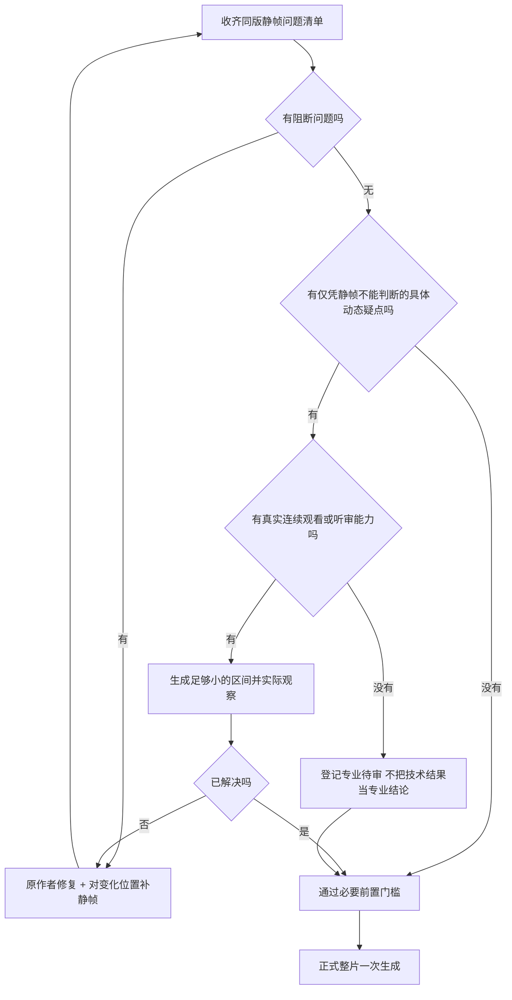
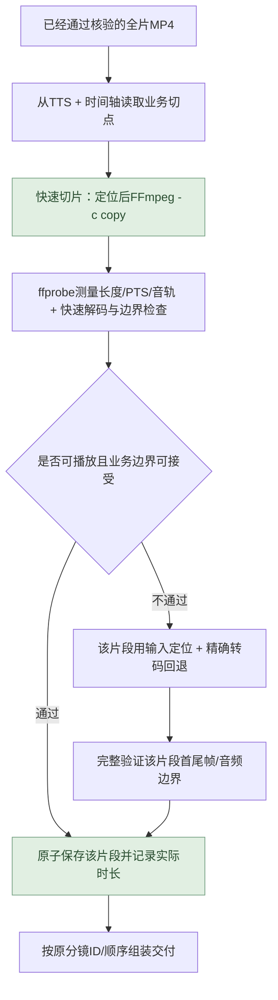
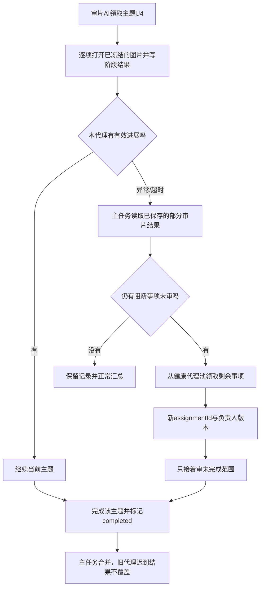

# VideoCutRemotion 视频制作耗时优化：最终实施方案

> **用途**：交给 Codex Worker 直接拆任务、开发、测试和验收的实施文档。不是聊天复述，也不是已经完成的代码改动。  
> **日期**：2026-10-14（文中生产时间统一采用北京时间）。  
> **代码基线**：`angelOnly/VideoCutRemotion` / `develop`，HEAD `0463fbd09eb1ed5c60e73a769349182ae5f3d1e9`；插件 `textvideo-studio 0.1.7`。  
> **证据基线**：用户上传《视频制作耗时分析资料_20261014.zip》，以及仓库中的 `docs/20261014新版插件部署与网页两阶段复测.md`。  
> **改动边界**：先实施方案、补测试、部署新版本并验收；**本次仅交付文档，不修改 Git 仓库、不触发生产任务**。

---

## 0. 先把最终决策说清楚

本次不推翻现有“Analysis 确认文案 → Render 制作统一时间轴 → Remotion 生成整片 → 输出整片与分镜 → 网页编辑”的主架构，主要修改 Render 的中后半段。

| 决策 | 最终方向 | 不做什么 |
|---|---|---|
| **A：并行审片** | 用现有章节/分镜结构拆成主题审查单元；可用名额内由 **3 名审片子代理并发领取任务**，导演额外检查跨主题一致性；先共同读取同版静帧，合并问题，再由**同一原视觉作者**修复 | 不为每个句子创建一个代理；不让审片代理并发写 Remotion 工程；不为每个代理重渲一套图片 |
| **B：按需预览** | 静帧检查构图和语义；只有明确动态问题且有人/工具真正能连续观察时，才生成小范围动态预览；正式整片生成后直接使用**这份已存在的 MP4 文件**供后续播放或验收 | 不默认生成七八段大范围预览；不把“文件可解码”冒充“已看完已听完” |
| **C：根据 TTS 实测时间轴快速切片** | **用已有 TTS 起止时刻、片头片尾及时间轴偏移确定业务切点**；优先尝试 FFmpeg 快速流拷贝，不能接受的切点才转码回退；保持现有整片和 `dataList` 分镜交付数量、ID 与顺序 | 不再默认逐镜从片头解码并二次编码；不为 33 条 TTS 生成 33 个 MP4（当前接口要的是 11 个确认分镜） |
| **D：定位正式整片约 7 分 31 秒** | 在现有构建、绘帧编码、整片校验环节加真实耗时埋点；**先测出各自成本**，再选择缓存、浏览器复用、资源/编码优化 | 不凭空断言这 7 分钟全是 Remotion 绘帧；不先盲目增加并发、降低画质 |
| **E：AI 审片断流恢复** | 审片子代理通信异常时记录已完成单元，把剩余**只读审查任务**交给健康代理；媒体作业、配音和视觉作者不重启 | 不把 `Broken pipe` 当成视频断流；不因为网络异常重渲可信整片 |

**明确的产品边界**：`33 段 TTS`、`11 个确认分镜`、`5 个主题章节`是本次样片的事实，不是通用硬编码。当前网页接口以确认分镜为编辑/返回单位。用户希望的是**用 TTS 时间轴确定切点，降低切割成本**，而不是改变网页对接契约。若将来产品明确要求“一句 TTS 对应一个视频”，那是另一项接口变更，不混入本轮性能优化。

### 0.1 本轮验收不应牺牲的质量

- 解说稿正文及顺序、角色音色、配音原编号、字幕、片头片尾、固定模板包装保持一致。
- 全片统一的 Remotion 画面/动画时间轴保持连续。主题/分镜切片不得重新从局部 0 秒绘制，跨镜运动不得被改变。
- 媒体技术检查、实际视觉/听觉观察、用户最终定稿是三种不同结论；不能把一种伪装成另外两种。
- “快速切片”允许合理的业务误差，但**绝不允许明显丢台词、截断音频、出现黑帧、画面明显串到下一镜、字幕与口播错位**。如果快速复制不满足条件，自动走正确但较慢的路径。
- 必须保留失败续切、任务取消、幂等性和源代码快照校验，不能通过降低运行可靠性虚报提速。

---

## 1. 现状、问题及耗时证据

### 1.1 真实的时间在哪里

**最新 0.1.7 验收**：网页分析提交到回调成功约 `2 分 45.510 秒`；用户确认约 `40.539 秒`；网页 Render 提交到发布回调成功约 **`39 分 59.871 秒`**；第一次网页提交到发布共 `43 分 25.920 秒`。分析、确认等待、制作与发布不应互相混算。

| 0.1.7 Render 的互不重叠阶段 | 耗时 | 关键解释 |
|---|---:|---|
| 输入、配音、时间轴、图解首版 | **3:54.053** | 不等于 TTS 耗时；33 段批量 TTS 本身约 8.093 秒 |
| 第一批 12 张静帧 | **0:27.955** | 批量图片渲染已较快 |
| 审片、返修、两批复查、动态预览 | **19:11.602** | 模型协作、真实修复、查看、等待和动态媒体生成的混合区间 |
| 正式整片 + 11 条分镜导出 | **14:14.515** | 约 7:31 整片准备/绘制/核验 + 约 6:43 逐镜切分/核验 |
| 最终音频句段审计、交接 | **1:16.304** | 不能算作渲染时间 |
| 发布检查、复制和回调 | **0:53.211** | 已含发布端检查，不能在前面再重复计时 |

**同口径 0.1.6 → 0.1.7**：Worker 受理至主会话完成从 `27:50.854` 变为 `39:04.429`，增加 `11:13.575`；变化主要落在**正式导出之前**（约 +11:25），而整片/切分这一块与旧版几乎持平（只快约 13 秒）。基线视频和新版视频并非同一素材、同一实现，不能把这看成严格单变量实验。

> 数据中以快照创建时间、作业记录 mtime 等作为近似边界；不是所有子阶段都有独立计时。本轮新增埋点之后才允许判断“渲染器真正绘帧耗时”。

### 1.2 已实测的具体问题

1. **图片没有慢到足以解释全程**：三批各 12 张静帧，共约 `72.9 秒`；但存在 `48 次 imageView`，由主任务、审片、视觉作者和导演多角色读取。多次阅读不全是浪费，但缺少同版责任分配和一次性问题归并。
2. **动态预览目的不明确**：7 段预览合计 `2450 帧 / 81.667 秒`，生成与完成记录之间约 `4:52`。制作会话并未完成真正的连续视频/音频专业观察；仅做文件技术核验，无法支撑预期收益。
3. **真正审出了有效问题**：首轮审片发现主体指代、连线穿字、图标连线关系、断路表达等 4 项真实问题，视觉作者修复了它们。故不能把审片整体取消，只能优化任务组织方式。
4. **正式整片只绘制一次已经实现**：仓库 `renderTemplate()` 正式分支只调用一次整片 `renderMedia()`；**不是**每镜都重新执行 Remotion。
5. **整片之后分镜切片仍重**：`cutSceneFromWhole()` 对 11 个分镜逐个从整片输入开始裁剪、二次 H.264/AAC 编码、完整检查；`renderMissingSlices()` 用串行 `for/await`。这个部分约 `6:43`。
6. **断流是 AI 通信问题，不是视频播放问题**：本次 `Broken pipe`、WebSocket 回退与审片反馈停顿同时出现，但后期部分异常与正式媒体导出重叠，不能把所有断流时间相加当成可节约的时间。

### 1.3 为什么知道时间轴，正式整片还需 7 分钟

时间轴是“某一帧应该显示什么”的**编排指令**，不是已经制作好的 4,255 张画面。Remotion 仍要把动画源码执行成真实帧，再编码为 H.264 并处理音轨；随后当前项目还要完整解码核验。时间轴已经知道位置，只解决了“**应该在什么时候**”，没有消除“**渲染成真实像素并编码**”的计算。

本轮的约 `7:31` 是**整片准备、构建、绘制、编码、文件核验的混合窗口**，不能直接称为“Remotion 纯绘帧 7 分钟”。必须先采集下文 D 包的真实埋点。

---

## 2. 当前链路与目标链路：到底改哪里

### 2.1 当前实测流程



### 2.2 目标流程（保留现有两阶段架构）



**“复用整片”只表示直接读取已存在的 `whole-video` MP4；不再次执行 Remotion。** 例如网页播放、技术校验、在已存在 MP4 上提取某一帧供真实检查。若没有能够连续看/听的工具或人员，只标记“专业连续视听待审”，**不能把技术核验写成专业审片通过**。不应把后置审片设计成又一套必经的大规模预览流程。

### 2.3 改动范围定位图



网页 Analysis、用户确认、TTS 接口和模板定义原则上保持；`Render` 的任务指令、质量审查子代理组织、媒体输出和观测需要调整。若因切片输出的实际时长元数据必须扩展交付 Schema，也要采用向后兼容方式，并同时验证旧网页。

---

## 3. 包 A：按主题拆分 + 多子代理并行审片

### 3.1 不再重新拆主题：当前工程已经有数据

本次样片 `project/timeline.json` 明确有 **5 个 `chapters`、11 个 `scenes`、33 个 `utterances`**，`project/director-plan.json` 的 `chapters[].scenes` 也能表示“主题 → 分镜”对应关系。直接使用已确认结构，不另让 AI 把文案重新切一遍。

| 主题审查单元 | 本次已有章节 | 分镜 | 全局帧范围（半开） | 约时长 |
|---|---|---|---|---:|
| U1 | `ch1` 胜负标准 | `scene_001`～`scene_003` | `[0,1035)` | 34.50 秒 |
| U2 | `ch2` 两种选择 | `scene_004`～`scene_005` | `[1035,1930)` | 29.83 秒 |
| U3 | `ch3` 五层模型 | `scene_006` | `[1930,2400)` | 15.67 秒 |
| U4 | `ch4` 市场代价 | `scene_007`～`scene_009` | `[2400,3525)` | 37.50 秒 |
| U5 | `ch5` 落地决胜 | `scene_010`～`scene_011` | `[3525,4188)`；全片尾至 4255 | 22.10 秒口播内容 |

> 以上是**本次实际样片**的分组示例，不应写死到通用代码。没有 `chapters` 的模板，优先使用已确认 `scene`/`dataList` 与导演的主题归属；还没有归属时可按相邻分镜分组，但不修改现有业务分镜 ID 和数量。主题以实际内容为准，不能仅按时长平均。

### 3.2 为什么采用「5 个审查单元 + 3 个审片代理池」

“每个主题一个子代理”在只有 5 个章节时可行，但若宿主代理名额有限，强行同时启动 5 个会与导演、视觉作者争抢名额。固定一个审片AI处理全部主题又失去并行收益。

首版使用 **最多 3 个独立审片代理**，5 个主题是独立工作单元：任一代理检查完一个主题，立即领取下一个**尚未检查**的主题。实际数量需先用宿主 `list_agents` 检查名额，若只剩 2 个名额就以 2 个跑；不能编造代理配额或靠重复 `spawn_agent` 冲撞上限。

任务领取优先参考**画面/文字复杂度与疑点、时长**，并非硬性平均场次数。首轮可优先给高复杂度的 U4、U1、U2，空闲代理再领 U5、U3。导演并行检查主题之间视觉语言、章间过渡、片头片尾（如果名额不足，导演任务与审片池共同调度）。



此图表达调度模式，而非要求所有代理同时完成、同时发回。**有依赖的汇总必须等需要阻断判断的单元交齐；无依赖的审查并行运行**。

### 3.3 各角色职责，避免互相重复

| 角色 | 负责 | 明确禁止 |
|---|---|---|
| 主任务/协调 | 读取同一快照、拆审查单元、核实代理名额、收集结构化问题、去重、派返修、维护任务状态 | 把所有图片自己再完整审一遍；根据别人的文字“猜测已看到视频” |
| 主题审片 AI × N | 检查分配的分镜文本语义、主体/数据/图表表达、构图、文字遮挡、进入/退出静态状态；回传真实检查证据 | 改写源码、插入画面、独占全片检查、递归创建子代理 |
| 导演 AI | 相邻主题之间的转接、全片视觉统一、关键重点、片头/片尾、全局风格或节奏判断；标识需连续观察的疑点 | 与每位审片AI重复逐张检查全部同版图片 |
| 原视觉作者 AI | 接收去重后的问题，集中修改同一份源码并说明影响范围 | 与审片AI同时写同一个 `project`；只修表象、不说明影响范围 |
| Render 媒体工具 | 在单视频媒体互斥规则下批量生成静帧/必要短预览，登记 `sourceDigest/readyFrames`，媒体工作可核查 | 每个审片AI各自重渲静帧；把不同源码版本图片混在一份结论里 |

### 3.4 固定同一版本，再并行读；**不能并行写**

正确顺序：

1. 视觉作者交回可渲染版本并结束本轮源码写入。
2. 主任务调用一次或少量批次 `preview_template_frames`；必须等 `read_render_job` 返回可核实的 `sourceDigest` 和已核验 `readyFrames`。
3. 所有审片代理领取同一个 `sourceDigest` 的图片，读取自己负责的帧号。批次最多 12 帧是**工具上限，不是必须每批凑满 12 张**。
4. 各子代理仅输出审查结果；主任务按版本/范围/问题身份汇总、去重。
5. 原视觉作者独占修改工作目录；修完后新快照有新 `sourceDigest`，只对**实际受影响的主题和相邻边界**新取证并复查。若改到共享组件、字幕层、全局时间轴或模板包装，应扩大范围。
6. 旧结果可以存档，但绝不能给新版本做通过证明；若确认画面输入完全等价，应使用可信的作者文件摘要证据，而不是口头说没改。

**审查结果应放在渲染工程之外**：建议 `runs/<runId>/qa/review-plan.json`、`review-units/<unitId>.<sourceDigest>.json`、`issue-ledger.json`。不要把补审片报告当成源码输入变化，导致快照摘要变化；但也不能随便忽略 `project` 内的 JSON/Markdown，因为有些是真实时间轴或模板指令。

### 3.5 推荐的数据协议（新增内部记录，不增加网页公共字段）

```json
{
  "schemaVersion": 1,
  "runId": "<current-render-run-uuid>",
  "sourceDigest": "<preview-job-confirmed-sourceDigest>",
  "timelineRef": "timeline.json",
  "units": [
    {
      "unitId": "chapter-ch4",
      "chapterId": "ch4",
      "sceneIds": ["scene_007", "scene_008", "scene_009"],
      "fromFrame": 2400,
      "toFrame": 3525,
      "reviewFrames": [2435, 2878, 3305],
      "issueHints": ["数据主体", "连线布局", "结论可理解性"],
      "status": "pending",
      "assignedAgentId": null,
      "assignmentId": null,
      "attempt": 0
    }
  ]
}
```

每个审片AI按如下格式交回（字段名为**建议新增的内部结构**，不是声称已有 API）：

```json
{
  "unitId": "chapter-ch4",
  "sourceDigest": "<same-preview-source-digest>",
  "assignmentId": "<host-confirmed-assignment>",
  "reviewerAgentId": "<actual-host-agent-id>",
  "status": "completed",
  "observations": [
    {
      "issueId": "ch4-line-cross-label",
      "severity": "blocking",
      "sceneId": "scene_008",
      "frame": 3096,
      "observationType": "still",
      "evidence": "<readyFrame path/sha256>",
      "problem": "连线穿过说明文字，影响可读性",
      "expected": "说明文字完整可读且连线保持语义正确",
      "affectedScopeHint": ["scene_008"]
    }
  ],
  "observedFrames": [2435, 2878, 3096, 3305],
  "unobservedRanges": [],
  "reviewedAudio": false
}
```

`issueId` 可以用 `(sourceDigest, sceneId, frame区间, 主要问题类别)` 归并，不必因为两个代理用了不同描述就建立两个返修单。`severity` 建议 `blocking / warning / suggestion`；**阻断项必须被证明修复或明确升级处理，不为追求速度默许跳过**。美术建议不会一律变成阻断项，也不强制限定返修轮数。

### 3.6 按可用的现有 Skills 和宿主功能落地

| 位置 | 必改或核验的内容 |
|---|---|
| `.agents/skills/production-coordinator/SKILL.md` | 为**当前文本模板任务**补“主题单元 → 审片代理池 → 同版汇总 → 原作者返修”；旧 Project/Revision 章节不应误触发 |
| `.agents/skills/production-coordinator/references/task-routing.md` | 明确 `list_agents` 真实名额、`spawn_agent`/`followup_task` 续接、同一主题唯一当前负责人，拒绝后不盲重试；注意现有代理名额限制 |
| `.agents/skills/quality-verification/SKILL.md` | 新增“只审分配主题和必要衔接、不可递归分派、仅报告实际观察、报告证据及未观测项” |
| `.agents/skills/production-director/SKILL.md` | 导演专审全片统一性和主题边界，不与主题审片重复全量静帧工作；有争议才扩大局部范围 |
| `.agents/skills/_shared/TEMPLATE_PRODUCTION.md` | 写清当前合同的审片并行、同版证据、修复复查及按需预览要求 |
| `packages/production-service/src/task-instructions.ts` / `taskInstruction()` | 同步实际注入到 Codex 的运行时指令；**只改 Skills 不够**；调整 `INSTRUCTION_VERSION` 并重新构建插件 |
| **可选** `packages/production-service/src/*` 的现有读回/日志机制 | 先把 `qa/` 作为任务运行记录随 `read_production_task` 可定位；**首版不需要新建复杂队列/工作流后端** |

**配置建议**：首版 `TEXTVIDEO_QA_MAX_REVIEWERS=3`，但此值只控制本视频**审片子代理建议上限**，不是创造新的宿主名额。运行时仍要尊重 `list_agents` 实际结果和已有导演/视觉作者工作。和每视频 Remotion 并发 5、全局最多 4 个 Run是不同资源；不能混为一谈。

---

## 4. 包 B：预览与复查流程改为“按需、有目的、能消费”

### 4.1 预览其实有两类，不应该混淆

| 类别 | 是什么 | 能证明什么 | 不能证明什么 |
|---|---|---|---|
| **静帧预览** `preview_template_frames` | 根据源码渲染某一帧的 PNG | 构图、文字遮挡、图表元素、特定状态 | 连续动作流畅度、整段真实声音 |
| **动态预览** `render_template(previewOnly=true)` | 先把某个范围渲成一段临时 MP4 | 若检查方真正能连续看/听，可判断某段运动和声音 | 仅 ffprobe、帧数正确时不能宣称运动/声音已被专业审阅 |
| **正式整片** `render_template(previewOnly=false)` | 生产完整 MP4，当前唯一一次正式 Remotion 全片绘制 | 可供完整播放、提帧、技术校验及实际人工/工具审查 | 文件生成成功本身不意味着内容已经定稿 |

### 4.2 前置预览的决策规则



**判定“需要动态预览”的例子**：图表从 A 状态向 B 状态过渡是否看得懂、数字人从全屏缩小是否遮挡当前主体、复杂线条连接是否在正确节奏上完成。请求必须列出 `目标问题/时间范围/负责检查者/实际检查方式/通过条件`；不能一句“全面审查声音动效”就默认预渲半个视频。

### 4.3 新增预览请求记录（在 `qa/`，避免重复计算）

```json
{
  "sourceDigest": "<current-snapshot-digest>",
  "purpose": "verify_chapter_transition_motion",
  "fromFrame": 1010,
  "toFrame": 1060,
  "question": "ch1到ch2切换是否有跳变或文字叠压",
  "consumer": "director",
  "capability": "actual_continuous_video_review",
  "passCriteria": "无黑帧、无主要对象突然消失、过渡中标题可读",
  "state": "requested"
}
```

请求中的能力只是**申请检查能力**，工具/代理必须在执行时再次核实。若当前没有连续视听能力，不应预先编造 `consumer` 或完成状态，改为标记 `professional_review_pending`。

### 4.4 修改哪些地方

- **必改**：`packages/production-service/src/task-instructions.ts` 将“静帧复查后再用 `render_template` 检查真实运动声音”从固定顺序改为上面的条件判断，并将“仅 ffprobe 或完整解码不代表专业视听”写进去。
- **必改**：`.agents/skills/_shared/TEMPLATE_PRODUCTION.md`、`quality-verification/SKILL.md`、`production-coordinator/SKILL.md`，与注入指令保持同一政策。已有执行合同要求每视频同时只有一个媒体作业、等待时查询原任务，不应放松。
- **复用现有接口**：`preview_template_frames` 一次最多 12 帧，`read_render_job` 返回 `readyFrames`、`sourceDigest`；动态预览仍走 `render_template(previewOnly=true)`；新需求主要是**调度与结果记录**，首版不必为这个条件逻辑增加一个公共 REST API。
- **复查版本**：修复后新取需要检查的帧、边界；如果共享组件/全局时间轴改变，必须扩大范围。不能仅因某些复查图没被查看，就把它们记为已审核。

### 4.5 “复用正式整片”到底是什么

`whole-video` 已经由 `renderMedia()` 生成并通过技术校验后，后续展示、特定画面提取和真实播放检查**直接读取同一个 MP4 字节文件**；不再为相同范围重复跑 Remotion 的 `renderMedia()`。

现有 `readyFiles` 可以提前告知内部已核验整片文件，但网页 `/media/:task/:run/:file` 只有 Run 成功发布后才开放，**不能擅自用未发布路径拼公共 URL**。首版用内部同Run的可信只读结果，正式发布后用原 `/media` 路由；将来需要“发布前网页看片”再单独设计鉴权只读接口。

也不要求等整条视频每一秒都由AI自动完整专业看完才准技术导出：在审查能力不足时，把“已完成技术核验”和“尚未做专业连续视听”分别记录。用户在网页上的最终观看、编辑、确认仍然有效。

---

## 5. 包 C：根据 TTS 实测时间轴，进行“业务可接受的快速硬切”

### 5.1 先澄清：TTS时长提供切点，真实切点必须考虑片头、空白与片尾

当前财经样片 `timeline.json` 中：

- `scene_001` 全局 `[0,298)`，其中片头 `0–67` 帧约 2.233 秒，TTS 首句从第 67 帧才开始。
- 全片共有 **33 条 TTS utterance**，已经具有实际 `startFrame`、`endFrameExclusive` 等信息。
- 正文口播结束在第 `4188` 帧；固定片尾是 `4188–4255` 帧；总共 `4255` 帧。
- 确认的业务分镜还是 **11 条**：`scene_001`、…、`scene_011`。每个分镜可包含 2～5 条 TTS。

所以不能简单按“33段音频文件长度相加”生成33个MP4；那会丢掉片头/片尾、句间间隔和主题过渡，也破坏现有网页编辑的 `dataList` 契约。

**正确用法**：`TTS实测开始/结束 + 已确认的场次归属 + 时间轴片头/片尾/停顿/转场` → 推导每个需要交付的视频片段的**业务起止秒数**。已有场次全局范围是首选，不重复让模型“猜”切点；时间轴与 TTS 一致性仍由现有 `verify_sentence_audio()` 等工具确认。

### 5.2 为什么“知道切点”与“快速复制MP4”仍是两件事

H.264 有关键帧和依赖前后帧的压缩帧。直接按任意小数秒 `-c copy` 截取 MP4，切点可能退到附近关键帧、出现音视频时间戳差、首帧不可正确解码等。**这不是时间轴精不精确的问题，而是压缩文件的存储方式问题。**

用户接受“不追求当前严格帧级裁剪”，不等于接受“丢一整句话”。因此选择 **优先快速拷贝 → 实测切点偏差与播放可用性 → 失败才精确回退** 的混合方案。比起盲目一律 stream copy，这样更可控。

### 5.3 两层处理策略



**快速路径**：首版在隔离环境中先验证 `-ss` + `-i whole.mp4` + `-t`/`-to` + `-map` + `-c copy` 的组合。不要仅因为 FFmpeg 退出码为0就标记通过。应验证：文件能正确解码、视频/音频流存在、PTS/首帧可用、实测时长、声音连续性以及首尾实际落点。

**失败回退**：使用上一版讨论过的 `-ss` 先定位到目标附近，再转换为局部视频帧/音频时间、精确转码；如果生产编码时间戳不满足条件，回退原始的完整精确裁剪实现。初期仅串行执行回退，以保留易排查性。

**可选第二阶段**：如果生产样本大多数 `-c copy` 因关键帧间隔过大失败，再试在整片编码阶段为业务切点布置关键帧（取决于项目实际 Remotion 4.0.519 编码选项），并评估文件大小、编码速度与切点质量。**不要未经验证就宣称可以任意位置零成本硬切**。

### 5.4 业务可接受的切点误差，应当可配置且可验证

试验配置建议：

| 判断项 | 首轮验收建议 | 说明 |
|---|---|---|
| 快速切点偏移 | 先用视频边界偏差 `≤100ms` 作默认候选门槛 | **试验阈值，不是已经确认的产品要求**；拿实际样片与网页体验再调 |
| 台词完整性 | 不能截掉 TTS 的有效起止内容；相邻段不能明显串台词 | 单靠 `ffprobe` 时长不足以证明，可用带边界信号的自动化音轨与真实TTS抽样听审 |
| 画面 | 首帧可解码、无黑屏、无明显提前露出下一主题的图 | 快速流拷贝不保证必然满足，需要检查 |
| 音画 | 音轨存在；开始/结束时戳合理；不明显错位 | AAC priming、B帧、非零起始PTS都要覆盖 |
| 快速路径失败 | **自动回退到准确转码，只重做该片段** | 不能因快切失败重画整片，也不能返回假成功 |

如果首轮 A/B 显示 100ms 门槛下快速复制命中率很低，就不要为了达标而强行放宽到 1～2 秒。应选择附近定位后局部转码，或评估编码关键帧设置；先确保**没有掉词**。

### 5.5 现有 API 兼容边界：这是实现中的重点

目前代码明确存在以下约束：

- `packages/production-service/src/contracts.ts`：`renderRequestSchema.dataList` 是稳定分镜 `id/content` 列表；`deliverySchema.files` 需要整片 + 分镜，且 `fromFrame/toFrame`、`dur` 等字段受严格验证。
- `apps/render-worker/src/template-renderer.ts`：正式 `renderToolSchema.ranges` 必须按 `dataList` 全量对应且分镜ID顺序一致；`renderMissingSlices()` 将整片后分镜按序生成；`retryRenderSlices()` 用精确文件范围/路径/哈希判断可信续做。
- `packages/production-service/src/video-output.ts`：`validateVideoOutput()` 目前要求确切帧数、时长和起始时间戳，快速流拷贝的自然时间戳偏差可能不能通过。
- `packages/production-service/src/delivery.ts`：`publishDelivery()` 再次检查视频、身份与摘要，并按同一ID顺序构造网页 `dataList`；不允许未经验证绕过此入口。

**所以不能只改 `cutSceneFromWhole()` 加 `-c copy` 就交付。** 必须区分业务计划范围（从TTS时间轴来）和视频文件实测范围，改动技术校验与可信恢复的判断，且保持网页协议兼容。

建议首版保持 `render_template` 的外部 `ranges` 形状不变，仍携带原业务分镜ID和逻辑全局帧范围；快速/回退策略从 **Worker 配置 `TEXTVIDEO_SCENE_CUT_MODE=hybrid`** 注入，默认旧 `accurate`，不用临时让大模型拼 FFmpeg 命令。

交付字段中 `fromFrame/toFrame` 表示**计划的逻辑位置**；对快速切片增加可选的内部 `cutMode`、`requestedStartSec`、`requestedEndSec`、`measuredDurationSec`、`startDeviationMs`、`endDeviationMs`、`mediaValidationVersion`（名字可按仓库既有命名统一，但含义必须清楚）。`deliverySchema` 是 strict，需要显式扩展可选字段；发布给旧网页的 `dataList` 原有 `id/content/url/dur/extraData` 保留，新增的实际切点信息可进入 `extraData`，不可把计划范围假冒为真实精确截取范围。**`dur` 必须使用文件实测值**。

避免把 `cutMode` 误写为 `stream_copy` 而实际已走转码回退。保存时必须记录真实使用的方法、失败原因和实际检查结论。

如果选择不扩展公开 Schema，则内部记录偏差并确保对外 `fromFrame/toFrame` 在接口文档中明确是逻辑区间，切片 `dur` 仍必须实测；但**不能**继续用现有“实测帧数必须恰好等于逻辑 `toFrame-fromFrame`”去验证快速路径。

### 5.6 最小代码落点与建议伪代码

| 文件 / 函数 | 具体修改 |
|---|---|
| **`apps/render-worker/src/template-slices.ts`** / `cutSceneFromWhole()` | 保留原准确转码为 `accurate` 回退；增加 `tryStreamCopyScene()`；对候选片段做必要验收，未通过回退；pending/原子改名/取消保留 |
| **`apps/render-worker/src/template-renderer.ts`** / `renderMissingSlices()` | 遵照 `dataList`/`ranges` 维持交付数量和顺序；从统一时间轴读取业务范围；传入切片策略；输出按scene ID聚合，不依赖完成先后；失败只影响单个片段 |
| **`apps/render-worker/src/template-renderer.ts`** / `retryRenderSlices()` | 对旧准确切片和新快速切片分别校验可信依据；原成功文件的真实SHA/模式/媒体检查版本要一致，不重绘整片 |
| **`packages/production-service/src/video-output.ts`** | 保留 `validateVideoOutput()` 的整片严格检查；新增类似 `validateSceneFastCut()` 的**单独**候选校验，避免把原严格检查全局放松 |
| **`packages/production-service/src/contracts.ts`** | 给 `deliverySchema.files` 增加兼容的切割方式与实测偏差字段（如采用）；保留旧字段及数据顺序 |
| **`packages/production-service/src/delivery.ts`** | 发布校验根据实际 `cutMode` 走对应可靠校验路径，复核文件SHA及真正复制到staging的字节；`dur` 用实测值；不得让用户可写JSON自行宣称已核验 |
| **`packages/production-service/src/config.ts`** | 在有效范围内读新模式开关；默认旧实现，确保灰度开关与快速回退 |
| **`apps/server/src/production/routes.ts`** | 将配置传入 `RenderOptions`；沿用目前 `RENDER_BUSY`、同Run工具鉴权、异步作业与 `readyFiles`，不为硬切另起独立任务接口 |

```ts
// 说明性伪代码；不是可直接贴入仓库的完整 TypeScript。
async function produceSceneFromWhole(whole, scene, policy, signal) {
  const requested = getLogicalBoundsFromVerifiedTimeline(scene);
  if (policy === 'hybrid') {
    const candidate = await tryStreamCopyScene(whole, requested, signal);
    if (candidate.ok) {
      const checked = await validateSceneFastCut(candidate.path, requested, signal);
      if (checked.accepted) return registerScene(scene.id, candidate.path, checked);
      await discardPending(candidate.path);
    }
  }
  const encoded = await cutSceneWithAccurateLocalSeek(whole, requested, signal);
  const checked = await validateSceneAccurate(encoded.path, requested, signal);
  return registerScene(scene.id, encoded.path, checked);
}
```

**恢复限制**：原 `retry_render_slices` 的幂等身份不变。已经成功校验的整片和分镜绝不重做；`unknown`、已取消、原快照不可信、摘要不一致的任务不能凭空换Key重试。正式作业仍发布1条整片＋全部确认分镜。

### 5.7 并发放在第二步，不要与快速切算法一起改

先做**串行混合切片**，确保路径正确并测算命中率。再独立测试2个分镜切片同时执行是否真的快。

四个 Run 同时运行时，FFmpeg 进程会争抢CPU、内存和IO，不能因为“每视频5个Remotion绘图槽”就额外任意开启5个FFmpeg编码任务。第二阶段才考虑跨Run的 CPU 配额和公平队列，且限额独立于Remotion绘图槽。

---

## 6. 包 D：正式整片 7:31 的性能根因与定向优化

### 6.1 先把“7分钟”切成可观测的真实步骤

现有源码路径：

```text
renderTemplate()
  ├─ freezeProject()            工程树摘要 + 快照复制 + 再核验摘要
  ├─ prepare()                  validateTemplate + Remotion bundle()
  ├─ selectComposition()        加载 Composition 与视频参数
  ├─ renderMedia()              浏览器绘帧 + H.264/AAC 输出（内部可能重叠）
  ├─ validateVideoOutput()      ffprobe + FFmpeg完整解码并数帧
  ├─ fileRecord()               SHA-256等文件登记
  └─ renderMissingSlices()      后续分镜切片（不应混算在整片7:31中）
```

**需要直接给各函数前后添加埋点，而不是再用文件创建时间猜测。** 同一进程中的持续时间用单调时钟，跨重启和回调边界同时记录UTC时间戳。每个事件关联 `runId`、`renderRequestId`、`sourceDigest`、`stage`、`spanId/parentSpanId`；单任务日志不要包含密钥。

示例观测记录（仅数据结构示例，非实际成绩）：

```json
{
  "schemaVersion": 1,
  "runId": "<render-run-uuid>",
  "renderRequestId": "<formal-render-key>",
  "event": "media_span_finished",
  "stage": "whole_video_validation_decode",
  "startedAt": "<iso-8601>",
  "endedAt": "<iso-8601>",
  "durationMs": 0,
  "sourceDigest": "<sha256>",
  "result": "succeeded",
  "metadata": {"frames": 4255, "fps": 30}
}
```

**重点要拆**：`prepare/bundle`、`selectComposition`、`renderMedia` 整体、`ffprobe`、完整解码数帧、`fileRecord` SHA；如项目使用的 Remotion 4.0.519 API 能拿到分帧和编码进度，再增加绘帧/编码子事件。注意这些子过程可能重叠，**不能把重叠阶段的持续时间简单相加**。

同时记录CPU利用率、RSS峰值、可用内存、I/O等待和同时运行的媒体作业数，以便区分CPU瓶颈、磁盘瓶颈和等待瓶颈。事后硬件参数不是运行时占用证据。

### 6.2 观测结果决定怎么优化

| 真实测得最慢 | 下一步考虑的优化 | 本轮先不盲做的改动 |
|---|---|---|
| `freezeProject` / 文件摘要 | 只在可靠输入快照不变时减少无意义的全树摘要/复制；将 `qa/` 与工程隔离 | 不忽略真实模板说明、时间轴和素材的改变 |
| `prepare` / Webpack bundle | 同一不可变快照、同一依赖/模板时研究缓存构建产物；动态预览同作业复用构建结果 | 不创建未验证的全局跨Run缓存、不能错误复用旧源码 |
| 浏览器准备 / 资源加载 | 同作业内安全复用Browser、缓存静态资源；核实Remotion API/实例生命周期 | 不跨不可信作业共享泄漏状态的Browser |
| `renderMedia` 主耗时 | 追踪慢帧、热组件、字幕/图表计算；查独立复杂度、素材解码及编码竞争 | 不一开始就加大 `concurrency` 或降分辨率 |
| H.264编码 | 根据实际机器验证编码参数及CPU配额，必要时A/B硬件编码候选 | 不在用户未确认下改变画质/色彩/音轨格式 |
| `validateVideoOutput` | 审视是不是在原渲染与发布阶段重复完整检查；用服务可信结果/文件SHA收敛冗余校验 | 不取消唯一可信的完整视频解码检查 |

### 6.3 必改的埋点位置

| 文件 / 代码 | 如何落地 |
|---|---|
| `apps/render-worker/src/template-renderer.ts` | 为 `freezeProject`、`prepare`、`selectComposition`、`renderMedia`、`validateVideoOutput`、`fileRecord`、每个分镜切片前后记录span；可选通过 `RenderOptions.onMetric` 上报持久化 |
| `packages/production-service/src/video-output.ts` | `ffprobe` 与FFmpeg完整解码分开记录运行时长，不改变原验证逻辑 |
| `apps/render-worker/src/template-slices.ts` | 每个片段分别记录快速复制、候选验证、回退转码、回退验证、实际偏差、命中率 |
| `apps/server/src/production/routes.ts` | 已存在 `startMedia` 作业登记与事件持久化入口，在现有Run目录持久化时间线；不要额外将metrics写入源码快照 |
| `packages/production-service/src/delivery.ts` | 发布的SHA复核、拷贝、再次媒体验证分别计时，判断可否使用服务可信校验凭据减少重复校验 |

**重要**：先交付这一轮真实拆分报告，再做编码器/渲染器专项优化。7:31 有可能从一项大的任务变成几个小成本，不能提前把任何一项认定为瓶颈。

---

## 7. 包 E：子代理审片“断流”与局部接管

### 7.1 什么叫断流

这里的“断流”是审片 AI 的**模型/工具通信连接异常**（本轮日志含 `Broken pipe`、连接回退、超时），不是 MP4 播放到一半停止，也不是 TTS 丢音。本次部分异常和正式渲染同时发生，因此没有证据说断流独立增加了全部11分钟。

### 7.2 用主题审查单元自然支持局部接管



要分清：**角色进度**、**工具事件进度**、**媒体作业进度**。心跳、重复问“完成了吗”不算实际审片进展。媒体任务 `read_render_job` 显示运行中时，不因审片代理卡顿就判媒体卡住。

现有 `packages/production-service/src/tool-observer.ts` 只发现长时间未结束的命令/MCP调用（默认180秒），还不足以判断“某个主题的审片AI有没有保存有效结论”。它需要与QA任务记录、宿主代理状态或可获得的错误事件配合，不能单靠一个 `stalledTools` 字段决定重启。

### 7.3 具体改动

- **第一阶段在Skills调度层完成**：每个审查单元有 `unitId/sourceDigest/assignmentId/assignedAgentId/status/lastMeaningfulProgressAt`；在 `qa/` 写入增量证据。`production-coordinator` 按当前负责人代次收结果，`task-routing.md` 已有 `list_agents`、`followup_task` 与迟到结果处理规则，可扩展使用。
- **第二阶段增加可观察性**：`packages/production-service/src/codex-session.ts` 中 `client.onEvent` / `client.onClose` 与stderr观测；`tool-observer.ts` 区分传输异常、工具长未完成和确实无有用审查进展；`turn-events.ts` 仍只允许主线程turn交付，不能将子代理断流视作主Run失败。
- **超时策略**：把 `120～180秒无有效进展且存在异常` 作为隔离测试的候选门槛，真实上线前需要验证；仅接管仍未完成的只读主题审查。原负责人若恢复，旧 `assignmentId` 的迟到结果只归档，不覆盖现任负责人，也不触发无依据的二次返修。
- **不碰媒体身份**：TTS `speechBatchRequestId`、正式 `renderRequestId`、整片快照、已成功文件一律沿用；因为审片异常而重发TTS或整片是严重回归。

---

## 8. 开发任务拆分：文件、函数、改法、退出条件

### 8.1 先做 P0：完善计时并建立固定样本

| 任务 | 修改位置 | 交付物 | 退出条件 |
|---|---|---|---|
| P0-1 正式媒体埋点 | `template-renderer.ts`、`video-output.ts`、`template-slices.ts` | 机器可读 `runs/<runId>/metrics/*.jsonl` | 能单独看出整片准备、bundle、渲染输出、解码校验、逐镜切割 |
| P0-2 任务级时序归并 | `routes.ts` 与原有事件 | 统一 `runId/renderRequestId` 的时间跨度报告 | 不把并行重叠时间相加；文件mtime推算与真实计时分开 |
| P0-3 冻结回放样本 | `tests/` 测试fixture与已有 0.1.7 样片证据 | 固定相同源码、TTS、模板、时间轴与11个分镜 | 旧路径可重现；不覆盖历史产物 |

### 8.2 P1：并行审片（A）+按需预览（B）

| 任务 | 修改位置 | 落地内容 | 退出条件 |
|---|---|---|---|
| P1-1 主题审查计划 | 现有协调Skill + 必要的计划生成辅助脚本/工具 | 读取冻结时间轴的 `chapters[].scenes` / `director-plan`，生成 `qa/review-plan.json` | 5主题11镜全部覆盖，不重复、不漏掉片头片尾；无章节时有回退 |
| P1-2 代理池调度 | `production-coordinator/SKILL.md`、`task-routing.md` | 依据 `list_agents` 真实限额，最多3个审片代理领取单元；确认唯一负责人和代次 | 真并行处理只读检查；无写入冲突；名额不足平滑降级 |
| P1-3 分工、审片格式 | `quality-verification/SKILL.md`、`production-director/SKILL.md` | 局部问题标准、导演全局职责、统一 `issue-ledger` | 同版不同代理问题可合并；每条结论标注真实观察范围 |
| P1-4 按需预览门槛 | `TEMPLATE_PRODUCTION.md`、`task-instructions.ts` | 关键静帧优先；动态预览必须有用途、能力和通过标准 | 普通无动态疑点任务不再默认生成7段短MP4 |
| P1-5 修复与局部复查 | 原作者协调流程、`qa/` 记录 | 唯一视觉作者修改；回传变更、重取受影响帧；跨场变化扩大检查 | 返修版与审核版的sourceDigest一致，不混版 |
| P1-6 Plugin发行一致性 | `plugins/textvideo-studio` 现有同步/构建脚本 | 同步Skill、提高 `INSTRUCTION_VERSION`、重新构建并验证安装包 | 新部署运行时读到新的指令和Skill摘要，而非旧缓存 |

### 8.3 P2：TTS时间轴快速切片（C）

| 任务 | 修改位置 | 落地内容 | 退出条件 |
|---|---|---|---|
| P2-1 切点核对 | `template-renderer.ts` + 已存在时间轴/音频审计逻辑 | `sceneId -> 逻辑起止帧/秒` 从已核验时间轴确定；完整考虑片头、片尾、停顿 | 33段TTS不误变33分镜；11个输出与现有dataList一一对应 |
| P2-2 快速复制候选 | `template-slices.ts` | 增加stream-copy尝试，旧准确路径保留，pending原子输出 | 不改变原文件；快速候选失败可清理、可自动回退 |
| P2-3 分镜差异化校验 | `video-output.ts`、`contracts.ts`、`delivery.ts` | 整片仍严格；快速切片增加实测时长、实际切点偏差/音画检查；Schema兼容 | 不将逻辑帧区间伪装为实际精确范围；旧网页可消费 |
| P2-4 续切恢复/取消 | `retryRenderSlices()`、`routes.ts` | 原run、原快照和整片可信时只补缺失片段，按原序汇总 | 某一片段失败不重画整片；未知结果不盲重试 |
| P2-5 单独优化并发 | 切片资源调度与配置 | **串行快切通过后**再A/B小并发，优先2并发 | 4个Run混合负载下不造成严重吞吐回退 |

### 8.4 P3：正式整片根因定向专项（D）

P0埋点得到至少一次相同样本的**单项真实耗时和CPU/IO状态**后，再提出定向PR。一个PR只动一项主要瓶颈（例如bundle、重资源加载、校验重复或慢帧），与混合切片、审片策略分别A/B。**没有耗时数据时此阶段只做分析，不先承诺“渲染7分钟→2分钟”。**

### 8.5 P4：子代理异常接管（E）与回归

优先用P1的 `review-unit/assignmentId` 结构支撑接管；再根据真实模型事件补错误观测。不要另造一个跨所有媒体作业的调度系统。故障注入需覆盖审片断流、迟到结论、视觉作者仍在写入、正式媒体仍在运行、取消Run等场景。

---

## 9. 给 Codex Worker 的可直接执行的 Skills 修改文案

> 以下是应写入相应**当前文本模板任务入口**的候选正式条款。编码阶段需以实际技能文件组织方式合并，不能直接附在旧Project/Revision的执行指令末尾，也不能覆盖原有模板强制包装、配音身份、幂等、鉴权约束。

### 9.1 共享执行合同 `TEMPLATE_PRODUCTION.md` 的新增/替换条款

```markdown
## 模板Render：主题并行审片及按需预览

当前 dataList 是已确认分镜，正文和顺序不变。优先读取真实时间轴、导演章节归属形成主题审查单元。对于具备章节的时间轴，尽量将同一主题下的连续分镜交同一个独立审片；没有章节时依真实分镜关系分组，不重新拆稿。

主任务先核对宿主真实代理名额，再组织最多三个独立审片子代理并行执行只读审片。子代理不递归分派、不直接改动渲染工程；导演负责跨主题衔接与整片一致性，不重复做所有主题的逐帧静态复查。每个主题只有一个当前负责人，按真实 assignmentId、agentId、sourceDigest 接收结果。空闲子代理可领取尚未审查的主题。

同一轮检查使用已经冻结且 sourceDigest 一致的静帧；每次取帧记录目标主题、实际帧号和问题。审片结论包含实际观察范围、截图引用、问题严重程度、预期修正及未完成项。主任务合并同版问题后交原视觉作者集中修改。变更后定向复查受影响区域及边界；共享组件、字幕、全局时间轴变化时扩大检查。禁止把旧版结论直接当作新版通过。

动态预览不是静帧之后的固定下一步。只有存在必须观察连续运动或声音才能判断的具体问题，并且有真实连续观看/听审能力与明确检查标准时，才生成足以判断该问题的短范围。不能为了执行流程而生成大范围短视频却没有人/工具实际观察。没有专业视听能力时仅记录技术检查及专业待审，不伪报已看已听。

必要前置问题关闭后冻结工程，正式整片只渲染一次。整片readyFiles经核验后，可直接使用已有文件做后续播放、提帧或真实视听验收，不为相同检查重复绘制。交付技术成功、专业视听检查、用户定稿三种状态分别记录。审片报告放在不参与实际渲染输入的任务qa目录，不得放松源码/模板/时间轴摘要校验。

分镜交付保持当前 dataList 的ID、内容和顺序；允许由服务依据已核验的TTS实测时间轴和片头片尾等偏移确定业务切点，使用安全的快速切片策略，不由模型手写FFmpeg命令。快速候选不能保证声画边界时由服务回退精确切分。所有文件仍由原工具登记、真实校验和发布。
```

### 9.2 `production-coordinator/SKILL.md` 的新增条款

```markdown
## 当前模板的审片并行调度

在同版静帧冻结并登记 sourceDigest 之后，把确认的主题/分镜切为有唯一 unitId 的只读检查单元。通过 list_agents 核对可用名额；最多同时安排3个独立审片代理，低名额时自动降级，不重复创建职责相同的负责人。原导演保留全片美术与跨主题边界检查职责，原视觉作者唯一负责修改源码。

代理只读取对应单元已准备好的证据。每个代理回传 sourceDigest、unitId、assignmentId、观察过的帧号/视频范围、问题清单及未完成范围；主任务合并问题，去重后一次性交原视觉作者。修改后只把受影响单元和必要相邻切口交回独立审片；共用内容变化扩大检查。

对同一审查单元，只接收当前 assignmentId 负责人的结论；旧负责人迟到结果保留为历史线索，不自动覆盖新负责人判断。审片代理断流只移交未完成的只读检查，不重做TTS、不重绘整片、不修改进行中的媒体作业。任务仍须完成原有技术交付及明确的质量阻断条件。
```

### 9.3 `quality-verification/SKILL.md` 的新增条款

```markdown
## 当前模板的主题审片

只审当前分配的 unitId、sceneIds、sourceDigest 和真实检查范围。读取同版本的静帧原图，关注文本/图表/主体关系准确性、可读性、画面主次、必要转场边界。按证据逐条记录 sceneId、frame、问题类别、严重程度、具体可见问题和希望达到的效果；没打开过的帧不得声称已审。

没有真实连续观看与听审能力时，禁止声称动作流畅度或音画同步已专业通过。不能直接修改工程，不能递归创建子代理。结果返回给主任务归并；遇通信异常，应尽可能保存已完成的检查和未完成项，以供当前负责人或接管者续查。
```

### 9.4 `production-director/SKILL.md` 的新增条款

```markdown
## 当前模板的导演审查范围

主题审片子代理负责各自分镜的局部图文质量。导演重点审全片信息组织、统一美术语言、章节之间的过渡和节奏、固定片头片尾与跨分镜对象延续；不重复代替所有主题审片者逐张查看同一静帧。跨主题或结论冲突的问题由导演给出明确的整体判断，并交原视觉作者实施。
```

### 9.5 `task-instructions.ts` 的实际注入文案替换要点

把目前 `taskInstruction()` 中以“静帧复查 → 再用 render_template 预览真实运动声音”为硬顺序的句子替换为：

```text
同一固定工程版本的关键静帧由主任务统一提交并校验 sourceDigest；主任务基于已确认的主题/分镜关系，在宿主实际名额内并发分派最多3个独立审片子代理，导演检查跨主题一致性。审片者只检查分配范围并返回真实可查证的观察记录，不直接修改源码。主任务合并问题后由原视觉作者集中返修，必要时对变更范围及相邻切口复查。

动态预览仅在具体运动/声音疑点不能从静帧判断，且有真实连续观察能力与明确检查目的时提交；不可默认生成大范围预览。技术核验不等于专业连续视听。正式整片渲染完成后，后续播放或审查应优先使用已核验的同一整片文件，非必要不得重复绘制。服务使用已核验的TTS实测时间轴与固定包装偏移确定分镜逻辑切点，并采用安全快速切片及回退，保持当前dataList交付契约。
```

随后提高 `INSTRUCTION_VERSION`，同步安装插件所携带的Skill版本，运行 `plugin:build`、`plugin:verify`，并通过实际 `read_runtime_release`/安装后的发行摘要核对；**不能只改开发目录而生产运行时仍用缓存旧合同**。

---

## 10. 测试设计与客观验收标准

### 10.1 单元及集成测试（优先复用现有生产测试）

| 测试文件（建议） | 场景 | 必须证明 |
|---|---|---|
| `tests/production-review-parallel.test.ts`（新增） | 5个主题分配给3个审片工位；代理名额不足；主题从同一源快照取证 | 不漏主题、不重复当前负责人、不混sourceDigest；实际只读审片并行执行 |
| `tests/production-review-revision.test.ts`（新增） | ch4局部修改 vs 共享字幕/全局时间轴修改 | 局部只重查必要范围；全局变化扩大审查；旧版通过结论不会污染新版 |
| `tests/production-preview-policy.test.ts`（新增） | 无动态疑点；有疑点但不能真实连续看；有疑点且具备能力 | 不会在无必要时提交大量预览；如实标记待审，不伪造视听结果 |
| `tests/production-tts-fast-cut.test.ts`（新增） | 片头67帧、片尾67帧、句间停顿、非关键帧、视频带B帧、AAC音轨 | 根据时间轴产生正确**业务**11段；快速成功与失败回退都有真实验证；台词不缺失 |
| `tests/production-render-optimization.test.ts`（现有） | 原准确切分、正式仅绘整片一次、续切和异常回退 | 旧路径不回归，改动后的新模式能恢复与取消 |
| `tests/production-concurrency.test.ts`（现有） | 4个Run与媒体互斥、并发操作 | 不因QA并行破坏每视频只允许一项媒体作业的规则 |
| `tests/production-release.test.ts`、`tests/production-flow.test.ts`（现有） | 新Skill+实际指令、新媒体Schema、正常网页回调 | 插件一致、回调/网页格式稳定 |
| `tests/production-review-takeover.test.ts`（新增） | Broken pipe/无进展、原代理迟到、已有媒体进行中 | 只接管未完成审查，不重跑TTS或可信整片 |

### 10.2 固定输入的真实耗时 A/B，不再拿不同视频硬比

本轮至少准备下列互相可比的实验组，固定同一台机器、相同源码、配音、模板、时间轴、分镜与FFmpeg版本：

| 组 | 改动 | 目标 |
|---|---|---|
| R0 | 0.1.7 原流程 | 形成同输入可重复基线 |
| R1 | 仅 A+B：并行审片与按需预览 | 单独测审查混合阶段墙钟是否降低、关键问题是否仍发现 |
| R2 | 仅 C：快速切片 + 回退 | 单独测切片/验收墙钟、快速命中率、回退率、边界品质 |
| R3 | A+B+C 组合 | 端到端实际收益，不把并行重叠时间相加 |
| R4 | 只有P0埋点且不做功能改动 | 识别计时/日志是否影响自身性能 |
| R5 | 4任务混合运行 | 检查单任务速度是否损害系统吞吐、排队、CPU/内存 |

每组多次运行（首轮至少3次），分别记录冷启动和可复用状态，给出中位数与波动；样本不足时不凭3个样本宣称可靠 P95。

### 10.3 验收条件分四类

**功能正确性**：Analysis/Render 正常网页端到端完成；1条整片 + 与确认分镜数相同的输出（本样片11条）；每条ID/正文/顺序不变；TTS内容和角色保持；保存再打开粗片成功。

**审查有效性**：QA主题分配与真实观察证据齐全；有明确可审任务时3工位可并行；已知四类画面问题仍可被识别并修复；同版/跨版判断明确；缺视听能力不虚报通过。

**切片质量**：实测音轨与目标TTS起止相容；切点偏差在选择的业务容差内；不丢词、不多出明显下一镜口播；高GOP间隔场景能触发回退；`readyFiles` 和已发布文件的 SHA/可信检查保持一致；旧准确模式继续通过原测试。

**性能与鲁棒性**：输出拆分有独立真实计时；没有不必要大范围动态预览；同输入端到端墙钟下降；4任务混合场景不出现异常资源争用；子代理异常时不重放媒体请求；失败恢复可追溯。

### 10.4 目标只能写成“候选试验预算”

- 当前网页 Render 到回调 **约40分钟**；现有导出前的混合审查区间约19分12秒，提前生成的大范围动态预览约4分52秒；正式切片与检查约6分43秒。
- **A+B**（并行审片＋按需预览）先把前置净减少**约3～5分钟**作为试验预算，但实际修复与有价值的审查不能砍掉。并行收益依赖可用代理名额、模型等待和画面复杂度，不能“3个AI就直接省三分之二”。
- **C**（快速切片）先把当前约6分43秒争取压到**约2～4分钟**作为候选区间；如果关键帧原因导致stream-copy低命中率，收益可能低于预算，必须如实回报。
- **D** 的正式整片7分31秒暂不写目标值：未分清 bundle、绘帧、编码和完整解码的时间，不能承诺变成2分钟。
- 审片通信恢复 **E** 的净收益不独立相加：部分异常与渲染重叠，主要追求可靠性和尾部耗时可控。
- 只有上述候选收益在同输入生产验证成立，才可考虑把网页Render从约40分钟推向**约31～35分钟**；绝不提前宣称原20～23分钟的目标已经达到。

---

## 11. 上线、回滚与旧任务安全

### 11.1 必须保留的功能开关

| 开关建议名 | 默认值 | 用途 |
|---|---|---|
| `TEXTVIDEO_QA_PARALLEL_REVIEW` | 旧流程/关闭（首次灰度） | 按主题并行审片；上线通过后再默认打开 |
| `TEXTVIDEO_QA_MAX_REVIEWERS` | 3（受宿主名额限制） | 只控制调度上限，不创造代理配额 |
| `TEXTVIDEO_PREVIEW_ON_DEMAND` | 旧流程/关闭（首次灰度） | 按需动态预览；实际指令版本需同步 |
| `TEXTVIDEO_SCENE_CUT_MODE` | `accurate` | `accurate` / `hybrid`，混合模式失败回退旧路径 |
| `TEXTVIDEO_MEDIA_TIMING` | `true`（验证后长期保留低开销日志） | 输出可靠耗时span；不得打印密钥与全文 |

实际代码应通过 `config.ts` 一次解析并校验开关，不在模型提示词中以自由文本拼接值。第一次部署需确保旧任务仍可按原Schema和旧 `cutMode` 读回；**不重写历史Run、结果或发布路径**。

### 11.2 发布顺序

1. 在功能分支开发，不直接改生产 `develop` 的既有任务状态；完成类型检查、单元测试和生产测试。
2. 同步/构建插件，核对运行时指令、Skill摘要、Release，不允许“源码新、已安装插件旧”。
3. 先打开仅计时的P0功能，不改变媒体算法，跑相同样本证明无明显埋点开销。
4. 分开灰度A+B，先确认审片可并行、阻断问题发现能力与总时间。
5. 分开灰度C的 `hybrid`，收集快速命中率、实际偏移和回退案例；任何异常一键回 `accurate`。
6. 组合验证后在正常网页新建一条业务任务完成Analysis/Render/播放/保存，并做4个Run混合测试；旧任务保留不动。
7. E包只读接管经过故障注入再开，不把审片失联当作执行失败或媒体未知。

### 11.3 失败时怎么回滚

- **并行审片错误**：关闭并行开关，回到原有单审片流程；同版已存问题保留供人工核查，不能直接覆盖新版本。
- **按需预览漏审**：恢复旧预览决策开关，记录遗漏点并加强审片规则；不触碰原媒体身份。
- **快速切片不可靠**：关闭 `hybrid`，自动使用保留的 `accurate` 旧切分函数。旧run已成功文件不覆盖，重试遵循原有明确失败续做边界。
- **新增元数据与旧网页不兼容**：保持原有 `dataList`/`files` 必填字段、序列和URI格式；回退新可选字段/解析路径，不把旧终态任务重交付一次。
- **新日志导致变慢**：关闭高频细粒度埋点，只留阶段级别计时；先解决过量同步IO。

---

## 12. 不让 Codex Worker 开发时走偏的约束清单

1. **先读并服从当前代码**：分支、运行时Schema、现有Skills、实际工具名与插件发行，不沿用旧 `Project/Revision` 模式虚构对象。
2. **不允许把“增加审片AI数量”理解为每个AI重新生成一份静帧或直接写同一个工程**；并行只读观察，合并后唯一视觉作者修订。
3. **不要硬编码本次5章节/11分镜/33句TTS**；它们是验收fixture，通用路径必须从当前冻结的模板和时间轴读取。
4. **“按TTS硬切”表示业务切点来自实测TTS与完整时间轴，并且允许通过业务校验的快速媒体切分**，不是直接把MP4的字节按秒切开，也不是无条件丢弃前导关键帧。
5. **当前公开合同输出 `whole-video + dataList全部分镜` 必须保留**；除非另有明确产品需求，不改成33个视频或单一整片链接。
6. **不要全局删除`validateVideoOutput`**；整片仍做严格技术核验，分镜的快速路径要独立设计适合的可信校验。
7. **不能在已发布目录外猜测或直接访问未完成的视频文件**；只用已核验 `readyFiles` 或成功发布的原路由，不能暴露pending。
8. **首轮不要并行改切割算法和并发数**：先串行优化、内容正确，后小并发A/B。
9. **不要把网络异常全部算进额外耗时**；并发区间只算墙钟交集之外的影响，模型连接断流不意味着媒体任务失败。
10. **绝不宣称没有实际看听的视频已完成专业审片**；报告实际看过/听过的范围与方法。
11. **先实测完整整片7:31内部分解，再动Remotion编码配置**；不能把“时间轴已经有了”误理解为4255帧已经缓存为成片画面。
12. **开发报告必须同时提交**：改动文件及函数列表、Schema迁移说明、旧路径回退开关、测试结果、同输入耗时A/B和用户能读懂的流程图。

---

## 13. 代码路径与证据索引

### 13.1 当前代码（已对照 `develop` HEAD）

| 路径 | 本方案引用的具体职责 |
|---|---|
| `packages/production-service/src/contracts.ts` | `sceneSchema`、`renderRequestSchema`、`deliverySchema`及Run状态 |
| `packages/production-service/src/task-instructions.ts` | `taskInstruction()`、`INSTRUCTION_VERSION`；**运行时实际注入** |
| `packages/production-service/src/config.ts` | 媒体并发、插件目录、生产配置；新增灰度开关 |
| `packages/production-service/src/codex-session.ts` | App Server事件/关闭、主会话恢复、工具长时间观测 |
| `packages/production-service/src/tool-observer.ts` | `ToolObserver` 对长命令/MCP的观察 |
| `packages/production-service/src/turn-events.ts` | 主Turn完成的准确判定；子事件不能冒充主结果 |
| `apps/server/src/production/routes.ts` | `startMedia`、`read_render_job`、`RENDER_BUSY`、`retry_render_slices`、已发布 `/media` 路由 |
| `apps/render-worker/src/template-renderer.ts` | `freezeProject`、`prepare`、`renderTemplate`、`renderMissingSlices`、`templateFrames`、`retryRenderSlices` |
| `apps/render-worker/src/template-slices.ts` | `cutSceneFromWhole()` 的现有从头读取+准确转码策略 |
| `packages/production-service/src/video-output.ts` | `validateVideoOutput()` 的ffprobe与完整解码数帧检查 |
| `packages/production-service/src/delivery.ts` | `publishDelivery()` 的身份/摘要/媒体验证/发布 |
| `.agents/skills/_shared/TEMPLATE_PRODUCTION.md` | 当前模板制作执行合同 |
| `.agents/skills/production-coordinator/SKILL.md` | 主任务协调、真实分派及结果交接 |
| `.agents/skills/production-coordinator/references/task-routing.md` | 宿主实际代理名额、`spawn_agent/followup_task`及现任负责人规则 |
| `.agents/skills/quality-verification/SKILL.md` | 独立专业审片能力与证据边界 |
| `.agents/skills/production-director/SKILL.md` | 导演对跨分镜、节奏与整体表达职责 |
| `tests/production-render-optimization.test.ts` | 原准确切分、首次只绘整片一次、可信续切与边界验证 |
| `package.json` | 已安装Remotion系列版本 `4.0.519`；部署时核实锁文件、运行时实际版本 |

### 13.2 上传资料内证据

| 证据 | ZIP 内路径 | 用途 |
|---|---|---|
| E1 | `02_新版阶段时间线.csv`、`03_优化前后对比.csv` | 前述时间线及 0.1.6/0.1.7 比较 |
| E2 | `04_结构化观测/新版017/render-timing.json`、`final-timing.json` | 正式渲染、切片、发布等近似耗时 |
| E3 | `05_事件摘要/静帧查看记录.csv` | 三批静帧与48次查看的复核 |
| E4 | `05_事件摘要/工具与等待时间线.csv`、`作者与主任务消息.csv` | 预览、返修、审片交接与工具执行 |
| E5 | `05_事件摘要/断流重连与警告.jsonl` | Broken pipe、回退与超时，不能直接推断外部根因 |
| E6 | `06_日志与任务工程/新版017/runs/<renderRunId>/project/timeline.json` | 真实 `chapters/scenes/utterances`、起止帧、片头片尾 |
| E7 | `06_日志与任务工程/新版017/runs/<renderRunId>/project/director-plan.json` | 主题章节映射和视觉/音频约束 |
| E8 | `06_日志与任务工程/新版017/runs/<renderRunId>/render-jobs/r93a9_delivery_v2.json` | `ranges` 11条、正式作业成功、整片与分镜清单 |
| E9 | `08_既有方案与验收/20261014新版插件部署与网页两阶段复测.md` | 发布路径、验收边界、工具使用情况 |

### 13.3 需要特别说明的证据限制

- 时间基线由一次旧版和一次新版业务任务构成；视频实现略不同。后续必须固定同输入，不能将“多11分钟”归因于一个单因素。
- 7:31 整片与 6:43 切片是生产文件与作业观测的近似拆分，尚无函数级精确性能记录。
- 既有 `stream copy + fallback` 是**本次拟开发方案**，不是当前仓库已有能力。快速路径对AAC/非关键帧输出的通过率和性能尚未由生产FFmpeg验证。
- 主题并行审片目前是**拟开发的调度策略**，而不是宣称本次5个章节已经按3代理池运行。真实可用并发要以宿主名额为准。
- 本文只规定开发方向、实现边界和验收，不包含已执行的部署、真实视频重新生成或性能保证。

---

## 14. 最终推荐的实施顺序（一句话）

**先加真实耗时埋点和固定回放基线 → 让5个主题单元由最多3个审片AI并行完成、取消没有实际消费价值的大范围默认预览 → 保留TTS时间轴与现有11镜契约，新增FFmpeg快速复制/精确回退 → 实测正式整片7分31秒内部哪一步最慢再专项优化 → 补审片断流局部接管与四任务回归。**

这轮的目标是减少**无效前置审查与重复媒体计算**，而不是牺牲画面准确性、声音完整性或稳定性来换一个更短的数字。
