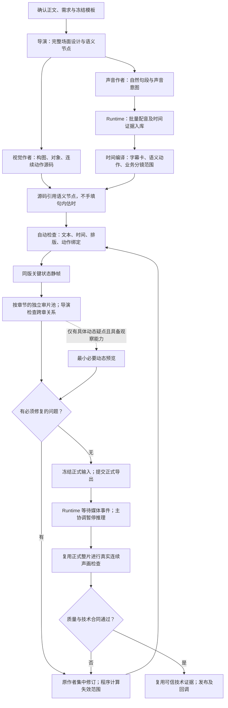
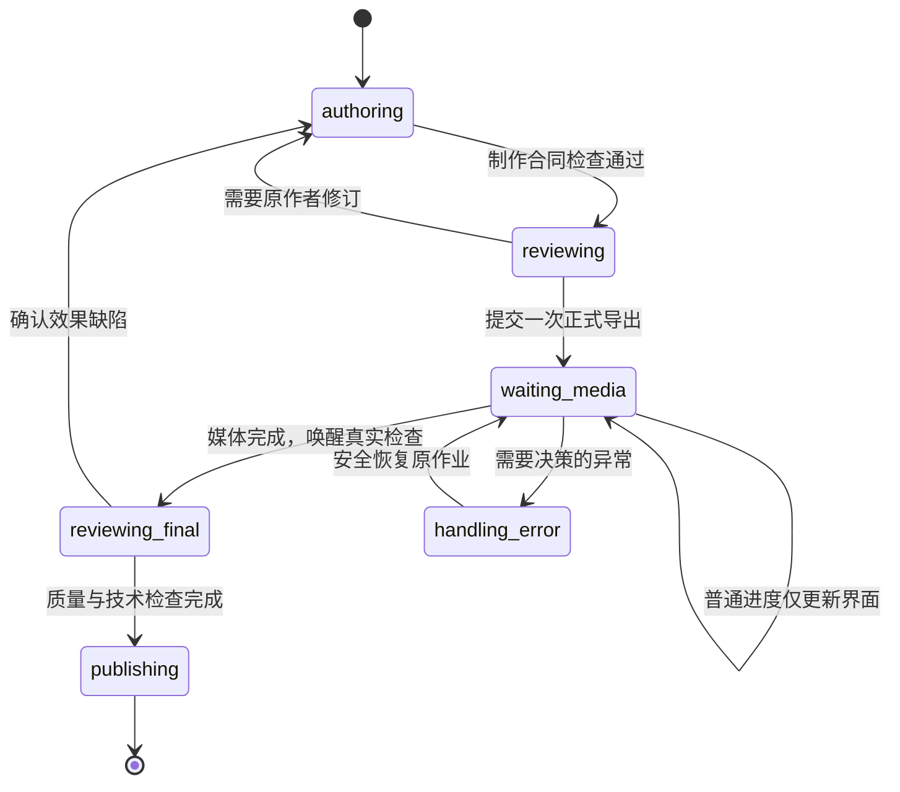

# VideoCutRemotion：保效果的全链路耗时优化方案

**目标：缩短从提交到可交付成片的等待，不通过减少语义动作、合并长字幕、降低画质或跳过必要声画检查换取速度。**

核对日期：2026-10-15。默认分支 `develop` 为 `8d611ba1888e47c2be3c7533f4139dd743ff6aae`；`codex/render-optimization` 的 `394fe4fcdd434a25152f6030f621a1a3e59633fa` 在此基础上只修改规则列表格式、补充验收文档，没有新增制作代码。本方案基于两者共同的 0.1.10 制作实现。[S01]

本次为源码与合同审查，没有修改仓库、访问生产服务器、重新生成视频或完成新一轮连续听审。耗时、图片调用数量及前后作品的动作时机来自本次提供的 Worker 记录；源码可独立确认的机制另行标明。新增接口、类型及文件均为待实施设计，不表示当前已经存在或通过验证。

## 一、最终判断：应修复三条基础链路，而不是继续堆优化开关

现有分析对“时间主要耗在正式导出前”的判断有价值，但还不能直接作为完整开发方案。最终采用以下一套方案：

| 核心改动 | 解决的根本问题 | 为什么能同时帮助速度和效果 |
|---|---|---|
| **统一语音时间依据** | 配音句段、字幕卡、语义动作目前共用过粗的句首时间 | 保留自然配音，字幕和动作使用细粒度时间；减少人工反复估时、改代码和返修 |
| **Runtime 接管确定性编排** | 模型承担参数转换、登记、派单、轮询与异常接替，串行等待累积 | 模型继续负责创作与真实观察，程序处理事务、任务领取和等待；不靠删减创作降低耗时 |
| **按检查目的和真实影响失效** | 一次局部修改，被扩大成全片、多角色、多个维度重查 | 只重做失效证据，未变部分保留；节省的审查预算用于关键动作与声音的对应检查 |

这不是重写整个剪辑系统。保留现有 Analysis/Render 入口、确认正文、完整 Composition、持续负责的创作作者、批量配音、分块绘制、连续音轨和视频码流复用。在既有生产服务中补齐时间合同、审片事务与执行控制，不能另建一个通用多 Agent 平台，也不把 Render 再拆成互不相干的“试作项目”和“正式项目”。

### 1.1 哪些事实已经确认

| 证据 | 当前代码或记录 | 可得出的结论 |
|---|---|---|
| 本次 Render 至发布 41分32秒，其中导出 5分44秒 | 用户提供的运行复盘；仓库验证记录保存了 9 段、128.266667 秒的正式媒体作业 | 继续调编码不是主要方向；本次不是严格同输入性能实验，不能直接算通用提速率 [S02] |
| 没有 `captionTiming` 时，字幕数必须等于配音数，每段只能对应一张卡 | `sentence-audio.ts` | 自然配音变长，会被当前合同推向长字幕；并非单纯模型忘记切卡 [S03] |
| 长文本只返回建议，细粒度对齐文件主要核对字段、摘要和一致性 | `sentence-audio.ts` | 长卡仍可技术通过；“文件写着 provider_timestamps”不等于时间戳确由供应商产生 [S03] |
| 豆包请求未开启细粒度字幕时间，响应处理只保存音频、终止状态 | `doubao.ts` | 缺少“取得时间—保存时间—验证来源—驱动制作”的完整链路 [S04] |
| 局部字幕变更返回全部审片单元；普通变更附带前后整章 | `affectedReviewUnits()` | 局部返修被扩大是明确的实现问题 [S05] |
| 每名审片者只能有一个活动单元；每次保存是独立文件读改写 | `review-policy.ts`、`review-cli.ts` | 只说“批量分派”仍不够；并发提交必须改变领取与存储机制 [S05][S06] |
| 只监听 `thread/started` 做新会话技能核对；通信诊断主要未归属具体线程 | `codex-session.ts`、`tool-observer.ts` | 当前机制不足以证明真实子线程隔离、也不足以自动接替指定审片者 [S07][S08] |
| 主执行器只接受最终交接，然后关闭 App Server；MCP 调用有 180 秒超时 | `codex-session.ts`、`runner.ts`、`mcp.ts` | “等待更久”不能直接实现无模型轮询；需增加非最终等待状态和会话生命周期管理 [S07][S09][S10] |
| 画面块按完整 Composition 的全局帧绘制，拼接用视频码流复制 | `template-chunks.ts` | 此媒体架构应保留，不能退回逐镜从零计时或重复编码 [S11] |

补充两处需要防止再次回归的合同问题：旧执行合同提供过完整 QA JSON 示例，而新的 `references/review.md` 只保留命令名称和概述；`references/director.md` 仍存在“接回代表段后再扩展”的默认式表述，与按需预览容易冲突。前者可解释协议交付回归；后者是流程风险，不能据此断言本次实际又做了完整代表段试作。[S12][S13][S14]

### 1.2 为什么原建议还不够可靠

**封装 MCP，不等于完成调度。** 如果只把 `review.cjs` 包一层，模型仍要搬运范围、生成证据字符串、逐项派单；并发读改写还可能丢失结果。必须同时定义服务所有权、事务、幂等、真实身份和“提交后领取下一项”。

**恢复短句 TTS，可以止住部分退化，但不宜作为默认最终架构。** 字幕需要短，不代表配音必须同样短。将所有配音重新切碎，可能增加请求和拼接听感问题，而且仍无法精准控制短句内部多个动作。需要先使用现有语音服务能够提供的时间，再让配音组织与视觉阅读独立。

**作者声明“只改两处”，不是可信的局部复查证明。** 全局字体、共享函数、字幕时间、前段时长都可能影响未声明区域。反过来，仅因源码总摘要改变就重查全部维度，同样不合理。需要按实际依赖区分。

**图片相同，只能复用该图片支持的静态结论。** 不能证明两张图之间运动相同，也不能证明换卡、数值变化与声音同步。不能把“减少图片调用”变成“取消时间质量检查”。

### 1.3 性能目标应怎么定义

按提供的本次记录，导出时间减半只能节省约 **2分52秒**。返修帧齐备到正式导出之间的 **22分24秒** 更值得排查，但其中有必要审查、网络恢复与重叠工作，不能全部当作可直接删除的浪费。

本轮先设可验证的目标：协议猜测为零；相同证据、相同目的不无理由重复观察；审片者不等待主协调手工再派单；纯媒体等待不唤醒主协调模型；视觉微调不重做声音；必需语义动作和字幕时序缺陷不能通过正式质量门。最终以同输入、同质量的重复实测给出分钟数，不预先承诺“必降到十分钟”。

## 二、最终生产链：创作并行，时间统一，程序接管等待



**并行不等于一切提前渲染。** 声音生成期间，视觉作者可以完成不依赖精确时间的构图、对象和连续过程；真实时间回来后绑定数据。静帧任务已有同版 `readyFrames` 时，可以观察已准备好的范围。保留当前“一条 Run 同时一项媒体工作”的约束，本轮不为了叠加预览和正式导出而另造媒体并发通道。[S15]

**保留同一批创作作者。** 导演掌握整片关系，视觉作者持续负责本期源码，声音作者负责语音及听感。不得为了减少上下文，在每次返修时重新启动一个不了解设计的作者；也不让多个审片者同时改源码。审片角色可以按只读任务接替。

**完整设计与轻量交接分开。** 当前完整设计保存为本 Run 的版本化材料，作者按职责读取；主协调接收材料引用、变更摘要、阻断问题与待办。完整材料没有删掉，只是不再反复搬入所有会话。

## 三、恢复效果的核心：一份可信时间数据，三种不同的制作单位

### 3.1 必须拆开的概念

| 单位 | 负责什么 | 划分依据 |
|---|---|---|
| 配音句段 `SpeechSegment` | 自然语气与连续发声 | 发言角色、自然句群、实际供应商能力 |
| 字幕卡 `CaptionCard` | 屏幕上的一次阅读 | 语义完整、真实字幅、可读时长、可靠语音边界 |
| 语义动作 `SemanticCue` | 哪个对象何时建立、强调、变化或接管 | 原文含义与真实语音落点 |
| 业务分镜 `Scene` | 用户可编辑与交付的单元 | 已确认的 `dataList`，不得为配音或审片重新拆稿 |

它们共享原文定位与时间来源，但数量不要求相等。**一条 13 秒的自然配音，可以对应多张短字幕和多个持续推进的动作。** 不是把整段动画拉长，也不是让对象一直抖动，而是讲到新的信息时，画面发生相应的、有意义的状态变化。

本轮仍尊重现有 `sceneId` 合同：单条 TTS 请求不跨多个确认业务分镜。先解决同一分镜内部的多字幕、多动作，不额外扩大成跨分镜语音合成改造。

### 3.2 首选路径：现有 TTS 同时取得时间，而不是默认再做全片转写

官方当前文档区分 TTS 2.0/ICL 2.0 的 `enable_subtitle` 与 TTS 1.0 的 `enable_timestamp`，可返回字词时间；字幕数据可能晚于对应音频返回，供应商缓存模式还可能不附时间戳。具体音色、资源配置和内容兼容性必须实测。[S16]

当前 `doubao.ts` 不仅没有请求相关能力，解析响应时也没有保留 `sentence` 时间数据。**只添加一个布尔开关仍不完整。** 应在同一次原语音作业内完成：请求能力选择 → 音频和时间分别收集 → 持久化 → 时钟与原文映射验证 → 交给制作。[S04]

实现如下：

| 环节 | 必须落实的行为 |
|---|---|
| 能力选择 | Runtime 根据真实 `voiceRef` 解析的模型、资源和验证过的配置选择参数；模型不能自行猜供应商开关 |
| 响应处理 | 音频数据与时间数据分别接收，处理迟到、重复与缺失记录；不能把网络返回先后当成发声时间 |
| 来源保存 | 保存原始时间响应的受管引用、音频 SHA、请求身份、参数摘要、解析器版本；引用不能由作者伪造 |
| 独立状态 | 音频成功与时间可用分别记录；时间缺失不能把已成功音频变成“必须重新配音” |
| 自有缓存 | 音频与时间证明作为一组复用，核对实际声音输入；不能只复制 MP3 后把所有对齐信息重置成 `segment_exact` |
| 缺失处理 | 已有音频优先补对齐或真实人工时间证据；没有该能力时，仅对确实无法制作的范围调整策略，不能按字数均分冒充对齐 |

首次接入时先用部署中的真实男女音色，验证中文、数字百分比、中英混排、多个子句、长句、尾部静音和缺失时间等固定样本。这个能力检查在开发/发行验收中完成，不是每条视频都新增一次“试音项目”。

不默认部署新的本地大模型。本项目发行明确标识 `localModels:false`；对齐补救能力若尚不存在，应显式返回 `TIMING_UNAVAILABLE`。对已知不具备细时间能力的声音配置，制作前就按必要语义边界选择较短自然句段；不得先做完全部长配音，再无条件全部重配。已成功音频只有在确需重录且原因明确时才生成替代版本。[S17]

### 3.3 时间证明和编译结果：谁能写，谁负责验证

新增 `packages/speech-services/src/speech-timing.ts`，处理供应商时间的解析、规范化和证明登记；新增 `packages/production-service/src/timeline-compiler.ts`，处理确认原文、作者语义节点、真实音频摆放与字幕分卡。

下列类型为拟新增的内部合同；正式开发用项目既有 Zod 定义并导出类型。文件路径、身份和摘要由服务填充，模型只编写创作意图与原文范围。

```ts
type TextSpan = {
  sceneId: string;
  fromCodePoint: number; // 当前 scene 原始正文的 Unicode 码点索引
  toCodePoint: number;   // 半开区间；不是 UTF-16 下标或模糊关键词匹配
};

type TimingProof = {
  proofId: string;
  speechJobId: string;
  audioSha256: string;
  sourceTextDigest: string;
  rawEvidenceRef: string;
  method: 'provider_timestamps' | 'forced_alignment' | 'reviewed_timestamps';
  clock: 'decoded-audio';
  sampleRate: number;
  parserVersion: string;
  tokens: Array<{
    span: TextSpan;
    fromSample: number;
    toSample: number;
    confidence?: number;
  }>;
};

type CueIntent = {
  cueId: string;
  span: TextSpan;
  targetIds: string[];
  purpose: string; // 自由描述本次认知变化，不固定成一套特效菜单
  anchor: 'span-start' | 'span-end';
  anticipationSec: number;
  settleAfterSec: number;
  required: boolean;
};

type CompiledCue = {
  cueId: string;
  proofId: string;
  targetIds: string[];
  startSample: number;
  impactSample: number;
  endSample: number;
  startFrame: number;
  impactFrame: number;
  endFrame: number;
};
```

`TextSpan` 始终指向确认正文，不能先删标点、替换数字再沿用原下标。归一化文本只用于对齐计算，另保存原文与读音的映射。重复出现的“应用层”、数字与百分号都必须能区分具体位置。非发声标点可归入相邻已证实的阅读边界，不要求标点有独立语音；读音展开产生的多对多映射不能用字数均分时间处理。业务正文的完整性检查与屏幕上的换行显示分开。

`reviewed_timestamps` 仅接收实际人工校准记录及其身份，不允许模型自己写一个同名字段就成为可信来源。现有 `captionTiming` 可以保留为兼容输出，但须绑定 Runtime 已登记的 `proofId`，服务反查原证据，不能只检查作者上传的 JSON 自洽。

**统一时钟不等于把所有东西硬锁到句首。** 正式时间来自音频实际摆放：供应商时间先映射到解码音频，再应用真实裁剪、插入包装、重采样等已发生的变换，最后进入全局时间线。TTS 生成语速已经体现在音频和时间中，不能再次除以同一语速。每段只增加一次全局偏移，字幕子句不得重复累加其自身已有的时间偏移。

内部保留采样级时间，显示和创作说明使用秒；输出 Remotion 时由同一函数转换为帧。相邻卡共享同一个量化后的边界，不独立累计每段舍入时长。保持全局半开范围与目前 `frameSample()`、连续 PCM 误差保护一致；不得放宽 0.1.10 的音频容差来掩盖新的时钟错误。[S11]

### 3.4 编译器怎么接入现有工程

执行顺序固定为：读取本次正文和设计节点 → 读取已成功配音及时间证明 → 验证文本覆盖和时钟 → 生成字幕阅读单位 → 生成动作时间 → 生成完整时间轴 → 一次返回全部阻断问题。

输出仍沿用现有时间轴的 `scenes / utterances / captions / captionTiming`，新增明确版本号与 `cues`。保留现有 `timelineModule` 所要求的模块导出接口，让 `.ts` 适配层引用唯一 JSON 数据，或者由同一编译过程同时生成并校验两者，禁止作者分别维护两个不同时间轴。

| 信息 | 模型负责 | 程序负责 |
|---|---|---|
| 主体与视觉变化 | 判断哪句话需要建立、比较、强调或接管，怎样演出 | 验证引用的对象和 cue 存在，不替模型选择美术 |
| 配音 | 自然句群、角色、语气与听感问题 | 批量登记、供应商请求、复用、测量与时间证明 |
| 字幕 | 容易歧义的语义分卡、必要换行与模板例外 | 原文覆盖、可靠边界、字幅和时长检查、全局时间生成 |
| 动作落点 | 选择落点表达的是开始、强调峰值还是结束；以秒描述预备与余势 | 将原文落点映射为实际时间，输出唯一可引用事件 |
| 返修 | 判断观察问题与保留设计 | 计算失效、重算数据、安排复查，不扩散无关工作 |

编译器应优先采用既有设计里已经表达的语义节点，不要求导演另写一份重复的“节点报告”。规则能够直接解决的字幕边界由程序生成；专名、否定、条件与结论可能被拆坏时才集中返回声音/字幕作者处理。

### 3.5 动效必须消费时间，不能只在文档里声明“已同步”

在模板中增加 `renderer/src/cue-timing.ts`，源码由仓库 `scripts/finance-template-patches/cue-timing.ts` 管理并在打包时复制。它只提供严格读取和时间换算，不封装固定美术或强制固定弹簧。下面是该助手的最小逻辑示意：

```ts
export function requireCue(
  cues: Readonly<Record<string, CompiledCue>>,
  cueId: string,
): CompiledCue {
  const cue = cues[cueId];
  if (!cue || ![cue.startFrame, cue.impactFrame, cue.endFrame]
        .every((value) => Number.isSafeInteger(value) && value >= 0)
      || cue.startFrame > cue.impactFrame
      || cue.impactFrame >= cue.endFrame) {
    throw new Error(`INVALID_OR_MISSING_CUE:${cueId}`);
  }
  return cue;
}

export function cueProgress(globalFrame: number, cue: CompiledCue): number {
  if (!Number.isFinite(globalFrame)) throw new Error('INVALID_GLOBAL_FRAME');
  return Math.max(0, Math.min(1,
    (globalFrame - cue.startFrame) / (cue.endFrame - cue.startFrame)));
}
```

视觉作者在 `visualExtensions.tsx` 的具体演出中使用 cue 时间驱动已有对象的状态，曲线、叠加、遮挡、惯性与接管由作者设计。禁止 `cue?.startFrame ?? 0`、缺失时回退到配音句首等静默处理。只有装饰性动作可以不绑定语言节点；承担解释的必要动作必须有有效绑定。

`FinancialDialogue.tsx` 内部存在 `Sequence` 局部时钟，因此应在一个明确的适配位置将 `localFrame + scene.from` 转为全局帧，下游统一使用。不能已是全局帧又叠加一次，也不能按单独导出的分镜从零重新算。模板真实入口和文件由 `renderer/renderer-manifest.json` 定位；上述财经模板路径由仓库整理器明确引用，但本轮没有取得部署中完整模板源码，实施时必须先核对其类型与导出结构。[S18]

“五层模型”应保留同一对象逐步建立、突出前四层、再让应用层成为重点；“接近 90% 到 0”应让数据变化与相应词语对应。旧片的 4.03 秒、9.83 秒只用于说明曾有推进，不能作为新配音的固定常量。

**需要动作不代表每一秒都必须运动。** 合理阅读停留和提前起势可以保留。应防止的是：多个相隔很远的语义事件全部压到同一句首，结论过早出现，或者前一秒完成全部变化后再空等十秒。

### 3.6 把明显退化挡在导出前，保留真正的连续声画验收

| 检查 | 通过依据 | 不允许用什么替代 |
|---|---|---|
| 正文与字幕 | 全文覆盖、顺序和原文定位准确；未删条件、数字、否定 | “大意一致” |
| 字幕可读性 | 模板实际字体和可用字幅、行数、显示时间、语义单位均成立 | 缩小字体、横向压字、只把长段换成两行 |
| 时间可信 | 音频字节及服务时间证明可追溯，边界精度满足本次用途 | 手填 JSON、按字数均分 |
| 关键动作覆盖 | 必需 cue 有有效时间、实际源码引用且关键状态有证据 | 设计清单写了 cue，却没影响可见对象 |
| 运动与声音 | 有能力的观察者以正常速度带声检查实际范围 | 两端静帧、波形、ffprobe、点击播放一次 |

对当前中文模板，可将 12～24 字作为优先阅读单位、28 字作为风险触发值，但它不是所有视频的普遍硬上限。超出时必须得到可用布局和合理阅读时间的证据；普通口播出现本次 72 字、13.33 秒且未分卡的情况，应返回明确未解决项，不能只打印建议后自动正式通过。极短卡闪烁和切断语义同样不通过。

在 cue 起势、主要变化、最拥挤中途与落定附近抽取少量关键状态，必要时利用实际运行的绑定记录定位。运行记录只能证明代码消费了时间，不能独自证明美术或声画正确。增加“首尾图相同、但中间动画时间错位”的反例测试，防止静态审片漏检重现。

正式整片已经生成时，直接打开该版本 `0.mp4` 的原文件完成连续声画观察，不先另渲染一套短片。发现局部问题，记录确切时间范围，再进入影响分析。没有真正的连续声画观察能力时，状态必须是 `professional_review_pending`；系统可以保留技术合格的待审成片，但不能宣称“效果已验证、不降质”。若要求自动正式发布，则真实视听检查能力必须成为可用的交付依赖。

## 四、降低等待的核心：审片任务池、局部失效、非模型等待

### 4.1 MCP 要管理真实任务，而不是暴露内部记账动作

扩展现有 `textvideo-studio` MCP，不新增独立服务。新增 `packages/production-service/src/review-service.ts`，在现有 SQLite 中保存审片计划、任务、证据、问题和分派；原 QA JSON 改为审计导出物，不再作为多个代理共同读改写的主状态。[S06][S10]

建议对模型只开放以下接口；身份从服务会话取得，不能用模型填入的 `reviewerAgentId` 冒充认证。

| 拟新增工具 | 模型提交 | 服务承担 |
|---|---|---|
| `prepare_review` | 当前快照引用、检查阶段 | 从时间轴、章节和真实预览作业建立范围；注册证据 ID、检查目的和剩余任务；同输入返回原计划 |
| `claim_review_work` | `reviewId` | 为认证审片者原子领取一个完整章节单元；返回材料和证据引用，不要求逐帧重新分派 |
| `submit_review` | 分派令牌、稳定提交 ID、实际观察证据、问题、部分/完成状态 | 检查权限、版本、分派代次、覆盖范围；去重落库，完成后直接返回下一任务 |
| `read_review` | `reviewId`、最后已知事件序号 | 返回待办计数、阻断问题、异常和新增变化；默认不展开全量历史 |

示意提交如下，ID 均来自前一工具结果；这不是要求作者自己生成文件摘要或自行指定审片者身份：

```json
{
  "reviewId": "review-02",
  "assignmentToken": "service-issued-assignment-token",
  "submissionId": "review-02-chapter-03-submit-01",
  "observedEvidenceIds": ["ev-101", "ev-102"],
  "findings": [
    {
      "checkId": "caption-layout",
      "evidenceIds": ["ev-102"],
      "severity": "blocking",
      "problem": "当前字幕遮挡了比较基线，导致数值关系难以辨认。",
      "expected": "调整该场景字幕与图解的相对布局，保留字体大小和比较基线。"
    }
  ],
  "status": "complete"
}
```

精确合同由 `review-service.ts` 导出的 Zod Schema 同时供 Runtime 校验、MCP 注册、JSON Schema 示例与契约测试使用。保留严格字段校验，但错误返回 `code / fieldErrors / retryable / recoveryAction / currentAssignment`，不要把异常多次转义成难以使用的字符串。错误的恢复只处理记录，不重做已经观察过的画面。

**有四项不可省略的服务保证：**

| 保证 | 实施要点 |
|---|---|
| 真实身份 | 宿主创建审片线程时发放绑定 Run、角色和授权范围的会话凭证。现有 Run 级令牌仅能证明属于本 Run，不能区分谁是审片者；需扩展鉴权 [S10][S15] |
| 幂等提交 | `(reviewId, submissionId)` 唯一，同 ID 同正文返回已接受结果，不重复追加；不同正文报冲突；重试不能额外领取多个任务 |
| 原子更新 | 结果接收、问题合并、单元完成、下一任务领取在一个短事务中完成；图片读取、哈希和模型调用不放在数据库锁内 |
| 过期隔离 | `snapshotDigest + unitId + generation + holder` 匹配才可影响当前计划；旧代理迟到结果保留历史，不覆盖新负责人结果 |

不能假设原生 MCP 自动携带可信 `threadId`。本方案的独立审片池由 Runtime 使用既有 `AppServerClient` 建立有界受管会话，每个审片者使用独立的 MCP 授权上下文；凭证由宿主传递，不放入模型正文。单个审片会话在本 Run 内持续复用，不按章节重新启动，也不得用独立进程绕过全服务和单 Run 的并发预算。若底层提供可验证的线程级调用归属，可由会话适配层实现同样的隔离合同，但不能仅靠调用参数里的自报身份。

现有“一位审片者一个活动单元”的约束可以保留。需要改变的是**谁负责给下一项**：服务在完成事务中安排，不再等待主协调收到消息、写 JSON、再调用 followup。不能直接给同一个代理登记多个活动单元，然后绕过原约束。[S05]

同一检查目的下，提交覆盖的证据必须属于分派范围；静帧证据不接受“已听审”的结论。读取或播放记录可用于辅助核对，但不能把“请求过播放”自动记为完整观察。

### 4.2 按实际章节组织工作，不按每张图或每个分镜交接

由 Runtime 从导演已有章节映射建立任务，不要求重新拆正文。本次 4 章/9 镜只是一个样本，代码不得写死。一个章节包包括本章场景、相关字幕和 cue、同版证据、上下文、明确待查目的；审片者在包内连续完成，必要时保存部分结果。

调度采用工作队列，优先复杂、耗时或阻断范围。2～3 名审片者是否真的更快要按宿主实际名额和时延测量，不能默认代理越多越快。章节特别大时可拆成有明确连续上下文的子范围，不能退化成“一张图一个代理”。

主协调只接问题摘要、冲突和未完成项，不默认打开全部截图。导演负责整片关系、跨章接点、片头片尾；独立审片者负责自己的完整章节；声音作者负责实际声音问题；原视觉作者集中修改。必要的二次意见针对有争议的范围，而非全员重复看全片。

现有五类专业观察目的可以保留，但它们是不同的判断任务，不应变成五道串行审批或五次重新加载全部内容。首次理解检查应在透露导演预期答案前完成；技术和对照检查再读取设计。[S13]

### 4.3 局部返修：失效的是某项结论，而不总是整个视频

保留完整 `sourceDigest`，用于冻结输入、追溯和防篡改；另建立按用途的依赖摘要，不能以取消总摘要检查换取命中缓存。

| 修改类型 | 必须重做 | 可以保留的内容 |
|---|---|---|
| 仅补设计说明或审片记录 | 记录校验 | 全部媒体与已有效观察；记录应存于 `qa/` 或 Run 级材料目录 |
| 单场景图形位置、颜色 | 受影响状态的布局、中途共存及相关接点 | 未变声音、字幕时间；无影响场景的同目的观察 |
| 单张字幕断行，文案与时间不变 | 该卡及其叠加背景范围的排版 | 音频和动作时间；其他字幕 |
| 一处字幕换卡时间 | 相关卡及相邻切换的时间/布局检查 | 无关章节声音与构图 |
| 全局字体、字号、字幕底板 | 全片相关排版检查 | 原语音生成与时间证据；不必再审无关声音维度 |
| 一段配音内容或实际时长 | 该段声音，相关原文映射；时长改变时重算后续全局时间和受影响包装/混音 | 未变音频文件，不自动重新调用全部 TTS |
| 共享动画函数、未知任意源码依赖 | 能证明闭包时重查受影响范围；证明不足时保守扩大 | 不能只凭作者声明排除其他场景 |

范围由 **真实变更 + 已知依赖 + 作者说明** 共同决定。作者说明是线索，不是唯一依据。边界检查包括持续对象、退场尾部、阴影/效果余尾及跨章声音，不自动把前后整章加进来，也不统一用固定 10 帧或 1 秒假装所有接点影响一样。

首轮实施不建设能够理解任意 TypeScript 的复杂依赖分析器。先对时间轴、字幕、声音、包装和已声明场景模块做明确分类；不能证明局部的共享源码保持保守策略。仍可重新生成便宜的代表帧，然后只让模型观察真正变化或尚无证据的部分。

**静帧观察可继承的条件：** 图片内容完全相同，检查目的、显示坐标/尺度、相关文字语义和影响条件没有改变；只继承这个采样状态的结论。相同图片不转移音频、运动、阅读时序和整段连续性的通过状态。

**音频核验可继承的条件：** 音频实际字节、确认文本、声音参数、对齐证明、摆放及相关检查策略未变。视觉代码改变后，服务可验证依赖并为新快照登记继承来源，不应再次完整解码同一组音频。但不得只把旧审计的 `sourceDigest` 改成新值。当前 `verify_sentence_audio` 与整个工程摘要绑定，需在该工具内部实施可追溯继承，而不是让作者绕过工具。[S03][S15]

正式渲染缓存比审片观察缓存要求更高。本轮优先减少重复模型观察和音频核验，**不承诺局部改两个元素就一定能只渲染两个片段**。当前画面块恢复要求同源码摘要；跨版本复用画面块需额外证明完整渲染依赖，不应靠图片相同来放行。[S11]

### 4.4 连接异常：恢复只读剩余任务，不重放整条生产

扩展 `tool-observer.ts`，将安装版本真实返回的线程/工具事件规范化为 `threadId / eventType / timestamp / activeItem / retryState`。不是仅解析 stderr，也不假定所有子代理都会发送 `thread/started`。[S07][S08]

工作状态分开记录：宿主连接是否在线、是否处于重试、工具是否在运行、最近一次有效观察进度。没有新文字不代表代理死亡；连接重试也不能继续标成“正在看图”。

| 情况 | 正确动作 |
|---|---|
| 正在正常观察或有明确活跃工具 | 不因文本暂时沉默就接替 |
| 单审片线程连接异常且宿主仍在有效恢复窗口 | 标记 recovering，保留进度；窗口由配置和实际宿主重试行为决定 |
| 明确失败或恢复窗口耗尽 | 增加分派代次，回收未完成范围，交可用审片者；旧结果只能进入历史 |
| 多线程同时发生上游连接故障 | 限制新建和重试，进入统一退避，避免成倍创建代理的重试风暴 |
| TTS 或媒体结果未知 | 先核对原任务、文件和服务状态，不按“审片代理坏了”重新配音或导出 |

只读任务可安全接替不代表写作者也能直接双开。若写作者需要恢复，必须确认旧写入已停止，取得新的独占写入权，再基于冻结材料继续；不能让两个作者同时写同一工程。

### 4.5 纯导出等待不再让模型反复做判断

只把 `read_render_job` 改为 60 秒返回一次，会缓解问题，但不能消除轮询；无限延长 MCP 调用还会撞上当前 180 秒超时。真正的修复是让执行器支持“当前没有决策，等待 Runtime 事件”的非最终状态。[S09][S10][S15]



在同一个 Render Run 内，给现有执行交接增加一种结果：

```ts
type ExecutionSignal =
  | {
      kind: 'await_runtime';
      taskId: string;
      runId: string;
      inputDigest: string;
      checkpointRef: string;
      waitFor: { jobId: string; afterEventSeq: number };
    }
  | {
      kind: 'final';
      taskId: string;
      runId: string;
      inputDigest: string;
      resultPath: string;
    };
```

`await_runtime` 只结束当前推理轮次，不结束视频任务，不发布，也不触发当前执行器的正常关闭逻辑。`AppServerClient` 的所有权应上移到 Run 级会话管理：正常等待保持进程/线程和作者材料；真正完成、取消或无法恢复的连接关闭时才回收。不能在每个 turn 的 `finally` 中关闭整棵会话，然后声称保留作者。[S07]

`runner.ts` 保持 Run 租约、取消和工作预算，收到最终交接才进入 `finishing`；新增 `execution-controller.ts` 负责等待记录、事件与下一轮恢复。媒体的细进度继续更新 UI；只在完成、失败、用户变更等需要行为的事件上唤醒模型，不把整个作业 JSON 的任意变化都当成需要推理。

等待注册和完成事件必须持久化。采用单调事件序号，先登记等待再核对当前状态，避免作业已完成却错过通知；恢复时从持久化作业状态补偿。每次唤醒有唯一 `wakeId` 并记录 turn 身份，`turn/start` 返回未知时先核对原线程，不盲目再开一轮。

可保留有界长轮询作为兼容入口，但最终生产路径的目标是：**无异常、无新增决策的正式导出等待中，主协调模型调用为零。** 正式成片出来后的真实检查依然需要模型或人工，不属于应删掉的等待。

### 4.6 Skills 隔离和上下文：不删专业能力，删无关注入与重复搬运

当前阶段视图生成已存在，不重建一套 Skills 体系。在原 manifest 增加角色映射，生成协调、导演、视觉、声音、审片的允许技能集合；正文引用按工作需要延迟读取。[S19]

宿主为每个真实线程绑定角色配置，创建前配置，创建后检查，不能仅靠“请勿读取其他技能”的提示。原生子线程若无法证明有效目录与工具隔离，应在新 Run 初始化时通过同一受管角色会话适配层提供原有作者角色；不增加作者数量或创作阶段，也不在正常返修中抛弃原作者上下文。验证同时记录：实际线程 ID、有效 cwd、声明角色、技能目录、强制系统条目、实际加载入口、工具权限。系统强制保留的条目如实报告，不能伪称已经隔离为零。

优先让 Runtime 管理只读审片线程的创建和角色权限。作者接手时获得完整当前设计与所需接口，不默认继承整段父会话的图片、失败诊断和状态历史。尽量保持当前作者继续修订，不能用“每轮换一个空白作者”换取较短上下文。

安装协议以发行固定的 Codex CLI 为准；仓库标注 `0.144.4`。官方支持按已安装 CLI 导出协议，应据此建立事件适配和真实子线程集成测试，不能把最新文档中的事件名称直接当作目标机已支持。[S17][S20]

当前主 turn 还硬编码 `effort:'low'`。不能据此认定本次退化是模型档位造成的；性能对比必须固定并记录实际模型、effort 和工具能力。后续角色配置可单独评估创作角色的推理投入，但本轮不能通过进一步降低模型能力来制造提速。[S07]

### 4.7 媒体层只做证据复用，不重新折腾已有效的渲染策略

保留 `scene-chunks`、完整 Composition 全局帧、连续 PCM、视频码流复用及实际资源预算。当前源码已按全局帧生成块和音频，不应为优化复查又退回单场景时钟。[S11]

将技术校验结果保存为服务侧证明，至少绑定：文件 SHA、流规格、帧/采样范围、校验器版本和策略、成功状态。发布阶段如果目标就是已完整验证的同字节文件，可复用该技术证明，再核对复制后 SHA、身份和发布目录；新封装文件、不同字节或策略变化仍须执行相应校验。不能仅凭源文件名相同跳过。[S21]

`delivery.ts` 当前已经有复制后字节检查，应保留。优化的是重复完整解码，不是删除复制完整性，也不是删除最终声画观察。其收益通常小于流程优化，本轮优先级靠后。

## 五、开发落点：修改哪些文件、改到什么程度

以下是同一套方案的实施清单。前两组是质量基础与审片服务，第三组接管等待，最后再做证明复用。不要把所有改动混成一次不可定位的大提交。

### 5.1 代码修改清单

| 路径 | 操作与具体职责 |
|---|---|
| `packages/speech-services/src/doubao.ts` | 修改：按真实声音配置启用已验证的时间能力；解析并保存时间响应；音频/时间状态分离；缓存、复用保留时间证明；请求指纹纳入实际生效的能力和参数；保留 unknown 不重发 |
| `packages/speech-services/src/speech-timing.ts` | 新增：供应商响应转受管时间证明，处理原文映射、时钟、重复/缺失、置信度和来源；提供统一失败原因 |
| `packages/production-service/src/timeline-compiler.ts` | 新增：从确认正文、已采用的语义设计、音频与证明生成字幕、cues、全局时间轴；一次返回全部待处理问题 |
| `packages/production-service/src/sentence-audio.ts` | 修改：支持服务登记的多卡/多动作时间证明，校验用途所需精度；风险不再只打印即放行；音频核验按依赖复用，仍绑定正式快照 |
| `apps/server/src/production/speech-tools.ts` | 修改：注册 `compile_timeline` 与审片工具；直接引用同源 Schema；批次摘要新增时间可用状态与证明引用，不展开全量字词数组 |
| `apps/server/src/production/routes.ts` | 修改：新增工具路由及角色授权；调用生产服务而非 CLI；媒体 UI 进度与模型动作事件分离；保存技术证明 |
| `packages/production-service/src/review-service.ts` | 新增：工具 Schema、证据登记、SQLite 事务、幂等提交、领取下一单元、代次校验、结构化错误与摘要读取 |
| `packages/production-service/src/review-policy.ts` | 修改：继续保留真实覆盖、静态证据边界和迟到隔离；失效计算按类型/范围；保留一位审片者一个活动单元，调度交服务 |
| `packages/production-service/src/review-invalidation.ts` | 新增：变更分类、检查依赖摘要、接点影响范围和可继承结论；未知依赖保守处理 |
| `packages/production-service/src/review-cli.ts` | 从生产必经路径移除；若保留诊断入口，必须调用同一个服务，不能保留另一套独立写计划逻辑 |
| `packages/production-service/src/repository.ts` | 修改：审片、等待、事件与提交去重的持久化表和短事务；保证服务重启后可恢复；不修改已有成功发布结果 |
| `packages/production-service/src/execution-controller.ts` | 新增：同 Run 的工作状态、审片池、持久化等待、唤醒去重、异常恢复；不负责美术和声画判断 |
| `packages/production-service/src/codex-session.ts` | 修改：区分 turn 与 Run 的生命周期；支持非最终等待及原线程续接；角色技能/工具授权；验证全部真实子线程；不能正常等待时关闭 App Server |
| `packages/production-service/src/tool-observer.ts` | 修改：接入结构化线程连接/重试事件，区分正常工作与异常；提供执行控制器所需的归属信息 |
| `packages/production-service/src/runner.ts` | 修改：理解 `await_runtime`；继续保持租约、取消和工具收敛；只对最终交接执行发布流程 |
| `packages/production-service/src/task-instructions.ts` | 修改：删除生产路径中的 `request.json/review.cjs` 指示、主协调逐项派单和重复状态查询；注入角色、材料引用及等待合同；仍保留确认正文和不盲重试约束 |
| `packages/production-service/src/contracts.ts`、`config.ts` | 修改：增加新版生产合同与相关状态配置；同一 Run 固定版本；把关键能力作为发行组合校验，不增加一堆可任意混搭的用户开关 |
| `apps/server/src/mcp.ts` | 修改：传递角色绑定授权与结构化错误；180 秒超时继续有界，长时间等待不压在单个 MCP 调用上 |
| `apps/render-worker/src/template-chunks.ts` | 保留现有策略；只补可靠校验记录及其复用接口，不重置全局时钟，不放宽 PCM 容差 |
| `packages/production-service/src/delivery.ts` | 修改：优先使用匹配当前文件与策略的服务校验证明，保留复制后 SHA、身份、完整清单和原子发布 |

`compile_timeline` 的拟定最小入参为 `compileRequestId / designRef / speechBatchRequestIds`，其中 `designRef` 是已登记的当前设计数据引用；输出 `compilationId / timelineRef / timelineDigest / unresolvedIssues`。不允许任意跨 Run 文件路径。相同键不同输入拒绝；完成后由冻结步骤建立正式 `sourceDigest`，编译中途不声称工程已经冻结。

实际影响画面的 cue 数据、字幕与时间轴必须进入渲染输入摘要。只有不参与执行的设计解释、讨论、审片意见放在旁路材料中；**不能把会影响成片的参数藏到旁路，再宣称补文档不需要重渲染。**

### 5.2 模板与发行同步，防止服务改了而作者仍执行旧规则

仓库侧修改：

| 路径 | 必须完成的同步 |
|---|---|
| `scripts/prepare-finance-template.py` | 更新生成的创作说明：配音、字幕、动作不是一一对应；新增 timing 合同版本；复制受维护的 cue helper；保留现有包装与全局 Composition |
| `scripts/finance-template-patches/cue-timing.ts` | 新增：严格 cue 读取及全局时间助手，供整理器复制到模板；不写固定动画类型 |
| `plugins/textvideo-studio/scripts/skill-manifest.mjs`、`sync-skills.mjs` | 扩展角色允许清单和参考依赖闭包校验，从 canonical manifest 生成角色视图；避免目录缩小后相对引用失效 |
| `plugins/textvideo-studio/scripts/build-production.mjs`、`verify-production.mjs` | 将时间/审片/执行控制变更打入同一发行，并核验模板合同、角色视图和必要工具；生产不依赖旧 CLI 路径 |

冻结模板内需检查并更新的准确相对位置为 `renderer/renderer-manifest.json`、`renderer/src/types.ts`、`renderer/src/validateTimeline.ts`、`renderer/src/FinancialDialogue.tsx`、`renderer/src/visualExtensions.tsx`，以及 manifest 的 `timelineModule` 指向的真实模块。它们是模板归档内路径，不应误当成仓库根目录已有文件。[S18]

新增模板助手文件为 `renderer/src/cue-timing.ts`。模板更新通过受控整理/打包发布新版本完成，不手改共享原件、已冻结快照或安装缓存。新任务必须验证 Runtime、MCP、Skills 与模板 timing 合同匹配后再开工；旧活动任务沿原发行收敛，不在执行中途迁移。

## 六、Skills 的具体修改正文

### 6.1 修改唯一维护源，不手改生成副本

维护源统一为 `.agents/skills/_shared/template-production/`。当前 `manifest.json` 定义 `render/<skill>/entry.md` 和 `references/*.md` 到插件视图的映射；`sync-skills.mjs` 会生成 `plugins/textvideo-studio/skills/`、`skills-stages/analysis/` 和 `skills-stages/render/`。[S19][S22]

新增共享参考文件 **`.agents/skills/_shared/template-production/references/timing.md`**，不新增一个常驻“时间规划代理”。在 `manifest.json` 中加入该参考的复制映射，并维护角色允许清单。引用目录包含共用参考文件，不意味着把 `production-coordinator/SKILL.md` 本文也强制注入每个角色。

| 需要修改的入口准确路径 | 职责、加载条件与正文改动 |
|---|---|
| `.agents/skills/_shared/template-production/render/production-coordinator/entry.md` | Render 主协调入口；加载下文协调合同，禁止 CLI 记账和逐项手动派发；制作开始不展开全部专业方法 |
| `.agents/skills/_shared/template-production/render/production-director/entry.md` | 主线与跨章设计时加载 `director.md`，需要描述语义推进时读 `timing.md` |
| `.agents/skills/_shared/template-production/render/visual-explainer-director/entry.md` | 解释结构设计时加载同一时间合同；避免把“有动画”当“关系有推进” |
| `.agents/skills/_shared/template-production/render/scene-planning/entry.md` | 场面与业务分镜关系设计时加载；保留跨句持续对象，不能按字幕卡重置场面 |
| `.agents/skills/_shared/template-production/render/remotion-production/entry.md` | 实际写本期动画源码时加载 `visual.md` 与 `timing.md`；强制使用已编译 cue |
| `.agents/skills/_shared/template-production/render/effect-timing/entry.md` | 设计动作落点、预备、余势时加载 `timing.md`；用秒描述，不提供无证据的句内帧号 |
| `.agents/skills/_shared/template-production/render/voice-production/entry.md` | 组织配音时加载 `audio.md` 与 `timing.md`；保留自然配音和缺失时间的处理边界 |
| `.agents/skills/_shared/template-production/render/captions/entry.md` | 字幕分卡与换卡问题时加载同一时间合同；不使用配音数组直接逐项生成整段长卡 |
| `.agents/skills/_shared/template-production/render/audio-finishing/entry.md` | 混音、语音修订及真实听审时加载；声音修改后通知时间编译，不让作者手改多个时间数组 |
| `.agents/skills/_shared/template-production/render/quality-verification/entry.md` | 实际审片时加载 `review.md`；按任务范围观察并通过 MCP 保存，不读取整段父历史 |
| `.agents/skills/_shared/template-production/render/export/entry.md` | 导出提交及最终交付时加载 `export.md`；长等待由 Runtime 管理，技术成功不等于专业验收 |

其他美术、机制检索、空间与证据表达 Skills 保留专业内容，不为了缩短目录删掉持续运动、真实中文排印或关系表达的方法。新增条款替换同主题旧规则，不能在末尾追加后仍保留冲突指令。

### 6.2 主协调：替换 `references/render.md` 中审片协调与等待相关段落

```text
以本次确认正文、需求和冻结模板为准，保留同一批持续负责的导演、视觉与声音作者。
主协调管理采用决定、责任交接和未解决问题，不承担重复的证据搬运与工具记账。

作者交回完整当前设计引用、可冻结工程和实际风险。由 Runtime 建立同版审片计划，
真实审片者通过任务工具领取完整章节范围，提交后直接取得下一项；不得每看一张图
或每完成一个分镜就等待主协调重新派单。主协调只读取摘要、阻断项和必要争议证据。
不再写 request.json 调用 review.cjs，不手工拼接图片路径与摘要，不伪造代理身份。

静帧、连续画面、音频与声画同步分别记录。可选审美建议不能无限阻止交付，已知的
关键语义、字幕阅读或同步缺陷不能靠补写“通过”关闭。返修交原作者集中处理，
审片者只读；复查范围使用服务返回的真实影响依据，不把所有字幕改动等同全片重审。

正式导出提交成功后，若没有新增决策，按执行合同交出 await_runtime 等待记录。
这是同一 Render 内的等待，不是任务完成。不要反复查询普通进度，不重启作者，
不要因等待或连接异常重新配音、重新导出。成片可用后复用该文件完成必要真实检查。
```

对应 `task-instructions.ts` 必须同步移除冲突段落，`verifyStageTools()` 必须核对新发行必要工具已加载，不能让模型在正式生产中发现“技能写了但工具不存在”。

### 6.3 导演：修改 `references/director.md`，并替换默认代表段流程

```text
在当前完整场面设计中标记必要语义节点：它对应哪段确认原文、哪个对象、什么认知
变化、采用建立/强调/接管等哪种过程，以及哪些共同参照必须持续存在。节点属于
当前设计，不另写一份重复方案。原文位置使用可验证范围，不只填可能重复的关键词。

TTS 句段、字幕卡、业务分镜和动画节点可以数量不同。自然配音可连续讲述，画面仍
需跟随其中的信息推进；不得把整句包含的多个变化统一安排在句首，也不能把每张
字幕当成新场面。允许有依据的提前起势和必要阅读停留，不要求装饰性持续运动。

视觉与声音在具备各自输入后并行；真实语音时间回来，由共同时间合同校准节点。
估时只服务初稿，不能成为正式动作时间证据。

不要求默认先完成一个代表段再制作整片。先用必要真实静态状态识别会扩散的布局、
字体和时钟风险；只有具体动态问题无法从静态判断且具备观察能力时，才安排最小
动态验证。代表范围通过仅覆盖该范围，不能扩大为整片已通过。

导演集中判断整片关系、跨章持续对象和节奏冲突，不重复打开已经由合格审片者
完成、且没有新疑点的所有图片。修复不得删除已采用的解释过程来迁就技术通过。
```

在 `references/scene.md` 的场面边界条款加入：“业务分镜边界是交付范围，不是重置全局进度、字幕或持续图形的命令；对象的持续、退出及接管范围需进入影响分析。”

### 6.4 共享时间合同：新增 `references/timing.md` 的完整指令核心

```text
# 共同语音时间与语义动作

输入是确认原文、采用的场面设计、实际声音作业及服务登记的时间证明。
创作者决定语义、阅读和演出；Runtime 决定真实定位、单位换算、时间轴与证据身份。

配音按自然语气组织；字幕按语义和屏幕阅读组织；动作按解释过程组织。三者共享
原文定位，但不要求一一对应。只能使用达到所需精度的真实时间，不能按字数均分，
不能拿一句的起点代替句内多个词语的时间，也不能把证据不足隐藏为默认零时刻。

节点描述保留对应原文范围、目标对象、预期变化及落点用途。用秒表达提前起势、
主要变化和余势，正式帧由服务统一生成。缺失或过期的必要 cue 必须返回处理。
源码严格读取 cue，不能在缺失时回退到句首；只是注册 cue 而没有驱动可见状态，
不算实现了动作。装饰性动画不冒充语义动作。

字幕保护专名、数字单位、否定、条件与结论。优先自然短阅读单位，超长、过短、
换卡过早或过晚按真实字幅、时长和声音检查。不能靠缩小字体或删字规避问题。
时间证据不足时处理所需精度，不能直接将整条长配音作为一整张字幕放行。

声音字节、正文、语速、裁剪或摆放发生变化时重新编译相关时间；纯视觉微调不
重新配音。全局时间只换算一次，Sequence 局部时间在统一入口转换。正文完整性、
源码绑定、静态布局、真实连续声画是不同检查，不互相代替。
```

### 6.5 声音与字幕：修改 `references/audio.md` 的配音与分卡段落

```text
先按 Runtime 已确认的声音能力组织自然句段，通过批次取得音频和可用时间证明。
服务已经取得的音频不因缺少细时间就重新请求；沿原作业处理缺失证据。只有实际
声音需要重录或已明确采用新的分段策略时，才生成受影响范围的替代音频。

字幕分卡不能使用“每条配音生成一张卡”的默认循环。按共同时间合同从原文阅读
单位生成多张卡，同一配音可以含多个动作节点。把无法可靠定位、无法读清或切断
语义的卡集中交回处理，不能只留长卡建议后继续宣布完成。

音频生成、技术核验、时间证明和实际听审分别报告。声音不变、只改布局时不重做
配音；声音变化后统一重算相关字幕、动作和混音接点，不分别手填几套时间数组。
保留现有自然听感、音乐退让、音效落点与真实声画观察要求。
```

### 6.6 视觉与动效：在 `references/visual.md`、`references/motion.md` 更新实现条款

```text
沿完整 Composition 的全局时间制作。真实语音时间未就绪时，可先完成构图、对象、
关系和不依赖精确时刻的演出逻辑；正式实现必须引用共同时间合同输出的 cue。

将入场、建立、比较、强调、接管设计成可追踪的状态变化。保留共同参照、阅读路径、
交叠和余势，不因接入时间合同退化成统一淡入淡出，也不要求每个字幕重新入场。
动作关键落点依据本次真实语音；不能把多个句内节点放到同一句首后就让画面停住。

保持模板固定包装与已采用美术。只改局部时，不重新选择全片风格；不通过缩小中文、
删掉主要动作或解除布局保护来消除报错。时间工具不替代构图和演出判断。

交回修改文件、实际影响的状态范围、持续对象及尾部影响、需要观察的动态问题。
作者声明供服务核对，不等于自行宣布其他区域不受影响。完成写入后由服务冻结证据，
不同版本不可混成同版通过。
```

### 6.7 审片与导出：更新 `references/review.md`、`references/export.md`

```text
审片者通过服务领取真实分派，在指定版本、范围和检查目的内观察；使用服务返回的
证据 ID 提交实际观察与问题。完成章节包后直接处理服务返回的下一包，不等待主
协调逐项转交。部分观察及时保存，接替只处理剩余范围，不重做已有效的观察。

静帧只证明被观察的状态；连续视频证明实际看过的范围；声音与声画对应必须具备
真实听看能力。相同图片仅可继承同条件的静态观察，不能继承运动与听审通过。
主协调不是默认的第二个全片审片者，导演也不重复检查所有单帧。

五类专业观察保留为检查目的，不强制五次全量审查。针对未完成目的安排必要观察，
没有对应能力则记录待审，不通过渲染更多无人消费的视频弥补能力缺失。

返修按服务计算的失效范围复查；已知阻断须修复并验证，建议不变成无尽审批。
正式整片可用后直接复用原文件检查，不重新渲染相同版本。渲染成功、可解码和完整
视听通过分别记录；只有满足相应交付合同才能标记正式验收完成。

导出提交一次后沿原作业身份执行。无决策的等待交 Runtime，不反复查询小进度，
不因连接问题重复发起。技术证明复用由服务核查，作者不得自行跳过媒体完整性检查。
```

上述修改同时覆盖入口、共享参考、动态任务指令和生成发行物。只改其中一层，会再次出现“文档讲新流程、运行时仍要求旧操作”。

## 七、实施顺序与验收：先不退化，再证明变快

### 7.1 分四组交付，每组都有退出条件

| 实施组 | 范围 | 退出条件 |
|---|---|---|
| **1：时间与效果基础** | 真实时间获取、服务证明、时间编译、模板 cue 消费、字幕质量与对应 Skills | 固定样本中长配音能生成可读多卡；多个真实语义节点分别推进；缺时间不能默认句首；音频不无故重做 |
| **2：审片服务与局部复查** | 同源 MCP、事务、身份、章节任务池、按目的失效、原作者集中返修 | 无协议猜测；并发结果不丢；重复提交不重复记账；两处局部修改不变成所有角色全片复查 |
| **3：执行控制与会话恢复** | 同 Run 等待、持续会话、结构化异常、角色技能/工具权限、唤醒去重 | 纯导出等待无主协调模型轮询；只读失败只接替剩余任务；主/子线程均有实际配置证据 |
| **4：证明复用与性能验收** | 音频/发布技术证明复用、固定输入基准与真实网页对照 | 质量不退化且端到端实测变快；没有把后续审片、失败或人工等待移出计时来美化数据 |

每组可以独立提交和测试，但新版正式发行必须成套验证合同。不能只上线“长配音”而没有细粒度时间与多卡消费，也不能只上线“并行 MCP”而没有事务与分派校验。

在新 Run 固定生产合同与发行版本。回滚只影响之后受理的新任务；活动 Run 保持原版本和原请求身份，未知收费请求不重放；成功发布结果不被覆盖。旧 CLI 的生产调用应删除，而不是长期同时维护两套审片协议。

### 7.2 必须添加的回归测试

| 拟新增测试文件 | 关键覆盖 |
|---|---|
| `tests/production-speech-timing.test.ts` | 音频先到、时间后到；时间缺失/重复；第二子句时间偏移；数字百分比/原文映射；时间无效但音频仍成功；缓存保留证据；unknown 不重复收费 |
| `tests/production-timeline-compiler.test.ts` | 长配音多卡多 cue；原文无损；重复关键词定位；不能按字数均分；全局时钟只加一次；包装和局部时间转换；音频变化引发后续时间重算 |
| `tests/production-review-service.test.ts` | 实际并发提交无丢失；重复 ID 幂等/冲突；提交后续领；旧代次拒绝；伪造身份/跨 Run 拒绝；章节实际覆盖与部分接替 |
| `tests/production-review-invalidation.test.ts` | 局部字位、单卡断行、全局字体、共享未知依赖、前段时长改变、持续对象退出、图片相同但中间运动不同 |
| `tests/production-execution-controller.test.ts` | 媒体先完成再登记等待；进程重启不丢唤醒；重复事件不重复 turn；正常等待不关闭作者；纯进度不调用模型；异常与正常活跃工具区分 |

另外用真实发行包做集成验证：新工具可发现、Schema 与服务一致、角色视图没有意外缺失引用、所有实际子线程都有记录，Runtime/MCP/模板同版。不要只用模拟 `thread/started` 的单元测试证明子代理隔离。

媒体回归使用固定音频和固定源码比较全局关键帧、总帧数、采样边界、分镜接点、正文完整性；加入本次类问题的负例——**72 字长卡、全部节点压到句首、词语已说完动作才开始、首尾图一样但中途错时**，确认它们无法被静态“通过”掩盖。

真实声画部分由具备能力的观察者完成，不把模拟成功返回当成效果验收。只记录实际完成的听看范围。

已有项目验证命令可继续使用：[S23]

```bash
npm run typecheck
npm run test:production
npm run plugin:build
npm run plugin:verify
```

这些命令是实施后的验证入口，本次未运行，也不代表通过后就已完成真实网页和声画验收。

### 7.3 性能测试分三种，不混算

**固定制作产物，测编排。** 使用同一正文、音频、字幕、cue 和冻结源码，比较审片派发、事务、工具往返、等待唤醒和恢复。网络故障分别做无故障与固定注入故障测试，不能拿一次偶然断流解释所有结果。

**固定渲染输入，测媒体。** 分辨率、帧率、时长、音轨、编码设置和机器一致，区分冷/热缓存；只改媒体实现时验证输出与接点。不要用减少镜头、缩短成片或降低清晰度换取速度。

**固定任务要求，测真正端到端。** 经真实网页进入 Analysis/Render，固定模型及实际 effort、模板、音色和约束，记录从受理到完成必要检查并发布的时间。每类先做至少 3～5 次配对试验，报告中位数、范围和失败情况；少量样本不包装成可靠的 P95，长尾数据另行累计。

| 指标 | 必须记录的口径 |
|---|---|
| 用户总等待 | 从实际受理到满足交付合同；技术文件完成、专业待审、最终发布分别记录 |
| 关键路径 | 每个阶段 ready/start/end、上游依赖、排队、实际工作、恢复和主协调空转；并行阶段不直接相加 |
| 模型负担 | 每角色调用数、输入上下文峰值、重复图片读取、实际输入/输出与缓存统计；上下文长度不直接等同计费 token |
| 审片效率 | 独立证据数、同目的重复观察、领取延迟、局部复查比例、失败与接替剩余量 |
| 质量 | 可读字幕覆盖、必需 cue 覆盖、真实语义落点偏差、提前泄露结论/长时间空等、构图和连续声画结论 |
| 外部故障 | 连接状态、受影响线程、恢复时间及是否产生重复收费/重复媒体工作 |

代码层可设置明确的调度目标：在容量可用时，结果接受与下一单元领取于同一事务完成；待办可运行到派发尝试不得再依赖主协调一轮推理。宿主创建会话和模型实际响应耗时另外测量，不把外部时间伪装成程序能保证的毫秒级。

质量验收采用“先通过，再比速度”，而不是把时间和画面质量混成一个能相互抵消的总分。省下十分钟但缺失关键动作，仍然是不通过。

### 7.4 给 Codex Worker 的执行指令

```text
仅在本方案获得确认后实施。基于当前实际分支和已部署发行核对差异，不直接修改
生产数据、冻结工程或插件安装缓存，不复用未知结果的收费请求。

按本文四组顺序分别提交：时间与效果基础、审片服务与局部复查、执行控制与会话
恢复、证明复用与性能验收。保留 Analysis/Render 接口、确认全文、持续创作作者、
完整 Composition、既有分块绘制与视频码流复用；不另造通用多 Agent 平台。

先补能够复现长字幕、动作挤在句首、并发结果覆盖与等待轮询的失败测试，再修改
实现。时间数据必须由服务保存并验证来源；必要 cue 缺失不能回退到 0 或句首。
MCP Schema 与服务同源；审片结果原子提交、幂等、验证真实身份与分派代次；
完成后自动续领。不能把 CLI 简单包成 MCP 就报告问题已解决。

正常等待不结束 Run、不关闭原作者；恢复前核对原 turn 和工具状态。按真实协议
验证所有子线程，而不只是主线程。只补说明不得触发媒体重做，实质时间参数改变
必须更新渲染输入。只复用证据真正证明的检查目的，不用图片相同证明声画同步。

同步修改 canonical Skills、共享参考、task-instructions、模板打包与发行验证。
删除冲突的旧生产规则，不只在文末追加。完整保留美术、连续演出及真实听看要求。

交付真实测试与性能证据。明确哪些是单元测试、媒体核验、网页流程和实际声画
观察；没有真实观察能力就报告待审，不得宣称效果不降级。端到端必须同输入、
同质量重复测量，不能以成功出片、短视频或更低档位模型替代性能验收。
```

**最终原则：减少的是猜参数、重复搬运、串行派单、无意义等待与过度复查；不能减少内容所需的语义分辨率、可读性、演出过程和真实质量证据。**

## 依据与核对范围

文中 `[Sxx]` 链接指向本轮实际读取的源码或官方文档。源码基线固定在 `8d611ba`，避免后续分支更新使结论无法复现；优化分支补充提交和旧协议使用各自提交。用户提供的服务器逐项计时与作品对比，本次没有重新测量。

[S01]: https://github.com/angelOnly/VideoCutRemotion/commit/394fe4fcdd434a25152f6030f621a1a3e59633fa
[S02]: https://github.com/angelOnly/VideoCutRemotion/blob/8d611ba1888e47c2be3c7533f4139dd743ff6aae/docs/validation/20261014-010-render-verification.json
[S03]: https://github.com/angelOnly/VideoCutRemotion/blob/8d611ba1888e47c2be3c7533f4139dd743ff6aae/packages/production-service/src/sentence-audio.ts
[S04]: https://github.com/angelOnly/VideoCutRemotion/blob/8d611ba1888e47c2be3c7533f4139dd743ff6aae/packages/speech-services/src/doubao.ts
[S05]: https://github.com/angelOnly/VideoCutRemotion/blob/8d611ba1888e47c2be3c7533f4139dd743ff6aae/packages/production-service/src/review-policy.ts
[S06]: https://github.com/angelOnly/VideoCutRemotion/blob/8d611ba1888e47c2be3c7533f4139dd743ff6aae/packages/production-service/src/review-cli.ts
[S07]: https://github.com/angelOnly/VideoCutRemotion/blob/8d611ba1888e47c2be3c7533f4139dd743ff6aae/packages/production-service/src/codex-session.ts
[S08]: https://github.com/angelOnly/VideoCutRemotion/blob/8d611ba1888e47c2be3c7533f4139dd743ff6aae/packages/production-service/src/tool-observer.ts
[S09]: https://github.com/angelOnly/VideoCutRemotion/blob/8d611ba1888e47c2be3c7533f4139dd743ff6aae/packages/production-service/src/runner.ts
[S10]: https://github.com/angelOnly/VideoCutRemotion/blob/8d611ba1888e47c2be3c7533f4139dd743ff6aae/apps/server/src/mcp.ts
[S11]: https://github.com/angelOnly/VideoCutRemotion/blob/8d611ba1888e47c2be3c7533f4139dd743ff6aae/apps/render-worker/src/template-chunks.ts
[S12]: https://github.com/angelOnly/VideoCutRemotion/blob/a128eeef2778f0524a7c89afd5119c2b86a7548a/.agents/skills/_shared/TEMPLATE_PRODUCTION.md
[S13]: https://github.com/angelOnly/VideoCutRemotion/blob/8d611ba1888e47c2be3c7533f4139dd743ff6aae/.agents/skills/_shared/template-production/references/review.md
[S14]: https://github.com/angelOnly/VideoCutRemotion/blob/8d611ba1888e47c2be3c7533f4139dd743ff6aae/.agents/skills/_shared/template-production/references/director.md
[S15]: https://github.com/angelOnly/VideoCutRemotion/blob/8d611ba1888e47c2be3c7533f4139dd743ff6aae/apps/server/src/production/routes.ts
[S16]: https://docs.volcengine.com/docs/DoubaoVoice/HTTPChunkedSSEUnidirectionalStreaming-V3?lang=zh
[S17]: https://github.com/angelOnly/VideoCutRemotion/blob/8d611ba1888e47c2be3c7533f4139dd743ff6aae/plugins/textvideo-studio/scripts/build-production.mjs
[S18]: https://github.com/angelOnly/VideoCutRemotion/blob/8d611ba1888e47c2be3c7533f4139dd743ff6aae/scripts/prepare-finance-template.py
[S19]: https://github.com/angelOnly/VideoCutRemotion/blob/8d611ba1888e47c2be3c7533f4139dd743ff6aae/plugins/textvideo-studio/scripts/sync-skills.mjs
[S20]: https://developers.openai.com/codex/app-server/
[S21]: https://github.com/angelOnly/VideoCutRemotion/blob/8d611ba1888e47c2be3c7533f4139dd743ff6aae/packages/production-service/src/delivery.ts
[S22]: https://github.com/angelOnly/VideoCutRemotion/blob/8d611ba1888e47c2be3c7533f4139dd743ff6aae/.agents/skills/_shared/template-production/manifest.json
[S23]: https://github.com/angelOnly/VideoCutRemotion/blob/8d611ba1888e47c2be3c7533f4139dd743ff6aae/package.json
