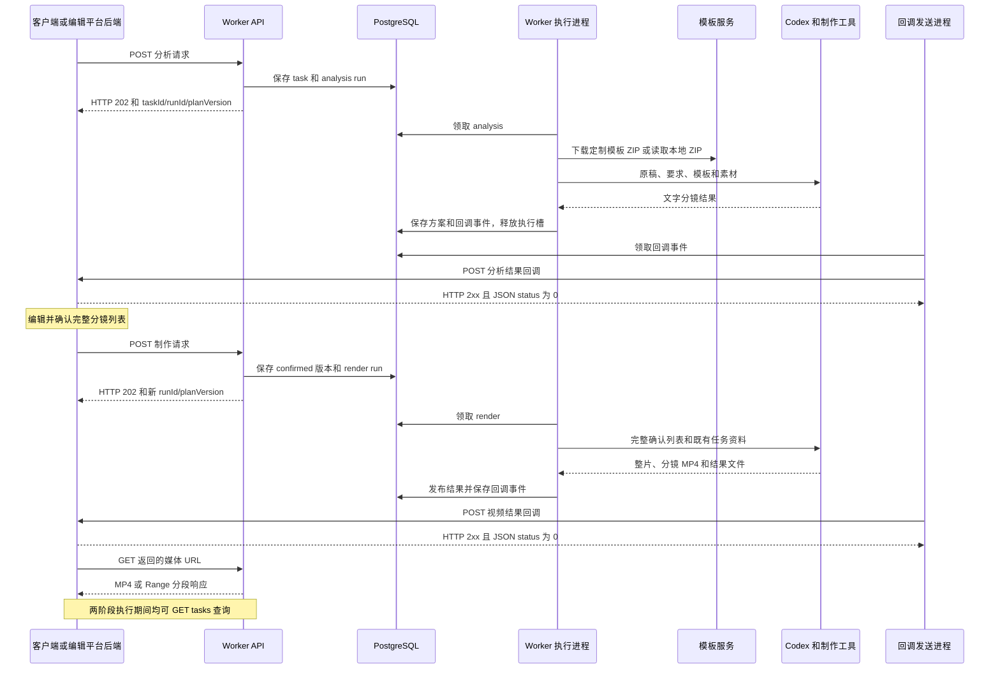

> 历史对接资料：当前独立插件为 textvideo-studio，现行字段与行为见 [文稿视频工坊两阶段接口](textvideo-studio两阶段接口.md)。本文件原文保留，不作为已实现接口承诺。

# 客户端与 Worker 两阶段请求回调及接口说明

代码基线：2026 年 10 月 12 日，仓库提交 `8fb5ec6`。本文描述该版本代码的实际行为，覆盖客户端提交、Worker 接收与执行、回调发送、接收确认、状态查询和媒体访问。部署地址由运行环境配置决定。

## 1 系统两端和调用方向

本项目的完整业务链路是：客户端提交原稿 → Worker 分析 → 客户端收到文字分镜 → 编辑确认并提交完整分镜 → Worker 制作并发布 → 客户端收到整片及分镜地址 → 播放或下载。

| 参与方 | 实际职责 | 本仓库代码 |
| --- | --- | --- |
| 编辑平台客户端及后端 | 收集原稿、模板和素材，提交分析，保存分析结果，编辑后提交制作，接收回调并展示成片 | 正式平台源码不在本仓库；其请求格式由 Worker 网页兼容入口定义 |
| 本仓库 HTTP 测试客户端 | 提交两阶段请求，轮询状态，保存响应 | `video-worker/scripts/deepseek-e2e.mjs` |
| Worker API 服务 | 校验和归一化请求，保存任务与执行记录，返回受理结果，提供查询、取消和媒体读取 | `src/api/routes.ts`、`src/application/tasks.ts` |
| Worker 执行进程 | 领取数据库任务，准备输入及模板，调用 Codex 制作，接收结果并发布文件 | `src/application/execute-run.ts` |
| 回调发送进程 | 从数据库读取回调事件，签名后 POST 到编辑平台，处理确认及重试 | `src/infrastructure/callback-outbox.ts` |
| 本仓库测试接收器 | 接收两个回调，解析并打印 JSON，返回业务成功 | `video-worker/deploy/callback-mock.mjs` |

下文源码路径未写完整前缀时，均相对于 `video-worker/`。正式平台收到回调后如何更新自身数据库和页面，本仓库没有对应实现；不能把测试接收器的行为视为正式平台的行为。



API、执行进程、回调进程通过同一个 PostgreSQL 交接；HTTP 提交连接不等待视频制作。浏览器并不是回调目标，回调目标是部署配置指定的编辑平台 HTTP 服务。

## 2 接口目录与地址配置

| 调用方 → 接收方 | 方法 | 完整路径 | 用途 |
| --- | --- | --- | --- |
| 客户端 → Worker | POST | `/narrate/ai_video_director/getAiVideoEditingAnalysisData` | 提交分析 |
| 客户端 → Worker | POST | `/narrate/ai_video_director/getAiVideoEditingData` | 提交制作 |
| Worker → 编辑平台 | POST | `/ai_video_director/getAiVideoEditingAnalysisDataCallback` | 分析成功或失败通知 |
| Worker → 编辑平台 | POST | `/ai_video_director/getAiVideoEditingDataCallback` | 制作成功或失败通知 |
| 客户端 → Worker | GET | `/ai_video_director/tasks/:taskId` | 查询业务任务 |
| 客户端 → Worker | POST | `/ai_video_director/runs/:runId/cancel` | 取消某次执行 |
| 客户端 → Worker | POST | `/ai_video_director/callbacks/:eventId/retry` | 重新投递死信回调 |
| 客户端 → Worker | GET | `/healthz` | API 和数据库基础检查 |
| 浏览器或客户端 → Worker | GET、HEAD、OPTIONS | `/media/*` | 读取已发布文件 |
| Worker → 模板平台 | GET | `/api/custom-templates/{id}/package` | 下载定制模板 ZIP |

只有两个提交接口带 `/narrate`。没有该前缀的同名提交路径不属于当前 Worker 路由。两个 Callback 路径由接收端提供，Worker API 不提供这两个接收路由。

| 配置 | 实际作用 |
| --- | --- |
| `API_BIND_ADDRESS`、`API_PORT` | Compose 对外绑定，默认 `127.0.0.1:8080`；容器内 API 监听 `0.0.0.0:8080` |
| `IFENG_CALLBACK_BASE_URL` | 回调接收服务基地址；请求中不能覆盖 |
| `IFENG_CALLBACK_SECRET` | 回调 HMAC 密钥，不放入业务请求或文档 |
| `CUSTOM_TEMPLATE_API_BASE_URL` | 模板平台基地址；配置后优先走远程 ZIP 下载 |
| `MEDIA_PUBLIC_BASE_URL` | 客户端可访问的 Worker HTTP/HTTPS 地址，用于生成成片 URL |
| `MEDIA_ROOT` | Worker 媒体文件根目录 |
| `IFENG_INPUT_ROOT`、`IFENG_ALLOWED_INPUT_PREFIXES` | 调用方输入路径映射及允许读取的子目录，默认允许 `input` |

本文 JSON 中 `https://worker.example.com` 只代表配置后的 Worker 地址。历史文档中的内网 IP 不等于当前运行服务地址。

## 3 通用请求和响应约定

- 提交使用 `Content-Type: application/json`，请求体上限为 2 MiB。
- 当前入站 API 不检查 `Authorization`，仅使用配置中的唯一租户；配置多个租户会在启动时报错。
- 标准请求为 `schemaVersion: 2`。网页兼容请求使用另一套字段，通过同一个 URL 进入；两套字段不能随意混合。
- 顶层请求以及显式定义的嵌套对象使用严格字段校验，多余字段会导致校验失败。制作请求的 `dataList` 元素和 `plan` 则允许扩展键。
- 输入素材 `url` 是以 `/` 开头的文件绝对路径；发布结果 `url` 是 HTTP/HTTPS 地址，两者语义不同。
- `dur` 使用秒，Analysis 为估算值，Render 为实际测量值。

### 3.1 受理响应

两阶段提交成功均返回 HTTP `202`：

```json
{
  "status": 0,
  "msg": "等待当前操作结束后交给 Codex",
  "data": {
    "taskId": "task-demo-001",
    "runId": "11111111-1111-4111-8111-111111111111",
    "state": "queued",
    "stage": "analysis",
    "planVersion": 1
  }
}
```

| 字段 | 含义 |
| --- | --- |
| `status` | `0` 表示本次接口处理成功，不表示制作完成 |
| `msg` | 新提交当前为上述中文；相同请求命中幂等记录时为 `accepted`，不要依赖此文案判断状态 |
| `data.taskId` | 调用方传入的业务任务 ID |
| `data.runId` | Worker 为本次执行生成的 UUID |
| `data.stage` | `analysis` 或 `render` |
| `data.state` | 本次执行当前状态；幂等重发时可能已经是 `running`、`succeeded` 或其他状态 |
| `data.planVersion` | 本次执行分配到的方案版本；从 1 开始，不是执行成功标志 |

### 3.2 同步错误响应

参数校验失败通常为 HTTP `400`：

```json
{
  "status": 1,
  "msg": "INVALID_REQUEST",
  "error": {
    "code": "INVALID_REQUEST",
    "issues": [{"path": ["taskId"], "message": "具体校验信息"}]
  }
}
```

应用错误使用其对应 HTTP 状态码：

```json
{
  "status": 1,
  "msg": "requestId 已用于其他内容",
  "error": {"code": "IDEMPOTENCY_CONFLICT", "retryable": false}
}
```

通用异常返回 `{"status":1,"msg":"REQUEST_FAILED"}`，HTTP 可能为 `400`、`413`、`415` 或 `500`，不保证存在 `error`。标准 schema 校验失败后代码会尝试网页兼容 schema，最终 `issues` 有时来自兼容格式校验。

## 4 第一阶段提交分析

`POST /narrate/ai_video_director/getAiVideoEditingAnalysisData`

### 4.1 标准 v2 请求

```json
{
  "schemaVersion": 2,
  "requestId": "analysis-demo-001",
  "taskId": "task-demo-001",
  "script": "第一句原始口播。第二句原始口播。",
  "otherRequirements": "横屏视频，保留原稿内容和顺序。",
  "digitalHumanAccounId": "",
  "plugin": {"digitalHumanId": "", "templateId": "3"},
  "narration": null,
  "outputSpec": {"width": 1920, "height": 1080, "fps": 30},
  "otherMaterial": {"picInfoList": [], "videoInfoList": []}
}
```

| 字段 | 类型 | 必填 | 限制及实际用途 |
| --- | --- | --- | --- |
| `schemaVersion` | number | 是 | 固定 `2` |
| `requestId` | string | 是 | 1～128 字符，当前租户范围内幂等键，两个阶段共用此唯一性范围 |
| `taskId` | string | 是 | 1～128 字符，两阶段使用同一值 |
| `script` | string | 是 | 1～50000 字符，不能全为空白，完整原稿 |
| `otherRequirements` | string | 是 | 最长 10000 字符，允许 `""` |
| `digitalHumanAccounId` | string | 是 | 最长 128 字符，保留这一历史拼写；无数字人时传 `""` |
| `plugin` | object | 是 | 只允许下列两个键 |
| `plugin.digitalHumanId` | string | 是 | 最长 128 字符，无数字人时传 `""` |
| `plugin.templateId` | string | 是 | 1～128 字符；远程模板模式要求可转入正整数 ID 路径，如 `"3"` |
| `narration` | object 或 null | 否 | 缺省 `null`；非空时为 `{assetId,url}`，作为音频输入登记 |
| `outputSpec` | object | 否 | 整个对象缺省为 `1080×1920 / 30fps`；提供时三个字段均必填 |
| `outputSpec.width/height` | integer | 随对象必填 | 64～3840，必须为偶数，单位像素 |
| `outputSpec.fps` | integer | 随对象必填 | 1～60 |
| `otherMaterial` | object | 是 | 图片和视频数组均必填，可以为空 |
| `otherMaterial.picInfoList` | array | 是 | 最多 200 项，每项 `{assetId,url}` |
| `otherMaterial.videoInfoList` | array | 是 | 最多 200 项，每项 `{assetId,url}` |

素材 `assetId` 长度为 1～128；`url` 长度为 1～4096，须以 `/` 开头且不得含空字符。图片、视频和 narration 的 `assetId` 在本次请求内必须全部唯一。

```json
{
  "assetId": "chart-001",
  "url": "/home/ops/jiangzb/videos/input/task-demo-001/chart.png"
}
```

路径存在、可读及授权范围是在异步准备输入时检查，HTTP 202 不意味着素材已通过检查。当前 API 没有素材上传接口，不会从这个字段下载任意远程 HTTP 文件。

**数字人字段的当前边界：** 最新请求 schema 只检查类型与长度，没有“非空立即拒绝”的校验。字段会进入任务配置/要求，但不能据此认定该接口自动调用数字人服务；Worker 此处没有数字人 HTTP 服务编排。旧文档关于“非空一定被拒绝”的描述不适用于这一代码基线。

### 4.2 网页兼容请求

```json
{
  "taskId": "web-demo-001",
  "content": "第一句原始口播。第二句原始口播。",
  "otherRequirements": "保留全文",
  "plugin": {"digitalHumanId": "", "templateId": "", "customTemplateId": "3"},
  "otherMaterial": {"picInfoList": [], "videoInfoList": []}
}
```

| 输入字段 | 限制或默认值 | Worker 归一化行为 |
| --- | --- | --- |
| `taskId` | 必填，1～128 字符 | 保留业务任务 ID |
| `content` | 必填，1～50000 字符 | 映射到标准 `script`；标准校验仍拒绝全空白 |
| `otherRequirements` | 可选，最长 10000，缺省空字符串 | 映射同名字段 |
| `plugin` | 必填对象 | 三个子字段均可省略，缺省空字符串，最长 128 |
| `plugin.customTemplateId` | 非空时优先 | 覆盖 `plugin.templateId`，输出固定为 `1920×1080 / 30fps` |
| `plugin.templateId` | customTemplateId 为空时使用 | 此分支输出为 `1080×1920 / 30fps` |
| `otherMaterial` | 必填，两个数组均必填 | 元素格式为 `{url:string}`；当前数组必须为空才能成功转换 |

两个模板 ID 都为空时报 `TEMPLATE_REQUIRED`。网页素材数组非空时报 `ASSET_MAPPING_REQUIRED`，目前没有把网页素材映射到受控文件目录的实现。

归一化还会补上 `schemaVersion=2`、`digitalHumanAccounId=""` 和 `narration=null`，并生成：

```text
requestId = web-v2-{taskId}-analysis-{指纹前16位}
指纹 = SHA256(JSON.stringify({content, requirements: otherRequirements, templateId}))
```

指纹不包含数字人字段等其他信息；改变这些字段但保持指纹输入不变，可能触发幂等冲突。生成后的 requestId 仍受 128 字符限制，因此网页 taskId 虽然自身允许 128 字符，过长时仍可能在归一化后失败。

### 4.3 Worker 如何接收并执行

1. `routes.ts` 调用 `Tasks.analysis()`，先尝试标准 v2，再尝试网页格式；保存原始请求到 `sourceRequest` 供追踪。
2. 检查是否配置模板来源；将原稿、要求、模板 ID、输出规格和账号信息放入任务配置。
3. `TaskRepository.submit()` 在事务中处理幂等，创建或复用业务 task，分配新的 `planVersion`，写入 `queued` run，返回 HTTP 202。
4. 执行进程通过 `Queue.claim()` 领取任务，冻结模板、复制并散列输入素材，写入本次消息的请求文件和附件文件。
5. Codex 通过两阶段制作协议返回结果引用。Analysis 的常规工具输出为自然句文字分镜和估时，不生成正式配音或视频。
6. Worker 检查结果身份和交付协议，保存 analysis 方案、run 结果与回调事件，执行状态变为 `succeeded`。该 run 仍是最新提交时，task 状态变为 `awaiting_editor`。

## 5 第一阶段分析回调

`POST {回调服务基地址}/ai_video_director/getAiVideoEditingAnalysisDataCallback`

成功示例，时间为示意值：

```json
{
  "schemaVersion": 2,
  "eventId": "aaaaaaaa-aaaa-4aaa-8aaa-aaaaaaaaaaaa",
  "requestId": "analysis-demo-001",
  "taskId": "task-demo-001",
  "runId": "11111111-1111-4111-8111-111111111111",
  "planVersion": 1,
  "status": 0,
  "msg": "",
  "dataInfo": {"templateId": "3", "durationMode": "estimated", "previews": []},
  "dataList": [
    {
      "id": "scene_001",
      "content": "第一句原始口播。",
      "dur": 1.6,
      "durationSource": "estimated",
      "production": {},
      "extraData": {"keywordList": [], "digitalHumanId": "", "videoInfoList": [], "picInfoList": [], "resources": []}
    },
    {
      "id": "scene_002",
      "content": "第二句原始口播。",
      "dur": 1.6,
      "durationSource": "estimated",
      "production": {},
      "extraData": {"keywordList": [], "digitalHumanId": "", "videoInfoList": [], "picInfoList": [], "resources": []}
    }
  ],
  "plan": {}
}
```

| 字段 | 当前生成方式 |
| --- | --- |
| `schemaVersion/eventId/requestId/taskId/runId/planVersion/status/msg` | 回调发送两阶段共用的关联字段；eventId 为单次通知的唯一 ID |
| `dataInfo.templateId` | 来自该 run 保存的任务配置 |
| `dataInfo.durationMode` | mapper 固定为 `estimated` |
| `dataInfo.previews` | mapper 固定为 `[]` |
| `dataList` | 直接采用阶段输出，Worker 不重新拆句或改写正文 |
| `dataList[].id/content` | 分镜 ID 和文字，下一阶段传回完整确认列表 |
| `dur/durationSource` | 常规分析工具输出估算秒数与 `estimated`，不能当成最终视频时长 |
| `production/extraData` | 常规分析工具按示例生成空制作信息和素材数组 |
| 顶层 `plan` | 分析回调固定投影为 `{}`；查询接口中的方案对象不一定为空 |

这里的分镜示例是 `tools/task_io.py` 的正常输出格式；Worker 的 Analysis 交付校验只强制 `result.dataList` 为数组，并没有逐字段重新验证全部分析内容，因此扩展字段会被保留。

## 6 第二阶段提交制作

`POST /narrate/ai_video_director/getAiVideoEditingData`

### 6.1 标准 v2 请求

```json
{
  "schemaVersion": 2,
  "requestId": "render-demo-001",
  "taskId": "task-demo-001",
  "basePlanVersion": 1,
  "field_5": "",
  "templateId": "3",
  "dataList": [
    {"id": "scene_001", "content": "第一句确认后的口播。"},
    {"id": "scene_002", "content": "第二句确认后的口播。"}
  ]
}
```

| 字段 | 类型 | 必填 | 限制及含义 |
| --- | --- | --- | --- |
| `schemaVersion/requestId/taskId` | 同 Analysis | 是 | 固定版本、独立幂等键、同一业务 taskId |
| `basePlanVersion` | positive integer | 是 | 必须引用本 task 已存在的 `plan_versions` 记录 |
| `field_5` | string | 是 | 最长 128；必须等于基础方案对应配置的 `digitalHumanAccountId`，无数字人传 `""` |
| `templateId` | string | 是 | 1～128；必须与基础方案的模板配置相同 |
| `dataList` | object[] | 是 | 1～200 项，本次完整确认列表，数组顺序就是制作顺序 |
| `plan` | object | 否 | 允许扩展字段，省略时按 `{}` 保存；当前入口没有对内部关联身份做额外校验 |

每条分镜的制作要求与 HTTP 接收校验分开：

| 分镜字段 | 实际处理 |
| --- | --- |
| `id` | 常规制作工具要求 `[A-Za-z0-9][A-Za-z0-9_.-]{0,127}`，全列表唯一；保留值 `whole`、`whole-video` 不得用于分镜 |
| `content` | 常规制作工具要求非空白字符串，渲染发布时逐条核对与提交内容一致 |
| `dur` | 可省略；传入估时不锁定最终长度，制作后以实测值覆盖 |
| `production` | 可选，制作适配器会复制到内部制作方案 |
| `visualPlan` | 可选，非空时放入内部 `production.visualPlan` |
| `extraData.keywordList` | 可选，非空时放入内部制作信息 |
| `extraData.picInfoList/videoInfoList` | 可选，每项至少提供有效 `assetId/url` 供异步素材准备使用；不等于网页素材上传 |
| 其他扩展字段 | 当前对象允许保留；常规 Render 输出复制提交项并覆盖时长和文件引用 |

HTTP schema 只检查 dataList 是对象数组，不在入口保证每项已有合法 id/content。缺字段、重复 ID、保留 ID 或非法素材可能先收到 202，再在制作阶段失败。需要提交**全部**确认分镜；仅发一条不会被解释成“只修改这一条”。

### 6.2 网页兼容请求

```json
{
  "taskId": "web-demo-001",
  "templateId": "",
  "introUrl": "",
  "introIndex": 0,
  "outroUrl": "",
  "outroIndex": 0,
  "dataList": [{"id": "scene_001", "content": "确认后的口播。"}]
}
```

- `taskId` 必填，1～128 字符；`dataList` 必填，1～200 个对象。
- `templateId` 可省略，缺省 `""`；非空则必须等于任务当前配置的模板 ID。
- `introUrl/outroUrl` 可省略，缺省空字符串，最长 4096；`introIndex/outroIndex` 可省略，缺省 0，必须为非负整数。
- Worker 查询任务当前配置，自动补 `basePlanVersion`、`field_5` 和实际 `templateId`。
- 原始网页请求保存到 `plan.sourceRequest`。片头片尾字段不会被直接转换成独立剪辑操作，不能将“接收字段”理解为“已经按该字段插入片头片尾”。

```text
requestId = web-v1-{taskId}-render-{指纹前16位}
指纹 = SHA256(JSON.stringify({dataList, templateId: 当前模板ID}))
```

指纹不包含片头片尾字段或版本。相同列表在任务版本变化后重发，自动生成的 requestId 可能相同，而归一化后的 basePlanVersion 已变化，因而可能返回 `IDEMPOTENCY_CONFLICT`。标准 v2 请求可以显式保存并重发原 requestId 和原请求体，语义更清楚。

### 6.3 Worker 如何接收并制作

1. 标准请求直接进入 `TaskRepository.submit()`；网页请求先读取当前任务配置再归一化。
2. 数据库事务查找 `basePlanVersion`、核对模板及账号，创建新的 render run，并立即写入新的 `confirmed` 方案版本。保存的是完整请求列表。
3. 同 task 的运行串行排队。执行时复用该业务 task 的稳定工作目录，加载不晚于基础版本的最近成功 Analysis 入口及其模板与原稿，补充本次素材。
4. Codex 和制作工具读取确认列表，组织配音、画面、字幕、实测时间轴、逐镜视频及合片。`task_io.py` 的交付入口负责必要的合片和制作终检。
5. Worker 验证结果引用属于本次消息，校验整片及分镜协议，保存交接文件，发布到独立结果目录。
6. 同一数据库事务记录成功结果、递增 `resultVersion`、保存回调事件。若当前 run 仍为最新提交，task 进入 `ready`；回调进程随后独立发送通知。

Worker 当前协议校验不等于它重新运行了一遍制作层的音画终检；`src/infrastructure/validation.ts` 与 `tools/task_io.py` 的职责不同。

## 7 第二阶段视频回调

`POST {回调服务基地址}/ai_video_director/getAiVideoEditingDataCallback`

确认 N 条分镜，当前成功回调的 `dataList` 必须有 **N+1 项**：第 0 项是整片，第 1 项起为确认顺序的分镜。示例 URL、时长与摘要只展示格式。

```json
{
  "schemaVersion": 2,
  "eventId": "bbbbbbbb-bbbb-4bbb-8bbb-bbbbbbbbbbbb",
  "requestId": "render-demo-001",
  "taskId": "task-demo-001",
  "runId": "22222222-2222-4222-8222-222222222222",
  "planVersion": 2,
  "resultVersion": 1,
  "status": 0,
  "msg": "",
  "dataInfo": {"templateId": "3", "sceneCount": 2, "width": 1920, "height": 1080, "fps": 30},
  "dataList": [
    {
      "id": "whole-video",
      "content": "第一句确认后的口播。\n第二句确认后的口播。",
      "dur": 5.8,
      "durationSource": "measured",
      "url": "https://worker.example.com/media/tasks/internal-task/results/run-token/video-whole.mp4",
      "extraData": {
        "kind": "wholeVideo", "sceneCount": 2, "width": 1920, "height": 1080, "fps": 30,
        "sha256": "0123456789abcdef0123456789abcdef0123456789abcdef0123456789abcdef"
      }
    },
    {
      "id": "scene_001", "content": "第一句确认后的口播。", "dur": 2.8,
      "durationSource": "measured",
      "url": "https://worker.example.com/media/tasks/internal-task/results/run-token/video-scene_001.mp4"
    },
    {
      "id": "scene_002", "content": "第二句确认后的口播。", "dur": 3.0,
      "durationSource": "measured",
      "url": "https://worker.example.com/media/tasks/internal-task/results/run-token/video-scene_002.mp4"
    }
  ]
}
```

| 字段 | 规则 |
| --- | --- |
| `resultVersion` | 每次 render 成功发布时递增；失败不递增 |
| `dataInfo.sceneCount` | 分镜数量，不含整片 |
| `dataInfo.width/height/fps` | 此 run 的输出配置 |
| `dataList[0].id` | 固定 `whole-video` |
| `dataList[0].extraData.kind` | 固定 `wholeVideo` |
| `dataList[0].extraData.sha256` | 整片文件 SHA-256，Worker 发布前核对交接文件摘要 |
| `dataList[1..].id/content` | 必须与提交列表逐条一致，顺序一致 |
| `dur` | 有限且大于 0 的实测秒数 |
| `durationSource` | 固定为 `measured` |
| `url` | Worker 发布生成的 HTTP/HTTPS 地址；内部 `artifactRef` 已被替换 |
| 分镜扩展字段 | 常规工具保留提交时的扩展字段，不保证始终包含空 `production/extraData` |

输出文件实际落在 `MEDIA_ROOT/tasks/<内部任务UUID>/results/<runId>-<执行令牌>/`。内部任务 UUID 与外部 taskId 不相同；客户端直接使用返回 URL，不自行推导路径。

## 8 失败回调与接收确认

### 8.1 两阶段共用的失败载荷

失败仍发送到对应阶段的 Callback 路径：

```json
{
  "schemaVersion": 2,
  "eventId": "cccccccc-cccc-4ccc-8ccc-cccccccccccc",
  "requestId": "render-demo-001",
  "taskId": "task-demo-001",
  "runId": "22222222-2222-4222-8222-222222222222",
  "planVersion": 2,
  "status": 1,
  "msg": "任务总时限已到",
  "error": {"code": "TIMEOUT", "message": "任务总时限已到", "retryable": false}
}
```

错误分支不带 `dataInfo/dataList/plan/resultVersion`。`error` 的额外字段由具体错误提供，`retryable` 并非所有制作层错误都必带。`needs_input` 也通过错误载荷通知，具体状态查询 `latestRun.state`。

提交时同步失败尚未创建本次 run，不会因此生成新的执行回调。已经 202 受理后的异步失败，则通过查询和对应阶段回调暴露。

### 8.2 Worker 发送的请求头

| 请求头 | 内容 |
| --- | --- |
| `Content-Type` | `application/json` |
| `X-Event-Id` | 回调事件 UUID，与 body.eventId 一致 |
| `X-Callback-Timestamp` | 当前 Unix 秒级时间戳字符串 |
| `X-Callback-Signature` | HMAC-SHA256 十六进制签名 |

```text
body = JSON.stringify(数据库中保存的事件 payload)
signature = HMAC-SHA256(callbackSecret, timestamp + "." + body).hex
```

验签应使用收到的原始 body 字节，不要先解析再重新序列化。重发保留相同 eventId 和 payload，重新生成时间戳和签名。接收端时间窗口及去重落库策略由编辑平台实现，Worker 不会替接收端完成这些检查。

### 8.3 接收端必须怎样应答

Worker 只有在 **HTTP 2xx 且响应 JSON 的 status 严格等于数字 0** 时记为 `delivered`：

```json
{"status": 0, "msg": ""}
```

空响应、`204` 无正文、`{"status":"0"}` 都不满足成功条件。失败通知若已成功接收，也应返回接收成功 `status:0`；不能因为通知内容中的业务任务失败而返回接收失败。

| 响应或异常 | Worker 的处理 |
| --- | --- |
| HTTP 2xx，JSON status 为数字 0 | `delivered` |
| HTTP 2xx，明确返回其他 status，包括字符串 `"0"` | `dead_letter` |
| HTTP 2xx，但缺 status、非 JSON 或空正文 | `retrying`，次数耗尽后 `dead_letter` |
| HTTP 429 或 5xx | `retrying` |
| 其他 4xx | `dead_letter` |
| 网络异常、超时、响应读取失败 | `retrying` |
| 重定向 | fetch 禁止自动跳转；通常作为连接失败进入重试 |

每次发送超时 15 秒，最多尝试 10 次；响应体最多读取 65536 字节。第 n 次失败后的基础延迟为 `min(3600, 2^n) + 0～2` 秒；有效 `Retry-After` 可以延长延迟，最多按一天处理。达到死信后不会自行无限发送。

### 8.4 本仓库接收器实际做了什么

`deploy/callback-mock.mjs` 监听默认 9000 端口，只接受上面两个 Callback 路径的 POST；读取最多 2 MiB body，解析 JSON，输出 `{path,eventId,body}` 日志，再返回 HTTP 200 和 `{"status":0,"msg":"test received"}`。

它没有验签、时间窗口检查、eventId 去重或业务持久化。Compose 中该测试接收器未映射宿主机端口，通过容器网络访问。正式平台的接收处理需要在平台自身源码中确认。

## 9 任务查询接口

`GET /ai_video_director/tasks/:taskId`

taskId 为业务任务 ID，放入路径时做 URL 编码，无请求体。不存在返回 HTTP 404 和 `TASK_NOT_FOUND`。

响应外层为 `{"status":0,"msg":"","data":{...}}`。data 字段如下：

| 字段 | 类型 | 实际来源及含义 |
| --- | --- | --- |
| `taskId` | string | 外部业务 ID |
| `taskState` | string | task 汇总状态，观察执行时优先结合 latestRun |
| `planVersion` | integer | task 最新提交所分配版本，可能还未成功 |
| `resultVersion` | integer | 最近成功制作结果版本，没有成功结果时为 0 |
| `latestRun.runId/stage/state` | string | 最新提交的 run，不一定是此刻正在运行的 run |
| `latestRun.progressStage` | string | 进展标签，不是百分比 |
| `latestRun.attempt` | integer | 领取执行次数，排队尚未执行时通常为 0 |
| `latestRun.error` | object 或 null | 执行错误或重试原因 |
| `latestRun.recovery` | object 或 null | 仅 waiting_human 时提供 revision/message |
| `queuePosition` | integer 或 null | 最新 run 为 queued 时，按创建时间和 ID 统计的全局排队位置；不是精确执行顺序或预计等待时长 |
| `callbackState` | string 或 null | 最新 run 的回调状态 |
| `callback` | object 或无此键 | 有事件时含 `id/state/attempts/last_error`；无事件时当前序列化可能直接省略 |
| `progress` | object 或 null | `last_event_at/last_progress_at/current_tool_name/tool_status`，来自执行记录 |
| `plan` | object 或 null | 当前 planVersion 对应方案；尚未生成 Analysis 方案时可为 null |
| `result` | object 或 null | 最新 run 已保存的阶段 result，成功 Render 时含完整 N+1 项 dataList |
| `latestResult` | array | 最近成功结果版本的分镜列表，**只含 N 条分镜，不含整片** |

`plan` 的形状随阶段变化：Analysis 保存阶段完整 result（常规含 `dataList/plan`）；Render 在提交时保存 `{dataList,plan,requestId}`。这与分析回调顶层 `plan:{}` 不是同一投影。

如果新任务已排队，`result` 可能为 null，`latestResult` 仍然是上次成功的视频。整片可从成功 Render 回调或该 run 仍为最新时的 `result.dataList[0]` 获取。当前没有按历史 runId 查询完整结果的公共 GET 接口，接收方需要保存收到的版本化回调。

### 9.1 状态如何解释

| 状态字段 | 常见值 | 含义 |
| --- | --- | --- |
| `latestRun.state` | `queued` | 等待执行，也可能是服务正在自动重试 |
| 同上 | `running` | 正在处理 |
| 同上 | `cancelling` | 停止执行和清理进程中 |
| 同上 | `succeeded` | 本次阶段完成 |
| 同上 | `failed`、`cancelled` | 执行失败或已取消 |
| 同上 | `needs_input` | 本次执行返回需要补充信息；没有专门的 HTTP resume 路由 |
| 同上 | `waiting_human` | 人工恢复流程状态，会阻塞同 task 后续领取，需运维处理或取消 |
| `taskState` | `analysis_queued/analyzing/awaiting_editor` | 分析排队、处理中、分析完成等待编辑 |
| 同上 | `render_queued/rendering/ready` | 制作排队、处理中、制作完成 |
| 同上 | `failed/cancelled/needs_input/waiting_human` | 相应异常或等待状态 |
| `callbackState` | `pending/retrying/delivered/dead_letter` | 通知待发、重试、已确认、停止自动重试 |

回调成功不会把 taskState 改为 `delivered`；`delivered` 属于 callbackState。制作成功和回调送达是两件事。

常见 progressStage 为 `preparing/codex/publishing/published/delivery_retry/codex_capacity_retry/recovered`，此字段不宜写死成进度条百分比。

## 10 取消和回调重投接口

### 10.1 取消执行

`POST /ai_video_director/runs/:runId/cancel`，runId 必须是 UUID，无需请求体。

```json
{"status":0,"msg":"","data":{"runId":"22222222-2222-4222-8222-222222222222","state":"cancelling"}}
```

| 原状态 | 当前处理 |
| --- | --- |
| `queued` 或 `waiting_human` | 立即改为 cancelled，创建对应阶段的 CANCELLED 失败回调 |
| `running` | 先改为 cancelling；执行端停止进程后完成取消，再释放槽位 |
| `cancelling` 或其他状态 | 返回已有状态；不会统一强制改成 cancelled |
| run 不存在 | HTTP 404，`RUN_NOT_FOUND` |

取消的是一个 run，不是删除业务 task，也不会取消其他已排队 run 或删除上次视频。`needs_input` 不在立即取消分支内。

### 10.2 重投死信回调

`POST /ai_video_director/callbacks/:eventId/retry`，eventId 必须是 UUID，无需请求体。

```json
{"status":0,"msg":"queued","data":{"id":"bbbbbbbb-bbbb-4bbb-8bbb-bbbbbbbbbbbb"}}
```

只处理本租户 `dead_letter` 事件：state 改回 pending、attempts 清零、清除 last_error、立即进入待发送队列。eventId 和 payload 不变，不重新执行分析或制作。

不存在或不在 dead_letter 时返回 HTTP 409：

```json
{"status":1,"msg":"事件不存在或不在 dead_letter 状态"}
```

## 11 媒体与健康检查接口

### 11.1 成片播放和下载

直接 GET 回调中的 `url`。媒体路由只开放：

```text
/media/tasks/<内部任务ID>/results/<发布目录>/<文件名>.<扩展名>
```

- 完整文件响应 HTTP 200；`.mp4` 返回 `video/mp4`，其他扩展名返回 `application/octet-stream`。
- 返回真实 `Content-Length` 和 `Accept-Ranges: bytes`；HEAD 返回相应头部，不返回正文。
- GET 支持单段 `Range: bytes=0-1023`、`bytes=1024-`、`bytes=-1024`，有效时返回 206 和 Content-Range。
- 可识别但越界的 Range 返回 416，含 `Content-Range: bytes */<总字节数>`。
- 多段或无法识别的 Range 被忽略；存在 `If-Range` 时当前代码也直接返回完整文件，没有条件范围验证逻辑。
- 路径不匹配、文件不存在或越界返回 404。输入快照、工程文件和临时文件不会通过此路由开放。
- 媒体 GET 允许 `Access-Control-Allow-Origin: *`；OPTIONS 返回 204，声明 GET/HEAD/OPTIONS 与 Range/If-Range 请求头。当前只为媒体路由显式配置了跨域，业务提交接口没有同样的 CORS 配置。

`MEDIA_PUBLIC_BASE_URL` 未配置，或使用 localhost、127.0.0.1、0.0.0.0 等本地地址时，发布会失败。发布层可能将此类错误表现为查询中的 `DELIVERY_RETRY`，具体根因需结合配置和日志判断。

### 11.2 健康检查

`GET /healthz` 执行数据库 `SELECT 1`，成功返回 HTTP 200 和 `{"status":0}`。此接口没有验证 Codex 登录、模板下载、配音供应商、回调可达或真实视频渲染能力。

## 12 模板平台请求

配置 `CUSTOM_TEMPLATE_API_BASE_URL` 时，Worker 在分析准备阶段直接 GET：

```text
{模板平台基地址}/api/custom-templates/{正整数模板ID}/package
```

该分支优先于本地模板配置。若未配置远程服务，则读取 `config/templates.json` 中显式配置的本地 ZIP。不会先请求定制模板详情，也不使用详情中的 package_url/package_local_path。

当前下载使用普通 fetch，不附带平台登录 Cookie 或 Authorization；禁止自动重定向，超时 30 秒。平台需返回实际可解压的 ZIP 数据，`Content-Disposition` 可辅助识别与压缩包同名的 Markdown 入口。代码不强制检查响应 MIME。

归档限制：压缩包不超过 64 MiB，最多 512 个条目，单文件不超过 64 MiB，解压总量不超过 256 MiB；单一根目录，入口 Markdown 必须可确定，禁止越界路径、特殊文件和重复路径。失败可能为 `TEMPLATE_UNAVAILABLE` 或 `TEMPLATE_INVALID`，通常发生在 202 受理之后。

两阶段 Worker 链路没有主动请求数字人详情、普通模板详情或素材详情接口；那些平台接口不能按旧截图文档直接推断为当前 Worker 的调用步骤。

## 13 幂等版本排队与失败恢复

### 13.1 三种 ID 和两种版本

| 标识 | 生成方与用途 |
| --- | --- |
| `taskId` | 客户端业务 ID，贯穿两阶段及后续修改 |
| `requestId` | 标准请求由客户端提供，网页请求由 Worker 算出；同租户唯一 |
| `runId` | Worker 生成，每个新请求对应一次执行 |
| `eventId` | Worker 生成，一次执行的通知事件，重复投递保持不变 |
| `planVersion` | 每个新受理的 Analysis 或 Render 都在任务版本上加 1；失败也不会回退 |
| `resultVersion` | 仅成功发布 Render 才加 1 |

同 requestId 且规范化后的 stage/input 相同，返回原 run；内容不同则 409 `IDEMPOTENCY_CONFLICT`。提交响应超时、结果未知时，原请求体与原 requestId 一起重发可以查询到同一受理结果；换 requestId 会变成新的排队工作。

**当前版本校验不是最新版本锁。** Render 只验证 basePlanVersion 所指方案记录存在，并校验相应模板/账号；存在的旧版本可以被接受。task.planVersion 可能指向尚未产出分析结果的 run，此时没有对应方案记录，直接用它提交会得到 `STALE_PLAN`。

典型顺序为：Analysis 受理分配 planVersion 1 → Analysis 成功保存方案 1 → Render 以 basePlanVersion 1 提交，分配 planVersion 2 → Render 成功分配 resultVersion 1。以查询或回调取得的明确成功基础方案进行确认，并保留 runId 与版本的对应关系。

### 13.2 排队和旧结果

当前数据库迁移配置 6 个全局执行槽，其中 Render 同时最多 4 个；有可执行 Render 时优先领取。同一 task 的新请求可在旧请求执行期间受理，但按 planVersion 串行执行；running、cancelling、waiting_human 会阻塞该 task 后续 run。

query.latestRun 始终指向最新提交，而回调可能来自较早完成的 run。接收端不能把所有回调都覆盖到同一“当前结果”记录，必须保留 taskId/runId/planVersion/resultVersion 关联。旧回调已接收但不用于当前展示时，仍应正常确认通知。

queuePosition 只是按创建顺序计算的参考值，未体现 Render 优先及同 task 阻塞。taskState 在多个请求排队时也可能受执行状态写入影响，不应代替具体 run 的身份与状态判断。

### 13.3 自动重试的范围

- Analysis 从首次开始计时，期限最多 600 秒；Render 默认 14400 秒。排队等待不等于已开始制作。
- Codex 明确容量不足且满足安全条件时，服务按 30、90、270 秒退避，耗尽后失败。查询可见 `codex_capacity_retry` 和错误详情。
- 已经交接的制作文件发布失败，走 `delivery_retry`，约 30 秒后重新发布保存文件，不再次调用 Codex 制作。
- 回调失败仅重发通知，不再次配音、渲染或递增 resultVersion。
- `needs_input` 没有独立 HTTP 补充输入/恢复接口；通过适当的新分析或完整制作请求继续业务，或由运维处理状态。`waiting_human` 的恢复工具属于内部运维入口。
- 收费调用结果未知时不能靠更换 requestId 盲目重做；应按具体错误核对供应商结果与任务文件。

### 13.4 主要错误码

| 错误码 | 出现位置 | 含义 |
| --- | --- | --- |
| `INVALID_REQUEST` | 同步 HTTP 400 | 请求 schema 或 UUID 参数错误 |
| `TEMPLATE_REQUIRED` | 同步 HTTP 400 | 网页请求没有有效模板 ID |
| `ASSET_MAPPING_REQUIRED` | 同步 HTTP 400 | 网页请求补充素材尚未映射 |
| `TEMPLATE_UNSUPPORTED` | 同步 HTTP 400 | 没有可用模板来源 |
| `TASK_NOT_FOUND/RUN_NOT_FOUND` | 同步 HTTP 404 | 业务任务或执行不存在 |
| `IDEMPOTENCY_CONFLICT` | 同步 HTTP 409 | 同 requestId 对应不同输入 |
| `STALE_PLAN` | 同步 HTTP 409 | 所引用基础方案记录不存在，不代表所有旧版本都会被拒绝 |
| `CONFIG_CONFLICT` | 同步 HTTP 409 | 模板或账号不一致 |
| `PIPELINE_REVISION_EXPIRED` | 提交或异步准备 | 旧任务执行协议不兼容 |
| `PATH_FORBIDDEN/ASSET_UNAVAILABLE/ASSET_ID_CONFLICT` | 异步准备 | 素材路径、可读性或 ID 绑定错误 |
| `TEMPLATE_UNAVAILABLE/TEMPLATE_INVALID` | 异步准备 | 模板下载或归档校验失败 |
| `INPUT_SNAPSHOT_INVALID` | 异步准备 | 既有输入发生变化或损坏 |
| `RESULT_PROTOCOL_INVALID/FILE_HANDOFF_FAILED` | 异步交付 | 当前消息结果、整片分镜协议或交接文件不符 |
| `DELIVERY_RETRY` | 查询 | 发布暂时失败，等待重新交付 |
| `CODEX_MODEL_OVERLOADED` | 查询或失败回调 | 模型容量不足，是否继续自动重试看状态和详情 |
| `TIMEOUT/EXECUTION_EXPIRED/CANCELLED` | 失败回调或查询 | 超时、过期执行终止、取消 |
| `INTERNAL_ERROR` | 异步失败 | 非公开应用异常，详细原因在服务日志 |

该表覆盖主要服务错误；制作工具还可以返回其他 error.code，不应把它当作封闭枚举。

## 14 仓库里的客户端实际怎样调用

`scripts/deepseek-e2e.mjs` 是现有 HTTP 调用示例，客户端方法按以下顺序工作：

1. `analysis()` 生成 taskId/requestId，先把完整请求保存到本地，再 fetch 分析接口；重跑命令会复用已保存的请求。
2. `api()` 使用 JSON 请求头，HTTP 超时 30 秒，同时检查 HTTP 成功和响应 `status===0`，返回 response.data。
3. `status --wait` 每 10 秒调用 GET tasks，保存状态和方案；分析完成后等待外部确认，不自动发起 Render。
4. `render --confirm` 读取查询中的方案和版本，提取每项 id/content，先保存完整 Render 请求，再 POST 制作接口；重跑复用保存的 Render 请求。
5. 回调由独立回调服务发送到部署指定的接收方；此脚本本身不监听回调，而是轮询 callbackState。

该脚本的 `verify()` 仍按“结果 URL 是磁盘绝对路径”做文件检查，requirements 中也有“无需整片”的旧文字；这些与当前 HTTP 媒体和整片交付代码不一致。它可以说明现有请求方式，不能作为最新成片验收契约。`tests/e2e-client.test.mjs` 使用假 HTTP 服务和旧路径示例，同样不能证明新服务已完成正式平台联调。

## 15 实现索引和当前差异

| 要核查的问题 | 最新实现位置 |
| --- | --- |
| 路由、请求体上限、错误响应、媒体 Range | `src/api/routes.ts` |
| 标准字段、网页兼容字段与指纹生成 | `src/contracts/ifeng.ts` |
| 请求入口与配置组装 | `src/application/tasks.ts` |
| 幂等、版本、查询、取消 | `src/infrastructure/task-repository.ts` |
| 调度、同任务串行、自动重试 | `src/infrastructure/queue.ts`、`migrations/005_execution_capacity.sql` |
| 模板下载与输入准备 | `src/infrastructure/template-provider.ts`、`workspace.ts`、`stage-workspace.ts` |
| 制作输入转换、Analysis 输出、Render 合片交付 | `../claude-code-video-toolkit/tools/task_io.py` |
| 结果身份及 N+1 文件协议 | `src/infrastructure/validation.ts`、`src/contracts/pipeline-io.ts` |
| 文件发布、结果版本、回调入库 | `src/infrastructure/storage.ts`、`src/application/stage-results.ts` |
| 回调载荷与路径 | `src/integrations/ifeng/mapper.ts` |
| 签名、确认、重试和死信 | `src/infrastructure/callback-outbox.ts` |
| 测试客户端和接收器 | `scripts/deepseek-e2e.mjs`、`deploy/callback-mock.mjs` |

与现有旧说明相比，当前最容易接错的是：**Render 回调为整片加分镜 N+1 项；输出 url 为 HTTP；latestResult 只含分镜；basePlanVersion 不强制最新；同 task 可以继续排队；接口接收数字人字符串但不等于调用数字人服务；plan 和分镜扩展内容不再由 Worker 全面重写或清空。**

正式平台的路由实现、验签、去重和业务落库不在此仓库。本文对这些环节只说明 Worker 实际发送内容与成功确认条件，不将其描述为平台已经实现的功能。
