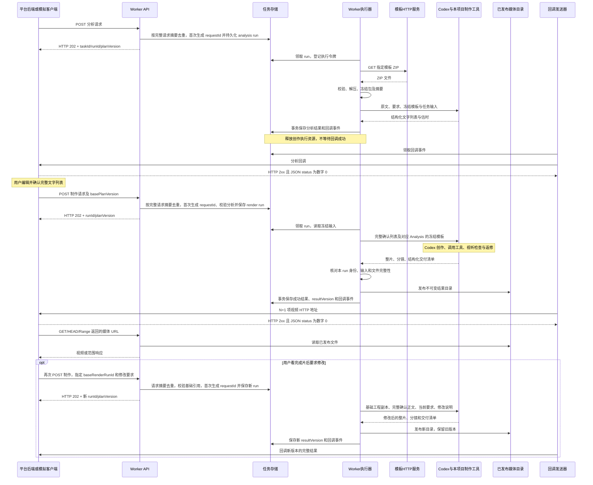

# 文本驱动模板视频生产改造方案与验收计划

> 2026-10-13 用户纠正：本项目独立发行 `textvideo-studio`（文稿视频工坊），不得覆盖另一个项目的 VideoFlowCut。下文插件路径已按独立身份更新；原插件目录和安装保持原状。
编写日期：2026-10-12  
适用仓库：`E:\ai\skills\VideoCutRemotion`  
方案来源：本任务此前三轮分析、接口文档核对、参考制作会话及源码检查。  
文档状态：**2026-10-12 设计基线。后续开发与本地真实两阶段测试已实施，当前结果见[部署与验收记录](textvideo-studio部署与验收记录.md)，未覆盖场景见[验收覆盖说明](textvideo-studio验收覆盖说明.md)。本文方案条款和初始状态不替代实际验收证据。**

本文在设计阶段已按反馈修订：明确两个阶段发给 Codex 的指令、豆包 MCP 工具和成片修改链路，记录 SQLite 已确认；requestId 改由后端生成并保存，以完整请求摘要去重，不要求前端增加该字段；交付形式明确为本项目插件及配套常驻 Runtime，插件部署要求见第 15 节。该设计整理轮次当时只修改本文，没有修改业务代码、Skills、三份原始接口文档或外部仓库，也没有执行制作和测试。后续实施事实另见上述记录。

## 1. 目标、已明确要求和待确认取舍

### 1.1 目标

将本项目改造成可重复调用的服务端生产能力：

```text
前端选择模板并提交文本
→ Worker 接收、持久化、下载并冻结平台模板 ZIP
→ Codex 读取本项目 Skills 和包内要求，返回可编辑的文字分镜
→ 前端编辑确认，提交完整文字列表
→ Codex 在冻结模板的任务副本中创作纯 Remotion 正文动效
→ 调用配音、测时、渲染和检查工具，审阅并修订
→ Worker 发布整片和分镜文件，回调平台后端
→ 前端播放、下载
```

“纯 Remotion 动效”指正文画面由代码创作；模板自带的头像、Logo、片头片尾、音乐和音效按包内要求使用。豆包云端配音保留，不依赖本地生成模型。

### 1.2 已明确的需求边界

| 项目 | 结论 |
| --- | --- |
| 开发范围 | 本项目的服务端生产链；当前不开发正式前端 |
| 交付和部署形式 | 本项目插件及同版本配套 Runtime；服务器常驻接收请求，后台 Codex 明确加载该插件的 Skills 和 MCP，不依赖人工打开桌面聊天 |
| Worker 职责 | 请求与协议、幂等、任务状态、排队、文件和数据转交、执行句柄、发布、回调 |
| 创作责任 | Codex 与本项目现有 Skills 负责，不放进 Worker |
| 模板来源 | 前端选择的、平台维护并提供下载的 ZIP |
| 模板要求 | 具体栏目要求、保护范围、可创作区域、声音及组件接口写在包内 |
| 旧项目代码 | 根据需求重新设计；不整体复制 VideoCutEditor Worker，不引入无关旧插件、旧 Skills 或兼容层 |
| 创作方法 | 使用本项目既有导演、美术、动效、声音和审阅方法，不新建一套平行创作体系 |
| 本地模型 | 删除 ComfyUI、Qwen 向量、多模态及相关本地模型任务链 |
| 网络搜索 | 保留代码，默认关闭；不能顺带关闭模板下载、Codex 或豆包通信 |
| 机制库 | 保留词语文本检索、机制正文及相关资料；去掉向量依赖 |
| 测试条件 | 暂时不能访问真实前端，需要模拟平台与客户端，再单独接真实前端 |
| 成片修改 | 客户端看完 Render 结果后，可以修改要求或正文，在明确指定的成片版本上继续调整，再返回新版本 |

### 1.3 已确认选型与待对齐的请求字段

| 项目 | 方案 | 代价及边界 | 当前状态 |
| --- | --- | --- | --- |
| 任务存储与部署 | 首版单机 SQLite，独立任务库 | 暂不支持多台服务器共同领取队列；创作和渲染并发通过部署配置，首版创作并发建议 1 | 用户已确认 SQLite 方案 |
| 插件部署 | Skills、MCP 工具与生产 Runtime 随本项目插件发行；安装插件后由服务启动入口运行 Runtime | 安装与常驻运行分别验证；首版沿现有外部依赖部署方式，不承诺单个插件目录包含所有运行依赖 | 用户已明确要求插件部署；具体部署合同见第 15 节 |
| requestId 归属 | 后端根据完整请求摘要识别重复；首次受理时生成 requestId 并存入 SQLite，重复提交读回原记录 | 前端无需生成、保存或回传 requestId；同 task 完全相同的请求按重发处理，不能用它表达“再随机生成一遍” | 用户已确定由后端负责 |
| 其他前端请求字段 | 保留现有 `taskId`；`basePlanVersion`、基础成片引用与修改要求按本文建议传递 | 用于明确采用哪份分析、修改哪版成片，与 requestId 去重无关 | 仍待前端对齐；本轮未改变这些字段的职责 |

SQLite 和 requestId 由后端生成均不再列为待确认。前端不因 requestId 改动；基础版本和修改字段仍需对齐，不能扩大解释为所有前端字段都已无需调整。本轮修订文档不等于批准开发或前端已经支持其他推荐字段。

方案还有两个明确代价：现有模板要整理后重新打包上传；新生产产物是可重制的 Remotion 工程与视频，不承诺直接兼容旧 Web 剪辑时间线。无需为本任务伪造旧 Project、Timeline 或 ExportArtifact。

## 2. 开发依据与已核查事实

### 2.1 参考资料及使用方式

| 资料 | 采用内容 | 不能直接当作新实现的内容 |
| --- | --- | --- |
| [AI视频剪辑接口文档](E:/ai/skills/VideoCutRemotion/docs/AI视频剪辑接口文档.md) | 平台接口来源、基础字段、模板 ZIP 下载端点 | 截图不代表功能已上线；数字人、任意素材及旧路径约定不全部保留 |
| [Worker客户端联调接口说明](E:/ai/skills/VideoCutRemotion/docs/Worker客户端联调接口说明.md) | 两阶段调用方式、提交前缀、回调方向、历史联调证据 | 旧版本限制、仅 N 段和磁盘输出路径 |
| [客户端与Worker两阶段请求回调及接口说明](E:/ai/skills/VideoCutRemotion/docs/客户端与Worker两阶段请求回调及接口说明.md) | 最完整的外部接口基线：202、关联字段、回调、N+1、HTTP 媒体 | 旧插件、PostgreSQL 内部表结构、双 schema 猜测、本地模板回退 |
| [参考制作任务](codex://threads/01a12fe3-b8fc-79a1-967e-f589ce83a202) | 模板制作方式、实际使用能力、样片记录 | 样片的固定句数、章节数、个人路径、历史正文 |
| 实际财经模板包 | 保护范围、可创作区域、组件扩展、声音和时间要求 | 旧工具名、旧交付数量、个人路径和重复自然语言规则 |
| 本项目源码及 `.agents/skills/` | 可复用基础能力及创作方法 | 已决定移除的本地模型操作链 |
| [Codex 官方 App Server 文档](https://learn.chatgpt.com/docs/app-server) | 启动、会话、turn、事件、结构化输出和取消协议 | 不复制旧 Worker 自行维护的类型与调用补丁 |

前期分析核对的外部 Worker 基线为 `E:\ai\VideoCutEditor\video-worker` 的 `8fb5ec6`。这里记录旧 Worker 行为的是[《客户端与Worker两阶段请求回调及接口说明》](E:/ai/skills/VideoCutRemotion/docs/客户端与Worker两阶段请求回调及接口说明.md)，**不是当前仓库已实现能力**。

本轮整理时，本仓库 HEAD 为 `47a9ff89d9dee68a5aa4c93895d90f63ff40d997`，工作区已有其他修改、删除和未跟踪内容，不能把 HEAD 当成整个现场快照。后续开发应记录实际起点并保留用户无关改动。

实施时，建议将[《客户端与Worker两阶段请求回调及接口说明》](E:/ai/skills/VideoCutRemotion/docs/客户端与Worker两阶段请求回调及接口说明.md)整理为唯一现行接口合同；《AI视频剪辑接口文档》和《Worker客户端联调接口说明》保留来源与历史记录标识。本轮保留三份原文，不把历史记录直接改写成尚未上线的行为。

### 2.2 文档中的冲突如何处理

| 冲突点 | 旧描述 | 本方案采用的目标行为 |
| --- | --- | --- |
| 视频数量 | 《Worker客户端联调接口说明》只返回分镜文件；《客户端与Worker两阶段请求回调及接口说明》还返回整片 | 例如确认 3 条分镜，就返回 4 个文件：1 个整片 + 3 个分镜；整片放第 0 项，ID 为 `whole-video`。文中的 N 是确认分镜数，N+1 包含整片 |
| 视频地址 | 执行机器磁盘路径 | 客户端可访问的 HTTP/HTTPS 地址 |
| 基础版本 | 必须最新，与任意存在版本可用并存 | `basePlanVersion` 引用成功 Analysis；成片修改另用 `baseRenderRunId` 引用成功 Render，二者用途不能混用 |
| 请求格式 | 同一地址曾接受两套字段：例如标准格式用 `script/plugin.templateId`，网页格式用 `content/plugin.customTemplateId`；先校验第一套，失败后再猜第二套 | 正式只保留一套明确定义的 JSON：本文使用 `content/plugin.customTemplateId` 等字段。schema 就是“字段名、类型、必填项和限制”，不是另一项产品功能 |
| 模板来源 | 下载 ZIP 或读取本地 ZIP | 只从配置的平台下载指定 ZIP，冻结后复用 |
| 数据库 | PostgreSQL 写入时序图 | 首版采用已确认的 SQLite；目前仍是设计，尚未实现 |
| 发布动作 | “向数据库发布结果” | 视频发布到媒体目录，结果记录与回调事件进入数据库事务 |

### 2.3 参考样片能证明什么

最终样片：

`E:\ai\VideoCut\output\ai-chip-template-20261012\AI芯片与应用竞赛_双人模板版.mp4`

前期检查确认文件存在，大小 19,426,913 字节。制作记录为 1920×1080、30 fps、4566 帧、152.2 秒。

- 模板头像、Logo、片头片尾、BGM/SFX 和栏目布局保留，中央图解由 Codex 创作。
- 配音使用豆包云端 TTS，没有使用本地 Qwen、ComfyUI 或本地多模态。
- 机制查询记录 `semantic_used=false`；读取过 `068-m09`、`051-m13`、`045-m08`，实际采用了 `068-m09` 的关系。
- 最终由独立模板 Remotion 工程生成，没有走通当前 Runtime 的正式 ExportArtifact 链。
- 原链路曾因纯动效主线时长漏算，在 `manage_audio` 报 `AUDIO_PROGRAM_NOT_READY`。
- 原任务有技术检查和代表帧检查，没有完整连续视听记录；不能作为新服务完整质量验收证据。

证据位置：[交付说明](E:/ai/VideoCut/output/ai-chip-template-20261012/交付说明.md)、[视觉实现记录](E:/ai/VideoCut/output/ai-chip-remotion-20261012/视觉实现记录.md)。本方案正式化模板工程链，不把旧音频缺口伪装成已修复，也不将全面修复旧剪辑内核列为前置条件。

## 3. 职责和规则归属

| 所在层 | 负责 | 不应承担 |
| --- | --- | --- |
| 前端和平台后端 | 提交正文、选择模板、编辑确认、保存版本、接收结果、展示媒体 | 把浏览器当作异步回调服务器 |
| Worker | 协议校验、持久化、下载冻结、启动/续接、取消恢复、交接校验、文件发布、回调 | 改稿、排发言、选模型/创作 Skill、选图形动效、评判美术、替用户确认 |
| Codex 与既有 Skills | 理解本期内容和模板，分场、美术、运动、发言、机制选择、源码、审阅返修 | 随意改变已确认正文、绕过模板保护范围和服务交付协议 |
| 制作工具 | 按确切参数执行豆包配音、测时、机制查询、预览、渲染、技术检查 | 从关键词推断艺术策略或自动替换模板 |
| 模板 ZIP | 栏目固定元素、可变区域、角色/音色引用、声音规则、工程与组件接口 | 覆盖服务鉴权、回调目标、结果格式等系统合同 |

通用创作方法放本项目 Skills；这个模板怎样创作放 ZIP；任务调度和外部协议放服务代码。Worker 对模板的“解析”仅指清单、路径、文件和技术结构校验，创作文字由 Codex 阅读。

模型和资源限制属于固定部署配置。Worker 不根据正文内容动态选择模型、推理强度或专业 Skill，也不解释“财经”“双人”等词来自动决定配色或交替发言。

## 4. 修订后的两阶段时序

原图的业务主干正确：分析、回调、确认、制作、发布、回调。新实现需补齐冻结模板、结果清单、文件发布与通知独立性。



两个提交 HTTP 连接都不等待制作。回调目标是部署配置指定的平台后端；浏览器通过平台获得结果。分析完成不自动进入制作，模拟客户端自动确认仅用于测试。

成片调整继续使用 Render，业务仍然只有 Analysis 和 Render 两个阶段。Worker 根据客户端明确传入的基础成片引用准备上下文，不从文字猜测用户要“新做”还是“修改”。

## 5. 拟定外部接口合同

本节是待落地的目标合同；新增字段的前端配合仍待确认。

### 5.1 保留的路径

| 调用方向 | 方法和路径 | 用途 |
| --- | --- | --- |
| 客户端 → Worker | `POST /narrate/ai_video_director/getAiVideoEditingAnalysisData` | 提交分析 |
| 客户端 → Worker | `POST /narrate/ai_video_director/getAiVideoEditingData` | 提交制作 |
| 客户端 → Worker | `GET /ai_video_director/tasks/:taskId` | 查询执行与通知状态 |
| 客户端 → Worker | `POST /ai_video_director/runs/:runId/cancel` | 取消某次执行 |
| 客户端 → Worker | `POST /ai_video_director/callbacks/:eventId/retry` | 重投回调，不重新制作 |
| 运维 → Worker | `GET /healthz` | 服务基础状态 |
| 浏览器 → Worker | `GET/HEAD /media/*` | 已发布视频；按浏览器跨域需求处理 OPTIONS |
| Worker → 平台 | `POST /ai_video_director/getAiVideoEditingAnalysisDataCallback` | 分析成功或失败通知 |
| Worker → 平台 | `POST /ai_video_director/getAiVideoEditingDataCallback` | 制作成功或失败通知 |
| Worker → 模板平台 | `GET /api/custom-templates/{id}/package` | 下载模板 ZIP |

只有两个提交接口带 `/narrate`。Callback 是平台接收端提供的接口，Worker 不把这两个路径当作自身业务提交路由。

### 5.2 分析请求

```json
{
  "taskId": "demo-001",
  "content": "完整原稿。",
  "otherRequirements": "保留原文和顺序。",
  "plugin": {
    "customTemplateId": "3"
  }
}
```

- `taskId`：平台业务任务标识。
- `content`：完整原稿，禁止空白正文。
- `otherRequirements`：本次补充要求，允许空字符串。
- `plugin.customTemplateId`：明确选择的模板 ID，不通过此值推断画幅或栏目规则。

**requestId 由后端生成并保存，前端不传。** taskId 关联这一期视频；后端用“账号范围 + taskId + 阶段 + 完整请求内容”识别一次逻辑操作。首次遇到该输入才分配内部 requestId 和 runId，原样重发则读取 SQLite 中的原记录。

| 操作 | taskId | 后端保存的 requestId（示意） | 服务行为 |
| --- | --- | --- | --- |
| 提交原稿分析 | `demo-001` | `analysis-001` | 新分析 |
| 提交确认正文生成 | `demo-001` | `render-001` | 新制作 |
| 生成请求超时后原样重发 | `demo-001` | `render-001` | 返回原 run，不再制作 |
| 看完视频后提交不同修改要求 | `demo-001` | `render-002` | 输入摘要变化，创建新的修改 run |
| 同 task、同阶段、同基础版本和全部相同内容再次提交 | `demo-001` | 对应原记录 | 即使上次已完成，仍返回原 run，不再生成 |

实际内部 ID 使用后端生成的 UUID，上表只是易读示意。requestId 可出现在查询、受理响应、回调和日志中用于排查，但客户端不必存储或回传它，也不将它纳入请求 schema。

关键区别是**先按输入查重，再为新操作生成并保存 ID**，不能每次收到 HTTP 都直接生成新 ID 入队。即使第一次响应丢失，客户端只要原样重发，后端也能找回同一执行；不能依赖内存缓存或时间窗口去重。

这一简单方案的边界：相同 task 内完全相同的历史请求始终返回原记录，包括已成功、失败或取消的记录。它无法区分“网络重发”和“要求不变但想再生成一次”。本期不新增强制重做开关；确实需要独立重做时，使用新的业务 taskId 建立新任务，或提交真实变化的要求/基础版本。不能靠随机空白、时间戳或删除数据库记录绕过去重，更不能在结果未知时新建任务重复收费调用。

`basePlanVersion` 仍说明采用哪份分析，`baseRenderRunId` 说明修改哪版成片；这些是业务版本引用，后端生成 requestId 不能替代它们。完整摘要字段及 SQLite 并发保证见 8.1～8.3。

输出规格、片头片尾和模板内角色配置来自包内清单与说明。删除本任务无关的数字人、任意素材、本地输入路径、手工片头片尾及旧 `plan` 等请求分支。采用严格且唯一的 schema，清楚报告未知字段，不先试旧协议再猜新协议。

### 5.3 首次制作请求，以及分析后微调

```json
{
  "taskId": "demo-001",
  "basePlanVersion": 1,
  "otherRequirements": "保留确认原文和顺序，中央图解突出两组数据的比较。",
  "dataList": [
    {"id": "scene_001", "content": "第一条确认内容。"},
    {"id": "scene_002", "content": "第二条确认内容。"}
  ]
}
```

`dataList` 是完整确认列表，不是局部补丁。可以经前端编辑、增删和排序；Worker 只校验合法性，不拆句或改正文。同步检查空列表、重复/非法 ID、空正文，并保留 `whole-video` 为整片专用 ID。

`basePlanVersion` 必须指向本 task 已成功的 Analysis，绑定其模板快照。Render 的 `dataList` 是本次完整正文，`otherRequirements` 是本次完整有效的补充要求，必填但允许空字符串。Analysis 原文和旧要求保留作背景；发生变化时，本次确认输入生效，不能偷偷拿旧要求覆盖客户端修改。

客户端可从所选基础分析或成片记录回填正文和有效要求，编辑只需微调；提交时由页面发送完整值，不要求用户手工重写所有历史要求。Worker 不对多轮自然语言要求做语义合并。

分析完成后，编辑可以直接改正文、顺序和画面/节奏要求再 Render，无需为了普通微调重跑 Analysis。若换模板，必须提交新 Analysis 冻结新包；若希望重新拆解全稿，由客户端提交变化后的原稿/要求，或以新 taskId 建立独立分析。同 task 原样重发 Analysis 返回原分析，不重新下载或分析。Worker 不依据措辞自行决定重新分析。

前端的一条确认分镜、配音短句、动画章节是不同层次，不要求一条分镜等于一张图或一个章节。

### 5.4 受理、回调与媒体结果

两阶段成功受理后返回 HTTP 202，外层延续 `status/msg/data`，包含 `taskId/requestId/runId/stage/state/planVersion`；requestId 为后端生成的内部关联字段，客户端无需回传。重复请求返回原 ID、原版本和当前状态，不重新入队。只有持久化成功才能返回受理；`status:0` 仅表示请求已处理，不表示作品完成。

| 返回类别 | 必须表达的内容 |
| --- | --- |
| 分析成功 | 关联 `eventId/requestId/taskId/runId/planVersion`；N 条 `id/content/dur`，`durationSource:estimated` |
| 制作成功 | 上述关联字段及 `resultVersion/basePlanVersion`；修改时同时返回 `baseRenderRunId`；N+1 条结果、模板/输出规格和整片摘要 |
| 制作结果第 0 项 | `id:whole-video`，整体正文、实测时长、HTTP URL，`extraData.kind:wholeVideo` |
| 制作结果第 1 项起 | ID、正文、顺序逐条对应完整确认列表；`dur` 为实测秒数，`durationSource:measured` |
| 同步拒绝 | HTTP 错误、明确错误码与字段位置；没有新 run 时不生成异步执行回调 |
| 异步终态失败 | 发到对应阶段 Callback，保存 run 和错误诊断；不伪造视频数据或新 resultVersion |

回调封装和 `schemaVersion` 应在统一合同中一次定稿，并同步前端；不能凭旧文档某个同名版本号推断新输入已经兼容。

Worker 将合法内部文件引用转换为配置的媒体 HTTP 地址，不将执行机器路径暴露为结果 URL。仅发布结果目录，不通过 `/media` 暴露正文、源码、日志或密钥。

媒体接口验证 GET、HEAD、Range，覆盖 200/206/416，以及 Content-Type、Content-Length、Content-Range。浏览器跨域配置按真实部署验证，不能只用本机磁盘打开视频代替 HTTP 播放测试。

### 5.5 前端必须同步的差异

前端不新增 requestId，也不负责幂等键：发生网络异常时原样重发原请求即可。后端生成并持久化 requestId，按完整输入识别重复提交。

尚需对齐的是业务字段：保存成功 Analysis 的版本，制作时回传 `basePlanVersion`；Render 传完整 `otherRequirements`；成片修改按 5.6 传 `baseRenderRunId/revisionInstructions`，并清理已移除字段。这些与 requestId 不同，仍是拟议前端变更，目前尚未完成对接。

前端还需按 `whole-video` 取整片，区分最新提交与最近成功结果；迟到的旧 run 回调不能覆盖更晚版本的当前展示。回调按 `eventId` 去重，不能只依赖 taskId。

这里的“前端不用改 requestId”不表示已有页面已经支持全部版本与修改字段。不自动读取“最新方案”替代客户端所选版本，也不保留两套猜测请求格式。

### 5.6 成片后的二次、多次调整

**上一版方案能够表达同 task 再次制作，但没有完整定义“基于某版成片修改”。本次补齐该能力，仍处于待开发状态，不能说当前代码已经支持。**

复用同一个制作接口，不新增第三个业务阶段。请求仍提交完整正文和当前有效要求，再明确基础成片与此次修改说明：

```json
{
  "taskId": "demo-001",
  "basePlanVersion": 1,
  "baseRenderRunId": "22222222-2222-4222-8222-222222222222",
  "otherRequirements": "保留确认原文和顺序，中央图解突出两组数据的比较；第二段图表的数字需要更大。",
  "revisionInstructions": "在指定成片基础上放大第二段图表数字，其余画面、配音和节奏保持。",
  "dataList": [
    {"id": "scene_001", "content": "第一条确认内容。"},
    {"id": "scene_002", "content": "第二条确认内容。"}
  ]
}
```

字段语义：

- `baseRenderRunId`：用户当前选中的成功成片对应 runId，来自制作回调/查询；不引用尚未成功、失败、已取消或其他 task 的 run。
- `revisionInstructions`：这次怎样改的自然语言说明；有基础成片引用时必须非空。Worker 原样转交，不将它转换成动效参数或自行判断影响范围。
- `otherRequirements`：修改后的完整有效要求；`revisionInstructions` 说明相对旧版的动作，不能代替完整需求。冲突时 Codex 报告具体冲突，不由 Worker 猜优先级。
- `dataList`：修改后的全量正文，未改部分也完整提交。保留原 ID 表示对应同一分镜；新增分镜用新 ID，删除和重排直接体现在全量列表。

`basePlanVersion` 始终引用成功 Analysis；`baseRenderRunId` 另指向成功 Render。服务校验两者属于同 task，基础成片来自该 Analysis、使用同一模板摘要。不能把 Render 的 planVersion 填进 basePlanVersion。

首次制作或明确从分析重新创作时，不传 `baseRenderRunId/revisionInstructions`；服务不隐式拿最近成片当基础。有基础引用时，从那一版已冻结的工程、时间轴、配音与制作记录建立新工作副本，并提供原片供 Codex 查看。基于历史成功成片修改是允许的，不必强制最新；客户端必须明确选中版本，服务不自动合并两条修改分支。

执行与代价：

1. 修改要求、完整正文或基础成片引用变化，后端摘要查重后生成新 requestId 和 render run；相同修改原样重发返回原 run。旧成片及工程不被覆盖，同 task 仍串行。
2. Codex 读取旧版本、完整新输入和修改说明，决定哪些源码、声音、字幕和时序受影响。
3. 未受影响的配音可在文本、音色、参数和文件校验一致时复用；改文案/语速/音色的部分重新配音，并重新核对后续时间轴。工具负责复用条件校验，不由 Worker 做声音决策。
4. 首版采用“已有工程上修改、重新检查并导出完整整片和全部分镜”。不承诺只渲染某几帧，也不新增通用增量构建系统。明确代价是小修改也可能需要完整渲染时间。
5. 成功后发布新目录、新 resultVersion，回调完整 N+1 结果及基础引用；失败只标记新 run，上一成功版本保持可用。
6. 再改一次就引用用户选中的新成功 run，循环相同流程。回调重试不创建修改版本。

例：Analysis 分配 planVersion 1；首次 Render 分配 planVersion 2、成功后 resultVersion 1；修改 Render 仍传 basePlanVersion 1，另引用首次 Render 的 runId，获 planVersion 3、成功后 resultVersion 2。taskId 全程不变。

必须保存每个成功 Render 对应的工程和可重制输入，仅保存 MP4 不足以可靠局部修改。若基础工程缺失或校验失败，应明确报告“基础工程不可用”，保留旧成片；不能暗中从头生成并声称局部修改。此方案增加版本文件存储占用，首版不自动清理仍被引用的基础文件。

## 6. 模板 ZIP 合同与冻结方式

### 6.1 下载和结构解析

下载地址由 `CUSTOM_TEMPLATE_API_BASE_URL` 与选择的模板 ID 组成：

```text
GET {CUSTOM_TEMPLATE_API_BASE_URL}/api/custom-templates/{id}/package
```

不依赖先调用模板详情取得本地路径，不使用 `package_local_path`。不从浏览器本地路径读取模板，不在下载失败时回退到机器上的财经包。

沿用“说明文档 + Remotion 工程 + 素材”的简单形态。建议包结构：

```text
模板根目录/
├─ 创作说明.md
├─ 动效组件与内容适配说明.md
├─ assets/
│  ├─ images/
│  ├─ audio/
│  ├─ video/
│  └─ fonts/
└─ renderer/
   ├─ renderer-manifest.json
   ├─ src/
   ├─ timeline.example.json
   └─ scripts/
```

机器入口固定为 `renderer/renderer-manifest.json`。在现有清单中新增明确说明入口，以下仅为字段片段：

```json
{
  "instructions": [
    "../创作说明.md",
    "../动效组件与内容适配说明.md"
  ]
}
```

上述相对路径以清单所在目录解析，解析结果必须留在模板根目录内。归档条目不得通过绝对路径、越界路径或链接写出解压目录；限制下载/解压体积并校验必需文件，报错指出具体文件。

清单保留模板版本、工程入口、Composition、时间轴接口、资源位置、输出规格和检查入口等技术信息；具体创作要求集中到 Markdown。将现有清单内重复的自然语言 `rules` 归并到说明，避免双份规则冲突。不靠 ZIP 文件名或“唯一 Markdown”猜入口。

### 6.2 当前财经模板需要写清的要求

参考包目录：`E:\ai\VideoCutEditor\claude-code-video-toolkit\deliverables\财经双人对话视频生成指令`。

| 类别 | 包内必须说明 |
| --- | --- |
| 固定包装 | 男女头像、Logo、人物与观点卡位置关系、背景、面板外壳、栏目字体配色、字幕区、导航和全片进度 |
| 可创作区域 | 中央面板中的主体、图形、图表、空间、构图、短标签和连续运动 |
| 本期内容 | 观点、章节标题、摘要、导航、数据、字幕随输入更新，不沿用历史正文 |
| 扩展接口 | 在任务副本 `visualExtensions.tsx` 注册组件和参数校验，允许增加本期源码文件 |
| 声音与发言 | 双人规则、音色配置引用、BGM/SFX 使用要求；本期句群与发言分配由 Codex 判断 |
| 字幕时间 | 根据真实音频边界；短句、确认分镜、章节分别建模，不按总长比例伪造逐词时间 |
| 连续性 | 分镜输出沿用完整时间轴，不重播章节开场，不重置连续图形和全片进度 |
| 片头片尾 | 使用包内原件，明确进入时机；完整片尾只播放一次，无已确认结束语不擅自加稿 |
| 检查 | 固定元素、正文、文字布局、声音、实际运动过程与最终文件都需要检查 |

来源：[主说明](E:/ai/VideoCutEditor/claude-code-video-toolkit/deliverables/财经双人对话视频生成指令/财经双人对话视频生成指令.md)、[适配说明](E:/ai/VideoCutEditor/claude-code-video-toolkit/deliverables/财经双人对话视频生成指令/动效组件与内容适配说明.md)、[现有清单](E:/ai/VideoCutEditor/claude-code-video-toolkit/deliverables/财经双人对话视频生成指令/renderer/renderer-manifest.json)。

这些仅属于该财经模板，不能提升为所有模板的 Worker 规则。其他模板可以有不同角色、画幅、颜色、声音和创作范围。

整理包时删除旧 `video-pipeline`、`stage_media` 依赖、个人绝对路径、旧 N 条结果说明。建议将完整片头片尾纳入完整 Composition，移除先占位再替换的旧流程；具体位置由模板和 Codex 时间轴表达。字体给出随包文件或部署字体引用，音色给出可解析配置引用，密钥不入包。

### 6.3 冻结与工作副本

1. Analysis 下载原 ZIP，校验、计算 SHA-256，保存原包及只读模板快照。
2. 成功 Analysis 记录模板 ID、版本、摘要和冻结位置。
3. Render 只读取 `basePlanVersion` 指向的快照，为本 run 创建可写工程副本。
4. Codex 仅修改本期工程、稿件和时间轴；共享包及冻结快照不被覆盖。
5. 平台更新同 ID 模板后，新 task 的 Analysis 获得新包；既有 Render 仍使用原摘要。同 task 完全相同的 Analysis 请求会命中原记录，不通过远程包更新隐式改变其身份；若输入确有变化而新受理 Analysis，也在该次下载时冻结包。

模板缺文件、要求已删除能力或不符合合同，应返回明确诊断；不能换默认模板、恢复模型或把模板错误直接认定为平台缺陷。

## 7. Codex 执行协议与制作链

### 7.1 会话适配器

使用官方 `codex app-server` 的 stdio 协议，形成窄适配：

```text
启动 app-server
→ initialize / initialized
→ thread/start 或 thread/resume
→ turn/start，传任务入口与 outputSchema
→ 读取运行事件并保存 threadId/turnId
→ 检查 turn/completed 的实际状态
→ 校验本次 run 的结构化结果与文件清单
```

前期已核对官方协议，**未验证目标部署 CLI 的实际版本和能力**。实施时记录 CLI 版本，按该版本 `generate-ts` 或 `generate-json-schema` 生成协议类型；`outputSchema` 是本 turn 的输出约束，不能用上一次配置代替本次传递。

`turn/completed` 不等于视频成功；必须核对完成状态、输出结构、run 身份及文件。断连时保留句柄并读回原运行，不从聊天自然语言猜完成，也不直接重开一次制作。

任务输入包含结构化事实：阶段、task/run、原始请求、完整确认列表、当前要求、基础分析、冻结模板、工作/输出目录、结果协议，以及成片修改时的基础工程和修改说明。

**Worker 必须给 Codex 发明确的任务指令。“Worker 不做创作决策”不等于“不给 Codex 指令”。** Worker 可以根据请求阶段选择固定的阶段指令，填入任务路径和字段；不能根据正文自行增加艺术要求、改变用户意图或决定使用哪个专业作者。

拟新增 `packages/production-service/src/task-instructions.ts`，只维护下文三份固定任务指令及其版本，供 `codex-session.ts` 调用。每个 run 保存实际发送的指令文本、指令版本、任务输入摘要与 thread/turn，便于排查“到底给 Codex 发了什么”。本文件中的指令是待实施合同，不表示该代码文件已存在。

部署固定可用 Skills、工具和执行配置；指令要求先读既有生产入口，再由 Codex 决定专业协作。后台 Codex 必须实际加载本次部署版本的插件 Skills，并连接同版 MCP；桌面插件安装状态不能代替后台会话配置。加载、版本核验和常驻服务边界见第 15 节。模板特有的角色、配色、动效和创作范围不复制进通用指令。

新 run 首版建立独立 Codex 会话，显式提供基础分析/成片文件；同 run 中断恢复才使用原 thread/turn。这样修改历史成片不会误用一个已经创作过其他版本的会话状态。延续的是可验证的工程与需求，不依赖聊天记忆；代价是每次新 run 都要重新读取必要上下文，不另加会话分支系统。

### 7.2 实际提交给 Codex 的三份指令

参考会话最初已明确要求“纯 Remotion、不搜网上图片视频、豆包配音、参考指定模板”，之后仍出现未按双人模板制作的问题。用户再次强调：“头像，logo，片头片尾这些是按模板来，只有动效内容是 remotion 自己创作”。因此任务指令必须要求读取包内完整说明并核对保护范围，不能仅传一个模板目录或一句“参考模板”。

以下 `${...}` 是 Worker 从已校验任务和部署配置中填入的文件位置，不是让模型自己猜路径。`${taskInputPath}` 指向完整冻结输入；`${productionEntryPath}` 指向本项目既有生产入口；`${resultSchemaPath}` 是当前阶段结果协议。实际原文、当前要求和修改说明保存在输入 JSON 中原样传递，避免 Worker 改写成长提示后丢失信息。

**A. Analysis 指令：**

```text
你正在执行视频任务的 Analysis（文字分析）阶段。
任务输入：${taskInputPath}
本项目生产入口：${productionEntryPath}
阶段结果协议：${resultSchemaPath}

先完整读取任务输入、项目生产入口、冻结模板的 renderer-manifest.json，
以及清单 instructions 声明的全部创作说明；需要的组件接口和参考文件继续按说明读取。
模板是本任务必须遵循的制作约束，不是可忽略的风格参考。
辨明固定包装、允许创作的区域、角色及声音规则和模板的技术入口。

按输入原稿、otherRequirements 和模板要求形成供客户端编辑确认的文字分镜。
保留原稿事实与含义；未获允许不要改写原文或添加发言、结束语。
每项输出 id、content、估算 dur，时长标记 estimated。
确认分镜不强制等于最终动画章节；具体画面与制作安排交给 Render。
将模板阅读依据、需要传给 Render 的约束和分析说明保存到任务上下文记录。

本阶段只分析文字，不生成配音、图片或视频，不执行渲染。
不使用网络素材搜索、本地模型或向量检索；必要时可读取本地机制资料。
若输入要求与模板保护范围或开放能力冲突，按结果协议报告具体原因，不擅自换模板。
完成后按阶段结果协议返回本 task/run 的结构化分析结果，不用聊天总结代替结果。
```

其中“保留原文”是默认任务约束；明确允许改稿的请求可以在其授权范围内改稿，最终 Render 仍以客户端确认正文为准。模板阅读记录供审计与后续制作使用，不把“模型写了已阅读”当成视觉合格证据。

**B. 首次 Render 指令：**

```text
你正在执行视频任务的 Render（视频制作）阶段。
任务输入：${taskInputPath}
本项目生产入口：${productionEntryPath}
阶段结果协议：${resultSchemaPath}

先读取当前完整 dataList、otherRequirements、基础分析记录和冻结模板清单，
完整读取清单 instructions 指向的创作说明，再读取需要的工程、组件接口和参考资料。
当前确认正文与当前要求是本期制作依据，不能用旧稿或历史样片正文替换。
必须按所选模板制作：保留包内规定的固定包装、人物/角色、Logo、片头片尾等，
只在说明允许的范围内创作和更新本期内容；模板未要求的角色或栏目元素不要自行套用。

使用本项目现有创作 Skills，在本 run 的工程副本中完成纯 Remotion 正文动效。
具体分场、发言、构图、运动、机制选择、声音设计和专业协作由你依内容和模板决定。
按需检索并阅读本地动效机制库，只用词法检索；不搜索网上图片、视频或其他素材，
不调用已移除的本地模型。配音通过本项目豆包 MCP 工具生成。
使用实测音频建立时间轴和字幕，不凭估时或字符比例伪造精确对齐。

对真实预览进行模板符合性、正文、画面、连续运动与声音检查，发现问题继续修订。
检查模板要求的人物、固定素材、保护区域和片头片尾确实进入成片，不能只在文字里承诺。
最终输出整片和与确认列表一一对应的全部分镜，分镜沿完整时间轴导出。
保存本期工程、配音、时间轴、制作记录、检查范围和交付清单，供后续修改。
不得改动共享模板或其他 run。未能完成的检查如实记录，不声称已通过。
最后按结果协议交回当前 task/run 的结果和文件引用，由 Worker 发布及回调。
```

**C. 成片修改 Render 指令：**

```text
你正在执行 Render 阶段中的成片修改。
任务输入：${taskInputPath}
本项目生产入口：${productionEntryPath}
阶段结果协议：${resultSchemaPath}

先读取当前完整正文、当前 otherRequirements、revisionInstructions，
以及 baseRenderRunId 所指成片、制作记录、工程、音频和完整时间轴。
重新读取该基础版本使用的冻结模板清单及 instructions 全部说明，遵守模板保护边界。
以输入指定的基础成片为起点，不自动改为最近版本，不从头套用另一种视觉方案。

在本 run 工作副本中完成本次要求，未要求改动且未受变更影响的内容和演出保持。
由你结合源码、实际画面和声音判断修改影响；Worker 不替你决定怎么改。
若正文或语速/音色改变，重新生成受影响配音并更新相关字幕和下游时间关系。
可复用经工具验证一致且完整的既有音频；不要因局部视觉修改无故重新生成全部配音。
沿用纯 Remotion、豆包 MCP、模板包装、本地机制词法检索和搜索关闭的约束。

完成后检查修改目标及相关段落，并核查整片连续性；重新导出整片和全部确认分镜。
保存新工程、时间轴、复用/重做记录及交付清单，不覆盖基础版本。
如基础文件缺失或修改要求与模板/当前完整要求冲突，返回具体原因，不暗中换方案。
按结果协议返回当前 task/run 的新结果；原版本是否展示由客户端决定。
```

固定指令负责表达阶段任务和已确认边界；既有 Skills 负责通用方法；ZIP 负责本模板细则。客户端的自由文本仍以用户内容身份传入，不允许模板或正文中的文字改写服务回调地址、密钥读取方式等系统配置。

### 7.3 两个阶段的交接内容

| 阶段 | Codex 与制作工具负责的事 | 交回 Worker |
| --- | --- | --- |
| Analysis | 阅读原文、补充要求、模板创作说明；形成文字分镜及估时 | 结构化文字列表，不生成配音或视频 |
| Render | 读取完整确认正文；设计场面与运动；按需词法检索；调用豆包、测时、源码、预览、审阅返修和导出 | 绑定当前 run 的整片、分镜、技术检查及交付清单 |
| Render 中的成片修改 | 读取明确基础成片及工程、全量新正文/要求、修改说明，在新副本中调整 | 新的完整视频结果、基础成片引用和修改记录；仍为 render 阶段 |

Render 原文一致性按确认内容检查，不能为了对话轮次自行补结束语。工具可报告技术问题；美术、发言、运动表达是否合适仍由 Codex 判断。

### 7.4 豆包 TTS 封装为本项目 MCP 工具

**拟采用：对 Codex 暴露 MCP 工具；工具内部调用豆包服务适配层。** 不要求 Codex 每次运行个人目录里的 Python，也不由 Worker 拼文案调用配音。使用现有 MCP 服务增加薄封装，不再独立搭一套语音平台。

```text
Codex（按模板和正文决定发言、文本及音色）
→ 本项目 MCP 配音工具
→ packages/speech-services/src/doubao.ts
→ 豆包云端 TTS
→ 校验并保存音频、实测时长和请求记录
→ MCP 返回受管文件引用
→ Codex 用实际时长制作字幕、动效和完整时间轴
```

工具名和字段是本次拟议，尚未发布；部署时以实际注册 schema 为准：

| 工具 | 拟议输入 | 返回与行为 |
| --- | --- | --- |
| `synthesize_speech` | 当前 run、`speechRequestId`、句段 ID、确切 `text`、`voiceRef`、受支持语音参数；可选基础音频引用 | 持久记录后返回 `speechJobId/state`；可复用音频时返回已校验结果，否则异步执行 TTS |
| `read_speech_job` | 当前任务范围内的 `speechJobId` | 返回状态、提供方请求号、受管 `audioRef`、摘要、实测时长和采样信息；失败/未知返回真实诊断 |

`speechRequestId` 是内部 MCP 配音调用自身的幂等键，与后端为 HTTP 操作生成的 requestId 分开，二者都不要求前端传入。相同配音键和输入返回原配音任务；相同配音键但文本/音色/参数不同拒绝覆盖。任务记录由当前 run 的检查点引用，首版不新增独立语音调度平台。MCP 等待超时只读回原 speechJob，不新建调用。

`voiceRef` 指向模板声明且部署可解析的音色配置；豆包鉴权信息只由服务端适配层读取，不放在模板或 Codex 指令里。接口核对 run 所属权限、参数和输出范围，不接受任意磁盘写入路径。Analysis 阶段拒绝生成配音，不能仅靠提示词约束。

支持按明确基础音频引用复用：Codex 决定希望保留哪段声音，工具验证正文、音色配置、合成参数及文件摘要一致，再绑定到本 run；参数不同不能当作同一声音直接复用。复用检查不自动决定发言人或艺术参数。

保存文本摘要、请求标识、提供方请求号、原始响应摘要、音频与实测时长。用真实音频建立字幕、人物发言和动效关系；删除本地对齐后首版以可靠句段边界为准，无词级证据不声称 `word_exact`。BGM、音效和声音桥仍由模板及声音作者决定。

供应商没有查询或幂等能力时，收费调用连接中断后可能无法确认结果；工具必须返回 unknown 并保留原凭据，不能承诺包装成 MCP 后就天然可以安全重试。run 取消时通知配音执行器停止后续工作，已发出的云端请求按真实可取消能力处理。

### 7.5 模板渲染

```text
读取清单与本期工程
→ Remotion bundle
→ selectComposition
→ renderMedia
→ FFmpeg/ffprobe 等技术检查
→ 生成交付清单
```

只支持符合本项目模板合同的工程。使用部署时固定的 React/Remotion 依赖、浏览器和字体能力，不在任务期间为任意 ZIP 自动安装依赖。

整片与 N 条分镜共享完整 Composition、时间轴及资源。分镜按全局帧区间输出，不能将本地帧 0 误用为章节或全片起点。完整片头片尾与正文区间的归属由模板合同和本次时间轴明确；整片时长不必机械等于分镜时长之和。

交付清单至少关联 task/run、确认输入摘要、模板摘要、源码/时间轴版本、文件引用、帧区间、规格、实测时长和摘要。Worker 做身份与完整性检查，制作工具做媒体技术检查，Codex 做创作检查；三者不能相互代替。

## 8. 任务存储、版本、发布与恢复

本节按用户已确认的单机 SQLite 方案展开。不新增 Redis、消息中间件、通用工作流 DAG 或模板数据库。

### 8.1 最小数据模型

| 表 | 主要内容 |
| --- | --- |
| `tasks` | 外部 taskId、内部 UUID、账号范围、最新分配版本、最近成功结果引用 |
| `runs` | runId、后端生成的 requestId、账号/任务归属、阶段、完整规范化请求及 inputDigest、planVersion、基础分析引用、可选 baseRenderRunId、模板快照、状态、执行令牌/心跳、Codex 句柄、指令版本、检查点、结果、工程快照引用、错误 |
| `callback_outbox` | eventId、run 引用、不可变 payload、投递状态、次数、下次重试时间、响应诊断 |

**不新增 requestId 专用表。** 内部 requestId、完整请求和摘要直接保存在 runs；一个新受理操作对应一个 requestId 和一个 runId，恢复和重试不重新分配。requestId 保持唯一，同时必须有基于输入的数据库唯一约束，不能只给随机 ID 加唯一索引就声称防重完成。

拟定唯一约束：tasks 按账号范围与外部 taskId 唯一；runs 使用 `UNIQUE(account_id, task_id, stage, input_digest)`。这些是数据库列的拟议名称，`task_id` 指向内部任务记录，防止首次并发提交创建两个相同业务任务。外部 taskId 不直接拼接为磁盘目录，文件目录用内部 UUID。

完整请求摘要：

```text
inputDigest = SHA-256(确定性序列化({账号范围, taskId, stage, 请求有效字段}))

Analysis 有效字段：content、otherRequirements、plugin.customTemplateId
Render 有效字段：basePlanVersion、完整且有序的 dataList、otherRequirements、
                baseRenderRunId 和 revisionInstructions（如存在）
```

计算前先按唯一请求 schema 校验，未知字段拒绝，明确约定的缺省值统一处理；对象键按稳定顺序序列化，JSON 排版空格和对象键顺序不影响摘要。正文字符串、修改说明及 dataList 数组顺序原样保留，不做语义改写或模糊匹配。相同摘要命中后仍核对保存的完整规范化请求，内容不一致则报告完整性冲突，不能错误复用。

摘要不含后端新生成的 requestId/runId、受理时间、随机值、当前最新任务版本、部署指令版本或远程模板当下内容；否则相同 HTTP 重发可能生成不同摘要。模板摘要在下载冻结后单独记录，Render 的基础引用决定使用哪个冻结包。规范化规则是接口合同的一部分，不在同一合同下随意改变。

去重记录随任务持久保存，跨服务重启仍有效，不设置几分钟后自动失效的窗口。首版不自动清除这些记录；后续若清理任务，需要另行明确去重与历史版本保留范围。

### 8.2 版本语义

- 同账号、taskId、阶段和完整请求输入，返回原 requestId/runId；不再执行，不增加 planVersion，不另建回调事件。
- 正文、要求、列表顺序、模板 ID 或基础引用有实际变化，属于新输入；校验通过后由后端分配新 requestId/runId 和 planVersion，不覆盖旧输入。不能沿用旧版“客户端同 requestId 改内容返回 409”的外部规则，因为客户端已不传此字段。
- 失败不回退版本计数；相同输入重发即使命中失败/取消 run，也返回原状态，不自动将终态变回排队。可恢复执行按原 run 的检查点和安全恢复规则处理，不能靠重复 HTTP 复活。
- **Render 可以明确引用本 task 任一已成功 Analysis，允许历史成功分析；不是“必须最新”的版本锁。**
- `basePlanVersion` 不能引用其他 task、失败/未完成 Analysis 或某个 Render 的版本；成片修改另用 `baseRenderRunId` 指向同一分析来源的成功 Render。不能用最新配置替换明确引用的版本。
- 两次请求引用同一成功 Analysis，但正文或要求不同，可以各自受理并串行；若所有有效字段都相同，则只有一个 run。不能用旧的“前端换个 requestId 就强制新做”语义。
- resultVersion 仅成功发布新视频后递增，分析、失败、取消、幂等重发和回调重试不递增。
- 查询需区分最新提交、当前执行、最近成功结果和各 run 的通知状态；不能让最新失败掩盖仍可访问的成功结果。
- 修改 run 保存明确的基础成片引用；结果与工程发布后不可变，旧版本仍可查询和播放。前端用回调/查询中的 runId 选择修改基础，不通过“最新文件名”推断。
- 同一基础成片可以有多个不同修改输入产生的 run，执行仍串行；相同修改输入返回原 run。不同修改不自动合并，前端当前选中版本不由回调抵达顺序决定。

### 8.3 运行方式和关键事务

建议 API 与执行进程分开；回调循环独立于创作阻塞，可放 API 进程异步运行。首版创作并发默认 1，同 task 串行；渲染内部并发使用独立部署配置。

事务保持短小，下载、Codex、TTS 和渲染在事务外执行：

1. 受理：字段校验并计算稳定摘要 → SQLite 短事务按账号/task/阶段/摘要查重；命中则核对输入并返回原记录 → 未命中才校验基础分析及基础成片 → 后端生成 requestId/runId、分配版本并写 queued run → 提交成功后返回 202。初次校验/事务失败不受理任务；HTTP 响应丢失不撤销已提交记录。
2. 领取：检查可执行顺序 → 写执行令牌与心跳 → 提交；之后状态写入都核对令牌，防止旧执行者回写。
3. 分析完成：保存分析结果和冻结模板引用 → 标记成功 → 写唯一 outbox。
4. 制作完成：先完成文件发布，再事务保存成功结果、结果版本和唯一 outbox。

受理使用 SQLite 写事务与上述唯一索引共同保证并发一致性：两个相同请求同时到达，只能一个新建成功；另一个读回已提交的原记录。必须在同一事务内完成查重、新 ID、版本计数和 run 插入；不能先在内存查重，再分别入库和排队。API 不直接发起 Codex，执行器只领取持久化后的 run。

同 task 的 `running/cancelling/recovering/unknown` 阻塞该 task 后续执行。租约到期不等于可重做，先恢复核查。

### 8.4 任务文件布局

以下为拟议布局，不表示这些目录已经创建：

```text
独立服务数据根/
├─ tasks.sqlite
└─ tasks/<内部UUID>/
   ├─ analyses/<analysisRunId>/
   │  ├─ request.json
   │  ├─ template.zip
   │  ├─ template.sha256
   │  ├─ template/              # 冻结快照
   │  └─ analysis-result.json
   ├─ runs/<runId>/
   │  ├─ input.json
   │  ├─ codex-instruction.txt  # 实际发出的指令，另记版本与输入摘要
   │  ├─ analysis-context.md    # Analysis 的模板阅读依据与交接说明（如适用）
   │  ├─ project/               # 本期工程副本
   │  ├─ source-snapshot/       # 成功时冻结源码、时间轴、资源及摘要，供后续修改
   │  ├─ checkpoints/
   │  ├─ output-staging/
   │  └─ logs/
   └─ results/<runId>/          # 发布后不可变
```

成功 Render 除 MP4 外还需保存可重制源码、时间轴、实际使用音频和资源清单。基础工程先校验，再复制到新 run；不能让新旧 run 共用可写的 timeline 或源码。基础 run 的 project/source-snapshot 和必要资源缺失时，不能假装能基于该版局部修改。

### 8.5 发布与崩溃恢复

```text
输出暂存目录
→ 核对交付清单、文件存在、摘要和技术结果
→ 同盘原子改名为不可变结果目录
→ 数据库事务登记成功结果和 outbox
```

文件系统和 SQLite 没有共同事务。若目录已发布但数据库尚未提交就崩溃，恢复时校验原清单及工程快照并补登记，不能重新生成。发布失败只恢复发布；回调失败只恢复通知。新的修改 run 失败不删除或降级基础成片；恢复仍针对失败 run，不修改其基础指向。

重启时核对原 thread/turn、子进程 PID 与启动标识、检查点和文件：原执行仍活着就续接监控；已停止且有确定检查点才继续未完成阶段；无法确认云端或制作结果则保持 `unknown` 并暴露诊断，不重新分配内部 requestId，也不通过换 taskId 盲重放。

TTS 在提交前保存请求标识和文本摘要，提交后尽快保存提供方请求号，音频先写临时文件、校验后改名。提供方不支持查询/去重的未知结果是实际限制，不能用租约超时掩盖。

### 8.6 取消

- 排队 run 可直接取消并记录对应终态通知。
- 运行 run 先进入 cancelling，调用 `turn/interrupt`，停止该 run 管理的渲染及媒体进程树。
- 确认进程退出后才标记 cancelled 并释放资源；不能只 kill 一个父进程就声称取消完成。
- 云端已提交请求未必能撤回，记录实际状态。无法确认退出或外部状态时保留恢复诊断。
- 取消当前 run 不删除已成功交付的视频，也不自动取消其他 run。

## 9. 回调投递合同

保持 `eventId` 和 payload 不变，重试只更新时间戳及签名。保存实际发送的 body，用相同原始字节验签：

```text
signature = HMAC-SHA256(secret, timestamp + "." + 原始body).hex
```

请求头：`Content-Type: application/json`、`X-Event-Id`、`X-Callback-Timestamp`、`X-Callback-Signature`。时间戳为 Unix 秒，密钥来自部署配置，不进入模板、业务输入或日志。

| 接收结果 | 处理 |
| --- | --- |
| HTTP 2xx 且 JSON `status === 0` | delivered |
| 2xx 但明确业务拒绝，包括字符串 `"0"` | dead_letter |
| 空正文、非 JSON、缺 status | 有限重试，耗尽后 dead_letter |
| 429、5xx、网络异常、超时、响应丢失 | 有限退避重试 |
| 其他明确 4xx | dead_letter |

可沿用旧合同的 15 秒发送超时、最多 10 次作为初始默认值；具体退避和测试加速参数在实现与唯一合同中一致记录，不无限重试。手工重投接口只处理通知。

只有 HTTP 2xx 不够，204 空响应也不算成功。失败任务的通知被正确收到时，平台仍返回接收成功 `status:0`。

接收端须原始 body 验签、检查时间窗口、按 eventId 去重，持久保存后再响应。传输只能保证至少一次：接收成功后响应丢失会导致重投；不能承诺恰好一次 HTTP 送达。

制作状态和通知状态分开，允许 `succeeded + callbackState:retrying`。回调重试不占创作名额，不再调用 Codex、TTS 或渲染。

## 10. 具体代码改造与复用边界

### 10.1 拟新增模块

以下是开发落点建议，文件尚未实现；模块仅按必要职责拆分，不扩展成通用编排框架。

| 拟新增路径（相对本仓库） | 职责 |
| --- | --- |
| `packages/production-service/src/contracts.ts` | 唯一请求、受理、任务输入、分析结果、交付、回调结构及校验 |
| `packages/production-service/src/repository.ts` | 独立三表、受理幂等、版本、执行令牌、检查点和事务 |
| `packages/production-service/src/template-package.ts` | 下载、归档校验、清单、冻结、任务副本 |
| `packages/production-service/src/task-instructions.ts` | 三份固定阶段指令、版本与已校验路径插值；无内容推断和艺术参数 |
| `packages/production-service/src/codex-session.ts` | 官方 App Server 协议、会话句柄、事件、取消及恢复 |
| `packages/production-service/src/runner.ts` | 领取任务、准备结构化输入；修改时准备指定基础工程副本；传递结果、恢复，不制定创作步骤 |
| `packages/production-service/src/delivery.ts` | 交付身份/输入/文件检查、原子发布、媒体 URL |
| `packages/production-service/src/callbacks.ts` | outbox、签名、退避、死信与重投 |
| `apps/server/src/production/routes.ts` | 两阶段、状态、取消、回调重投路由 |
| `apps/server/src/production/speech-tools.ts` | 在现有 MCP 服务注册豆包生成/查询工具，校验 run 范围和阶段，转调语音服务 |
| `apps/render-worker/src/template-renderer.ts` | 清单指定工程、Composition、Props、全局帧范围渲染 |
| `packages/speech-services/src/doubao.ts` | 豆包调用、原请求记录、音频与测时结果 |

同时修改服务启动、工具注册、健康检查、部署配置、构建发行和相关测试。新增生产模块必须进入插件发行 Runtime，不能只在源码开发入口可用。插件清单、MCP 启动器、Runtime 启动器和构建验证脚本的改造要求见第 15 节。通用媒体能力按现有组织抽取，不为少量函数另造大平台。

### 10.2 已有能力不能直接替代什么

| 已核查位置 | 现有行为/限制 | 新方案处理 |
| --- | --- | --- |
| [compiler.ts](E:/ai/skills/VideoCutRemotion/packages/motion-work/src/compiler.ts) | 受限单文件 TSX、导入白名单，不接受普通模板相对模块和完整 Composition/Audio 工程 | 不把 `submit_motion_work` 冒充 ZIP 工程入口，新增模板渲染适配 |
| [motion-renderer.ts](E:/ai/skills/VideoCutRemotion/apps/render-worker/src/motion-renderer.ts) | PNG 序列与静音代理，FFmpeg 存在 `-an` | 不作为完整有声视频制作器 |
| [exporter.ts](E:/ai/skills/VideoCutRemotion/apps/render-worker/src/exporter.ts) | `RevisionRenderer` 绑定 `videocut-project` 和 ProjectSnapshot | 复用独立渲染/检查函数，不整体套用旧项目导出器 |
| [runtime 入口](E:/ai/skills/VideoCutRemotion/apps/runtime/src/index.ts) | 编辑 API 和媒体/渲染循环，没有此两阶段 Codex 执行器 | 接入新的生产入口与独立任务执行 |
| [speech-services](E:/ai/skills/VideoCutRemotion/packages/speech-services/src/index.ts) | OmniVoice/Bridge 与通用媒体函数混在一起 | 先拆 `runProcess/probeMedia` 等，再删除本地模型，补豆包 |
| [任务 schema](E:/ai/skills/VideoCutRemotion/packages/edit-application/src/persistence/schema.ts) | 旧 jobs 强制 project_id | 新建业务任务存储，不改为可空，不造假 Project |
| [job-runtime](E:/ai/skills/VideoCutRemotion/packages/job-runtime/src/index.ts) | 依赖 EditingApplication | 参考诊断与取消思路，不整体搬作新队列 |
| [SQLite repository](E:/ai/skills/VideoCutRemotion/packages/edit-application/src/persistence/sqlite-project-repository.ts) | 旧租约过期可直接重领，缺少本方案所需的执行令牌保护 | 新链先核查结果与句柄，避免重复付费调用 |
| [motion-process.ts](E:/ai/skills/VideoCutRemotion/apps/render-worker/src/motion-process.ts) | 单子进程 kill 不证明整树退出 | 增补本 run 进程树取消和实际退出验证 |

可以复用 Fastify、Zod、SQLite 基础、Remotion bundler/renderer、浏览器定位、字体能力、FFmpeg/ffprobe，以及机制库的 `searchLibrary/readLibraryMechanism`。这些属于基础工具，不是要删除的本地大模型。

## 11. 本地模型删除、搜索停用和 Skills 适配

### 11.1 能力处理清单

| 能力 | 处理 | 关键落点 |
| --- | --- | --- |
| ComfyUI、Qwen 向量、多模态、本地生成/配音/转写/强制对齐/数字人任务 | 删除调用、注册、分发、配置、健康依赖、发行内容和相关旧断言 | server、job-worker、配置、speech-services、构建脚本 |
| 机制词法检索 | 保留并脱离 Project/向量任务依赖 | `motion-library-tools.ts`、机制库文本搜索实现 |
| `search_motion_mechanisms`、`read_motion_mechanism` | 保留 | 返回实际查询、结果与词法限制，供 Codex 选择 |
| 带项目查询自动创建语义 Job | 删除 | `apps/server/src/motion-library-tools.ts` 的自动向量分支 |
| `analyze_motion_reference` 本地模型分析 | 删除 | 工具注册与对应执行任务 |
| 网络素材、网页、音效检索 | 保留代码，默认关闭 | 统一能力开关，同时控制工具暴露和底层执行 |
| 机制正文、图片分镜、词表、来源指纹 | 保留 | 供本地检索和阅读 |
| Remotion、Chromium、字体、媒体探测和检查 | 保留 | 纯动效有声制作的必要基础 |

默认关闭开关及入口中文注释实现用户“先注释掉搜索”的目的，避免四处注释而遗漏调用。关闭时不开放搜索工具，底层显式返回能力关闭；宿主自带搜索也不作为制作会话的替代入口。无结果由 Codex 调整本地词语，不自动转模型或网络。

指定模板下载、Codex 及豆包请求属于必要服务通信，不是网络素材检索。将来恢复搜索不恢复已删除模型链。

重点文件包括：

- [motion-library-tools.ts](E:/ai/skills/VideoCutRemotion/apps/server/src/motion-library-tools.ts)：词法工具解耦与自动向量分支删除。
- [job-worker 入口](E:/ai/skills/VideoCutRemotion/apps/job-worker/src/index.ts)：模型 Job 注册和执行分发。
- [project-overview](E:/ai/skills/VideoCutRemotion/packages/project-overview/src/index.ts)：Bridge/semantic 配置及健康依赖。
- [server MCP](E:/ai/skills/VideoCutRemotion/apps/server/src/mcp.ts) 与 [server HTTP](E:/ai/skills/VideoCutRemotion/apps/server/src/app.ts)：工具和路由注册。
- [发行构建脚本](E:/ai/skills/VideoCutRemotion/plugins/textvideo-studio/scripts/build-production.mjs)：移除模型集成打包，例如 `integrations/comfyui-semantic`。

不能整个删除混合包：speech-services 中有通用 FFmpeg/测时；media-intelligence 中有应保留的搜索会话、候选与指纹能力。先按引用拆分，再删除模型专用链。旧数据或用户作品的删除不是本方案授权的清理范围。

### 11.2 现有 Skills 的适配

唯一维护源仍为 `.agents/skills/`，发行副本通过现有 `npm run plugin:sync-skills` 同步。`docs/` 不再维护一份活动技能树。

| 现有 Skill/文件 | 修改入口与操作合同 |
| --- | --- |
| `project-basics` | 读取 task/run、基础版本、冻结包，不默认要求先建旧 Project |
| `production-coordinator` 及路由参考 | 区分 Analysis/Render；Render 修改读取指定基础版本和差异，沿既有作者职责协作，不默认素材搜索 |
| `_shared/TOPIC_TO_FILM.md` | 调整与本任务不符的素材主导、向量与默认搜索分支 |
| `voice-production` | 将 OmniVoice/Bridge 执行合同改为豆包 MCP、原请求恢复、可验证的音频复用和真实音频边界，保留声音方法 |
| `remotion-production` | 模板任务副本、清单入口、源码/时间轴、预览返修；局部修改保护未受影响内容并保存新快照，不强制单 TSX + Asset/Cue |
| `captions` | 去默认本地 FunASR 依赖，明确句段与词级精度来源 |
| `export`、`quality-verification` | 绑定本次输入、模板、源码、时间轴和实际文件，不虚报旧 ExportArtifact |
| `motion-case-library` | 去向量与模型分析分支，保留词法、阅读及机制适配方法 |

通用导演、写作、美术、动效和审阅方法不重写为另一套 Skills；具体栏目规则不进入这些通用方法。

## 12. 无前端条件下的测试与验收

本节全部为待执行测试，不是本轮结果。数据库、目录、端口、队列和进程标识必须与生产隔离。

### 12.1 测试环境组成

```text
模拟客户端
    ↓ 真实 HTTP
新 Worker API + 任务存储 + 执行器 + 媒体发布
    ↔ 模拟平台：模板 ZIP HTTP + 两个 Callback
```

可使用 Worker 18080、模拟平台 18081 等未占用端口，实际以启动前检查为准。测试目录使用独立数据根；不连接旧生产 Runtime、项目数据库或工作队列。

模拟平台必须实现：真实 ZIP 下载、访问次数和摘要记录、回调原始 body 保存、HMAC 验签、时间窗口、eventId 去重、持久化后回数字 0，以及可控故障注入。旧 mock 仅打印 JSON 并回 0，不能直接作为本次验收依据。

### 12.2 第一层：协议、状态和恢复

API、数据库、队列、模板 HTTP、发布、回调均真实，仅将制作执行器换成可控 stub。stub 记录调用次数，使用明确标记的合法测试媒体，不能将其结果算作真实 Codex 创作。

| 编号 | 输入或故障 | 必须验证 |
| --- | --- | --- |
| T01 | 正常提交分析 | 持久化后 202，关联字段一致；只分析不制作 |
| T02 | 不传 requestId，同 task/阶段/完整输入原样或并发重发 | 后端返回相同 requestId/runId，只落一条 run，版本和制作调用次数不增加 |
| T03 | 同 task 改正文、要求、模板或阶段后提交 | 合法新输入生成新 requestId/runId；旧输入不变，不再套用旧的 requestId 冲突规则 |
| T04 | Render 引用未完成、失败、其他 task 或 Render 版本 | 同步拒绝，不启动制作 |
| T05 | Render 明确引用历史成功 Analysis | 正确受理，绑定历史冻结输入；不误判“版本过期” |
| T06 | 同一成功 Analysis 收到两个不同正文/要求的制作请求 | 两个新 run 按同 task 串行；若输入完全相同，则只受理一个 |
| T07 | 空正文、重复/保留/非法 ID | 入口同步报字段错误 |
| T08 | Analysis 后平台替换同 ID ZIP | Render 及原 Analysis 的相同请求重发仍绑定原包；新 task 的 Analysis 下载新包 |
| T09 | ZIP 404、下载中断、损坏、越界、缺入口/声明文件 | 具体模板诊断；无本地回退；无不完整包启动 Codex |
| T10 | 结果缺分镜、正文/顺序不符、run 不符、文件损坏 | 不发布成功、不递增 resultVersion |
| T11 | 文件发布失败 | 保留制作检查点，只恢复发布，不重做 TTS/渲染 |
| T12 | 文件已发布、数据库登记前崩溃 | 原文件核对后补登记，无二次制作 |
| T13 | 回调 500/429/超时/非 JSON/业务拒绝 | 按合同重试或死信；执行成功状态不改变 |
| T14 | 回调已落库但响应丢失 | 原 eventId 重投，接收端业务只落一次 |
| T15 | 手工重投死信 | 只重通知，payload、文件与结果版本不变 |
| T16 | 执行器重启/租约到期/旧执行者迟到回写 | 先核对原句柄；执行令牌阻止过期回写 |
| T17 | TTS 提交后连接断开 | unknown/查原请求，不自动换 ID 再收费生成 |
| T18 | 排队和运行中取消 | 状态正确、所属进程树确实退出、不影响其他 run |
| T19 | 旧回调迟到 | 保留历史，不覆盖前端较新展示 |
| T20 | HTTP GET/HEAD/Range 与越界路径 | 正确媒体响应，不能读取任务源码和输入 |
| T21 | 无本地模型、搜索关闭 | 启动与词法检索正常，无向量 Job、模型或素材搜索调用 |
| T22 | 客户端只改制作要求，正文不变 | 要求参与摘要，后端生成新 requestId 受理；Codex 收到当前要求，不被 Analysis 旧要求覆盖 |
| T23 | 看完视频后修改图表，指定成功 baseRenderRunId | 使用指定工程副本和模板；保存新结果，基础文件摘要不变 |
| T24 | 修改引用失败/其他 task/其他 Analysis 的成片 | 入口拒绝，不自动改为最近成片或从头生成 |
| T25 | 基础 MP4 存在但工程/时间轴缺失 | 明确基础工程不可用；旧片可播放，不冒充已完成局部修改 |
| T26 | 修改 run 失败、取消或发布重试 | 旧成功版本可用；恢复不改变基础引用；回调重投不另建修改 run |
| T27 | 纯视觉修改复用音频；文案/音色/语速修改 | 一致音频可验证复用，不一致部分重做；重新测时并检查后续字幕/动画 |
| T28 | 重发同 speechRequestId；请求中途超时 | 返回原 speechJob；同键不同输入拒绝；未知结果不再次提交豆包 |
| T29 | 检查实际 Codex 指令和工具记录 | Analysis/首次 Render/修改 Render 的阶段与文件引用正确；模板说明明确要求读取；Analysis 配音调用在工具层被拒绝 |
| T30 | 受理落库后响应丢失，服务重启，再原样提交 | 从 SQLite 返回原 requestId/runId/版本，无二次执行，不依赖客户端保存 ID |
| T31 | JSON 对象键顺序/排版变化；正文内容或 dataList 顺序变化 | 前者同摘要；后者新摘要。basePlanVersion、baseRenderRunId、修改要求都参与判断 |
| T32 | 已成功/失败/取消后原样重发；两个账号或 task 使用相同正文 | 同任务同输入返回原状态，不复活终态；账号/task 不同分别受理 |

### 12.3 第二层：模拟前端完整两阶段闭环

模拟客户端保存可重放请求及所有关联 ID，按顺序执行：

1. 提交分析，保存 202、查询和分析回调。
2. 等待分析结果，模拟人编辑一条正文并调整顺序。
3. 保存完整确认列表与要求，提交明确 basePlanVersion；不发送 requestId，由后端生成并返回。
4. 等待制作回调，用 HTTP 下载整片及每一分镜。
5. 比较 N+1、ID、正文、顺序、文件摘要、实际时长与帧区间。
6. 验证 Range 和拖动播放所需响应，保存断言报告。
7. 以成功 Render 的 runId 为基础，提交“只修改第二段图表”的请求；接收新 resultVersion，核对旧版摘要未变。
8. 再模拟一处正文修改，验证完整输入、基础引用和配音时间变化；最后注入修改失败，确认客户端仍能播放上一成功版本。

这里的自动确认只存在于测试客户端，不能实现成生产 Worker 的自动跳过确认逻辑。

### 12.4 第三层：真实制作

沿用同一个模拟平台和客户端，将执行器换成真实 Codex、豆包和 Remotion：

- 先跑约 20～40 秒短样例，经历 Analysis、确认、Render、词法查询、配音、源码、渲染、发布与回调。
- 再跑参考样片规模的完整样例，覆盖长时间轴、跨句/跨分镜连续性、字幕、角色和片尾。
- 换另一个符合合同的模板，不改 Worker，验证模板说明和创作边界生效。
- 同 ID 更新 ZIP 后跑新任务，验证新包生效且旧任务摘要保持不变。
- 对真实已完成视频进行至少一次视觉微调和一次正文微调，检查指定基础版本、改动范围、音频复用/重做和更新后的整片，不能只测试再次全新生成。
- 重放参考会话中曾出现的问题：使用明确双人模板，核查角色/头像、Logo、片头片尾和正文自由创作区域，不能只看指令里出现“遵守模板”就判通过。

自动检查包括完整解码、分辨率、帧率、音轨、时长、文件完整性和结果对应关系。视听检查需单独记录是否连续看/听完整片、覆盖时间段、发现的问题和修订结果；代表帧、静态检查或 ffprobe 不能替代连续视听。

核查无 ComfyUI/Qwen/本地多模态调用、无向量 Job、无网络素材搜索；允许模板下载、Codex、豆包通信。未拿到可用凭据或真实调用未完成时，如实报告阻断点，不用 stub 冒充真实制作通过。

### 12.5 验收证据与声明边界

每次测试保存：代码及配置版本、CLI/依赖版本、隔离目录与端口、原始请求/响应、规范化请求及 inputDigest、后端生成的 requestId、实际 Codex 指令及版本、模板 SHA-256、task/run/thread/turn/event 关联、修改基础 run/工程摘要、MCP 配音任务及复用记录、回调验签及去重记录、故障注入点、调用次数、结果文件摘要、自动检查和视听范围。

| 实际完成范围 | 可以报告 | 不能据此报告 |
| --- | --- | --- |
| 本方案文档 | 方案已整理 | 代码已完成 |
| stub 协议与恢复测试 | 接口及状态恢复测试通过 | Codex 视频生成通过 |
| 真实制作并技术检查 | 真实生成与对应技术检查通过 | 未检查的创作质量或完整视听通过 |
| 模拟平台闭环 | 隔离环境模拟联调通过 | 正式前端已联调成功 |
| 正式前端真实请求验证 | 已验证范围内的正式联调通过 | 未测试环境或场景均无问题 |

## 13. 后续排查问题的方法

### 13.1 先定位本次执行，再判断失败层

最小关联信息：`taskId/阶段/inputDigest → 后端requestId/runId → planVersion/basePlanVersion → baseRenderRunId（修改时）→ templateSha256 → 指令版本/threadId/turnId → speechJobId（配音时）→ resultVersion/eventId`。客户端首次响应丢失时可按原请求定位，不要求先有 requestId。不要只按任务标题、文件名或“最新一条日志”判断。

查询和日志需能区分：最新提交、当前执行、最近成功结果、当前 run 制作状态、回调状态。错误记录至少包含阶段、错误码、是否已提交外部请求、原句柄、检查点和原始诊断摘要，不记录密钥。

| 现象 | 优先检查 | 正确恢复边界 |
| --- | --- | --- |
| 提交没有 202 | 路由前缀、字段 schema、请求上限、存储事务、账号/task/阶段/完整原请求摘要 | 未知受理结果先查询或原样重发，由后端找回原 ID，不先造新任务 |
| 原样重发却创建多个 run | 规范化规则、摘要是否混入时间/随机/最新版本、tasks/runs 唯一索引及受理事务 | 修正数据库防重；不能只要求前端少点几次 |
| 请求已成功后再次提交没有新视频 | 当前请求是否与某次历史规范化输入完全一致 | 这是内容去重约定；不要清除去重记录。确需独立重做使用新业务任务，未知结果不能这样绕过 |
| 已 202 但一直排队 | 执行器心跳、同 task 前序 run、unknown/cancelling、资源占用 | 恢复原执行器；不跳过结果未知的前序 run |
| 模板下载或解析失败 | 配置基址、模板 ID、HTTP 诊断、ZIP 摘要、清单和引用文件 | 修正模板/连接，不使用本地默认包 |
| Render 用错模板 | basePlanVersion 对应分析、冻结摘要、任务副本来源 | 修正引用/冻结缺陷；不要下载最新包掩盖 |
| 成片没有遵守双人/固定包装等模板规则 | 实际发送的指令、instructions 路径与阅读记录、模板快照、真实预览和检查记录 | 回到 Codex 模板理解/实现/审阅定位；不能只增加 Worker 关键词判断 |
| 客户端微调需求后没有生效 | 当前完整 otherRequirements、revisionInstructions、实际 Codex 输入、指令版本 | 核对新输入传递，不能让历史会话或 Analysis 要求覆盖新输入 |
| 修改了错误版本或旧版被覆盖 | baseRenderRunId、其分析归属、基础工程摘要、新工作副本及结果目录 | 恢复明确版本引用和副本隔离，不自动改用最近一次成片 |
| 豆包 MCP 工具超时 | speechRequestId/speechJobId、提供方请求号、原任务状态 | 查询原配音任务，不因 MCP 返回超时就再次合成 |
| Codex 已结束但没有视频 | turn 实际状态、outputSchema、交付文件、当前 run 绑定 | 分类为执行或交接错误，不能把 completed 当成片成功 |
| 配音超时/重复收费风险 | 原文本摘要、请求号、提供方响应、临时音频 | 先查原请求，未知不盲重放 |
| 字幕漂移 | 实测音频、句段边界、时间轴、字幕分页 | 制作层修时间；Worker 不按字符比例补时间 |
| 分镜开场重复或进度归零 | 完整 Composition、全局帧区间、局部帧换算 | 修渲染/作品时间引用，不逐段新建整片 |
| 再次报 AUDIO_PROGRAM_NOT_READY | 是否误入旧 Project/manage_audio 链 | 新模板链按真实音频时间工作，不伪造旧对象绕过 |
| 文件存在但未通知 | 是否已发布、数据库结果/outbox 是否落库 | 发布后崩溃补登记；已有事件只投递 |
| 视频成功但回调失败 | 原始 body、时间戳、签名、HTTP 和 JSON status、eventId | 只重通知，不重做视频 |
| 浏览器不能播放或拖动 | MEDIA_PUBLIC_BASE_URL 可达性、GET/HEAD/Range、MIME、跨域 | 修媒体服务/配置；不把本地可播放当 HTTP 可达 |
| 出现向量 Job 或搜索请求 | 工具注册、底层门控、自动语义分支、会话工具配置 | 移除漏接分支；不只改界面显示 |
| 取消后仍有 CPU/GPU 占用 | 本 run 进程树、启动标识、云端请求状态 | 确认实际退出后再释放，禁止误杀其他任务 |
| 插件已安装但前端连不上服务 | 常驻 Runtime 进程、监听地址、端口、对外代理/网络、部署状态 | 安装不等于服务已启动；按发行启动入口检查，不靠人工新开聊天触发 |
| 后台 Codex 找不到配音工具或 Skill | 该 run 的插件根路径、Skills 摘要、MCP 连接和发行版本 | 修正后台会话的明确加载配置，不假定继承桌面插件；不回退到开发源码 |
| 每次 Codex 会话都多起一套 Worker | MCP 连接入口、Runtime 所有权、数据根及单实例锁 | MCP 仅连接已管理服务，不能递归拉起生产执行器或抢同一队列 |

### 13.2 排查时的重试原则

客户端重发完整原请求，不生成或回传 requestId；后端按摘要读回 SQLite 中原 requestId/runId。制作恢复沿原 run 和会话，发布失败只发布，通知失败只投递。不能因文件未及时出现就生成新内部 ID、修改输入或换 taskId 重做；HTTP 重发本身不复活终态失败或取消的 run。

素材或机制检索无结果、模板内容不适合、创意方案失效，由对应作者调整；只有确认平台自身缺陷阻断操作时才按项目规则报修复工单。保存现场比用重做覆盖现场更有助于定位。

## 14. 实施顺序、交付与真实前端接入

### 14.1 实施顺序

| 阶段 | 开发内容 | 完成证据 |
| --- | --- | --- |
| P0 合同定稿 | 按已确认 SQLite 和后端 requestId 方案，固定完整请求摘要规则，对齐基础版本/修改字段、指令、模板、时序和回调 | 唯一接口合同与差异清单，不再有三套规则 |
| P1 协议骨架 | 任务表、API、队列/恢复、发布、回调、模拟平台与客户端 | stub 协议和故障测试报告 |
| P2 模板与会话 | ZIP 冻结、三份明确指令、任务输入、App Server 适配、既有 Skills 入口 | 真实 Analysis、实际指令记录和同 run 会话恢复证据 |
| P3 制作工具 | 豆包 MCP、时间轴、模板渲染、工程快照、基于成片修改、交付检查 | 真实短片、两阶段回调和二次调整证据 |
| P4 能力收敛与插件发行 | 删除本地模型链，搜索关闭，词法解耦；Skills、MCP、常驻 Runtime、启动器、配置和发行同步 | 可安装发行物、依赖清单、同版握手、无模型环境运行验证 |
| P5 完整验收 | 从插件发行物启动，跑长样例、另一模板、成片修改、重启/取消/未知结果/发布/回调与升级故障 | 业务测试和第 15 节部署测试的实际证据、报告与限制 |
| P6 正式联调 | 真实页面请求、模板平台、回调平台和浏览器媒体 | 正式环境实际通过范围 |

删除和门控不应等到最终验收才第一次生效；真实制作阶段使用的会话配置应已限制本地模型与搜索。各阶段可协调推进，但不能跳过合同或用模拟结果代替真实制作。

### 14.2 开发完成应交付

- 可安装的插件发行物、同版生产 Runtime、发行清单与摘要；不以源码目录代替插件交付。
- 服务器运行依赖及可重复安装步骤、配置示例、Runtime 启停/状态/恢复说明；版本与已验证操作系统明确记录。
- 符合新合同并实际验证的模板 ZIP 及包摘要。
- 模拟平台、模拟客户端、可重放请求和故障场景。
- 自动测试结果、原始请求响应、回调验签与去重证据。
- 真实生成的视频、可重制工程、时间轴、制作和视听记录。
- 实际阶段指令及版本、已验证的豆包 MCP schema、至少一条基于成片的修改链及新旧结果。
- 唯一现行接口文档、前端字段变更清单、失败恢复和排障说明。

### 14.3 接入真实前端时仍需验证

1. 对照真实页面请求，确认请求不需要 requestId；原样重发可返回后端同一执行。基础版本、修改字段、唯一 schema 和移除字段单独核对。
2. 配置真实模板基址、回调基址/密钥、客户端可访问的媒体地址；确认实际 ZIP 符合合同。
3. 完成一轮真实 Analysis → 用户确认 → Render，核对版本、模板摘要与结果正文。
4. 验证平台原始 body 验签、eventId 去重、数字 0 应答和迟到回调处理。
5. 在真实浏览器播放整片和分镜并拖动，检查 N+1、HTTP 可达性和 Range。
6. 从页面选中某个成功成片提交修改，核对传入基础 run、当前完整要求和返回新版本；模拟修改失败时旧版仍可展示。

正式环境的鉴权与代理配置应按实际平台要求核实，不能把旧 Worker 没有入站鉴权的历史状态当作新部署默认合同。此项属于部署对接核对，不增加一套无需求的账号系统。

## 15. 插件发行与服务器部署合同

### 15.1 交付目标与当前差距

**正式交付形式为本项目插件及其配套 Runtime。** 两阶段 API、任务执行、回调和媒体发布属于插件发行的服务能力；创作 Skills、豆包 MCP、机制词法检索和模板渲染工具也随同一版本交付。Worker 的业务职责及 Codex 的创作职责保持不变。

当前仓库已有插件清单、Skills 同步、MCP 启动器、Runtime 启动器及发行构建脚本，但尚未实现本文新的两阶段生产服务。现有代码还通过仓库定位取得宿主 `node_modules`，不能把现有插件描述为“复制一个目录到任意服务器就能直接运行”。

首版建议沿用插件发行物加服务器预置运行依赖的方式，将依赖目录和服务数据目录显式配置，清除个人机器路径。其代价是安装插件之外还需按清单准备运行环境；本期不额外实现包含全部平台二进制的单文件安装器，也不把任务运行时自动安装依赖作为回退。

### 15.2 完整运行链路

```text
服务器准备匹配版本的运行依赖和服务端配置
→ 通过支持的插件安装/发布流程部署本项目插件
→ 通过插件配套服务入口启动常驻 Runtime
→ Runtime 提供两阶段 HTTP API、任务执行、回调及媒体服务
→ 前端提交 Analysis / Render
→ Worker 持久化请求，下载冻结模板，创建 Codex 会话
→ Codex 显式加载本发行版 Skills，连接本发行版 MCP
→ 使用工具分析、制作或修改，交回结构化结果
→ 同一 Runtime 发布文件并回调平台
```

插件安装、Runtime 启动、Codex 会话可用及业务生产成功是四个不同状态，分别检查。关闭桌面聊天不应停止服务器接收请求；不要求人为发送一句消息来启动生产。服务器重启后需能由操作系统已有的服务管理方式恢复 Runtime，具体方式按目标系统实现并验证，不另造进程管理平台。

### 15.3 插件、运行依赖和持久数据的边界

| 内容 | 所在位置与要求 |
| --- | --- |
| 插件清单、MCP 注册、启动脚本 | 插件发行目录；描述改为实际的文本模板生产能力，不能仍只宣称旧剪辑工作台 |
| 既有创作 Skills | 从 `.agents/skills/` 同步到插件，后台实际加载发行副本；不另维护创作规则副本 |
| 业务 API、执行器、回调、配音适配、模板处理与渲染 | 编译到插件配套 Runtime；运行发行入口，不依赖 `tsx` 临时执行仓库源码 |
| 机制词法库、所需本地资料、受支持字体和技术资源 | 纳入发行物或显式依赖清单，保证部署后能定位；删除向量/ComfyUI 发行依赖 |
| Node.js、匹配锁文件的第三方依赖、Chromium、FFmpeg/ffprobe | 服务器按版本清单准备并验证；目前代码要求 Node.js 至少 22.5，最终支持版本以部署验收记录为准 |
| Codex CLI/App Server | 服务器安装经过验证的版本，并配置可用认证；不把桌面账号状态当成后台已授权证据 |
| 模板 ZIP | 按前端选择从平台下载、冻结到任务；不将财经样片包写死到插件 |
| SQLite、任务工程/快照、音频、结果、日志 | 独立持久数据目录；不写入插件安装缓存或 `runtime/dist`，升级和卸载插件不能顺带清空业务数据 |
| 豆包与回调密钥、Codex 认证信息 | 服务账户可访问的外部配置/凭据位置；不进入插件发行物、模板或任务指令 |

安装程序/说明必须列清包含和不包含的内容，以及依赖准备、路径配置和检查步骤。依赖缺失时提供具体错误，不能静默回退到开发者的目录。首版只承诺实际测试过的系统和环境，不根据开发机运行成功推断 Windows/Linux 全部可用。

### 15.4 常驻 Runtime 与 MCP 的启动边界

1. 提供明确的启动、状态、停止入口，基于现有 Runtime 启动器调整。最终命令在实施验证后写入部署说明，本文不把尚不存在的命令当作可直接执行指令。
2. Runtime 负责生产 API、任务执行器和独立回调循环的生命周期；MCP 是 Codex 的工具入口。一个 Codex 会话可以有自己的 MCP 传输进程，但不能因此创建另一套生产服务或重复领取业务队列。
3. 以配置的数据根和服务实例标识取得单实例锁；重复启动连接/报告现有实例，同一数据根不允许两个独立 Runtime 无意争用。测试使用独立数据根与端口。
4. Worker 启动的后台 Codex 连接已经由部署入口管理的 Runtime。后台 MCP 入口不递归启动 Worker → Codex → MCP → Worker，不因工具首次使用而悄悄起第二个服务实例。
5. 停止服务时先停止受理/领取新制作，处理正在执行的 run 并保存检查点，按本文取消和未知结果规则退出；重启先对账，不将所有 running 直接重新排队。
6. 服务监听和媒体公开地址由部署配置决定。当前启动器的本机地址不能直接当作正式前端可达地址；按目标环境配置监听或已有反向代理，并测试真实 HTTP/Range 访问。

### 15.5 后台 Codex 必须加载正确插件

Worker 创建会话时明确提供本发行版的插件/Skills 位置、生产入口、MCP 连接配置、任务工作目录和能力限制。通过目标 CLI 版本支持的正式插件与会话配置机制完成，不默认继承桌面聊天安装列表，也不只在提示词里写“请使用插件”就视为加载成功。

实现时核对官方协议和目标 CLI 的实际能力，固定并记录验证版本；如果 CLI 的插件装载方式与桌面不同，按受支持配置加载同一发行内容，不复制出另一份独立维护的 Skills。缺插件或缺工具时明确报告部署错误，不自动切到另一版本或个人源码目录。

启动与会话核验至少覆盖：

- 插件清单版本、Runtime Release ID、MCP Release ID、启动器版本和 Skills 内容摘要对应同一发行清单。
- 后台会话实际能够读取本版生产入口、发现并调用必需工具，词法库和模板渲染资源可访问。
- 模型和网络搜索能力限制生效，Analysis 的配音/渲染限制生效；不能只检查工具名称存在。
- 每个 run 记录实际使用的发行版本、Skills 摘要、Codex 版本及工具配置摘要，排查时能证明用的是哪一版，记录不包含密钥。

Runtime 基础健康与生产就绪分别表达：进程存活、端口开放不代表 Codex 认证、豆包配置、模板访问和渲染依赖全部可用。必要能力未就绪时明确暴露原因；不得把旧 media worker/ComfyUI 健康当作新服务的必备条件。

### 15.6 构建、安装与升级

沿用当前 `plugin:sync-skills`、`plugin:build`、`plugin:verify` 等入口并按新能力调整其内容；这些入口当前存在，不表示已经能构建本文的新生产服务。需要修改的位置包括：

| 现有位置 | 目标修改 |
| --- | --- |
| `plugins/textvideo-studio/.codex-plugin/plugin.json`、`.mcp.json` | 更新能力描述和 MCP 配置，移除个人路径，明确发行入口 |
| `plugins/textvideo-studio/scripts/build-production.mjs` | 纳入新生产模块、工具及必要资源；移除模型打包；登记发行版本、依赖与 Skills 摘要 |
| `plugins/textvideo-studio/scripts/production-release.mjs` | 整理为部署环境明确配置的依赖与数据定位，不能携带开发机绝对路径作为生产默认值 |
| `plugins/textvideo-studio/scripts/production-launcher.mjs` | 支持常驻生产生命周期、状态、单实例、优雅停止和恢复 |
| `plugins/textvideo-studio/scripts/production-mcp-launcher.mjs` | 后台会话连接已管理的同版 Runtime，避免每会话拉起业务执行器 |
| `plugins/textvideo-studio/scripts/verify-production.mjs` 及发行端到端测试 | 检查发行完整性、同版装载、依赖准备和真实业务闭环 |

发行物按现有约定生成于 `plugins/textvideo-studio/runtime/dist/`。构建完成后经支持的安装/发布流程部署，不能手改已安装插件缓存。正式启动应使用已部署发行物，不能在验收时悄悄从开发源码补文件。

首版升级采用受控停止和切换：停止新制作，等待当前 run 完成或明确取消/保留待恢复状态，核对没有仍在执行的付费调用，再备份数据、安装新发行物、执行必要迁移并核验就绪。**不要求生产任务执行中热切插件版本。** 若存在无法确认的外部执行，不强行跨版本续跑；恢复或报告后再切换。

插件升级不得覆盖 SQLite、模板快照、基础工程和已发布视频。旧 run 保留原版本记录；跨版本读取旧工程/继续修改须验证可用性，不能承诺任意版本兼容。回退先核查数据库与工程格式是否兼容；不通过清空数据或无提示恢复旧备份掩盖失败。简化的受控切换会有维护停机时间，本文不额外引入零停机多版本调度系统。

### 15.7 必须从插件发行物验收

第 12 节的业务测试最终至少在隔离部署目录中使用实际发行插件跑一遍，明确区分源码测试与发行测试。依赖按部署清单准备；停止源码开发服务，不借用已有生产队列、已打开聊天或个人路径。

| 编号 | 部署验收场景 | 必须观察到 |
| --- | --- | --- |
| D01 | 在隔离目录安装发行插件并按清单准备依赖 | 启动使用编译发行入口；没有缺资源后回退源码或开发机路径 |
| D02 | 不打开桌面聊天，直接启动服务并提交请求 | API 和执行器持续可用；后台 Codex 实际加载本版 Skills/MCP，完成模拟两阶段闭环 |
| D03 | 多次启动服务、连续创建多个 Codex 会话 | 同一数据根只有一个业务 Runtime；MCP 连接不重复启动执行器或递归创建会话 |
| D04 | 移除依赖或提供错误发行版本/凭据 | 明确就绪失败和具体诊断；不伪造成功、不静默选择其他插件 |
| D05 | 从发行插件跑真实短片、完整样例及成片修改 | 豆包、词法库、模板、渲染、回调和新旧版本均正常；保存实际发行与视听证据 |
| D06 | 停服、重启，模拟待发回调与受理响应丢失 | SQLite 防重、执行检查点和 outbox 保留；未知外部结果不重复提交 |
| D07 | 受控升级并检查历史任务 | 数据、视频和工程未丢失；新会话版本一致，旧版本记录可追溯；不在活动任务中热切 |
| D08 | 从客户端可达地址访问媒体并关闭桌面应用 | GET/HEAD/Range 正常；桌面退出不终止常驻服务器 |

验收报告应给出插件包及发行清单摘要、依赖/CLI 版本、实际加载路径、Skills/MCP/Runtime 对齐证据、启动方式、测试目录与端口、业务结果和已知限制。只有开发目录测试通过，不能报告插件部署验收通过；插件部署通过也不等于正式前端已联调成功。

## 16. 设计阶段初始状态与后续记录方式

下表保留 2026-10-12 编写时的历史基线。2026-10-13 已完成独立插件 0.1.4 部署、全文及第二模板两阶段制作、图形与单句成片修改和 21 项相关自动测试；当前接口见[两阶段接口](textvideo-studio两阶段接口.md)。正式前端、完整故障矩阵和完整连续视听仍未验收。

| 项目 | 截至本文件编写时 |
| --- | --- |
| 需求、参考任务、三份接口文档及关键源码分析 | 已完成前期只读分析 |
| 本方案文档 | 已整理 |
| 单机 SQLite 取舍 | 用户已确认，尚未实现 |
| requestId 由后端生成并保存 SQLite | 用户已确定；前端不传，以完整输入摘要查重，尚未实现 |
| basePlanVersion 及成片修改字段 | 仍待前端对齐；本轮不改变其业务职责 |
| Codex 分阶段指令、豆包 MCP、成片调整 | 已补充具体方案，尚未实现 |
| 插件发行及常驻服务器部署 | 已确认为交付需求并补齐合同；新生产发行物、后台插件装载及部署验收尚未实现/执行 |
| 业务代码、模板包、Skills 和发行修改 | 未实施 |
| 模拟平台/客户端与自动测试 | 未实施、未运行 |
| 真实短片/完整样例验收 | 未运行 |
| 正式前端联调与部署 | 未进行 |

后续实施应按 P0～P6 记录实际提交、修改文件、配置/依赖版本、运行命令、测试报告路径和失败现场；只在有证据时更新状态。若实现偏离本方案，明确记录变更理由及受影响合同，避免用新描述覆盖历史事实。

已修正的早期建议不再作为开发依据：不整体沿用外部 Worker；模板必须来自平台 ZIP；basePlanVersion 按成功 Analysis 明确引用，成片修改另指明成功 baseRenderRunId，不采用严格最新锁；现有受管单文件动效工具不能直接充当完整模板渲染器。Worker 负责明确传达阶段任务，创作判断仍由 Codex 承担。
