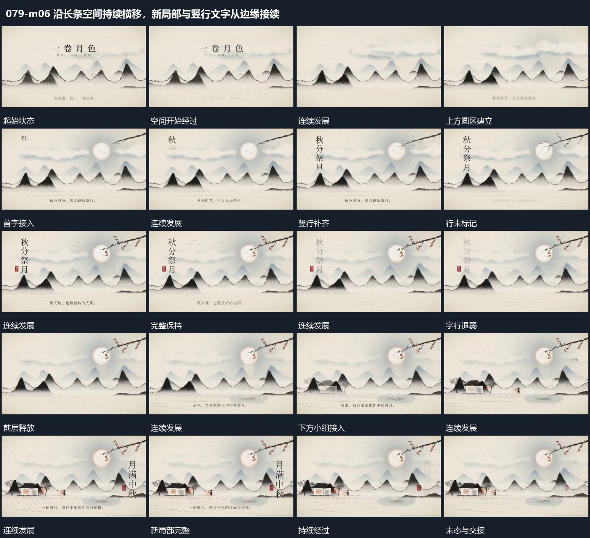

# 沿长条空间持续横移，新局部与竖行文字从边缘接续

## 运动指令

起始：多层起伏范围已建立。

1. 整个长空间沿横向持续展开，新局部从边缘进入。

2. 竖行字分项显出并保持，在继续移动时退弱，下一组接替。

上述镜头变化与局部动作按同一条连续过程推进；写明同时发生的步骤在原场面中交叠，不先完成整段运镜再重演局部。

## 分镜过程

## 组合与调整

保留以下动作关系：整个长空间沿横向持续展开，新局部从边缘进入；竖行字分项显出并保持，在继续移动时退弱，下一组接替。

可调整位移距离、层级间距、重复数量与相对快慢；已有锚点和未退出的层继续承接。连接下一段时以切片末态为起点，另行设计不连续的状态转换。
