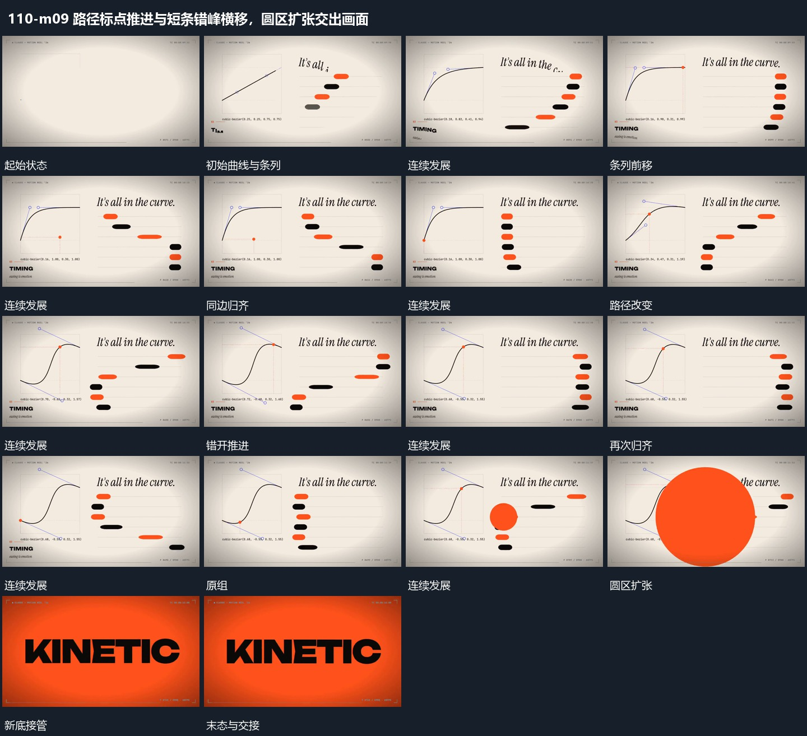

# 路径标点推进与短条错峰横移，圆区扩张交出画面

## 运动指令

标点沿曲线推进，旁侧多排短条错峰横移并归齐；短条变化完成后侧边圆区放大覆盖，形成下一场的明确交接。

1. **曲线标点沿路径移动多排短条错开横移并归齐**

左侧标点沿当前曲线移动，右侧多排短条同时横移，但各排起步和途中位移不同。经过中形成错位，最后停到共同竖向边界；更换曲线路径后重复，短条仍保留原排位。

2. **侧边圆区向外扩大覆盖并换底**

在侧边建立圆区，圆边向外扩大并横过原组，原组被覆盖区域逐步遮住。圆区越界后新底完整接管，下一主行接入，中心可沿覆盖方向继续。

整段结束：圆区越界新底接管 保留必要落稳与交接，中间已建立的参照沿用到下一步骤。

> 本发行仅包含机制文字与静态分镜，不包含视频切片。

## 分镜过程

## 组合与调整

标点沿曲线推进，旁侧多排短条错峰横移并归齐；短条变化完成后侧边圆区放大覆盖，形成下一场的明确交接。 复用时可调整元素数量、幅度和相对节奏，保留上述进入、交叠与完成关系；不直接沿用原片题材或时长。

曲线形状与短条时序在新片重新设计，不把原曲线数字写成硬约束。

可改变圆心位置，保持边界与接管一致；不让旧组提前整体消失。
