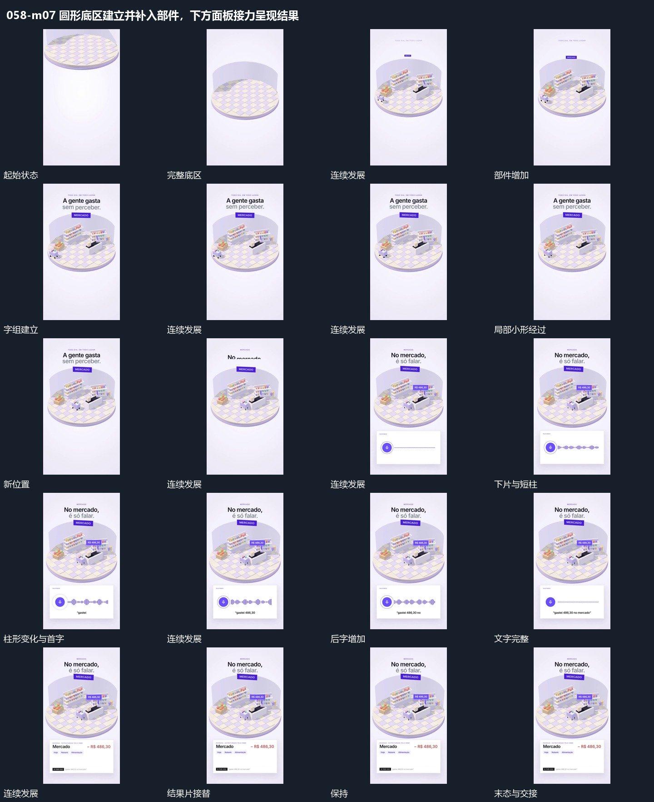

# 圆形底区建立并补入部件，下方面板接力呈现结果

## 运动指令

圆形底区先落位，内部部件逐项建立，小形持续经过；下方固定片接入，短柱、输入和结果片依次完成。

1. **圆形底区接入，局部部件逐项建立，小形在内经过**

接入圆形底区，先稳定其尺度与位置，再逐项补入局部部件。各部件落稳后小形沿底区内部路径经过，上方字组分行建立，稳定部件不跟随小形移动。

2. **固定片内短柱伸缩，文字逐字增加后结果片接替**

在下方固定片中让短柱交替伸缩，文字从少到多逐字增加。文字到完整状态后短柱收回较小活动，再由结果片在同一位置接替，外部大组保持。

整段结束：短文字完整，结果片接管 保留必要落稳与交接，中间已建立的参照沿用到下一步骤。

> 本发行仅包含机制文字与静态分镜，不包含视频切片。

## 分镜过程

## 组合与调整

圆形底区先落位，内部部件逐项建立，小形持续经过；下方固定片接入，短柱、输入和结果片依次完成。 复用时可调整元素数量、幅度和相对节奏，保留上述进入、交叠与完成关系；不直接沿用原片题材或时长。

只采用空间建立与局部活动，不按原片场景主题命名。

不推定声音识别功能，短柱活动与输入只作为可见接续。
