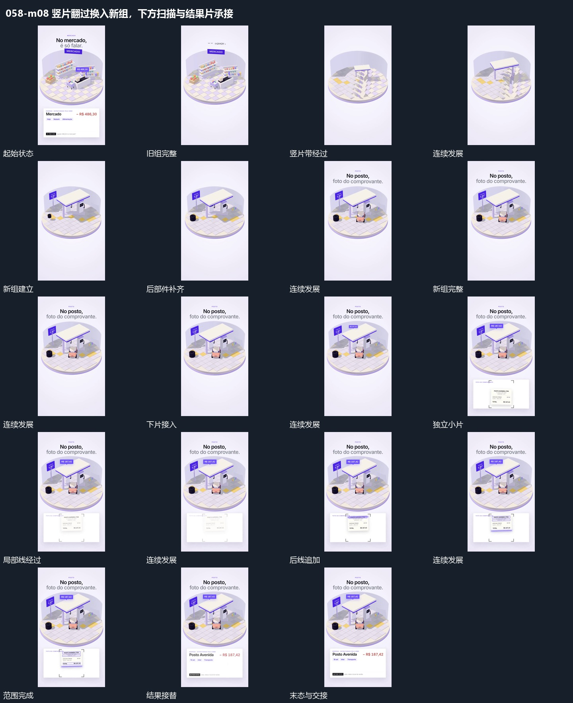

# 竖片翻过换入新组，下方扫描与结果片承接

## 运动指令

侧方片带逐段翻过遮住旧组，新组在同一区域落位；下方独立片被角框限定，横线扫描后接入结果片。

1. **侧方竖片带逐段翻过，覆盖旧组后新组同区接管**

保留圆底位置，让竖向片带从侧方逐段翻过。片带覆盖经过时旧组退出，新组在同一底区依次接入，最后片带离开，部件完整保持。

2. **角框限定独立小片，局部横线顺序经过后换结果片**

在下方片面中接入独立小片，先用角框限定其范围，再让局部横线顺序经过不同位置。小片来源保持，过程完成后结果片接替原承载位置。

整段结束：局部过程完成，结果片建立 保留必要落稳与交接，中间已建立的参照沿用到下一步骤。

> 本发行仅包含机制文字与静态分镜，不包含视频切片。

## 分镜过程

## 组合与调整

侧方片带逐段翻过遮住旧组，新组在同一区域落位；下方独立片被角框限定，横线扫描后接入结果片。 复用时可调整元素数量、幅度和相对节奏，保留上述进入、交叠与完成关系；不直接沿用原片题材或时长。

新旧组共享底区，翻转带不必继承原片几何结构，但应覆盖真实交界。

结果反馈不代表现实识别能力，采用可见过程即可。
