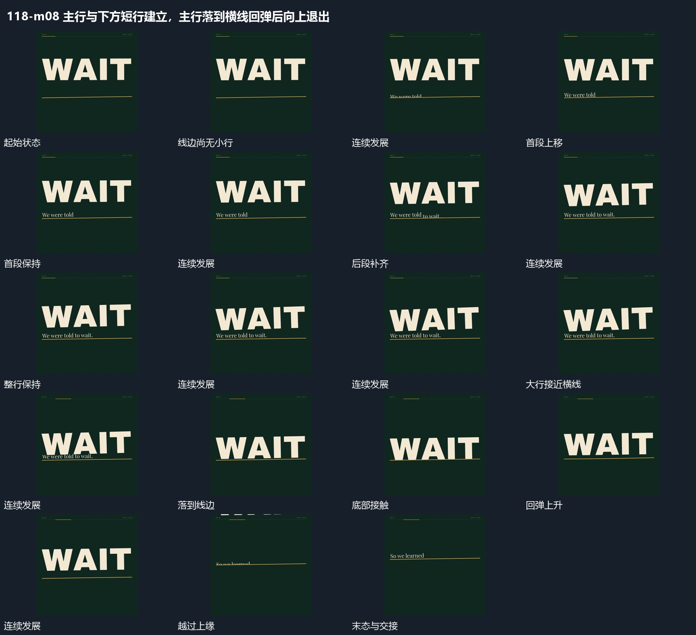

# 主行与下方短行建立，主行落到横线回弹后向上退出

## 运动指令

起始：横线保持且新行尚未齐全。

1. 下方短行沿横线逐段建立，旧短行沿边界退出。

2. 主行随后下落接触横线、回弹，再向上退去，留下横线继续承接。

上述镜头变化与局部动作按同一条连续过程推进；写明同时发生的步骤在原场面中交叠，不先完成整段运镜再重演局部。

> 本发行仅包含机制文字与静态分镜，不包含视频切片。

## 分镜过程

## 组合与调整

保留以下动作关系：下方短行沿横线逐段建立，旧短行沿边界退出；主行随后下落接触横线、回弹，再向上退去，留下横线继续承接。

可调整位移距离、层级间距、重复数量与相对快慢；已有锚点和未退出的层继续承接。连接下一段时以切片末态为起点，另行设计不连续的状态转换。
