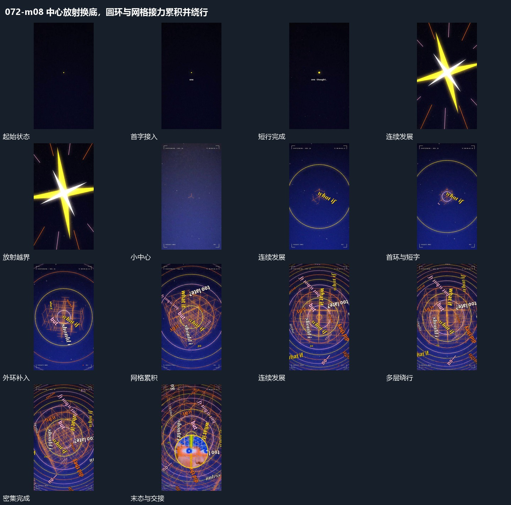

# 中心放射换底，圆环与网格接力累积并绕行

## 运动指令

中央点和短字先建立，放射覆盖换入新底；多圈与网格逐层累积，短字沿不同方向绕行。

1. **点下方补字再由中心放射覆盖**

先让中央小点保持位置，在其下方逐步补出短行。短行完成后退弱，交叉长条从原中心向外伸展，宽度与长度一起增加并越过边缘。下一层在覆盖经过后接入，中心仍作为新的运动起点。

2. **环网格累积并让短字沿不同方向绕行**

围绕稳定中心先增加一圈弧线与一条倾斜短字，再逐项加入不同半径的环和交叉网格。已有层继续转向或绕行，新层从空处加入，不同时重置。短字沿不同倾角经过中心周边，外圈逐渐超过边界。

整段结束：中心保留且外围形成密集环与字列 保留必要落稳与交接，中间已建立的参照沿用到下一步骤。

> 本发行仅包含机制文字与静态分镜，不包含视频切片。

## 分镜过程

## 组合与调整

中央点和短字先建立，放射覆盖换入新底；多圈与网格逐层累积，短字沿不同方向绕行。 复用时可调整元素数量、幅度和相对节奏，保留上述进入、交叠与完成关系；不直接沿用原片题材或时长。

可改变长条数量与方向，保留由单点到覆盖的尺度变化；接续时让下一层的中心与原点对齐。

需要清楚阅读时减少同时活动的字列；可把内圈保留下来作为下一窗口的边界。
