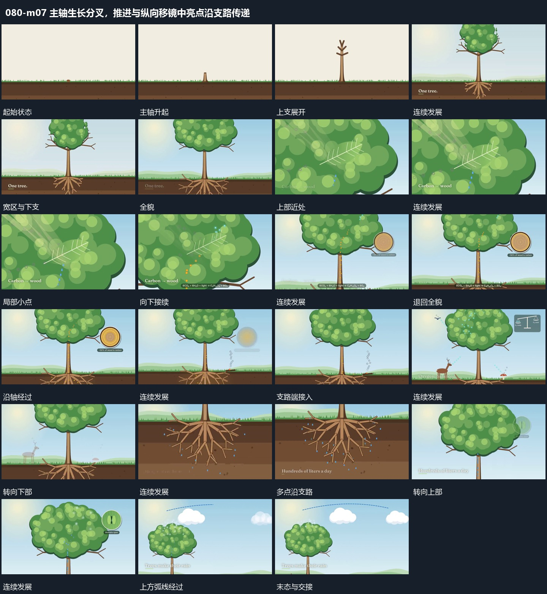

# 主轴生长分叉，推进与纵向移镜中亮点沿支路传递

## 运动指令

起始：底线附近仅有小起点。

1. 主轴从底线长出分支，整体成形后推向局部。

2. 亮点沿已有支路运动并建立圈注，观看范围回到整体再纵向移动到另一层。

上述镜头变化与局部动作按同一条连续过程推进；写明同时发生的步骤在原场面中交叠，不先完成整段运镜再重演局部。

> 本发行仅包含机制文字与静态分镜，不包含视频切片。

## 分镜过程

## 组合与调整

保留以下动作关系：主轴从底线长出分支，整体成形后推向局部；亮点沿已有支路运动并建立圈注，观看范围回到整体再纵向移动到另一层。

可调整位移距离、层级间距、重复数量与相对快慢；已有锚点和未退出的层继续承接。连接下一段时以切片末态为起点，另行设计不连续的状态转换。
