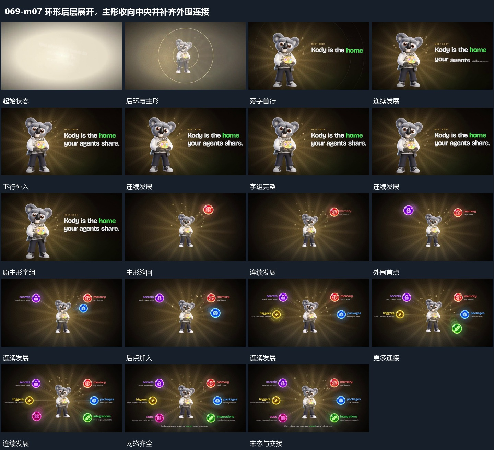

# 环形后层展开，主形收向中央并补齐外围连接

## 运动指令

主形与旁字先在环形后层前建立，随后主形缩回中央，外围圆点逐项加入并连向中心，完成关系网络。

1. **环形后层展开，一侧主形保持，旁字逐行补齐**

让环形后层围一侧主形展开，主形落稳后保留。旁侧字组逐行增加，前行保持，附属短行最后接上，后环逐渐减弱，形成稳定主形与旁字布局。

2. **主形缩回中央，外围圆点逐项加入并连接到中心**

把主形缩小移回中部，旁字退出。外围圆点逐项加入，每个点确立后补连接到中心，已有点与线保持，最后形成完整网络。

整段结束：主形在中部，外围点与连接齐全 保留必要落稳与交接，中间已建立的参照沿用到下一步骤。

> 本发行仅包含机制文字与静态分镜，不包含视频切片。

## 分镜过程

## 组合与调整

主形与旁字先在环形后层前建立，随后主形缩回中央，外围圆点逐项加入并连向中心，完成关系网络。 复用时可调整元素数量、幅度和相对节奏，保留上述进入、交叠与完成关系；不直接沿用原片题材或时长。

主形可换，后环只负责建立与接续，不永久绕行抢读点。

圆点内容可替换，保留从单主形到周边关系的建立次序。
