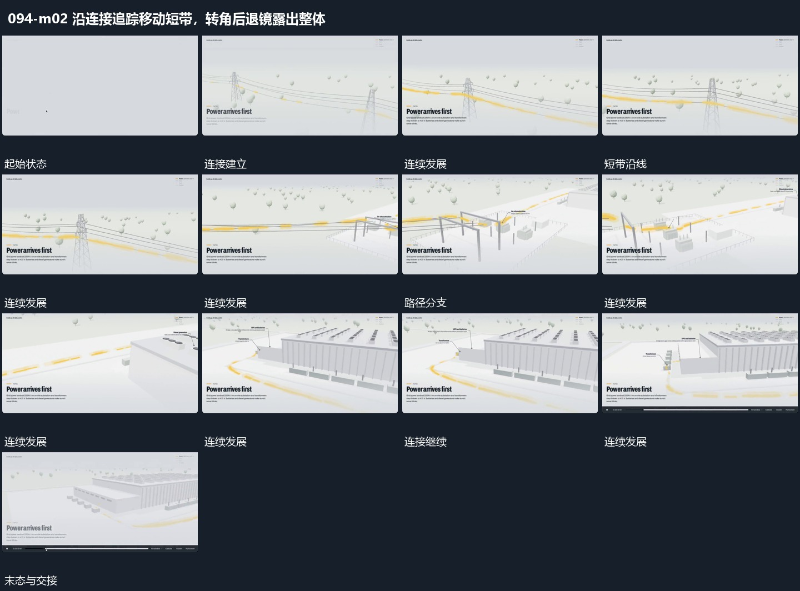

# 沿连接追踪移动短带，转角后退镜露出整体

## 运动指令

先沿已有连接靠近移动短带，连接本身不位移；短带持续沿线路向前经过，观看范围跟随前进并转向连接终端。经过转折后取景逐步退远，露出终端与完整连接关系，在下一独立空间出现前结束。

> 本发行仅包含机制文字与静态分镜，不包含视频切片。

## 分镜过程

## 组合与调整

短带流动与取景同步，不能先播放线路再重新从起点运镜；可更换路径，保留转折与最终整体回看。
