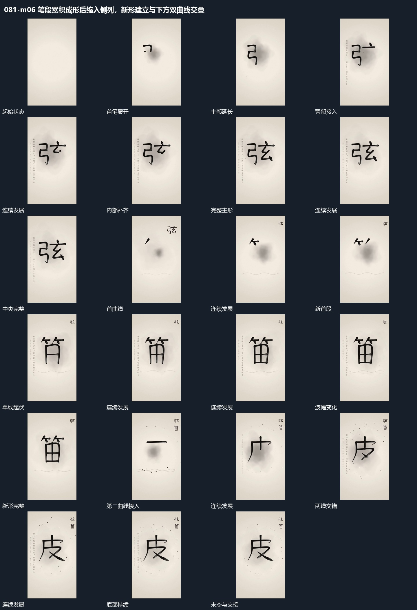

# 笔段累积成形后缩入侧列，新形建立与下方双曲线交叠

## 运动指令

起始：中央只有小点或首段短线。

1. 中央短笔段沿路径累积成形，完成主形缩小进入侧列，新形在中央重新描入。

2. 下方双曲线相位错开持续起伏。

上述镜头变化与局部动作按同一条连续过程推进；写明同时发生的步骤在原场面中交叠，不先完成整段运镜再重演局部。

> 本发行仅包含机制文字与静态分镜，不包含视频切片。

## 分镜过程

## 组合与调整

保留以下动作关系：中央短笔段沿路径累积成形，完成主形缩小进入侧列，新形在中央重新描入；下方双曲线相位错开持续起伏。

可调整位移距离、层级间距、重复数量与相对快慢；已有锚点和未退出的层继续承接。连接下一段时以切片末态为起点，另行设计不连续的状态转换。
