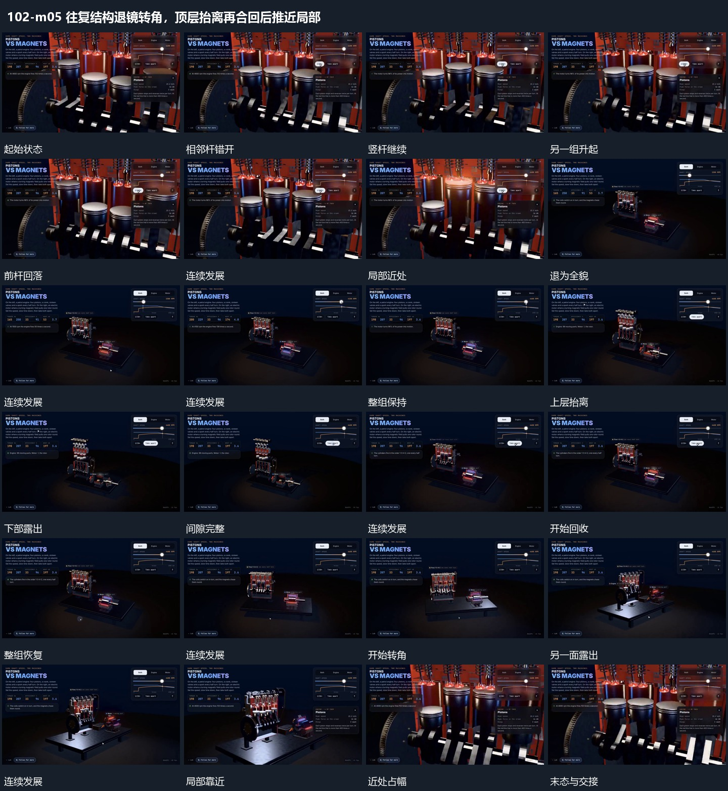

# 往复结构退镜转角，顶层抬离再合回后推近局部

## 运动指令

起始：多竖杆与下方连接已在。

1. 竖向部件持续错峰往复，下方连接随动。

2. 取景从局部退至整体并转角，顶层抬开露出下层，再原位合回，最后推近局部。

上述镜头变化与局部动作按同一条连续过程推进；写明同时发生的步骤在原场面中交叠，不先完成整段运镜再重演局部。

> 本发行仅包含机制文字与静态分镜，不包含视频切片。

## 分镜过程

## 组合与调整

保留以下动作关系：竖向部件持续错峰往复，下方连接随动；取景从局部退至整体并转角，顶层抬开露出下层，再原位合回，最后推近局部。

可调整位移距离、层级间距、重复数量与相对快慢；已有锚点和未退出的层继续承接。连接下一段时以切片末态为起点，另行设计不连续的状态转换。
