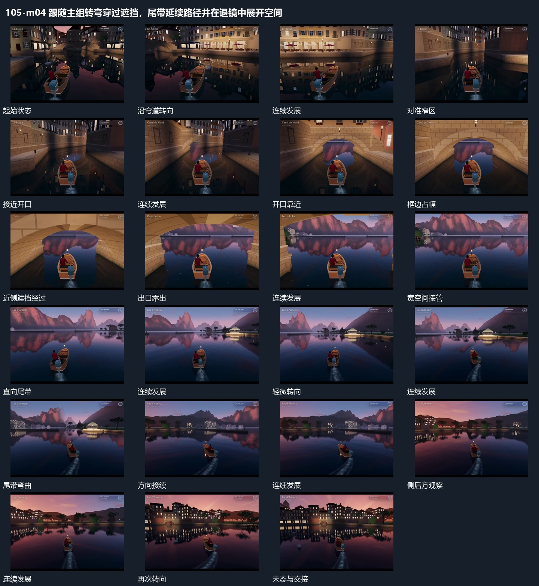

# 跟随主组转弯穿过遮挡，尾带延续路径并在退镜中展开空间

## 运动指令

起始：主组在近处前方。

1. 取景从后方跟随主组沿弯曲路径移动。

2. 穿过近侧开口后空间变宽，主组继续转向，身后短带随路径弯曲。

3. 取景逐渐退远显示整体行进关系。

上述镜头变化与局部动作按同一条连续过程推进；写明同时发生的步骤在原场面中交叠，不先完成整段运镜再重演局部。

> 本发行仅包含机制文字与静态分镜，不包含视频切片。

## 分镜过程

## 组合与调整

保留以下动作关系：取景从后方跟随主组沿弯曲路径移动；穿过近侧开口后空间变宽，主组继续转向，身后短带随路径弯曲；取景逐渐退远显示整体行进关系。

可调整位移距离、层级间距、重复数量与相对快慢；已有锚点和未退出的层继续承接。连接下一段时以切片末态为起点，另行设计不连续的状态转换。
