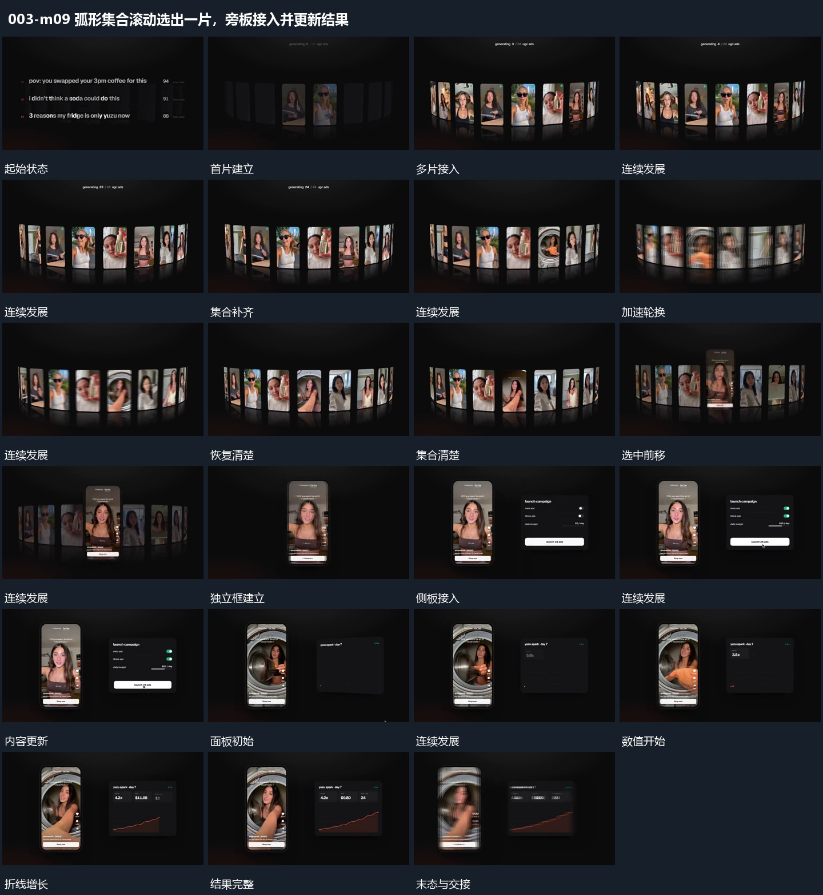

# 弧形集合滚动选出一片，旁板接入并更新结果

## 运动指令

弧形集合先补齐并滚动，选中片前移成为稳定参照，旁侧面板接入并以数字和折线完成反馈。

1. **弧形竖片逐项补齐，加速横移后停清**

沿弧形位置逐项显出竖片，先到者保留，直到整排补齐。随后整排横向加快轮换，形成模糊经过，最后降速停清，弧形边界一直可辨认。

2. **选中竖片向前接管，旁侧面板补入**

从停清的集合中提起一片向前，周围片减淡退出。留下独立竖框后，在旁侧补入面板，框内继续变化，面板内标记和条形依次更新。

3. **数字与折线在固定面板内逐步增长**

保持两侧外框，让旁侧数值逐步更换，折线从左端向右延长，已走过的线保留，下方填充跟进。达到最终状态后数值与路径停稳，框内活动仍继续。

整段结束：数字停止更换，折线与填充完整 保留必要落稳与交接，中间已建立的参照沿用到下一步骤。

## 分镜过程

## 组合与调整

弧形集合先补齐并滚动，选中片前移成为稳定参照，旁侧面板接入并以数字和折线完成反馈。 复用时可调整元素数量、幅度和相对节奏，保留上述进入、交叠与完成关系；不直接沿用原片题材或时长。

可调弧度与轮换方向，必须给后段一个清楚的停稳项，方便继续选中。

可换选中项，必须从原位置接起；侧板不能在选中片还被后层遮住时抢占重点。

路径与数值含义需在新片另定；保持固定参照，不把整面板反复重画。
